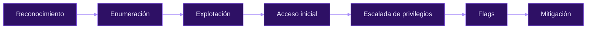

# hacking-journey

> Writeups de las máquinas que voy resolviendo en Hack The Box. En cada una documentamos el proceso completo —reconocimiento, enumeración, explotación, escalada de privilegios y mitigación— explicando el porqué de cada paso, no solo el comando.

[](https://app.hackthebox.com/users/4011018)
[](https://www.linkedin.com/in/francisco-gutierrez-garcia)


---

## Sobre el repositorio

Colección de writeups de Hack The Box que documenta mi formación en ciberseguridad ofensiva. Cada writeup recoge el proceso completo hasta comprometer la máquina: no solo ponemos el comando, sino que explicamos por qué lo usamos y qué hace realmente, con especial atención a cómo se mitiga cada vulnerabilidad.

Solo se publican máquinas **retiradas**, conforme a las normas de Hack The Box.

## Índice

- [Writeups](#writeups)
- [Metodología](#metodología)
- [Estructura del repositorio](#estructura-del-repositorio)
- [Formato de cada writeup](#formato-de-cada-writeup)
- [Aviso legal](#aviso-legal)
- [Contacto](#contacto)

## Writeups

| # | Máquina | SO | Dificultad | Vector principal | CVE / Técnica |
|:-:|:--|:--|:--|:--|:--|
| 01 | [Lame](./HTB/machines/easy/Lame) | Linux | Easy | Inyección de comandos en Samba | CVE-2007-2447 |
| 02 | [Legacy](./HTB/machines/easy/Legacy) | Windows | Easy | Buffer overflow en SMB (XP) | MS08-067 |
| 03 | [Blue](./HTB/machines/easy/Blue) | Windows | Easy | EternalBlue | MS17-010 / CVE-2017-0144 |
| 04 | [Devel](./HTB/machines/easy/Devel) | Windows | Easy | FTP anónimo → webshell ASPX → kernel | MS10-059 |
| 05 | [Grandpa](./HTB/machines/easy/Grandpa) | Windows | Easy | IIS 6.0 WebDAV + Churrasco | CVE-2017-7269 |
| 06 | [Granny](./HTB/machines/easy/Granny) | Windows | Easy | IIS 6.0 WebDAV → escalada a SYSTEM | CVE-2017-7269 / MS14-058 |
| 07 | [Optimum](./HTB/machines/easy/Optimum) | Windows | Easy | Rejetto HFS 2.3 RCE | CVE-2014-6287 / MS16-032 |
| 08 | [Jerry](./HTB/machines/easy/Jerry) | Windows | Easy | Tomcat con credenciales por defecto → WAR | Default creds |
| 09 | [Shocker](./HTB/machines/easy/Shocker) | Linux | Easy | Shellshock sobre CGI → sudo perl | CVE-2014-6271 |
| 10 | [Knife](./HTB/machines/easy/Knife) | Linux | Easy | Backdoor PHP 8.1.0-dev → sudo knife | PHP 8.1.0-dev backdoor |
| 11 | [Bashed](./HTB/machines/easy/Bashed) | Linux | Easy | Webshell phpbash expuesta → cron | Sudo misconfig |
| 12 | [Nibbles](./HTB/machines/easy/Nibbles) | Linux | Easy | Subida arbitraria en Nibbleblog → script editable | CVE-2015-6967 |
| 13 | [Traverxec](./HTB/machines/easy/Traverxec) | Linux | Easy | Nostromo RCE → journalctl / less | CVE-2019-16278 |
| 14 | [Validation](./HTB/machines/easy/Validation) | Linux | Easy | SQLi UNION → INTO OUTFILE → reúso de contraseña | SQLi / Password reuse |

<sub>La tabla se actualiza con cada máquina completada.</sub>

## Metodología

Todos los writeups siguen el mismo flujo de trabajo:



**Competencias trabajadas:**

- Enumeración de servicios y mapeo de la superficie de ataque (SMB, FTP, HTTP, WebDAV, CGI).
- Identificación de vulnerabilidades conocidas a partir de la versión del servicio y su CVE.
- Escalada de privilegios en Linux: `sudo` mal configurado, cron jobs, GTFOBins.
- Escalada de privilegios en Windows: token impersonation, exploits de kernel, Metasploit.
- Revisión de configuraciones inseguras: credenciales por defecto, servicios expuestos, permisos excesivos, reúso de contraseñas.
- Documentación técnica estructurada con medidas de mitigación.

## Estructura del repositorio

Las máquinas se organizan por dificultad bajo `HTB/machines/`. Cada máquina tiene su propia carpeta y su writeup es el `README.md`, así que GitHub lo renderiza en cuanto abres la carpeta.

```
HTB/
└── machines/
    └── easy/
        ├── Lame/          README.md + capturas
        ├── Blue/
        ├── Knife/
        ├── Traverxec/
        └── ...            (14 máquinas)
```

Las carpetas `medium/`, `hard/` e `insane/` se añadirán a medida que complete máquinas de esas dificultades.

## Formato de cada writeup

1. **Enumeración** — reconocimiento, escaneo de puertos e identificación de servicios.
2. **Explotación** — analizamos la vulnerabilidad y conseguimos el acceso inicial, paso a paso.
3. **Escalada de privilegios** — del usuario inicial hasta root / SYSTEM.
4. **Post-explotación** — obtenemos las flags.
5. **Resumen rápido y mitigación** — conclusiones y cómo se habría evitado el fallo.

## Aviso legal

> [!WARNING]
> Todo el contenido de este repositorio tiene **fines exclusivamente educativos**.
>
> - Solo se publican writeups de máquinas **retiradas** de Hack The Box, conforme a sus normas.
> - Las técnicas se aplican únicamente en **entornos de laboratorio autorizados**.
> - El autor no se responsabiliza del uso indebido de esta información. Atacar sistemas sin autorización es ilegal.

## Contacto

**Francisco Gutiérrez García** — `ph4n3s`

[](https://app.hackthebox.com/users/4011018)
[](https://www.linkedin.com/in/francisco-gutierrez-garcia)
