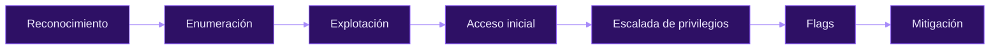

<div align="center">


<a href="https://github.com/phanesopenyoureyes/hacking-journey">

</a>

<br>

[](https://app.hackthebox.com/users/4011018)
[](https://www.linkedin.com/in/francisco-gutierrez-garcia)


<br><br>

[**Writeups**](#-writeups) &nbsp;·&nbsp; [**Cómo trabajo**](#-cómo-trabajo) &nbsp;·&nbsp; [**Estructura**](#-estructura-del-repositorio) &nbsp;·&nbsp; [**Lo que viene**](#-lo-que-viene) &nbsp;·&nbsp; [**Aviso legal**](#-aviso-legal)

</div>

---

> [!NOTE]
> Soy estudiante de ciberseguridad y aquí documento **cada máquina de Hack The Box que resuelvo**. No son chuletas de "comando → flag": escribo el proceso real, con el porqué de cada paso, los callejones sin salida en los que caí y —en cada máquina— cómo se habría evitado el fallo. Si algo de esto te sirve, una ⭐ es lo que me dice que siga escribiendo.

<div align="center">


</div>

## 📂 Writeups

<div align="center"><sub>Cada máquina enlaza a su carpeta con el writeup completo y las capturas.</sub></div>

<br>

| # | Máquina | SO | Dificultad | La clave de la máquina | Writeup |
|:-:|:--|:-:|:-:|:--|:-:|
| 01 | **Lame** | 🐧 Linux | 🟢 Easy | Samba `username map script` — `CVE-2007-2447` | [→](./HTB/machines/easy/Lame) |
| 02 | **Legacy** | 🪟 Windows | 🟢 Easy | SMB en Windows XP — `MS08-067` | [→](./HTB/machines/easy/Legacy) |
| 03 | **Blue** | 🪟 Windows | 🟢 Easy | EternalBlue — `MS17-010` | [→](./HTB/machines/easy/Blue) |
| 04 | **Devel** | 🪟 Windows | 🟢 Easy | FTP anónimo → webshell ASPX → exploit de kernel | [→](./HTB/machines/easy/Devel) |
| 05 | **Grandpa** | 🪟 Windows | 🟢 Easy | IIS 6.0 WebDAV — `CVE-2017-7269` + Churrasco | [→](./HTB/machines/easy/Grandpa) |
| 06 | **Granny** | 🪟 Windows | 🟢 Easy | IIS 6.0 WebDAV → `NETWORK SERVICE` → SYSTEM | [→](./HTB/machines/easy/Granny) |
| 07 | **Optimum** | 🪟 Windows | 🟢 Easy | Rejetto HFS 2.3 RCE — `CVE-2014-6287` + `MS16-032` | [→](./HTB/machines/easy/Optimum) |
| 08 | **Jerry** | 🪟 Windows | 🟢 Easy | Tomcat con credenciales por defecto → WAR malicioso | [→](./HTB/machines/easy/Jerry) |
| 09 | **Shocker** | 🐧 Linux | 🟢 Easy | Shellshock sobre CGI — `CVE-2014-6271` → sudo perl | [→](./HTB/machines/easy/Shocker) |
| 10 | **Knife** | 🐧 Linux | 🟢 Easy | Backdoor en PHP 8.1.0-dev → sudo `knife` | [→](./HTB/machines/easy/Knife) |
| 11 | **Bashed** | 🐧 Linux | 🟢 Easy | Webshell `phpbash` expuesta → cron con sudo | [→](./HTB/machines/easy/Bashed) |
| 12 | **Nibbles** | 🐧 Linux | 🟢 Easy | Subida en Nibbleblog — `CVE-2015-6967` → script editable | [→](./HTB/machines/easy/Nibbles) |
| 13 | **Traverxec** | 🐧 Linux | 🟢 Easy | Nostromo RCE — `CVE-2019-16278` → `journalctl` + `less` | [→](./HTB/machines/easy/Traverxec) |
| 14 | **Validation** | 🐧 Linux | 🟢 Easy | SQLi UNION → webshell con `INTO OUTFILE` → reúso de contraseña | [→](./HTB/machines/easy/Validation) |

<div align="center"><sub>Ordenadas más o menos por el orden en que las fui cayendo · la tabla crece con cada máquina nueva.</sub></div>

<div align="center">


</div>

## 🛠 Cómo trabajo

La misma rutina en todas las máquinas — repetitiva a propósito, para que los writeups sean fáciles de seguir:



<table>
<tr>
<td width="50%" valign="top">

**Lo que te da cada writeup**
- Los comandos exactos, con su salida real
- El *porqué* de cada paso, no solo el *qué* teclear
- Los callejones sin salida en los que caí (y por qué)
- Una nota de mitigación: cómo se tendría que haber protegido

</td>
<td width="50%" valign="top">

**Lo que estoy construyendo**
- Enumeración de servicios y mapeo de superficie de ataque
- Relacionar versiones con sus CVE conocidos
- Escalada en Linux (`sudo`, cron, GTFOBins)
- Escalada en Windows (tokens, exploits de kernel, Metasploit)
- Documentación técnica limpia y repetible

</td>
</tr>
</table>

<div align="center">


</div>

## 🗂 Estructura del repositorio

Las máquinas viven bajo `HTB/machines/`, separadas por dificultad. Cada máquina es una carpeta autocontenida: el writeup es su `README.md`, así que GitHub lo renderiza en cuanto abres la carpeta.

```
HTB/
└── machines/
    └── easy/
        ├── Blue/          README.md + capturas
        ├── Bashed/
        ├── Knife/
        ├── Traverxec/
        └── ...            (14 máquinas)
```

> Las carpetas `medium/`, `hard/` e `insane/` irán apareciendo según vaya subiendo de nivel — la estructura ya las está esperando.

<div align="center">


</div>

## 🚀 Lo que viene

- [x] Terminar las clásicas de dificultad **Easy** (14 hechas)
- [ ] Entrar en las máquinas **Medium**
- [ ] Añadir una ruta de Active Directory
- [ ] Un índice de "lecciones aprendidas" común a todas las máquinas

<div align="center"><sub>Escribo en español, pero con el C1 de Cambridge detrás por si hay que saltar al inglés.</sub></div>

<div align="center">


</div>

## ⚖ Aviso legal

> [!WARNING]
> Todo el contenido tiene **fines exclusivamente educativos**.
> - Solo se publican writeups de máquinas **retiradas** de Hack The Box, conforme a sus normas.
> - Las técnicas se aplican únicamente en **entornos de laboratorio autorizados**.
> - Atacar sistemas sin permiso es ilegal — el autor no se responsabiliza de un uso indebido.

---

<div align="center">

### Si estos writeups te han ayudado, deja una ⭐ — es la única métrica que me dice que siga escribiendo.

[](https://app.hackthebox.com/users/4011018)
[](https://www.linkedin.com/in/francisco-gutierrez-garcia)

<sub>Hecho por <b>Francisco Gutiérrez García</b> · <code>ph4n3s</code></sub>


</div>
