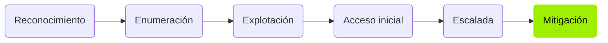

<div align="center">

# `hacking-journey`

**Writeups de máquinas retiradas de Hack The Box**<br>
Reconocimiento · enumeración · explotación · escalada · mitigación

<br>

[](https://app.hackthebox.com/users/4011018)
[](https://www.linkedin.com/in/francisco-gutierrez-garcia)


</div>

---

## Sobre el repositorio

Colección de writeups de mi progreso en Hack The Box como parte de mi formación en seguridad ofensiva. Cada writeup documenta el camino completo hasta comprometer la máquina, explicando el *porqué* de cada paso —no solo el comando— e incluyendo una nota de mitigación que describe cómo se habría evitado el fallo.

Solo se publican máquinas **retiradas**, conforme a las normas de Hack The Box.

> [!TIP]
> Las máquinas están organizadas por dificultad en [`HTB/machines/`](./HTB/machines). Entra en cualquier carpeta y GitHub abrirá su writeup directamente.

## Metodología



Cada writeup sigue ese recorrido y se cierra con una nota de mitigación. Competencias que se trabajan a lo largo del repositorio:

- Enumeración de servicios y mapeo de la superficie de ataque (SMB, FTP, HTTP, WebDAV, CGI).
- Identificación de vulnerabilidades a partir de la versión del servicio y su CVE.
- Escalada en Linux: `sudo` mal configurado, cron jobs, GTFOBins.
- Escalada en Windows: token impersonation, exploits de kernel, Metasploit.
- Revisión de configuraciones inseguras: credenciales por defecto, servicios expuestos, permisos excesivos, reúso de contraseñas.

## Formato de cada writeup

```
1. Enumeración              reconocimiento, puertos, servicios y versiones
2. Explotación              análisis de la vulnerabilidad y acceso inicial
3. Escalada de privilegios  del usuario inicial a control total
4. Post-explotación         obtención de las flags
5. Mitigación               qué parche o configuración lo habría evitado
```

## Estructura del repositorio

Cada máquina es una carpeta autocontenida cuyo writeup es su `README.md`, de modo que GitHub lo renderiza al abrir la carpeta. Las máquinas se agrupan por dificultad:

```
HTB/
└── machines/
    ├── easy/
    ├── medium/
    ├── hard/
    └── insane/
        └── <Máquina>/     README.md + capturas
```

## Aviso legal

> [!WARNING]
> Todo el contenido de este repositorio tiene **fines exclusivamente educativos**.
>
> - Solo se publican writeups de máquinas **retiradas** de Hack The Box, conforme a sus normas.
> - Las técnicas se aplican únicamente en **entornos de laboratorio autorizados**.
> - El autor no se responsabiliza del uso indebido de esta información. Atacar sistemas sin autorización es ilegal.

---

<div align="center">

**Francisco Gutiérrez García**

[](https://app.hackthebox.com/users/4011018)
[](https://www.linkedin.com/in/francisco-gutierrez-garcia)

</div>
