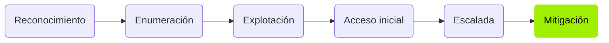

<div align="center">

```
ph4n3s@htb:~$ cat hacking-journey
```

# `Hacking-Journey`

**Writeups de máquinas de Hack The Box** · recon ──▶ foothold ──▶ privesc ──▶ root

[](https://app.hackthebox.com/users/4011018)
[](https://www.linkedin.com/in/francisco-gutierrez-garcia)
[](https://phanesopenyoureyes.github.io/hacking-journey/)

</div>

---

Soy **Francisco Gutiérrez García**, estudiante de ASIR en formación de seguridad ofensiva.
Este repositorio documenta mi progreso resolviendo máquinas de Hack The Box: para cada una
explico el *porqué* de cada paso —no solo el comando— y cierro con una nota de mitigación
que describe cómo se habría evitado el fallo. Es a la vez mi cuaderno de aprendizaje y una
muestra de cómo trabajo y documento.

> [!TIP]
> **¿Tienes cinco minutos?** La tabla de abajo lista las máquinas resueltas con las técnicas
> de cada una. Entra en cualquiera para ver el writeup completo, o visita el
> [sitio web](https://phanesopenyoureyes.github.io/hacking-journey/), que tiene buscador.

## Qué hay en el repositorio

| Área | Contenido |
| --- | --- |
| [`maquinas/htb/`](./maquinas/htb) | Writeups de Hack The Box, por dificultad: `facil/`, `media/`, `dificil/`, `insane/` |
| [`certificaciones/`](./certificaciones) | Certificaciones obtenidas |
| [`preparacion/`](./preparacion) | Guías de preparación de certificaciones |
| [`herramientas/`](./herramientas) | Herramientas propias |
| [`.plantillas/`](./.plantillas) | Plantillas de writeup, certificación y herramienta |
| [`scripts/`](./scripts) | Scripts para crear contenido, validar, y generar índice y sitio |
| [`docs/`](./docs) | Fuente del sitio web publicado |

> [!NOTE]
> ¿Quieres añadir una máquina, una certificación o una herramienta? Mira
> [**GUIA.md**](./GUIA.md): se publica solo, incluso desde la web de GitHub sin
> instalar nada.

## Competencias que se trabajan

- Enumeración de servicios y mapeo de la superficie de ataque (SMB, FTP, HTTP, WebDAV, CGI).
- Identificación de vulnerabilidades a partir de la versión del servicio y su CVE.
- Escalada en Linux: `sudo` mal configurado, cron jobs, GTFOBins.
- Escalada en Windows: *token impersonation*, exploits de kernel, Metasploit.
- Revisión de configuraciones inseguras: credenciales por defecto, servicios expuestos,
  permisos excesivos y reúso de contraseñas.
- Redacción técnica ordenada: cada writeup sigue la misma plantilla y pasa un validador.

## Máquinas resueltas

> La tabla se genera automáticamente con `python scripts/generar-indice.py`. Solo aparecen
> las máquinas publicadas; las que están en preparación no se listan.

<!-- INDICE:INICIO -->

### Fácil

| Máquina | SO | Fecha | Técnicas |
| --- | --- | --- | --- |
| [Irked](maquinas/htb/facil/irked/) | Linux | 2026-10-30 | `enumeracion-web`, `unrealircd-backdoor`, `esteganografia`, `suid`, `path-hijacking` |
| [Buff](maquinas/htb/facil/buff/) | Windows | 2026-10-28 | `enumeracion-web`, `file-upload`, `rce`, `pivoting`, `chisel`, `buffer-overflow` |
| [ServMon](maquinas/htb/facil/servmon/) | Windows | 2026-10-27 | `ftp-anonimo`, `directory-traversal`, `nvms-1000`, `reutilizacion-de-credenciales`, `nsclient-abuse` |
| [Traverxec](maquinas/htb/facil/traverxec/) | Linux | 2026-10-25 | `enumeracion-web`, `rce`, `crackeo-de-hash`, `sudo-misconfig`, `gtfobins` |
| [Optimum](maquinas/htb/facil/optimum/) | Windows | 2026-10-24 | `http-file-server`, `rce`, `kernel-exploit` |
| [Devel](maquinas/htb/facil/devel/) | Windows | 2026-10-23 | `ftp-anonimo`, `carga-de-archivos`, `iis`, `kernel-exploit` |
| [Nibbles](maquinas/htb/facil/nibbles/) | Linux | 2026-10-22 | `enumeracion-web`, `fuzzing`, `carga-de-archivos`, `sudo-misconfig` |
| [Bashed](maquinas/htb/facil/bashed/) | Linux | 2026-10-21 | `enumeracion-web`, `exposicion-de-herramienta`, `sudo-misconfig`, `cron-abuse` |
| [Shocker](maquinas/htb/facil/shocker/) | Linux | 2026-10-20 | `enumeracion-web`, `fuzzing`, `shellshock`, `sudo-misconfig`, `gtfobins` |
| [Knife](maquinas/htb/facil/knife/) | Linux | 2026-10-19 | `enumeracion-web`, `php-backdoor`, `sudo-misconfig`, `gtfobins` |
| [Granny](maquinas/htb/facil/granny/) | Windows | 2026-10-18 | `iis`, `webdav`, `buffer-overflow`, `token-impersonation` |
| [Blue](maquinas/htb/facil/blue/) | Windows | 2026-10-16 | `enumeracion-smb`, `ms17-010`, `eternalblue` |
| [Legacy](maquinas/htb/facil/legacy/) | Windows | 2026-10-16 | `enumeracion-smb`, `ms08-067`, `ms17-010` |
| [Lame](maquinas/htb/facil/lame/) | Linux | 2026-10-15 | `enumeracion-smb`, `samba`, `rce` |
| [Validation](maquinas/htb/facil/validation/) | Linux | 2026-10-12 | `inyeccion-sql`, `webshell`, `reutilizacion-de-credenciales` |

<!-- INDICE:FIN -->

## Metodología



Cada writeup sigue ese recorrido y se cierra con una nota de mitigación.

## Aviso legal

> [!WARNING]
> Todo el contenido tiene **fines exclusivamente educativos**.
>
> - Solo se publican writeups de máquinas **retiradas** de Hack The Box, conforme a sus normas.
> - Las técnicas se aplican únicamente en **entornos de laboratorio autorizados**.
> - El autor no se responsabiliza del uso indebido de esta información. Atacar sistemas sin
>   autorización es ilegal.

## Licencias

- Los **writeups y textos** se publican bajo [CC BY 4.0](./LICENSE-writeups).
- El **código** (`scripts/`) se publica bajo [Apache 2.0](./LICENSE-code).

---

<div align="center">

**Francisco Gutiérrez García** · [Hack The Box](https://app.hackthebox.com/users/4011018) · [LinkedIn](https://www.linkedin.com/in/francisco-gutierrez-garcia)

</div>
