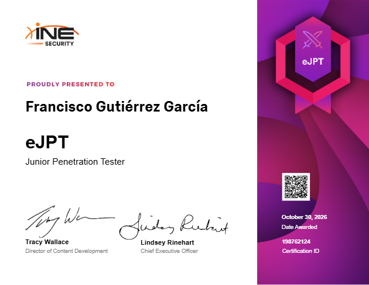

# eJPT — Junior Penetration Tester

[{ .cert-img }](https://certs.ine.com/8e06fa35-b83f-44bb-b02c-2d12024fd260#acc.2epksVSN)

[:material-shield-check: Verificar credencial](https://certs.ine.com/8e06fa35-b83f-44bb-b02c-2d12024fd260#acc.2epksVSN){ .md-button .md-button--primary }
[:material-school: INE Security](https://ine.com/learning/certifications/internal/elearnsecurity-junior-penetration-tester-cert){ .md-button }

*Haz clic en el certificado para verificarlo en INE.*
{ .cert-pie }

## Resumen

El **eJPT (Junior Penetration Tester)** es una certificación de **INE Security**
(eLearnSecurity), 100 % práctica y basada en laboratorio, que acredita competencias de
nivel inicial en pruebas de penetración.

- **Entidad emisora:** INE Security (eLearnSecurity)
- **Obtenida:** 30 de octubre de 2026
- **Válida hasta:** 30 de octubre de 2029
- **ID de certificación:** 198762124
- **Verificación:** [certs.ine.com](https://certs.ine.com/8e06fa35-b83f-44bb-b02c-2d12024fd260#acc.2epksVSN)

## Qué cubre

El examen es práctico, en un entorno de laboratorio real, y recorre todo el ciclo de
vida de una prueba de penetración:

- Metodologías de evaluación (*assessment*).
- Auditoría de hosts y de redes.
- Pruebas de penetración sobre hosts y redes.
- Pruebas de penetración de aplicaciones web.

Cada examen usa infraestructura, sistemas operativos y versiones de software actuales, y
genera un entorno único para cada candidato, por lo que no se puede resolver de memoria.

## Qué aprendí

- Aplicar una **metodología ordenada** de principio a fin: reconocimiento, enumeración,
  explotación y post-explotación, en lugar de ir probando sin método.
- **Enumerar a fondo** servicios y redes como base de todo lo demás.
- Encadenar el acceso a un host con el **pivoting** hacia la red interna.
- Enfrentarme a objetivos **sin pistas ni soluciones**, resolviendo con lo que encuentro,
  que es justo lo que practico con las máquinas de este portfolio.
