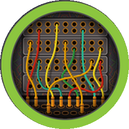

# Connected

[{ .maquina-icono }](https://app.hackthebox.com/machines/Connected)

!!! warning "Máquina activa — write-up bloqueado"
    **Connected** sigue **activa** en Hack The Box. Publicar el write-up de una
    máquina activa va contra las normas de HTB (solo se publican máquinas
    **retiradas**), así que **no se puede ver hasta que la máquina se retire**.

    La resolví el **2026-11-19**; cuando se retire, aquí aparecerá el write-up
    completo. Puedes comprobar su estado en la página oficial de la máquina:

    [Ver Connected en Hack The Box :material-open-in-new:](https://app.hackthebox.com/machines/Connected){ .md-button .md-button--primary }
