# Keeper

[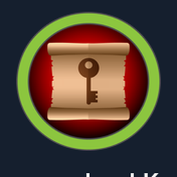{ .maquina-icono }](https://app.hackthebox.com/machines/Keeper)

## Resumen

Máquina Linux centrada en una gestión de *tickets* **Request Tracker (RT)** y en un gestor de
contraseñas **KeePass**. RT se deja con las **credenciales por defecto** (`root:password`), y en
el perfil de un usuario alguien apuntó su contraseña en un comentario, lo que da acceso por
**SSH** y la flag de usuario. En el *home* hay un volcado de memoria y una base de datos de
KeePass: aprovechando la **CVE-2023-32784** se recupera (casi entera) la **contraseña maestra**,
que resulta ser una frase en danés. Con ella se abre KeePass, donde está la **clave SSH privada
de root**; tras convertirla de formato PuTTY a OpenSSH, se entra como **root**.

## Reconocimiento

Un ping para ver el TTL y el sistema operativo:

```
64 bytes from 10.129.229.41: icmp_seq=1 ttl=63 time=57.0 ms
```

Un TTL cercano a 64 (63) indica **Linux**.

### Enumeración de puertos

```
nmap -p- --open -T4 --min-rate 5000 10.129.229.41
```

```
22/tcp open  ssh
80/tcp open  http
```

Detallamos versiones:

```
nmap -p 22,80 -sVC -T4 --min-rate 5000 10.129.229.41
```

```
22/tcp open  ssh   OpenSSH 8.9p1 Ubuntu 3ubuntu0.3
80/tcp open  http  nginx 1.18.0 (Ubuntu)
```

## Enumeración

La web del puerto 80 solo tiene un aviso que enlaza a `tickets.keeper.htb/rt/`:

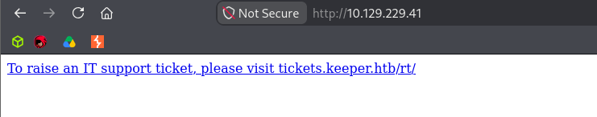

Añadimos el dominio al `/etc/hosts` y accedemos. Es un **Request Tracker (RT)**, un sistema de
seguimiento de incidencias y gestión de *tickets* de código abierto:

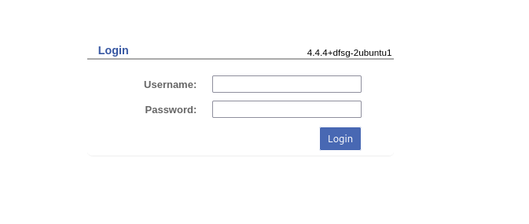

### Credenciales por defecto

Buscando la documentación de RT, las credenciales de administrador **por defecto** son
`root` / `password`. Y funcionan:

Dentro, en la administración de usuarios, hay dos cuentas: `root` (Enoch Root) y
**`lnorgaard`** (Lise Nørgaard):

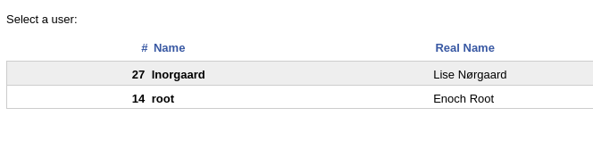

Abriendo el perfil de `lnorgaard`, alguien dejó su contraseña escrita en el comentario del
usuario (un error muy común):

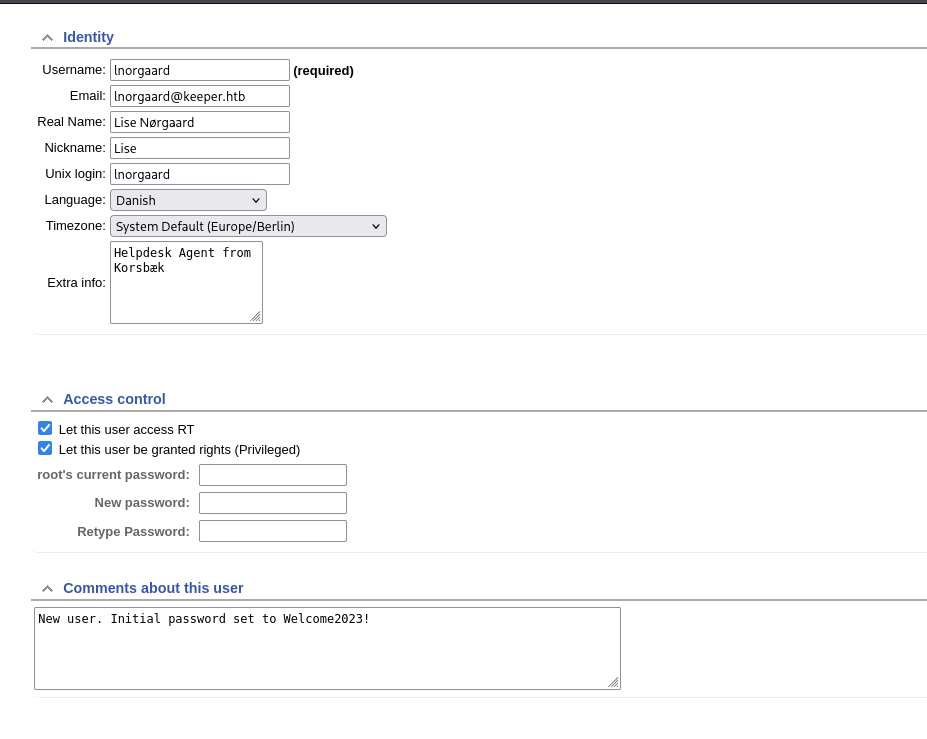

```
New user. Initial password set to Welcome2023!
```

## Explotación

Con esas credenciales entramos por **SSH** y leemos la flag de usuario:

```
ssh lnorgaard@10.129.229.41
# contraseña: Welcome2023!
cat user.txt
```

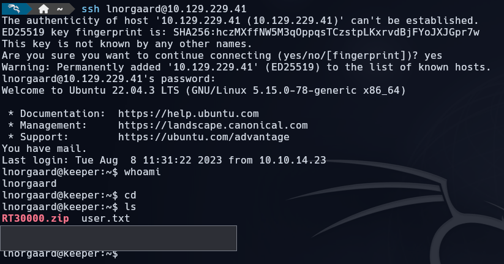

```
USER FLAG -> [censurada]
```

En el *home* hay un `RT30000.zip`; al descomprimirlo salen dos ficheros: un **volcado de
memoria** (`KeePassDumpFull.dmp`) y una base de datos de **KeePass** (`passcodes.kdbx`):

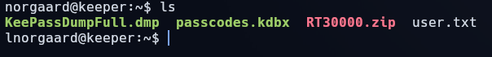

## Escalada de privilegios

La máquina salió en 2023, así que la versión de KeePass es anterior a la 2.54 y arrastra la
**CVE-2023-32784**: a partir de un **volcado de memoria** se puede recuperar la **contraseña
maestra** (casi toda; se pierde el primer carácter). Uso la PoC de
[keepass_dump](https://github.com/z-jxy/keepass_dump) sobre el `.dmp`:

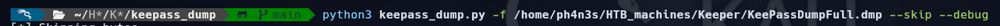

El resultado es una contraseña incompleta: `●dgrd med flde`.

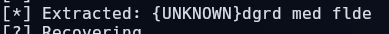

Buscando esos fragmentos, coinciden con una frase en **danés** (encaja con el perfil de
`lnorgaard`, que tenía el idioma en danés): **`rødgrød med fløde`** (un postre típico).


> Para escribir los caracteres `ø` y `å` hay que cambiar el *layout* del teclado a nórdico; si
> no, KeePass no acepta la contraseña.

Con esa contraseña maestra abrimos `passcodes.kdbx`:

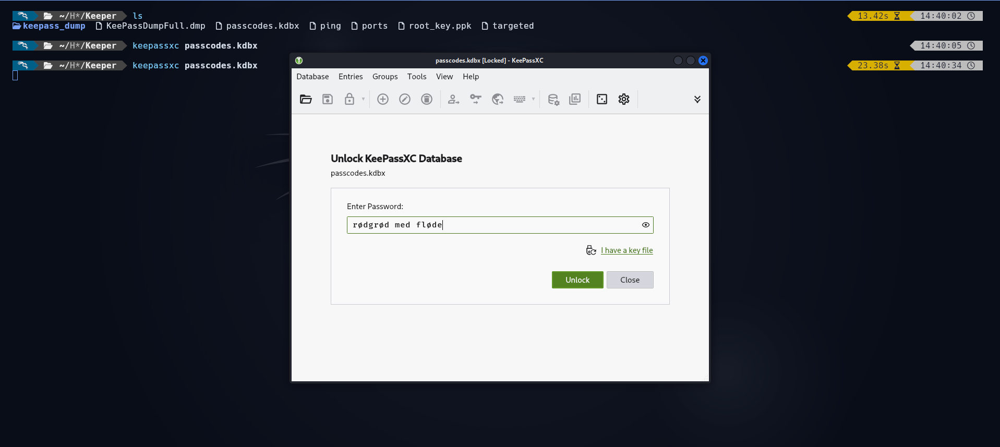

Dentro están las entradas de la máquina, incluida la del servidor con las credenciales de root:

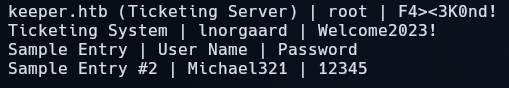

La entrada **"keeper.htb (Ticketing Server)"** guarda, en sus notas, la **clave SSH privada de
root** en formato **PuTTY** (`.ppk`).

> *No reproduzco aquí la clave privada: una clave privada no se publica, aunque sea de una
> máquina retirada.*

La clave está en formato PuTTY y hay que **convertirla a OpenSSH** para usarla en Linux:

```
puttygen root_key.ppk -O private-openssh -o root_key.pem
```

SSH rechaza las claves con permisos demasiado abiertos, así que ajustamos los permisos:

```
chmod 600 root_key.pem
```

Y nos conectamos como **root**:

```
ssh -i root_key.pem root@10.129.229.41
cd /root && cat root.txt
```

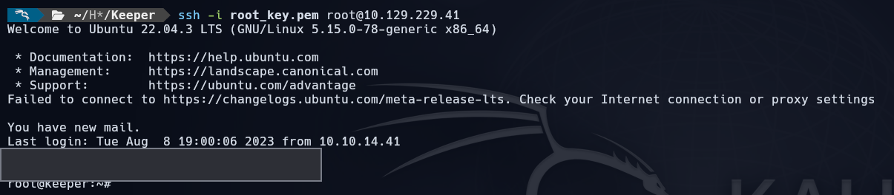

```
ROOT FLAG -> [censurada]
```

## Mitigación

- **Cambiar las credenciales por defecto** de Request Tracker (`root:password`) nada más
  instalarlo; son públicas y lo primero que se prueba.
- **No escribir contraseñas en comentarios** ni en campos de texto de los perfiles: ahí quedan
  en claro y visibles para cualquiera con acceso al panel.
- **Actualizar KeePass** a 2.54 o superior para cerrar la **CVE-2023-32784**, y no dejar
  volcados de memoria (`.dmp`) ni bases de datos de contraseñas accesibles en el servidor.
- **Proteger las claves SSH privadas**: no almacenarlas en gestores compartidos sin cifrado
  fuerte y rotar las que se hayan podido exponer.

## Qué he aprendido

- Las **credenciales por defecto** siguen siendo una de las vías de entrada más frecuentes:
  antes de buscar exploits, vale la pena probar el usuario/contraseña estándar del software.
- Una contraseña apuntada en un **comentario** convierte un panel de administración en un acceso
  directo al sistema. Lo que se escribe «para acordarse» acaba siendo la vía de ataque.
- La **CVE-2023-32784** enseña que un gestor de contraseñas no protege nada si su memoria queda
  volcada: de ahí se recupera la contraseña maestra casi entera.
- Detalles del contexto (el idioma danés del usuario) ayudan a completar lo que falta: la frase
  `rødgrød med fløde` no habría salido de un diccionario en inglés.
