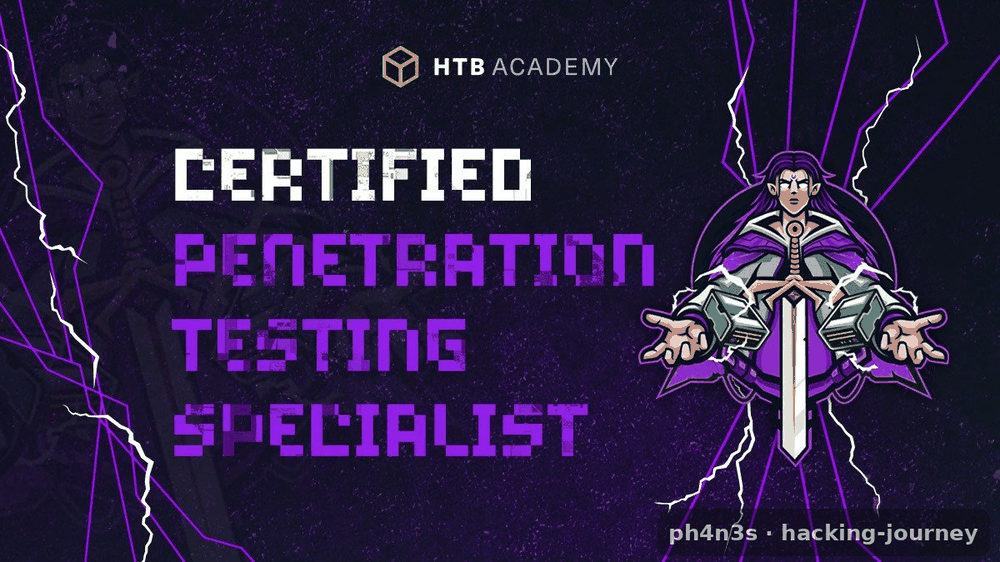

# CPTS — Certified Penetration Testing Specialist

[{ .cert-img }](https://academy.hackthebox.com/preview/certifications/htb-certified-penetration-testing-specialist)

[:material-file-table: Hoja de temas clave](https://docs.google.com/spreadsheets/d/1Og-coNcSH9NTr9ehQcgx2ZVKdpp7Ew10/edit?usp=sharing&ouid=104282750453312151527&rtpof=true&sd=true){ .md-button .md-button--primary }
[:material-school: HTB Academy](https://academy.hackthebox.com/preview/certifications/htb-certified-penetration-testing-specialist){ .md-button }

*Mi preparación para la CPTS, con la hoja de temas que considero importante dominar.*
{ .cert-pie }

## Resumen

La **CPTS (Certified Penetration Testing Specialist)** es una certificación de **Hack The
Box** 100 % práctica, pensada para demostrar que eres capaz de llevar a cabo una prueba
de penetración completa de principio a fin, al nivel de un *pentester* profesional, y de
**entregar un informe** como el que se espera en un trabajo real.

- **Entidad:** Hack The Box (HTB Academy)
- **Formato:** examen práctico de larga duración sobre un entorno real, con entrega de
  informe profesional.
- **Enfoque:** metodología completa, no solo «conseguir la flag».

## Qué evalúa

Un pentest de empresa realista, que incluye entre otras cosas:

- Enumeración exhaustiva y mapeo de la superficie de ataque.
- Explotación web y de servicios.
- **Active Directory**: ataques y abuso de configuraciones.
- Escalada de privilegios en Linux y Windows.
- **Pivoting** y movimiento lateral por la red interna.
- Redacción de un **informe** claro, con hallazgos, impacto y remediación.

## Cómo me estoy preparando

- Completando el *job role path* **Penetration Tester** de HTB Academy.
- Practicando máquinas (las que documento en este portfolio) para afianzar metodología.
- Repasando de forma ordenada los temas de la hoja de abajo y marcando lo que domino y lo
  que me falta.

## Recursos

- **[Hoja de temas clave](https://docs.google.com/spreadsheets/d/1Og-coNcSH9NTr9ehQcgx2ZVKdpp7Ew10/edit?usp=sharing&ouid=104282750453312151527&rtpof=true&sd=true)** — mi
  checklist de lo que conviene tocar para la CPTS.
- [Página oficial de la CPTS](https://academy.hackthebox.com/preview/certifications/htb-certified-penetration-testing-specialist) en HTB Academy.
