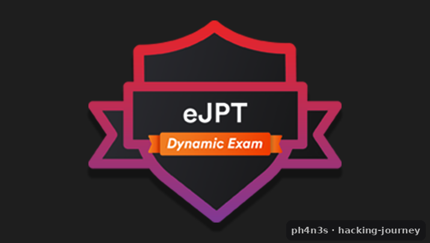

# eJPT — Junior Penetration Tester

[{ .cert-img }](https://ine.com/learning/certifications/internal/elearnsecurity-junior-penetration-tester-cert)

[:material-file-table: Hoja de temas clave](https://docs.google.com/spreadsheets/d/1T3lqXiJqoWhiqOIOmFI5qMTwJRrnofjt/edit?usp=sharing&ouid=104282750453312151527&rtpof=true&sd=true){ .md-button .md-button--primary }
[:material-school: INE Security](https://ine.com/learning/certifications/internal/elearnsecurity-junior-penetration-tester-cert){ .md-button }

*Guía y hoja de temas para preparar el eJPT (yo ya lo tengo — ver [Certificaciones](../../certificaciones/ejpt/)).*
{ .cert-pie }

## Resumen

El **eJPT (Junior Penetration Tester)** de **INE Security** es una certificación práctica
de nivel inicial que acredita que sabes llevar a cabo las tareas básicas de una prueba de
penetración. Es un punto de partida ideal para entrar en la seguridad ofensiva.

- **Entidad:** INE Security (eLearnSecurity)
- **Formato:** examen práctico en laboratorio, con entorno único por candidato.
- **Nivel:** inicial.

## Qué evalúa

- Metodologías de evaluación (*assessment*).
- Auditoría de hosts y de redes.
- Pruebas de penetración sobre hosts y redes.
- Pruebas de penetración de aplicaciones web.

## Cómo me preparé

- Enumeración a fondo como base de todo.
- Mucha práctica con máquinas para interiorizar la metodología.
- Repaso ordenado de los temas de la hoja de abajo.

## Recursos

- **[Hoja de temas clave](https://docs.google.com/spreadsheets/d/1T3lqXiJqoWhiqOIOmFI5qMTwJRrnofjt/edit?usp=sharing&ouid=104282750453312151527&rtpof=true&sd=true)** — checklist
  de lo que conviene dominar para el eJPT.
- [Página oficial del eJPT](https://ine.com/learning/certifications/internal/elearnsecurity-junior-penetration-tester-cert) en INE.
